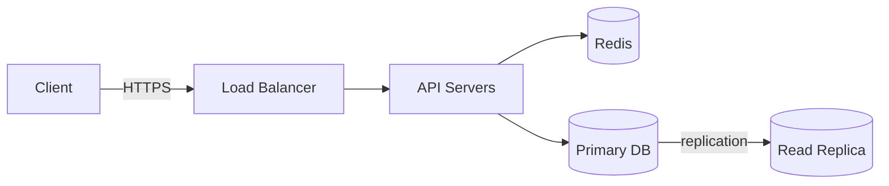

# System Design 101

A personal study repo for learning system design: concept notes, case studies
(design X), diagrams, and small runnable experiments that demonstrate a concept.

## Goals

- Build intuition for the trade-offs behind distributed systems, not just memorize answers.
- Prepare for system design interviews with consistent, reusable write-ups.
- Keep every note short, accurate, and easy to revisit.

## Repository layout

Numbered folders are in study order. Keep to this structure:

```
_01_Interview_Playbook/  # how to run the interview: framework, estimation cheat sheet,
                         # trade-offs to say out loud, red flags, final checklist
_02_Fundamentals/        # principles and theory: scaling, CAP/PACELC, consistency models,
                         # replication, sharding, consensus, distributed transactions
_03_Building_Blocks/     # concrete components: load balancer, cache, databases, message
                         # queue, CDN, API gateway, object storage, search index
  _01_Docker_Databases/  # docker-compose setups for running each database locally
  _02_Docker_Message_Brokers/ # docker-compose setups for Kafka and RabbitMQ
_04_Case_Studies/        # end-to-end designs: url-shortener, chat, news-feed, payments
_05_Diagrams/            # diagram sources that don't fit inline (Excalidraw / draw.io)
_06_Experiments/         # small runnable code that shows a concept in practice
resources.md             # books, papers, blogs, and videos worth revisiting
```

**Where does a note go?** If it answers "what principle or guarantee is this?" it goes in
`_02_Fundamentals/`. If it answers "how does this component work and how do I use it?" it
goes in `_03_Building_Blocks/`. Example: `_02_Fundamentals/consistent-hashing.md` vs
`_03_Building_Blocks/cache.md`, which links to it.

File names are kebab-case markdown, e.g. `_04_Case_Studies/url-shortener.md`. Link related
notes to each other with relative links instead of repeating content.

`_02_Fundamentals/system-design-interview-guide.txt` is my original one-file revision guide.
Its content has been split into the notes in `_01_`–`_04_`; the notes are the source of truth.
When a note changes, keep the guide's matching short section in sync, or tell me it has drifted.

## How to help me

- **Explain like a senior engineer mentoring me.** Start with the intuition, then the
  mechanism, then the trade-offs. Give real-world examples (e.g. how Kafka, DynamoDB,
  Cassandra, or Redis do it).
- **Always discuss trade-offs.** No design is "best". Say what you gain, what you give
  up, and when you would pick something else.
- **Use numbers.** Do back-of-the-envelope estimates (QPS, storage, bandwidth) and
  show the arithmetic.
- **Be accurate.** If something is uncertain, version-specific, or debated, say so
  rather than guessing. Don't invent benchmarks or citations.
- **Ask before big restructures.** For edits to existing notes, keep my wording
  unless it's wrong; fix errors and point out what changed.
- **Quiz me when asked.** If I say "quiz me" on a topic, ask one question at a time
  and wait for my answer before giving feedback.

## Concept note template (`_02_Fundamentals/`, `_03_Building_Blocks/`)

```markdown
# <Concept>

## TL;DR
2–3 sentences.

## Why it matters
The problem it solves.

## How it works
Mechanism, with a diagram if helpful.

## Trade-offs
| Pros | Cons |
|------|------|

## Real-world examples
Systems that use it and how.

## Common interview questions
- ...

## Further reading
- ...
```

## Case study template (`_04_Case_Studies/`)

Follow the standard interview flow:

1. **Requirements**: functional and non-functional (latency, availability, consistency, scale).
2. **Capacity estimates**: users, QPS (avg/peak), storage, bandwidth.
3. **API design**: key endpoints or RPCs with request/response shapes.
4. **Data model**: entities, schema, choice of database and why.
5. **High-level design**: components and data flow (Mermaid diagram).
6. **Deep dives**: the 2–3 hardest parts (e.g. ID generation, fan-out, hot keys).
7. **Scaling and bottlenecks**: sharding, replication, caching, async processing.
8. **Reliability**: failure modes, retries, idempotency, monitoring.
9. **Trade-offs and alternatives**: what you'd change at 10x / 100x scale.

## Diagrams

- Prefer **Mermaid** inside markdown so diagrams render on GitHub and stay diffable.
- Keep diagrams focused: one idea per diagram, label arrows with what flows over them
  (e.g. `HTTP`, `async event`, `replication`).



## Experiments (`_06_Experiments/`)

- One folder per experiment with a `README.md` covering what it shows, how to run
  it, and what to observe.
- Keep them minimal and self-contained (e.g. `docker compose up`, a single script).
- Don't add dependencies beyond what the experiment needs.

## Writing style

- Concise. Bullet points and tables over long paragraphs.
- Define acronyms on first use (e.g. "CAP (Consistency, Availability, Partition tolerance)").
- Use consistent units: ms for latency, QPS for throughput, KB/MB/GB/TB for size.

## Topic checklist

Track progress here; tick items off as notes are written.

**_01 – Interview playbook**
- [x] Interview framework, red flags, final checklist
- [x] Estimation cheat sheet: latency numbers, QPS/storage math, availability nines
- [x] Trade-offs phrasebook

**_02 – Fundamentals**
- [x] Vertical vs horizontal scaling; stateless services
- [ ] Latency vs throughput
- [x] CAP and PACELC
- [x] Consistency models (strong, eventual, causal, read-your-writes)
- [x] Replication (leader-follower, multi-leader, leaderless, quorums)
- [x] Sharding / partitioning; consistent hashing
- [ ] Consensus (Raft / Paxos), leader election
- [x] Distributed transactions (2PC, Saga, outbox)
- [x] Reliability: idempotency, retries with backoff, timeouts, circuit breakers
- [x] Sync vs async communication
- [ ] API design (REST, gRPC, GraphQL, pagination, versioning)
- [x] Rate limiting algorithms
- [x] Observability: logging, metrics, tracing
- [x] Security: authN/authZ, TLS, secrets

**_03 – Building blocks**
- [x] Load balancer
- [x] Cache (strategies and eviction)
- [x] SQL databases and indexing
- [x] NoSQL databases (key-value, document, wide-column, graph)
- [x] Message queues and event streaming
- [ ] CDN
- [ ] API gateway
- [ ] Object storage
- [ ] Search index

**_04 – Case studies**
- [ ] URL shortener (blueprint written, needs full write-up)
- [ ] Rate limiter (blueprint written, needs full write-up)
- [ ] Chat application (blueprint written, needs full write-up)
- [ ] News feed (blueprint written, needs full write-up)
- [ ] Notification system (blueprint written, needs full write-up)
- [ ] Payment system (blueprint written, needs full write-up)
- [ ] Distributed cache / key-value store (blueprint written, needs full write-up)
- [ ] File storage (blueprint written, needs full write-up)
- [ ] Video streaming (blueprint written, needs full write-up)
- [ ] Search autocomplete (blueprint written, needs full write-up)
- [ ] Web crawler
- [ ] Ride sharing
