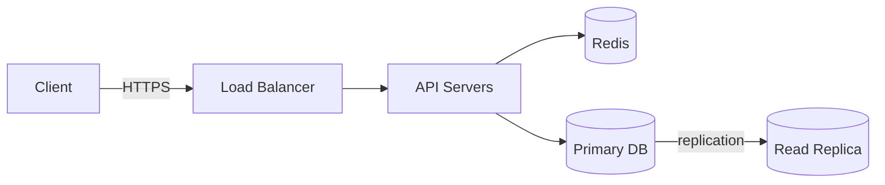

# System Design 101

A personal study repo for learning system design: concept notes, case studies
(design X), diagrams, and small runnable experiments that demonstrate a concept.

## Goals

- Build intuition for the trade-offs behind distributed systems, not just memorize answers.
- Prepare for system design interviews with consistent, reusable write-ups.
- Keep every note accurate and easy to revisit: thorough, but scannable in a minute
  from its TL;DR, tables and decision points.

## Repository layout

Numbered folders are in study order. Keep to this structure:

```
_01_Interview_Playbook/  # how to run the interview: framework, estimation cheat sheet,
                         # trade-offs to say out loud, red flags, final checklist
_02_Fundamentals/        # principles and theory: scaling, CAP/PACELC, consistency models,
                         # replication, sharding, consensus, distributed transactions
_03_Building_Blocks/     # concrete components: load balancer, cache, databases, message
                         # queue, CDN, API gateway, object storage, search index
  _01_Docker_Databases/  # docker-compose setups for running each database locally
  _02_Docker_Message_Brokers/ # docker-compose setups for Kafka and RabbitMQ
_04_Case_Studies/        # end-to-end designs: url-shortener, chat, news-feed, payments
_05_Diagrams/            # diagram sources that don't fit inline (Excalidraw / draw.io)
_06_Experiments/         # small runnable code that shows a concept in practice
resources.md             # books, papers, blogs, and videos worth revisiting
```

**Where does a note go?** If it answers "what principle or guarantee is this?" it goes in
`_02_Fundamentals/`. If it answers "how does this component work and how do I use it?" it
goes in `_03_Building_Blocks/`. Example: `_02_Fundamentals/consistent-hashing.md` vs
`_03_Building_Blocks/cache.md`, which links to it.

File names are kebab-case markdown, e.g. `_04_Case_Studies/url-shortener.md`. Link related
notes to each other with relative links instead of repeating content.

`_02_Fundamentals/system-design-interview-guide.txt` is my original one-file revision guide.
Its content has been split into the notes in `_01_`–`_04_`; the notes are the source of truth.
When a note changes, keep the guide's matching short section in sync, or tell me it has drifted.

## How to help me

- **Explain like a senior engineer mentoring me.** Start with the intuition, then the
  mechanism, then the trade-offs. Give real-world examples (e.g. how Kafka, DynamoDB,
  Cassandra, or Redis do it).
- **Always discuss trade-offs.** No design is "best". Say what you gain, what you give
  up, and when you would pick something else.
- **Use numbers.** Do back-of-the-envelope estimates (QPS, storage, bandwidth) and
  show the arithmetic.
- **Be accurate.** If something is uncertain, version-specific, or debated, say so
  rather than guessing. Don't invent benchmarks or citations.
- **Ask before big restructures.** For edits to existing notes, keep my wording
  unless it's wrong; fix errors and point out what changed.
- **Quiz me when asked.** If I say "quiz me" on a topic, ask one question at a time
  and wait for my answer before giving feedback.
- **"Enhance" means bring the note up to the standard below.** When I ask to enhance or
  expand a note, follow the concept note standard, keep the existing correct content, and
  tick the topic checklist only when the note meets the definition of done.

## Concept note standard (`_02_Fundamentals/`, `_03_Building_Blocks/`)

The reference example is [`_02_Fundamentals/api-design.md`](_02_Fundamentals/api-design.md).
Match its structure and depth.

Most topics are a **choice between options**: API styles, caching patterns, load-balancing
algorithms, consistency models, databases, sharding strategies, queues vs pub/sub. Cover
every option with the same blocks, then help pick between them. For a **single concept**
(e.g. consistent hashing), use one option block for the concept itself, and compare it with
the alternatives it replaces.

```markdown
# <Topic>

## TL;DR
One bullet per option: "**X** for <situation>." End with when to use none of them.

## <Landscape overview>              e.g. "Ways services communicate"
Table grouping the options by category or pattern.

## Side-by-side comparison
One table: options as columns, the same dimensions as rows (model, performance,
consistency, cost, complexity, tooling, when it breaks, ...).

---

## <Option A>

**What it is.** 2–4 sentences: definition, expanded acronym, how it works at its core.
Add a small table for its variants or sub-types, and a short example (code, request,
config or SQL) when it makes the idea concrete.

**Use when**
- Concrete situations, with a real-world example.

**Don't use when**
- Situation → the better alternative.

**Advantages**
- ...

**Limitations**
- **Key problem in bold:** why it happens, and the usual fix.

### <Option A> guidelines            optional: practical rules, tables, gotchas

---

## <Option B> ...                    same blocks for every option

---

## <Cross-cutting concern>           e.g. "Pagination, sorting and filtering"
Strategies table (how, pros, cons, use when), rules, and a worked example that ties it
together: request → query/code → index/config → response.

## Quick decision points
- Mermaid flowchart of yes/no questions that ends at an option.
- "If you need… → Choose" table.
- Common combinations used in interview designs (link the case studies).

## Interview questions
**Q: X vs Y?**
Short answer: the pick, why, and the trade-off.

## Related
- Relative links to related notes, case studies and Docker labs.
```

**Definition of done** for a concept note:
- [ ] TL;DR lets me answer "which one and why" in 30 seconds.
- [ ] Every option has what it is, use when, don't use when, advantages and limitations.
- [ ] One side-by-side comparison table and one decision flowchart.
- [ ] At least one worked example (code, SQL, request/response or config).
- [ ] Interview questions cover each "X vs Y" a reviewer might ask.
- [ ] Links to related notes, and to a Docker lab in `_03_Building_Blocks/_0N_Docker_*/` when one exists.
- [ ] All relative links and `#anchor` links resolve.

## Case study template (`_04_Case_Studies/`)

Follow the standard interview flow:

1. **Requirements**: functional and non-functional (latency, availability, consistency, scale).
2. **Capacity estimates**: users, QPS (avg/peak), storage, bandwidth.
3. **API design**: key endpoints or RPCs with request/response shapes.
4. **Data model**: entities, schema, choice of database and why.
5. **High-level design**: components and data flow (Mermaid diagram).
6. **Deep dives**: the 2–3 hardest parts (e.g. ID generation, fan-out, hot keys).
7. **Scaling and bottlenecks**: sharding, replication, caching, async processing.
8. **Reliability**: failure modes, retries, idempotency, monitoring.
9. **Trade-offs and alternatives**: what you'd change at 10x / 100x scale.

For each major choice (database, API style, cache, queue), say what you picked, the
alternative you rejected and why, linking the concept note's "Use when / Don't use when"
instead of repeating it.

## Diagrams

- Prefer **Mermaid** inside markdown so diagrams render on GitHub and stay diffable.
- Keep diagrams focused: one idea per diagram, label arrows with what flows over them
  (e.g. `HTTP`, `async event`, `replication`).



## Experiments (`_06_Experiments/`)

- One folder per experiment with a `README.md` covering what it shows, how to run
  it, and what to observe.
- Keep them minimal and self-contained (e.g. `docker compose up`, a single script).
- Don't add dependencies beyond what the experiment needs.

## Writing style

- Scannable. Bullet points and tables over long paragraphs; short sentences.
- Bold the key phrase that starts a bullet when it names a problem or rule
  (e.g. "**N+1 problem:** …"), then explain it.
- Point to the better choice with an arrow: "Need real-time updates → WebSocket".
- Separate option sections with `---` so each one stands out.
- Use fenced code blocks with a language (`sql`, `json`, `graphql`, `bash`, `mermaid`) for
  examples, and keep them realistic and consistent (e.g. the same `orders` table throughout).
- Define acronyms on first use (e.g. "CAP (Consistency, Availability, Partition tolerance)").
- Use consistent units: ms for latency, QPS for throughput, KB/MB/GB/TB for size.
- Name real systems and tools as examples, but don't invent benchmarks or exact numbers.

## Topic checklist

Track progress here; tick items off as notes are written.

**_01 – Interview playbook**
- [x] Interview framework, red flags, final checklist
- [x] Estimation cheat sheet: latency numbers, QPS/storage math, availability nines
- [x] Trade-offs phrasebook

**_02 – Fundamentals**
- [x] Vertical vs horizontal scaling; stateless services
- [x] Latency vs throughput (in scalability.md, with Little's Law)
- [x] CAP and PACELC
- [x] Consistency models (strong, eventual, causal, read-your-writes)
- [x] Replication (leader-follower, multi-leader, leaderless, quorums)
- [x] Sharding / partitioning; consistent hashing
- [x] DB sharding in practice: partitioning, Vitess/Citus, distributed DBs, resharding (db-sharding.md)
- [x] Unique ID generation: auto-increment, UUIDv4/v7, Snowflake, ranges (id-generation.md)
- [x] Service discovery (service-discovery.md)
- [x] Consensus (Raft / Paxos), leader election (leader-election.md)
- [x] Distributed transactions (2PC, Saga, outbox)
- [x] Reliability: idempotency, retries with backoff, timeouts, circuit breakers
- [x] Resiliency patterns: backpressure, retry budgets, hedging, cells, shuffle sharding, static stability
- [x] Sync vs async communication
- [x] API design (REST, GraphQL, SOAP, gRPC, RPC, WebSocket, pagination, sorting, filtering, versioning)
- [x] Rate limiting algorithms
- [x] Observability: logging, metrics, tracing
- [x] Security: authN/authZ, TLS, secrets

**_03 – Building blocks**
- [x] Load balancer
- [x] Cache (strategies and eviction)
- [x] SQL databases and indexing (deep dive: `_02_Fundamentals/db-indexing.md`)
- [x] NoSQL databases (key-value, document, wide-column, graph)
- [x] Message queues and event streaming
- [x] CDN (`_02_Fundamentals/cdn.md`)
- [x] API gateway (`_02_Fundamentals/api-gateway.md`)
- [x] Object storage (`_02_Fundamentals/object-storage.md`)
- [x] Search index (`_02_Fundamentals/search-index.md`)

**_04 – Case studies**
- [ ] URL shortener (blueprint written, needs full write-up)
- [ ] Rate limiter (blueprint written, needs full write-up)
- [ ] Chat application (blueprint written, needs full write-up)
- [ ] News feed (blueprint written, needs full write-up)
- [ ] Notification system (blueprint written, needs full write-up)
- [ ] Payment system (blueprint written, needs full write-up)
- [ ] Distributed cache / key-value store (blueprint written, needs full write-up)
- [ ] File storage (blueprint written, needs full write-up)
- [ ] Video streaming (blueprint written, needs full write-up)
- [ ] Search autocomplete (blueprint written, needs full write-up)
- [ ] Web crawler
- [ ] Ride sharing
