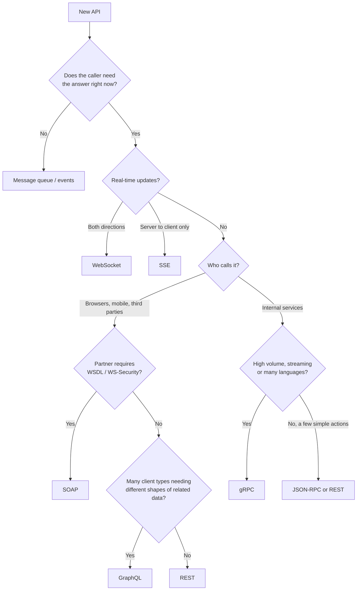

# API Design and Communication Styles

## TL;DR
- **REST** for public and browser-facing APIs.
- **GraphQL** when many different clients need different shapes of related data.
- **gRPC** for fast, typed service-to-service calls and streaming.
- **WebSocket** when client and server both push data in real time.
- **SOAP** only when an enterprise partner or a standard requires it.
- **Plain RPC** (JSON-RPC, Thrift) for simple internal "call this function" APIs.
- If the caller doesn't need an answer right now, skip the API call: use a
  [message queue](message-queues.md).

## Ways services communicate

| Pattern | Who starts it | Styles |
|---------|---------------|--------|
| Request / response (sync) | Client asks, server answers | REST, SOAP, gRPC (unary), RPC, GraphQL |
| Streaming | Either side keeps sending over an open connection | gRPC streaming, WebSocket, SSE |
| Server push | Server notifies the client when something happens | WebSocket, SSE, webhooks, long polling |
| Async messaging | Producer drops a message; a consumer handles it later | Kafka, RabbitMQ, SQS (see [message queues](message-queues.md)) |

## Side-by-side comparison

| | REST | GraphQL | SOAP | gRPC | RPC (JSON-RPC, Thrift) | WebSocket |
|---|---|---|---|---|---|---|
| Model | Resources + HTTP verbs | Typed schema; client picks the fields | Operations in an XML envelope | Remote functions (methods) | Remote functions | Open two-way channel |
| Transport | HTTP/1.1 or HTTP/2 | HTTP, usually POST to one endpoint | Usually HTTP; also SMTP, JMS | HTTP/2 | HTTP, TCP | Upgraded HTTP → TCP |
| Payload | JSON (usually) | JSON | XML only | Protocol Buffers (binary) | JSON / binary | Any (text or binary frames) |
| Contract | Optional (OpenAPI) | Required (schema) | Required (WSDL) | Required (`.proto`) | Optional (JSON-RPC), IDL (Thrift) | None; you define messages |
| Streaming | No (polling or SSE) | Subscriptions (usually over WebSocket) | No | Yes: client, server, bidirectional | No (mostly) | Yes, both directions |
| Browser support | Native | Native | Poor | Needs gRPC-Web + a proxy | Native (JSON-RPC over HTTP) | Native |
| HTTP caching | Yes (GET, ETag, CDN) | Hard (needs persisted GET queries) | No | No | No | No |
| Payload size / speed | Medium | Only requested fields; server cost varies per query | Large, slow to parse | Small, fast | Small to medium | Small per-message overhead |
| Human-readable | Yes | Yes | Yes, but verbose | No | JSON-RPC yes; Thrift no | Depends on payload |
| Connection | Short-lived, stateless | Short-lived (long-lived for subscriptions) | Short-lived | Long-lived, multiplexed | Short-lived | Long-lived, stateful |

---

## REST

**What it is.** Representational State Transfer: an architectural style where everything is a
**resource** with a URL (`/users/42/orders`), and you act on it with HTTP methods. Each request
carries everything the server needs (stateless).

**Use when**
- Public or third-party APIs: everyone knows HTTP + JSON, and any language can call it.
- Browser and mobile clients.
- CRUD-style domains (users, orders, products) that map cleanly to resources.
- Read-heavy data that benefits from HTTP caching and CDNs.

**Don't use when**
- Services call each other very often and latency matters → gRPC.
- You need real-time or two-way updates → WebSocket or SSE.
- Clients need very different shapes of data from many entities in one call → consider GraphQL.

**Advantages**
- Simple, universal, easy to debug with a browser or `curl`.
- Stateless, so it's easy to scale horizontally behind a [load balancer](load-balancer.md).
- Built-in HTTP caching (Cache-Control, ETag) and standard status codes.
- Huge ecosystem: OpenAPI, API gateways, client generators.

**Limitations**
- **Over-fetching / under-fetching:** fixed responses return too much, or too little and need several calls.
- JSON is text: bigger and slower to parse than binary formats.
- No built-in streaming or server push.
- No enforced contract unless you add OpenAPI; breaking changes are easy to ship by accident.
- Actions that aren't resources (`/transfer-funds`) fit awkwardly.

### REST design guidelines
- Clear resource URLs with plural nouns: `GET /users/{id}/orders`, not `/getOrdersForUser`.
- Correct HTTP methods:

| Method | Meaning | Idempotent? |
|--------|---------|-------------|
| GET | Read | Yes |
| POST | Create / action | **No**: use an `Idempotency-Key` header for payments and orders (see [idempotency](idempotency-and-delivery-guarantees.md)) |
| PUT | Replace | Yes |
| PATCH | Partial update | Not guaranteed |
| DELETE | Remove | Yes |

- Meaningful status codes:

| Code | When |
|------|------|
| 200 OK / 201 Created / 204 No Content | Success |
| 400 Bad Request | Invalid input |
| 401 Unauthorized / 403 Forbidden | Not logged in / not allowed |
| 404 Not Found | Resource doesn't exist |
| 409 Conflict | Version or state conflict |
| 429 Too Many Requests | [Rate limited](rate-limiting.md); send `Retry-After` |
| 500 / 503 | Server error / temporarily unavailable |

- **Pagination, sorting and filtering:** see [the section below](#pagination-sorting-and-filtering).
- **Versioning:** `/v1/...` in the path, or a header. Add fields freely; never remove or rename them within a version.
- **API gateway:** a single entry point for auth, [rate limiting](rate-limiting.md), routing and
  logging (e.g. AWS API Gateway, Azure APIM = API Management). See [API gateway](api-gateway.md).

---

## SOAP

**What it is.** Originally Simple Object Access Protocol: a strict, XML-based messaging protocol.
Every message is an XML **envelope** (header + body), and the service is described by a
**WSDL** (Web Services Description Language) contract. It comes with a family of WS-* standards
such as WS-Security, WS-ReliableMessaging and WS-AtomicTransaction.

**Use when**
- Integrating with banks, insurance, telecom, government or older enterprise systems that only offer SOAP.
- You need **message-level** security (signing or encrypting parts of a message), not just TLS.
- A formal, machine-checked contract is required between organizations.
- The transport isn't HTTP (e.g. over a JMS message queue).

**Don't use when**
- Building a new public, web or mobile API → REST.
- Performance or payload size matters → gRPC.
- The team or client has no SOAP tooling.

**Advantages**
- Strict contract (WSDL) and strong typing; client code can be generated.
- Mature standards for security, reliable delivery and distributed transactions.
- Transport-independent.
- Standard error format (SOAP Fault).

**Limitations**
- Very verbose XML: large messages, slow parsing.
- Complex tooling and steep learning curve.
- Almost always POST, so no HTTP caching.
- Poor fit for browsers and mobile; little use in new systems.

---

## gRPC

**What it is.** An open-source RPC framework created at Google. You define services and messages
in a `.proto` file, and gRPC generates client and server code in many languages. It sends
**Protocol Buffers** (compact binary) over **HTTP/2**, which multiplexes many calls on one connection.

It supports four call types:

| Type | Example |
|------|---------|
| Unary (one request, one response) | `GetUser(id)` |
| Server streaming | Server sends a stream of price updates |
| Client streaming | Client uploads a stream of sensor readings |
| Bidirectional streaming | Both sides send freely, e.g. a live game or chat between services |

**Use when**
- Internal microservice-to-microservice calls, especially high-volume or latency-sensitive ones.
- Polyglot systems: one `.proto` contract generates Go, Java, Python and other clients.
- You need streaming between services.
- Mobile or IoT clients on slow networks, where small payloads help.

**Don't use when**
- The API is called directly from browsers (it needs gRPC-Web and a proxy such as Envoy).
- It's a public API for unknown third parties who expect REST + JSON.
- You want responses cached by HTTP caches or CDNs.
- The team needs to inspect traffic by eye; binary payloads need special tools.

**Advantages**
- Small binary payloads and fast serialization.
- Strong, enforced contract with code generation; fewer integration bugs.
- Streaming in both directions.
- Built-in deadlines/timeouts, cancellation and metadata, which help [reliability](reliability.md).
- HTTP/2 multiplexing: many concurrent calls share one connection.

**Limitations**
- Limited browser support.
- Not human-readable; debugging needs tools like `grpcurl`.
- **Load balancing is trickier:** long-lived HTTP/2 connections stick to one server behind a
  Layer 4 load balancer, so you need Layer 7 (HTTP/2-aware) or client-side load balancing.
- Contract changes need care: never reuse or renumber `.proto` field numbers.
- No HTTP caching.

---

## RPC (Remote Procedure Call)

**What it is.** The general idea of calling a function on another machine as if it were local:
`transferFunds(from, to, amount)`. gRPC is one modern RPC framework. Others include:
- **JSON-RPC 2.0:** JSON request `{"method": "...", "params": ..., "id": 1}` over HTTP or WebSocket.
- **XML-RPC:** the older XML version.
- **Apache Thrift:** binary, with an IDL (Interface Definition Language), from Facebook.
- **Java RMI**, and **tRPC** (TypeScript end to end).

**Use when**
- The API is a set of **actions**, not resources: `calculateQuote`, `restartJob`.
- Internal tools where both sides are under your control.
- Blockchain node APIs and editor tooling, which commonly use JSON-RPC (e.g. Ethereum nodes, the Language Server Protocol).

**Don't use when**
- It's a public API that should be discoverable and cacheable → REST.
- You need strong contracts, streaming and code generation across languages → gRPC.

**Advantages**
- Simple mental model: just call a function.
- Lightweight (especially JSON-RPC): little ceremony, easy to add.
- Maps naturally to commands and actions.

**Limitations**
- **Hides the network:** a remote call looks local but can be slow, fail halfway or time out.
  Always add timeouts and retries.
- Tighter coupling: clients depend on function names and signatures.
- No standard caching, and often no standard error codes (JSON-RPC returns errors inside a 200 OK).
- Weak discoverability compared with REST + OpenAPI.

---

## GraphQL

**What it is.** A query language and runtime for APIs, created at Facebook and open-sourced in
2015. The server publishes a typed **schema**; clients send a query to a **single endpoint**
(usually `POST /graphql`) asking for exactly the fields they want, across related objects, in
one request. Each field is filled in by a **resolver** function on the server.

Three operation types:

| Operation | Purpose |
|-----------|---------|
| Query | Read data |
| Mutation | Change data |
| Subscription | Receive live updates, usually over WebSocket |

```graphql
query {
  user(id: "42") {
    name
    orders(first: 2) {
      edges { node { id total } }
    }
  }
}
```

```json
{
  "data": {
    "user": {
      "name": "Ada",
      "orders": { "edges": [ { "node": { "id": "o1", "total": 19.99 } },
                             { "node": { "id": "o2", "total": 5.00 } } ] }
    }
  }
}
```

With REST, the same screen might need `GET /users/42` and then `GET /users/42/orders`, and both
responses would include fields the screen never shows.

**Use when**
- Many client types (web, iOS, Android, partners) each need different fields from the same data.
- Screens show deeply related data (a product page with seller, reviews and stock), which would
  take many REST calls.
- An API layer combines several backend services into one graph (a Backend for Frontend, or
  federation).
- The frontend changes quickly and shouldn't wait for new backend endpoints.

**Don't use when**
- Simple CRUD with one client: REST is less work.
- Responses must be cached by CDNs and HTTP caches.
- Service-to-service calls inside the backend → gRPC.
- Large file uploads or binary streaming (not part of the GraphQL spec).
- The team can't invest in query-cost limits, batching and monitoring.

**Advantages**
- **No over- or under-fetching:** the client gets exactly the fields it asked for.
- One round trip for related data, which helps on slow mobile networks.
- Strongly typed schema with introspection: great tooling (GraphiQL, code generation).
- Evolves without versions: add fields freely and mark old ones `@deprecated`.
- Real-time updates through subscriptions.

**Limitations**
- **N+1 problem:** resolving `orders` for 100 users can run 100 separate queries. Fix it by
  batching with DataLoader.
- **Caching is harder:** every query is a POST to one URL. Use persisted queries sent as GET,
  plus client-side caches (e.g. Apollo, Relay).
- **Expensive queries:** a client can ask for deeply nested data. Protect the server with depth
  limits, query cost analysis and timeouts, and [rate-limit](rate-limiting.md) by query cost,
  not request count.
- Errors usually come back as HTTP 200 with an `errors` array, so monitoring by status code doesn't work.
- More server complexity: schema design, resolvers, and per-field monitoring and authorization.

---

## WebSocket

**What it is.** A protocol that starts as an HTTP request and **upgrades** (`101 Switching
Protocols`) into a persistent, **full-duplex** TCP connection. After that, client and server can
send messages to each other at any time with very little overhead. URLs use `ws://` or `wss://` (TLS).

**Use when**
- Chat and messaging (see the [chat application](../_04_Case_Studies/chat-application.md) blueprint).
- Multiplayer games, collaborative editing, live whiteboards.
- Live dashboards, trading screens, sports scores where the client also sends data.
- Presence and typing indicators, live location (e.g. ride-sharing drivers).

**Don't use when**
- Plain request/response: REST is simpler and cacheable.
- Only the server pushes and updates are one-way → **SSE** (Server-Sent Events) is simpler and auto-reconnects.
- Updates are rare (minutes apart) → polling or webhooks cost less than holding open connections.
- Service-to-service streaming → gRPC streaming.

**Advantages**
- Real-time, two-way communication with low latency.
- Low overhead per message once connected (no HTTP headers each time).
- Works in all modern browsers.

**Limitations**
- **Stateful connections are hard to scale:** each server holds thousands of open connections, so
  you need a way to route messages to the right server (e.g. a Redis pub/sub backplane or a
  presence store) and sticky load balancing.
- Load balancers and proxies may cut idle connections: send heartbeats (ping/pong).
- Clients must handle reconnects and missed messages.
- No HTTP caching, and no built-in request/response matching, delivery guarantee or ordering
  across reconnects; you build these yourself.
- Auth happens at the handshake; long sessions need token refresh logic.

### Other server-push options

| Option | How | Best for |
|--------|-----|----------|
| Short polling | Client asks every N seconds | Simple, infrequent updates |
| Long polling | Server holds the request until there is news | Fallback when WebSocket isn't available |
| SSE | One long HTTP response streaming events, server → client only | Notifications, live feeds, progress updates |
| Webhooks | Server calls *your* URL when an event happens | Server-to-server events (payments, Git pushes) |

---

## Pagination, sorting and filtering

Any endpoint that returns a list needs all three. Without them, one request can return
millions of rows, and clients can't find what they need.

### Pagination

| Strategy | Request | How it works | Pros | Cons | Use when |
|----------|---------|--------------|------|------|----------|
| Offset / limit | `?limit=20&offset=40` | Skip N rows, return the next `limit` | Simple; can jump to any page | Slow for large offsets (the DB still reads the skipped rows); items shift when data changes, so pages skip or repeat | Small, stable data; admin tables |
| Page number | `?page=3&size=20` | Offset in disguise: `offset = (page - 1) × size` | Friendly for numbered page links | Same problems as offset | UIs with "page 1, 2, 3" links |
| Cursor (keyset) | `?limit=20&cursor=eyJ0Ijo…` | Return rows *after* the last row seen, using the sort columns | Fast at any depth (uses an index); stable while data changes | No jumping to page N; only next/previous | Feeds, timelines, infinite scroll, large or fast-changing data |

**How cursor pagination works**
- The cursor encodes the sort values of the last row returned, e.g. `{created_at, id}`, as an
  **opaque** base64 string. Clients must not build or parse it.
- The next page is a range query on an index:

```sql
-- page 1
SELECT * FROM orders
ORDER BY created_at DESC, id DESC
LIMIT 21;                     -- ask for limit + 1 to know whether another page exists

-- next page: rows after the last one seen
SELECT * FROM orders
WHERE (created_at, id) < (:last_created_at, :last_id)
ORDER BY created_at DESC, id DESC
LIMIT 21;
```

- Fetching `limit + 1` rows tells you whether there's a next page without a separate count query.

**Response shape**

```json
{
  "data": [ { "id": "o1", "total": 19.99 }, { "id": "o2", "total": 5.00 } ],
  "page": {
    "next_cursor": "eyJjcmVhdGVkX2F0IjoiMjAyNi0xMC0yOSIsImlkIjoibzIwIn0",
    "has_more": true
  }
}
```

**Pagination rules**
- Always enforce a **maximum page size** (e.g. 100), even if the client asks for more.
- Set a sensible default (e.g. 20).
- A **total count** is expensive on large tables (`COUNT(*)` scans rows). Make it optional, or return an estimate.
- An alternative to links in the body is the HTTP `Link` header (`rel="next"`), as GitHub's API does.

### Sorting

```
GET /orders?sort=-created_at,total        # "-" means descending
GET /orders?sort_by=created_at&order=desc # another common convention
```

- **Allow-list** sortable fields. Sorting by an unindexed column on a big table is slow, and
  arbitrary column names invite injection bugs.
- Always add a **unique tie-breaker** (usually `id`) as the last sort key. Without it, rows with
  equal values come back in an unpredictable order, and pages skip or repeat items.
- Back each allowed sort with an index, e.g. `(created_at DESC, id DESC)`.
- The cursor depends on the sort. If the client changes the sort, start again from page 1.

### Filtering

```
GET /orders?status=shipped&customer_id=42              # exact match
GET /orders?created_after=2026-10-01&total_gte=50      # ranges
GET /orders?total[gte]=50&total[lte]=200               # operator-style alternative
GET /products?q=mechanical+keyboard                    # full-text search
```

- **Allow-list** filter fields and **validate types** (dates, numbers, enums). Never pass raw
  filter text into SQL.
- Add indexes for the most common filter + sort combinations. A composite index on
  `(status, created_at, id)` serves `?status=shipped&sort=-created_at` directly.
- Free-text search (`q=`) belongs in a search index (Elasticsearch / OpenSearch), not `LIKE '%…%'`.
- For complex filters that don't fit in a URL, use `POST /orders/search` with a JSON body.
- Keep filters in the cursor's scope. A cursor from one filter must not be reused with another.

### Putting it together

```
GET /v1/orders?status=shipped&sort=-created_at&limit=20&cursor=eyJ0Ijo…
```

```sql
SELECT id, total, created_at FROM orders
WHERE status = 'shipped'
  AND (created_at, id) < (:last_created_at, :last_id)
ORDER BY created_at DESC, id DESC
LIMIT 21;
-- served by INDEX orders(status, created_at DESC, id DESC)
```

### The same ideas in GraphQL and gRPC

**GraphQL** usually follows the Relay **connection** pattern:

```graphql
query {
  orders(first: 20, after: "eyJ0Ijo…",
         orderBy: { field: CREATED_AT, direction: DESC },
         filter: { status: SHIPPED }) {
    edges { cursor node { id total createdAt } }
    pageInfo { hasNextPage endCursor }
  }
}
```

**gRPC** commonly follows Google's API Improvement Proposals (AIPs): a request has `page_size`,
`page_token`, `order_by` (e.g. `"create_time desc"`) and `filter` (e.g. `"status = SHIPPED"`), and
the response returns `next_page_token`. An empty token means the last page.

---

## Quick decision points



| If you need… | Choose |
|--------------|--------|
| A public API anyone can use | REST (+ OpenAPI) |
| Fast internal calls between microservices | gRPC |
| Streaming between services | gRPC streaming |
| Two-way real-time in the browser | WebSocket |
| One-way live updates to the browser | SSE |
| To integrate with a bank or legacy enterprise system | SOAP (if that's what they offer) |
| A few simple internal commands | JSON-RPC (or REST) |
| Flexible queries across many entities from one client | GraphQL |
| To decouple work that can happen later | Message queue |

**Common combinations in interviews**
- **Chat app:** REST for login, history and contacts; WebSocket for live messages and presence.
- **Ride sharing:** REST for booking; WebSocket for live driver location.
- **Microservices backend:** REST at the API gateway for clients; gRPC between internal services;
  a message queue for background work.
- **Payments:** REST with `Idempotency-Key`, plus webhooks to notify merchants.

## Interview questions
**Q: REST vs gRPC: which do you choose and why?**
REST for external, browser-facing or cacheable APIs, because it's universal and easy to use.
gRPC for internal service-to-service calls, because binary payloads, HTTP/2 multiplexing and
generated typed clients give lower latency and fewer integration bugs. Many systems use both.

**Q: Why not use gRPC directly from the browser?**
Browsers don't give JavaScript the low-level HTTP/2 control gRPC needs. You need gRPC-Web plus a
proxy (e.g. Envoy) that translates, or you expose REST at the edge.

**Q: How do you scale WebSocket servers?**
Run many WebSocket servers behind a load balancer that supports long-lived connections. Keep a
presence store (user → server) and use pub/sub (e.g. Redis) so any server can deliver a message
to a user connected elsewhere. Add heartbeats, reconnect logic, and replay of missed messages
from storage.

**Q: WebSocket vs SSE vs long polling?**
WebSocket for two-way real-time. SSE when only the server pushes; it's plain HTTP with
auto-reconnect. Long polling as a fallback where neither works.

**Q: SOAP vs REST?**
SOAP is a strict protocol with XML, a WSDL contract and WS-* standards, suited to enterprise
integrations that need them. REST is a lighter architectural style over HTTP + JSON, suited to
most modern web and mobile APIs.

**Q: REST vs GraphQL?**
REST is simpler, cacheable by HTTP and CDNs, and fits CRUD with one or two clients. GraphQL fits
many client types that need different fields of related data in one round trip, at the cost of
harder caching, the N+1 problem and protecting the server from expensive queries.

**Q: What is the N+1 problem in GraphQL and how do you fix it?**
Fetching a list of N parents runs 1 query, then each parent's child field runs its own query:
N more. Fix it with DataLoader, which batches all child lookups in one tick into a single
`WHERE id IN (...)` query and caches them per request.

**Q: Offset vs cursor pagination?**
Offset (`LIMIT 20 OFFSET 10000`) gets slower as the offset grows, because the database still
reads the skipped rows, and it can skip or repeat items when data changes. A cursor remembers the
sort values of the last row and asks for rows after it, which uses an index: fast at any depth
and stable. The trade-off is no jumping to page N.

**Q: How do you paginate a feed sorted by a non-unique column like `created_at`?**
Sort by `(created_at, id)` so every row has a unique position, put both values in the cursor,
and query `WHERE (created_at, id) < (:c, :id)` with a matching composite index.

**Q: How do you make filtering and sorting safe and fast?**
Allow-list fields and validate values (no raw SQL), cap the page size, index the common
filter + sort combinations, and send free-text search to a search index.

## Related
- [Message queues](message-queues.md): async communication
- [Load balancer](load-balancer.md): Layer 4 vs Layer 7 (matters for gRPC and WebSocket)
- [Idempotency](idempotency-and-delivery-guarantees.md)
- [Rate limiting](rate-limiting.md)
- [Security](security.md)
- [API gateway](api-gateway.md): auth, routing and rate limiting at the edge
