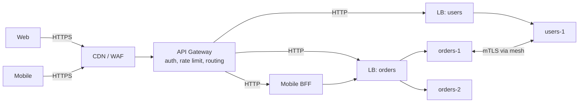
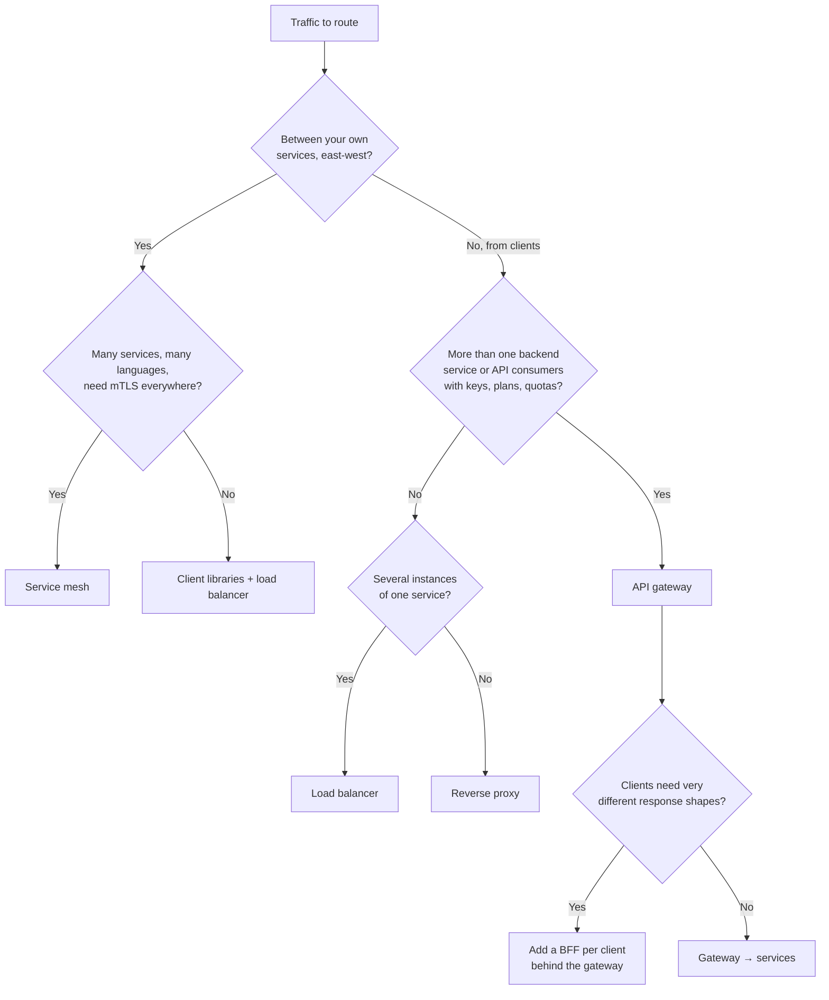

# API Gateway

## TL;DR
- **API gateway** for one public entry point to many backend services: authentication,
  [rate limiting](rate-limiting.md), routing, request shaping and per-client policies.
- **Reverse proxy** (Nginx, HAProxy) when you only need TLS termination, path routing and caching
  in front of one or a few apps.
- **[Load balancer](load-balancer.md)** when you only spread traffic across identical instances.
- **BFF (Backend for Frontend)** when web, mobile and partners need differently shaped APIs.
- **Service mesh** (Istio, Linkerd) for **east-west** traffic between your own services: mTLS,
  retries, timeouts and telemetry without changing service code.
- **None of them** for a single monolith behind a load balancer: a gateway is one more hop and one
  more thing to run. Add it when you have several services or several kinds of clients.

## Where each one sits

| Traffic | Component | Typical layer | Examples |
|---------|-----------|---------------|----------|
| Internet → your edge (north-south) | CDN / WAF (Web Application Firewall) | L7 | Cloudflare, CloudFront, AWS WAF |
| Edge → right service | **API gateway** | L7 | Kong, AWS API Gateway, Azure APIM, Apigee, Envoy Gateway, Tyk, KrakenD |
| Edge → right service, simpler | Reverse proxy | L7 | Nginx, HAProxy, Traefik, Caddy |
| One service → its instances | Load balancer | L4 or L7 | AWS ALB/NLB, HAProxy, Kubernetes Service |
| Client type → tailored API | BFF | L7, your code | A Node or GraphQL service per frontend |
| Service ↔ service (east-west) | Service mesh (sidecar or node proxy) | L4/L7 | Istio, Linkerd, Consul Connect, Cilium |



## Side-by-side comparison

| | Reverse proxy | Load balancer | API gateway | BFF | Service mesh |
|---|---|---|---|---|---|
| Main job | Forward requests, terminate TLS, cache | Spread load across instances | Manage APIs as a product: who may call what, how often | Shape the API for one client | Secure and observe service-to-service calls |
| Traffic | North-south | Either | North-south | North-south | East-west |
| Knows about | Hosts, paths | Instances, health | Consumers, API keys, plans, routes, versions | One frontend's screens | Every service identity |
| Auth | Basic (or via module) | No | Yes: API keys, OAuth 2.0 / JWT (JSON Web Token), mTLS | Often user session | Service identity (mTLS) |
| Rate limiting | Basic, per IP | No | Per key, per plan, per route; quotas | Rarely | Sometimes (local) |
| Transform / aggregate | Headers only | No | Headers, body, protocol (REST ↔ gRPC) | Yes: its whole purpose | No |
| Owned by | Platform team | Platform team | Platform / API team | Each frontend team | Platform team |
| Added latency | Low (one hop) | Low | Low to medium (plugins, auth calls) | One more service hop | Two proxy hops per call (sidecars) |
| When it breaks | Config sprawl | Uneven load if sticky | Becomes a bottleneck or a monolith of business logic | Duplicated logic across BFFs | Operational complexity, debugging through proxies |

---

## Reverse proxy

**What it is.** A server that accepts client requests and forwards them to one or more backends,
hiding them from the client. It terminates TLS, routes by host or path, compresses, caches and
buffers slow clients. Every API gateway is a reverse proxy with API-management features on top.

**Use when**
- One app, or a few, behind one domain: `/` → web, `/api` → API server.
- You need TLS termination, gzip, static file serving or a small cache.
- Kubernetes ingress for simple routing (ingress-nginx, Traefik).

**Don't use when**
- You need per-consumer API keys, plans, quotas or a developer portal → API gateway.
- You need different response shapes per client → BFF.

**Advantages**
- Fast, battle-tested, cheap to run; one config file.
- Hides internal topology and lets you change backends without touching clients.

**Limitations**
- **Policies get hand-written:** auth and per-key limits end up as config snippets copied across
  routes. When you have many APIs and consumers, move to a gateway.
- No consumer management, analytics or portal.

---

## Load balancer

**What it is.** Spreads requests or connections across healthy instances of **one** service,
using an algorithm (round robin, least connections, consistent hashing). Covered in depth in
[load balancer](load-balancer.md).

**Use when**
- Several identical instances of a service need traffic spread across them.
- You need health checks and failover between instances.

**Don't use when**
- You need to decide **which service** handles a request based on the API, consumer or version → API gateway.

**Advantages**
- Simple, fast, essential for horizontal scaling.

**Limitations**
- **No API awareness:** it doesn't know who the caller is or what plan they're on.

---

## API gateway

**What it is.** A single entry point that sits between clients and your services and applies
**cross-cutting policies** before a request reaches any backend: authenticate, authorize, rate
limit, route, transform, log. Services stay focused on business logic.

| Responsibility | What it does | Example |
|----------------|--------------|---------|
| Routing | Path, host, header or version → service | `/v1/orders/*` → orders service |
| Authentication | Validate API keys, JWTs, OAuth 2.0 tokens, mTLS certs | Reject expired JWT with `401` |
| Authorization (coarse) | Scopes and plans per route | Free plan can't call `/v1/exports` |
| [Rate limiting](rate-limiting.md) and quotas | Per key, per user, per route | 100 requests/min, 10,000/day |
| Request / response transformation | Add headers, rename fields, REST ↔ gRPC | Add `X-Request-ID`, strip internal headers |
| Aggregation | Call several services, merge one response | Product page = catalog + price + stock |
| Caching | Cache GET responses at the edge of your system | `GET /v1/products/42` for 30 s |
| Observability | Access logs, metrics per route and consumer, trace start | p99 latency per API key |
| Traffic management | Canary and weighted routing, retries, timeouts, circuit breaking | 5% of traffic to `orders-v2` |
| Developer experience | API keys, docs, portal, usage analytics | Partner signs up and gets a key |

| Kind | Examples | Good for |
|------|----------|----------|
| Managed (cloud) | AWS API Gateway, Azure API Management, Google Apigee / API Gateway, Cloudflare API Shield | Serverless backends, no ops team, built-in portal and billing |
| Self-hosted, plugin-based | Kong (on Nginx/OpenResty), Tyk, Apache APISIX | Many consumers, custom plugins, multi-cloud |
| Envoy-based / Kubernetes | Envoy Gateway, Emissary, Gloo, Istio ingress gateway (Kubernetes Gateway API) | Kubernetes platforms, gRPC, same proxy as the mesh |
| In-code framework | Spring Cloud Gateway, YARP (.NET) | A team that wants gateway logic in its own language |

**Use when**
- Microservices: clients shouldn't know there are 30 services, or call each one directly.
- Public or partner APIs with keys, plans, quotas and a portal (e.g. Stripe-, Twilio-style APIs).
- You want auth, rate limiting and logging done **once**, consistently, not in every service.
- You're migrating a monolith (**strangler fig**): route `/v1/orders` to the new service and
  everything else to the old monolith, then move routes one by one.

**Don't use when**
- One service and one client → a reverse proxy or load balancer is enough.
- You need service-to-service policies (mTLS, retries) inside the cluster → service mesh.
- Each frontend needs heavy, screen-specific aggregation → a BFF behind the gateway.

**Advantages**
- One place for security and traffic policies; services get simpler.
- Hides internal structure: split or rename services without breaking clients.
- Central metrics per API and per consumer.
- Enables canaries, versioning and migrations by changing routes.

**Limitations**
- **Single point of failure and bottleneck:** every request passes through it. Run it stateless,
  with several instances across availability zones behind a load balancer, and keep shared state
  (rate-limit counters) in Redis or approximate it locally.
- **Extra latency:** one more hop, plus plugin work. Keep plugins cheap; validate JWTs locally
  with cached public keys instead of calling the auth server on every request.
- **Business logic creep:** "just one small transformation" turns the gateway into a new monolith
  that every team must change. Keep business rules in services or BFFs.
- **Coupled releases:** if every new route needs a platform-team change, teams wait. Use
  declarative config in Git per team (decK for Kong, Kubernetes `HTTPRoute` objects).

### API gateway guidelines
- **Authenticate at the gateway, authorize again in the service.** The gateway checks "is this a
  valid token with scope `orders:read`"; the service checks "may user 42 see order 9001". Pass the
  verified identity in a header and strip any client-sent copy of that header.
- **Timeouts shorter than the client's:** the gateway's upstream timeout must be less than the
  client's timeout, or clients give up while the gateway still waits ([reliability](reliability.md#timeouts)).
- **Don't retry non-idempotent calls** at the gateway (`POST /payments`) unless the request
  carries an `Idempotency-Key` ([idempotency](idempotency-and-delivery-guarantees.md)).
- **Generate a request ID** at the gateway and propagate it, so one ID ties logs and traces
  together ([observability](observability.md)).
- **Return standard errors:** `401` bad credentials, `403` not allowed, `404` no route, `429`
  with `Retry-After`, `502`/`503`/`504` for backend problems.

---

## BFF (Backend for Frontend)

**What it is.** A small backend service owned by **one frontend team** that exposes exactly the
API that frontend needs. It calls the internal services, aggregates and trims the data, and
handles client-specific concerns (mobile pagination sizes, image sizes, feature flags). The
pattern was popularised by SoundCloud and described by Sam Newman.

**Use when**
- Web and mobile screens differ a lot: mobile needs less data and fewer round trips.
- A product page needs 5–10 internal calls; doing them from a phone over 4G is slow.
- Frontend teams want to ship without waiting for backend teams to add fields.

**Don't use when**
- All clients need the same data → one API behind the gateway.
- You'd end up with business rules copied in three BFFs → move shared logic to a service.
- A single GraphQL layer can serve all clients' different shapes → [GraphQL](api-design.md#graphql)
  (it's often used *as* the BFF).

**Advantages**
- Fewer round trips and smaller payloads for each client.
- Frontend teams own their API and release independently.

**Limitations**
- **Duplication:** several BFFs re-implement similar aggregation. Share libraries, not logic.
- One more service per frontend to deploy, monitor and secure.

---

## Service mesh

**What it is.** Infrastructure that handles **service-to-service** traffic. A proxy (usually
Envoy, or Linkerd's Rust proxy) runs next to each service as a **sidecar**, or once per node
(Istio ambient mode, Cilium). A control plane pushes config to all proxies: mTLS (mutual TLS)
identities, retries, timeouts, circuit breaking, traffic splits and telemetry.

**Use when**
- Dozens of services in several languages need the same mTLS, retry and timeout behaviour.
- Zero-trust networking: every call is authenticated with a service identity.
- You need per-call metrics and traces between services without changing code.

**Don't use when**
- A handful of services → libraries (gRPC interceptors, Resilience4j) and a plain load balancer are simpler.
- The team can't operate it: a mesh is a distributed system of its own.
- Public, consumer-facing API management → API gateway (meshes don't do API keys, plans or portals).

**Advantages**
- Consistent security and resilience for every call, in every language.
- Rich telemetry and traffic control (canary by percentage, fault injection).

**Limitations**
- **Operational cost:** control-plane upgrades, certificate rotation, proxy resource use on every pod.
- **Extra hops:** each call passes through two proxies with sidecars; usually small, but measure it.
- Harder debugging: failures can come from the proxy config, not the code.

---

## Worked example: an Nginx gateway with auth, routing and rate limiting

Nginx isn't a full API-management product, but it shows the core gateway jobs in a few lines.
This config was run with `nginx:latest` in Docker, with two stub services behind it.

```nginx
# API keys the gateway accepts → the caller's identity
map $http_x_api_key $api_client {
    default        "";
    ""    "mobile-app";   # fill in the mobile app's key
    ""    "web-app";      # fill in the web app's key
}

# 5 requests/second per API key, short bursts of 10
limit_req_zone $http_x_api_key zone=per_key:10m rate=5r/s;

upstream orders_svc { server orders:8081; keepalive 32; }
upstream users_svc  { server users:8082;  keepalive 32; }

server {
    listen 8080;
    limit_req_status 429;
    add_header X-Request-ID $request_id always;      # one ID per request, returned to the client

    # 1. Authentication: reject unknown keys before touching any backend
    if ($api_client = "") { return 401 '{"error":"invalid API key"}\n'; }

    # 2. Routing by path prefix  3. Rate limit per key  4. Timeouts per upstream
    location /v1/orders {
        limit_req zone=per_key burst=10 nodelay;
        proxy_pass http://orders_svc;
        proxy_set_header X-Request-ID $request_id;   # propagate for logs and traces
        proxy_set_header X-Client     $api_client;   # verified identity; client copies are overwritten
        proxy_connect_timeout 1s;
        proxy_read_timeout    3s;
    }
    location /v1/users {
        limit_req zone=per_key burst=10 nodelay;
        proxy_pass http://users_svc;
        proxy_set_header X-Request-ID $request_id;
        proxy_set_header X-Client     $api_client;
    }
    location / { return 404 '{"error":"no route"}\n'; }
}
```

API keys are left empty in this note. Put your own keys in the `map` block and send them in `X-API-Key`; the output below was captured with keys set.

```bash
$ curl -i localhost:8080/v1/orders/1                          # no key
HTTP/1.1 401 Unauthorized
{"error":"invalid API key"}

$ curl -i -H 'X-API-Key: ' localhost:8080/v1/orders/1
HTTP/1.1 200 OK
X-Request-ID: b98acfab89b0c06628332b407585447b
{"service":"orders","path":"/v1/orders/1"}

$ curl -H 'X-API-Key: ' localhost:8080/v2/foo
{"error":"no route"}

# 20 requests in a burst with one key: the bucket allows 1 + burst of 10, then 429
$ for i in $(seq 20); do curl -s -o /dev/null -w '%{http_code} ' -H 'X-API-Key: ' localhost:8080/v1/orders/1; done
200 200 200 200 200 200 200 200 200 200 200 429 429 429 429 429 429 429 429 429
```

What a real gateway adds on top: JWT/OAuth validation, counters shared across gateway instances
(this `limit_req` zone is per Nginx instance), per-plan quotas, a consumer database, a portal
and analytics. The same policy in Kong is a `services → routes → plugins` declarative file.

**Capacity sketch.** Peak 50,000 QPS through the gateway. Assume a load test shows one instance
handles 5,000 QPS with your plugins at acceptable p99 (measure this; it varies a lot with TLS
and plugins). Run at 60% to leave headroom: 50,000 / (5,000 × 0.6) ≈ 17 instances, plus 2 spare
so losing a zone doesn't overload the rest: **~19 instances across 3 zones**.

---

## Quick decision points



| If you need… | Choose |
|--------------|--------|
| Per-consumer API keys, quotas, developer portal | API gateway (managed if no ops team) |
| TLS + path routing in front of one app | Reverse proxy |
| To spread load across instances | Load balancer |
| Mobile-specific aggregated endpoints | BFF behind the gateway |
| mTLS, retries and telemetry between 50 services | Service mesh |
| To carve services out of a monolith gradually | Gateway routes (strangler fig) |
| Serverless backends (Lambda, Functions) | Managed gateway (AWS API Gateway, Azure APIM) |

**Common combinations in interviews**
- **Microservices backend:** CDN → API gateway (JWT validation, rate limits) → services over gRPC,
  with a mesh or client libraries for retries and mTLS.
- **[Rate limiter](../_04_Case_Studies/rate-limiter.md):** the limiter usually runs *in* the
  gateway, with counters in Redis.
- **[Chat application](../_04_Case_Studies/chat-application.md):** gateway for REST (login,
  history); WebSocket connections routed through it or a dedicated connection tier.
- **[Payment system](../_04_Case_Studies/payment-system.md):** gateway enforces auth and
  `Idempotency-Key` presence; no automatic retries on `POST`.

## Interview questions
**Q: API gateway vs load balancer?**
A load balancer spreads traffic across instances of one service and knows nothing about the API.
A gateway decides which service handles a request and applies API policies: auth, rate limits,
transforms. They're layered: gateway in front, a load balancer behind it for each service (often
built in).

**Q: API gateway vs service mesh?**
The gateway handles north-south traffic from clients and manages APIs as products (keys, plans,
quotas). The mesh handles east-west traffic between services (mTLS, retries, telemetry). Many
platforms run both, often on the same proxy (Envoy).

**Q: API gateway vs BFF?**
The gateway is shared, generic and owned by the platform team. A BFF is one per frontend, owned by
that frontend team, and shapes data for its screens. Put BFFs behind the gateway.

**Q: Isn't the gateway a single point of failure?**
Only if you run one. Keep it stateless, run several instances across zones behind an L4 load
balancer or anycast, keep shared state in a replicated store, and make it degrade safely (e.g. if
Redis is down, fall back to local rate limits rather than rejecting everything).

**Q: Where should authentication happen?**
Validate the token at the gateway (cheap, consistent, stops bad traffic early) and pass the
verified identity downstream. Fine-grained authorization ("may this user see this order") stays in
the service that owns the data, because only it knows the rules. See [security](security.md).

**Q: How do you keep the gateway from adding too much latency?**
Validate JWTs locally with cached keys, avoid synchronous calls to other services in plugins, keep
connection pools to upstreams warm (`keepalive`), and watch the gateway's own p99 separately from
the backends'.

**Q: How would you migrate a monolith to microservices with a gateway?**
Put the gateway in front of the monolith first. Extract one capability into a service, route its
paths to the new service, keep everything else on the monolith, and repeat (strangler fig). Roll
back by switching the route.

## Related
- [Load balancer](load-balancer.md): L4 vs L7, algorithms, health checks
- [Rate limiting](rate-limiting.md): the algorithms a gateway runs
- [API design](api-design.md): REST, gRPC, GraphQL and versioning behind the gateway
- [Security](security.md): OAuth 2.0, JWT, mTLS
- [Service discovery](service-discovery.md): how the gateway finds service instances
- [CDN](cdn.md): the layer in front of the gateway
- [Resiliency](resiliency.md) and [reliability](reliability.md): timeouts, retries, circuit breakers at the edge
