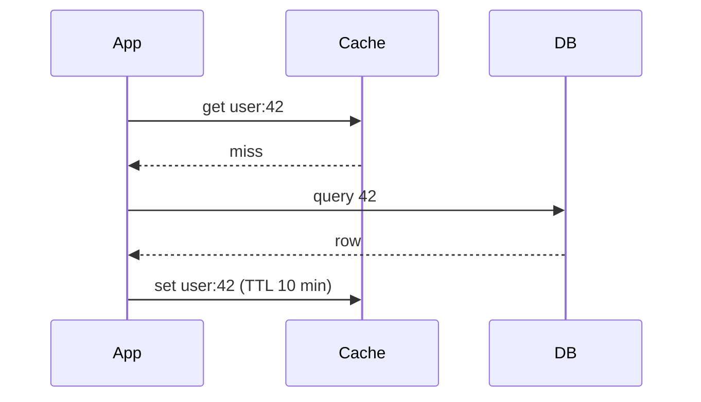
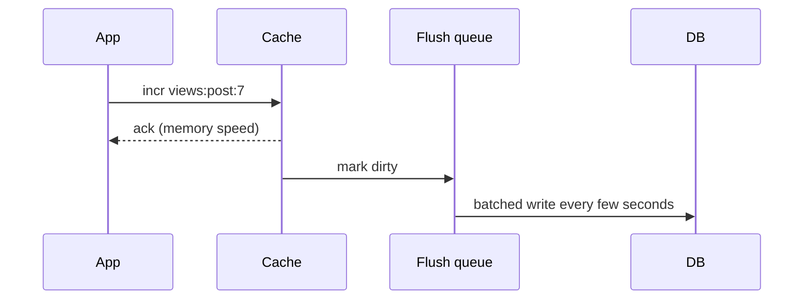
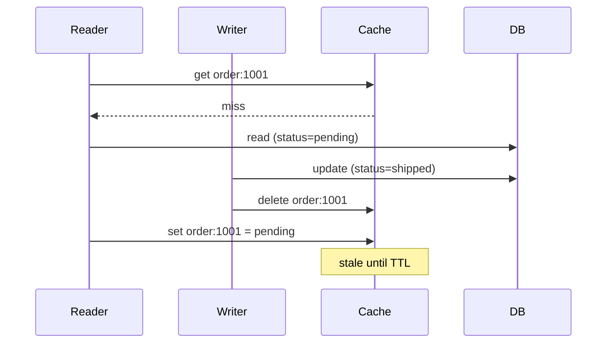
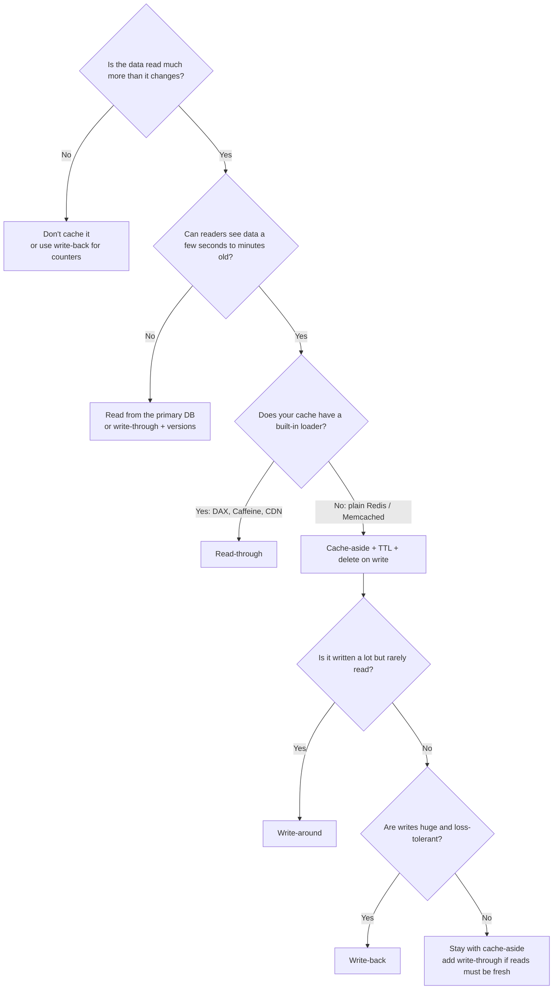

# Cache

## TL;DR
- **Cache-aside** for most apps: read the cache, on a miss read the DB and fill the cache.
  Use a TTL, and on writes **delete** the entry rather than updating it.
- **Read-through** when a library or service (DynamoDB DAX, Caffeine, a CDN) should own the loading logic.
- **Write-through** when reads must always see the latest write and slower writes are fine.
- **Write-back** when writes are heavy and you can risk losing a few seconds of data (counters, metrics).
- **Write-around** when data is written a lot but rarely read back (logs, uploads).
- **Use no cache** when the data is already fast to read, changes on every request, or must
  never be stale (account balances, inventory at checkout). Fix the query or index first.

## Why it matters
Memory is ~1000× faster than SSD (see [latency numbers](../_01_Interview_Playbook/estimation-cheat-sheet.md#latency-numbers)),
and read-heavy systems can serve most traffic without touching the database.

| Benefit | How |
|---------|-----|
| Lower latency | A hit costs a memory read plus a network hop (~0.5 ms in the same data center), not a disk-backed query |
| Less database load | At a 90% hit ratio the DB sees 10% of the reads |
| Absorbs spikes | A hot key is served from memory, not from one DB row |
| Cost | A few GB of RAM can replace several database replicas |

What you pay: **stale data**, **one more thing that can fail**, and **invalidation logic**
(famously one of the two hard problems in computer science).

## Where you can cache

| Layer | What it caches | Example | Invalidation |
|-------|----------------|---------|--------------|
| Browser | Static files, API responses | `Cache-Control`, `ETag` | Hard: you can't reach the user's browser, so version the URL (`app.3f2a.js`) |
| CDN (Content Delivery Network) | Static files and cacheable responses near users | CloudFront, Cloudflare | Purge API or TTL |
| API gateway / reverse proxy | Whole responses | Nginx, Envoy, Varnish | TTL, purge |
| Application (in-process) | Hot objects, config | Caffeine, Guava, a dict | TTL; each instance has its own copy |
| Distributed cache | Shared objects, sessions, counters | Redis, Memcached | Your code (delete, TTL) |
| Database | Pages, query plans | Buffer pool, OS page cache | Automatic |

Rule of thumb: **cache as close to the user as the data's freshness allows**. Each layer
you go closer is faster but harder to invalidate.

## Side-by-side comparison of write/read patterns

| | Cache-aside | Read-through | Write-through | Write-back (write-behind) | Write-around |
|---|---|---|---|---|---|
| Who talks to the DB | The app | The cache | The cache (on write) | The cache (later, async) | The app |
| Read path | App checks cache, falls back to DB | Cache loads from DB on a miss | Always hits after a write | Always hits after a write | App checks cache; first read after a write misses |
| Write path | App writes DB, deletes cache entry | Not defined (pair with another) | Cache and DB written together, then ack | Cache written, ack, DB written later | App writes DB only |
| Read latency | Miss costs cache + DB | Miss costs cache + DB | Low | Low | Miss on first read |
| Write latency | DB speed | n/a | Slower: two writes | Fastest: memory | DB speed |
| Staleness | Until TTL or delete | Until TTL | Low | Low (but DB lags the cache) | Until TTL or delete |
| Data loss risk | None | None | None | **Yes** if the cache dies before flushing | None |
| Complexity | Low: logic is in your code | Medium: needs a loader | Medium | High: queue, retries, ordering | Low |
| Cache fills with unread data | No | No | **Yes** | Yes | No |
| Typical use | Web apps with Redis/Memcached | DAX, Caffeine `LoadingCache`, CDN origin pull | Profiles, settings | Counters, metrics, buffer pools | Logs, bulk imports |

---

## Cache-aside

**What it is.** Also called **lazy loading**. The application owns the logic: it reads the
cache first, and on a miss reads the database and fills the cache. The cache knows nothing
about the database. Only data that is actually requested gets cached.

```
function getUser(id):
    user = cache.get("user:" + id)
    if user is null:
        user = db.query(id)
        cache.set("user:" + id, user, ttl = 10 minutes)
    return user

function updateUser(id, data):
    db.update(id, data)
    cache.delete("user:" + id)      // delete, do not update
```



**Use when**
- Read-heavy data that tolerates a little staleness: product pages, user profiles, config.
- You use a plain key-value cache (Redis, Memcached) that can't load data itself.
- A cache outage should degrade to "slower", not "down": the app can fall back to the DB.

**Don't use when**
- Every read must see the latest write → write-through, or skip the cache.
- A cold cache would crush the DB right after a restart → pre-warm it, or add request coalescing (see [stampede](#cache-failure-modes)).
- You want the loading logic in one place instead of in every caller → read-through.

**Advantages**
- Simple and the most widely used pattern; easy to reason about.
- Resilient: if the cache dies, reads still work (slowly).
- Caches only what is requested, so memory goes to hot data.

**Limitations**
- **Miss penalty:** a miss costs cache check + DB read + cache write. The first request after a restart or expiry is slow.
- **Stale data:** between a DB write and the cache delete (or until the TTL), readers can see old data.
- **Race on fill:** a slow reader can put an old value back after the writer deleted it. See [invalidation races](#invalidation-and-consistency).
- **Logic is duplicated** across services unless wrapped in a shared library.

### Why delete instead of update on a write
Two concurrent updates can write the cache in the wrong order and leave stale data. Example:
request A writes `name=Asha` to the DB, request B writes `name=Bea`, but B's cache write
lands before A's. The DB says `Bea`, the cache says `Asha` until the TTL expires. Deleting is
safer: the next read loads fresh data. (Deleting is not perfect either; see the race below.)

---

## Read-through

**What it is.** The cache sits in front of the database and **loads missing data itself**
through a loader you register. The app only ever talks to the cache. Same flow as cache-aside,
but the logic lives inside the cache layer.

```java
// Caffeine (in-process): the loader runs on a miss, and concurrent callers for the
// same key wait for one load instead of each hitting the DB
LoadingCache<Long, Order> orders = Caffeine.newBuilder()
    .maximumSize(10_000)
    .expireAfterWrite(Duration.ofMinutes(10))
    .build(id -> db.findOrder(id));

Order o = orders.get(1001L);
```

| Variant | How it works | Example |
|---------|--------------|---------|
| Library loader | A function you pass to the cache | Caffeine `LoadingCache`, Guava `CacheLoader` |
| Managed service | The cache service talks to the DB for you | DynamoDB Accelerator (DAX) in front of DynamoDB |
| Origin pull | The cache fetches from your origin on a miss | CDN pulling from your web server |

**Use when**
- Many services read the same data and you don't want each to reimplement the miss logic.
- The library or service can **coalesce** concurrent misses (one DB call per key). That alone prevents most stampedes.
- You front a managed store (DAX, CDN) that already works this way.

**Don't use when**
- You use plain Redis or Memcached, which have no loader → cache-aside.
- Each caller needs different loading rules (different fields, different fallbacks) → cache-aside.

**Advantages**
- Callers stay simple: `cache.get(key)` always returns data.
- Natural place for request coalescing and **refresh-ahead** (reload a hot entry shortly before its TTL ends, so users never see a miss).

**Limitations**
- **Cache is on the critical path:** if it fails, reads fail unless you add a fallback.
- **Tighter coupling:** the cache layer needs DB access, credentials and a data mapper.
- **Still stale** until TTL or explicit invalidation; read-through only solves loading, not writes.

---

## Write-through

**What it is.** Every write goes to the cache **and** the database in one operation, and the
write is acknowledged only when both succeed. The cache is always warm for data that was
just written.

```
function updateOrder(id, data):
    db.update(id, data)                       // source of truth first
    cache.set("order:" + id, data, ttl = 1 hour)
    return ok                                  // ack only after both
```

**Use when**
- Data is read soon after it is written, and reads must not be stale: user settings, profile edits.
- Read-heavy, write-light workloads where slower writes don't matter.
- You pair it with read-through (DAX works this way).

**Don't use when**
- Writes are heavy and most data is never read again → write-around (it fills the cache with junk).
- Write latency is critical → write-back.
- The two writes can't be made atomic and you can't tolerate a mismatch → cache-aside with delete.

**Advantages**
- Cache and DB stay consistent in the normal case; no stale window.
- Reads right after writes are always hits.

**Limitations**
- **Slower writes:** you pay for the cache and the DB.
- **Partial failure:** the DB write succeeds and the cache write fails (or the reverse). Fix: write the DB first, and on a cache failure delete the key and rely on the TTL.
- **Cache pollution:** data that is written but never read still takes memory. Use a TTL.
- **Concurrent writers** can still apply cache writes out of order; use a version number (see [invalidation](#invalidation-and-consistency)).

---

## Write-back (write-behind)

**What it is.** Writes go to the cache only; the cache acknowledges immediately and
**flushes to the database later** in the background, often batched. Writes are as fast as
memory, and many updates to the same key can be merged into one DB write.



**Use when**
- Very write-heavy and loss-tolerant data: view counters, likes, metrics, last-seen timestamps.
- Bursts must be smoothed: the DB sees a steady batch instead of a spike.
- You already rely on it without noticing: the **database buffer pool**, the OS page cache and CPU caches are all write-back.

**Don't use when**
- Losing data is unacceptable: payments, orders, inventory → write-through or write to the DB first.
- You need other systems to read the DB right away (reports, other services) → they will see old data.

**Advantages**
- Fastest writes and best write throughput.
- Coalesces repeated writes to the same key; fewer DB writes.
- Hides short DB outages (writes queue up).

**Limitations**
- **Data loss:** if the cache node dies before flushing, unflushed writes are gone. Mitigate with replication, a persistent log (Redis AOF, a Kafka topic) or a short flush interval.
- **DB is stale:** anything reading the DB directly sees old data.
- **Ordering and retries:** flushes can fail or reorder; the flusher must be idempotent (see [idempotency](idempotency-and-delivery-guarantees.md)).
- **Most complex pattern:** needs a dirty-tracking structure, a flusher, backpressure and monitoring.

---

## Write-around

**What it is.** Writes go **straight to the database and skip the cache**. The cache is filled
only when someone reads the data (usually via cache-aside). Often combined with a delete of any
existing entry, so the old value doesn't linger.

**Use when**
- Data is written often but read rarely or much later: logs, audit trails, bulk imports, uploaded files.
- You don't want one-off writes to evict hot data (cache pollution).

**Don't use when**
- Data is read right after it is written (the first read always misses) → write-through.

**Advantages**
- Cache memory holds only data that is actually read.
- Simple: the write path is just a DB write.

**Limitations**
- **First read is slow:** a guaranteed miss after each write.
- **Stale entry:** if you forget to delete the old cached value, readers see old data until the TTL.

---

## Eviction policies (what to remove when the cache is full)

Memory is finite. When a cache hits its size limit it must drop something. **TTL (Time To
Live)** removes entries by age; an **eviction policy** removes entries by usefulness.

| Policy | Evicts | Good for | Weakness |
|--------|--------|----------|----------|
| **LRU** (Least Recently Used) | The item not used for the longest time | General purpose; recent use predicts reuse | One big scan (a report reading everything once) flushes the hot set |
| **LFU** (Least Frequently Used) | The item used the fewest times | Stable hot set (popular products, top pages) | Old popular items linger; new items start with a low count |
| **FIFO** (First In First Out) | The oldest inserted | Simple buffers, streaming | Ignores usage: can evict a hot item |
| **Random** | A random item | Very cheap; surprisingly close to LRU | No intelligence |
| **TTL-based** | The item closest to expiry | Data with a natural lifetime | Needs TTLs on everything |

**Real systems**
- **Redis** `maxmemory-policy`: `noeviction` (the default; writes fail when full), `allkeys-lru`,
  `allkeys-lfu`, `allkeys-random`, and `volatile-*` variants that only evict keys that have a TTL
  (`volatile-ttl` evicts the soonest to expire). Redis LRU and LFU are **approximate**
  (it samples a few keys), which saves memory.
- **Memcached** uses an LRU variant per slab class.
- **Caffeine** uses W-TinyLFU, which combines frequency and recency to resist scans.

**Pick:** `allkeys-lru` for a pure cache; `volatile-lru` when the same Redis also holds data
without a TTL that must never be evicted (but better: use separate instances).

### TTL guidelines

| Data | Typical TTL | Why |
|------|-------------|-----|
| Static reference data (countries, categories) | Hours to days | Rarely changes |
| User profile, product details | Minutes | Staleness is tolerable; delete on write too |
| Search results, feed pages | Seconds to a minute | Changes constantly, and exact freshness is not needed |
| Negative results ("not found") | 30–60 s | Don't hide a newly created record for long |
| Sessions, tokens | The session lifetime | Business rule |

Always **add random jitter** (for example ±10%) so keys created together don't expire together.

---

## Invalidation and consistency

You have three levers; most systems combine them.

| Strategy | How | Staleness | Use when |
|----------|-----|-----------|----------|
| **TTL only** | Entries expire on their own | Up to the TTL | Staleness is fine; the safety net for every other strategy |
| **Delete on write** | App deletes the key after the DB write | Short window | Default for cache-aside |
| **Event-driven** | A change event (CDC: Change Data Capture, e.g. Debezium reading the DB log; or a queue message) triggers deletes | Small, async | Many writers or services; the writer doesn't know all the cache keys |
| **Versioned keys** | Put a version in the key (`order:1001:v7`) so new data is a new key | None for readers who know the version | Immutable content, CDN assets, config |

### The race that delete does not fix
Even "delete on write" can leave stale data:



Fixes, from cheapest to strongest:
1. **Short TTL** bounds the damage (always do this).
2. **Delayed double delete:** delete again a second or so after the write, so a late fill is removed. Cheap, not airtight.
3. **Version check:** store a version with the value and only accept a newer one. The Lua script below is atomic in Redis.
4. **Leases:** the cache hands the reader a token on a miss, and rejects the fill if the key was deleted in between. Facebook's Memcache deployment used this (see the "Scaling Memcache at Facebook" paper).

```lua
-- KEYS[1] = cache key, ARGV[1] = version, ARGV[2] = value. Returns 1 if stored, 0 if stale.
local cur = redis.call('GET', KEYS[1] .. ':v')
if (not cur) or tonumber(cur) < tonumber(ARGV[1]) then
  redis.call('SET', KEYS[1],           ARGV[2], 'EX', 600)
  redis.call('SET', KEYS[1] .. ':v',   ARGV[1], 'EX', 600)
  return 1
end
return 0
```

A write with version 7 is stored; a late write with version 6 returns `0` and is ignored.
Use a DB row version or `updated_at` as the version.

If you need **strong consistency** (balances, inventory at checkout), don't cache that read
path; read from the primary DB. See [consistency models](cap-and-consistency.md).

---

## Cache failure modes

| Problem | What happens | Fixes |
|---------|--------------|-------|
| **Stampede** (thundering herd, dogpile) | A hot key expires and thousands of requests hit the DB at once | Lock so one request rebuilds; request coalescing; TTL jitter; refresh before expiry |
| **Penetration** | Requests for keys that don't exist always miss and hit the DB | Cache "not found" with a short TTL; Bloom filter; validate input |
| **Avalanche** | Many keys expire together, or the cache goes down, and the DB takes everything | TTL jitter; replicas and failover for the cache; rate limit or shed load to the DB; pre-warm after restarts |
| **Hot key** | One key gets more traffic than a single cache node can serve | Local in-process copy with a short TTL; replicate the key under several names (`key#1..#N`) |
| **Big key** | A huge value blocks the cache and the network | Split it, compress it, or don't cache it |
| **Cold start** | A new or restarted cache is empty, so every read misses | Pre-warm from the DB or a snapshot (Redis persistence); ramp traffic up |

**Stampede arithmetic:** a key served at 100,000 QPS (queries per second) expires; rebuilding it
takes 50 ms. Without protection, 100,000 × 0.05 = **5,000 requests** run the same DB query. With a lock,
exactly **one** does.

**Stampede fix: a lock with `SET NX`** (tested on Redis 7.4)

```bash
SET lock:order:1001 <random-token> NX PX 5000     # OK for the winner, (nil) for everyone else
# ... winner loads the DB, writes the cache ...
# release only if the lock is still yours (compare token, then delete, atomically):
EVAL "if redis.call('GET',KEYS[1])==ARGV[1] then return redis.call('DEL',KEYS[1]) else return 0 end" 1 lock:order:1001 <random-token>
```

- `NX` sets the key only if it doesn't exist; `PX 5000` makes the lock expire in 5 s, so a crashed winner can't block forever.
- Losers wait a few milliseconds and re-read the cache, or **serve the stale value** while one request refreshes.
- Releasing with a plain `DEL` can delete another request's lock after yours expired; the token check prevents that.

**Penetration fix: negative caching**

```bash
SET order:999999 __NULL__ EX 60      # "this order does not exist", short TTL
```

Use a **Bloom filter** (a compact structure that says "definitely not present" or "maybe
present") when attackers can generate endless fake keys.

**Jitter**

```
ttl = 600 + random(0, 60)      # 10 to 11 minutes, so keys don't expire in lockstep
```

---

## Local (in-process) vs distributed cache

| | In-process (Caffeine, Guava) | Distributed (Redis, Memcached) |
|---|---|---|
| Latency | ~100 ns (a memory read) | ~0.5 ms (a network round trip) |
| Capacity | Limited by one app's heap | Many GB to TB across nodes |
| Consistency | Each instance has its own copy: they disagree | One shared copy |
| Survives app restart | No | Yes (the cache keeps running) |
| Extra failure point | None | Yes |
| Invalidation | Short TTL, or broadcast (Redis pub/sub, client-side caching in Redis 6+) | Delete once |
| Use for | Hot, small, rarely changing data (config, feature flags, hot keys) | The main shared cache |

**Two levels (L1 + L2):** a small in-process cache in front of Redis gives nanosecond hits for the
hottest keys. Keep the L1 TTL very short (seconds).

| | Redis | Memcached |
|---|---|---|
| Data types | Strings, hashes, lists, sets, sorted sets, streams | Strings (blobs) only |
| Persistence | Optional (RDB snapshots, AOF log) | None |
| Replication / failover | Built in (replicas, Sentinel, Cluster) | Client-side sharding, no replication |
| Threading | Mostly single-threaded command execution (I/O threads since 6.0) | Multi-threaded |
| Extra features | Lua scripts, pub/sub, TTL per key, atomic counters | Simple and very fast for plain caching |

**Pick Redis** by default; **Memcached** when you only need a simple, large, multi-threaded
blob cache. To spread keys over many cache nodes, use [consistent hashing](consistent-hashing.md)
so adding a node doesn't invalidate most of the cache.

---

## Sizing and hit ratio

**Hit ratio** = hits ÷ (hits + misses). It is the number that decides whether a cache is worth it.

```
average latency = hit ratio × cache time + miss ratio × (cache time + DB time)
```

Worked example (assume 0.5 ms for a cache round trip and 10 ms for the DB query):

| Hit ratio | Average latency | DB load at 50,000 reads/s |
|-----------|-----------------|---------------------------|
| 0% (no cache benefit) | 0.5 + 10 = 10.5 ms | 50,000 QPS |
| 90% | 0.5 + 0.1 × 10 = 1.5 ms | 5,000 QPS |
| 99% | 0.5 + 0.01 × 10 = 0.6 ms | 500 QPS |

Going from 90% to 99% cuts DB load **10×**, so small hit-ratio gains matter a lot at scale.

**How much memory?** Cache the hot set, not everything. Assume 10 M orders at 1 KB each = 10 GB
total. With the 80/20 rule (80% of reads hit 20% of the data), cache ~20% = **2 GB**, then add
headroom for per-key overhead (measure with `MEMORY USAGE <key>` rather than guessing).

**Monitor:** hit ratio (`keyspace_hits` and `keyspace_misses` in `INFO stats`), evictions, memory use,
latency (p99), and DB QPS. A falling hit ratio after a deploy usually means a key format change
or a TTL that is too short.

---

## Worked example: caching an order lookup

Request → code → cache → response, using the same `orders` table as the rest of these notes.

```sql
CREATE TABLE orders (
  id         BIGINT PRIMARY KEY,
  user_id    BIGINT NOT NULL,
  status     TEXT   NOT NULL,         -- pending, shipped, delivered
  total      NUMERIC(10,2) NOT NULL,
  version    INT    NOT NULL DEFAULT 1,
  updated_at TIMESTAMP NOT NULL DEFAULT now()
);
```

**Read: `GET /orders/1001` (cache-aside with stampede lock, negative cache and jitter)**

```python
def get_order(order_id):
    key = f"order:{order_id}"
    cached = redis.get(key)
    if cached == NULL_MARKER:                       # penetration protection
        return None
    if cached:                                      # hit
        return json.loads(cached)

    token = uuid4().hex
    if redis.set(f"lock:{key}", token, nx=True, px=5000):   # only one rebuilds
        try:
            row = db.query("SELECT * FROM orders WHERE id = %s", order_id)
            ttl = 600 + random.randint(0, 60)               # jitter
            if row is None:
                redis.set(key, NULL_MARKER, ex=60)          # negative cache
            else:
                redis.set(key, json.dumps(row), ex=ttl)
            return row
        finally:
            release_lock(f"lock:{key}", token)              # Lua compare-and-delete
    sleep(0.02)                                             # others wait briefly, then re-read
    return get_order(order_id)                              # (cap the retries in real code)
```

**Write: `PATCH /orders/1001`**

```python
def update_order(order_id, changes):
    db.execute("UPDATE orders SET status = %s, version = version + 1, updated_at = now() "
               "WHERE id = %s", changes["status"], order_id)
    redis.delete(f"order:{order_id}")               # delete, don't update
    schedule(redis.delete, f"order:{order_id}", delay=1)   # optional delayed double delete
```

**Try it** against the [Redis lab](../_03_Building_Blocks/_01_Docker_Databases/redis/):

```bash
docker exec -it sd101-redis sh -c 'redis-cli -a "$REDIS_PASSWORD" --no-auth-warning'
```
```
SET order:1001 '{"id":1001,"status":"pending","total":42.50}' EX 600
TTL order:1001
GET order:1001
DEL order:1001                           # what the write path does
GET order:1001                           # (nil): next read rebuilds from the DB
CONFIG SET maxmemory 100mb
CONFIG SET maxmemory-policy allkeys-lru  # evict least-recently-used keys when full
INFO stats                               # keyspace_hits / keyspace_misses = hit ratio
```

---

## Quick decision points



| If you need… | Choose |
|--------------|--------|
| The safe default for a web app | Cache-aside + TTL + delete on write |
| Loading logic in one place, concurrent misses merged | Read-through |
| Fresh reads right after writes | Write-through (with a version check) |
| Fastest writes, can lose seconds of data | Write-back |
| Cache only what is read; heavy one-time writes | Write-around |
| Cache static files near users | CDN, versioned file names |
| Hot key overloading one node | Local cache + key replication |
| Protection from missing-key floods | Negative caching or a Bloom filter |

**Common combinations in interview designs**
- **Cache-aside + TTL + jitter + lock:** the standard answer for [URL shortener](../_04_Case_Studies/url-shortener.md) redirects (heavy reads, immutable data).
- **Cache-aside for hot items + precomputed lists:** [news feed](../_04_Case_Studies/news-feed.md) timelines.
- **Write-back counters flushed to the DB:** view counts, likes.
- **CDN (read-through origin pull) + browser caching:** [video streaming](../_04_Case_Studies/video-streaming.md) segments.
- **Redis as shared state, not a cache:** counters for [rate limiting](rate-limiting.md); eviction must be off for those keys.
- **Cache nodes sharded with consistent hashing:** [distributed key-value store](../_04_Case_Studies/distributed-key-value-store.md).

---

## Interview questions

**Q: Why delete the cache entry on update instead of updating it?**
Two concurrent updates can write the cache in the wrong order and leave stale data.
Deleting is safer; the next read loads fresh data. A stale fill can still race with the
delete, so add a TTL, and a version check or a delayed second delete if it matters.

**Q: What is a cache stampede (thundering herd) and how do you prevent it?**
A hot key expires and thousands of requests hit the DB at once. Fixes: a lock so only one
request rebuilds the entry, random jitter on the TTL, or refreshing the key early in the
background.

**Q: What is cache penetration?**
Repeated requests for keys that don't exist, so they always hit the DB. Fixes: cache the
"not found" result with a short TTL, or use a Bloom filter (a compact structure that
quickly says "definitely not present").

**Q: What is a cache avalanche, and how is it different from a stampede?**
A stampede is **one** hot key expiring. An avalanche is **many** keys expiring together (same TTL) or the
whole cache failing, so the DB takes all the traffic. Fix with TTL jitter, cache replicas, load
shedding and pre-warming.

**Q: Cache-aside vs read-through?**
Same flow, different owner. Cache-aside puts the load logic in your app and works with any
cache; read-through puts it in the cache layer, so callers are simpler and concurrent misses
can be merged, but you need a cache that supports loaders.

**Q: Write-through vs write-back?**
Write-through writes the cache and DB together: consistent, but slower writes. Write-back
acknowledges after the cache write and flushes later: fastest, but unflushed data is lost if
the cache dies. Choose write-back only for loss-tolerant data such as counters.

**Q: LRU vs LFU?**
LRU evicts what hasn't been used for the longest time: good default, but a one-time scan can
flush the hot set. LFU evicts the least-used: better for a stable popular set, but old favorites
linger. Redis offers both (`allkeys-lru`, `allkeys-lfu`).

**Q: Local cache vs Redis?**
Local is ~1000× faster (memory vs a network hop) but each instance has its own copy and
can't be invalidated centrally. Redis is shared and consistent but adds a hop and a failure
point. Use both: a tiny short-TTL local cache in front of Redis for hot keys.

**Q: How do you keep the cache consistent with the DB?**
You can't make it perfectly consistent cheaply. Pick the weakest guarantee the product
tolerates: TTL for bounded staleness, delete on write for freshness, events (CDC) when many
services write, versions to reject out-of-order fills. For data that must never be stale, skip the cache.

**Q: Where can you cache?**
Browser → CDN → API gateway → application (local memory) → distributed cache (Redis) →
database buffer cache.

**Q: How would you know a cache is working?**
Track hit ratio, p99 latency, evictions and DB QPS. A 90% hit ratio at 50,000 reads/s means
the DB sees 5,000 QPS; if the hit ratio drops, DB load rises 1:1 with the extra misses.

---

## Related
- [Distributed key-value store](../_04_Case_Studies/distributed-key-value-store.md)
- [Consistent hashing](consistent-hashing.md): spreading keys over many cache nodes
- [Rate limiting](rate-limiting.md): Redis counters and Lua scripts
- [Reliability](reliability.md): timeouts, retries with jitter, idempotency
- [Consistency models](cap-and-consistency.md): how stale is acceptable
- [Message queues](message-queues.md): event-driven invalidation and write-back flushing
- [Databases](databases.md) and [sharding](sharding.md)
- [Estimation cheat sheet](../_01_Interview_Playbook/estimation-cheat-sheet.md): latency numbers
- [Redis lab](../_03_Building_Blocks/_01_Docker_Databases/redis/): run the examples locally
