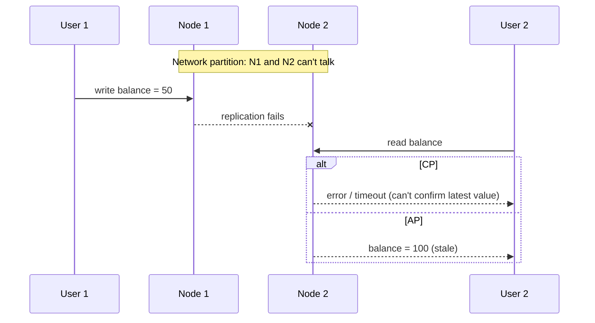
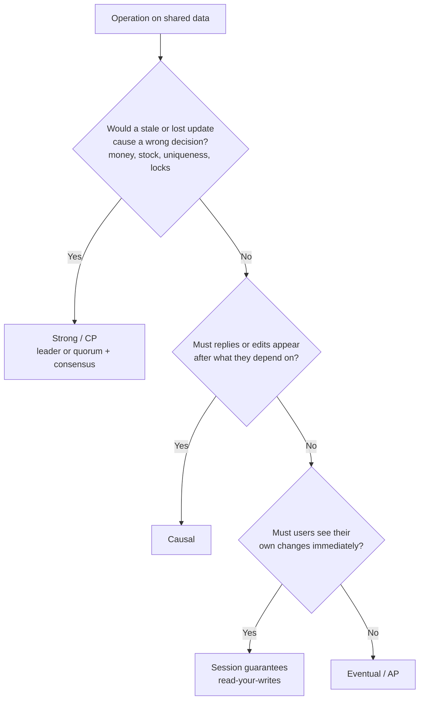

# CAP Theorem, PACELC and Consistency Models

## TL;DR
- **CP** (consistency over availability) for money, inventory, locks and leader election:
  during a network partition, refuse requests rather than return wrong data.
- **AP** (availability over consistency) for feeds, likes, carts and caches: during a
  partition, keep answering and reconcile later.
- **PACELC:** even with no partition, you trade **latency** for **consistency** on every
  request. That's the choice you make every day.
- **Consistency models**, from strongest to weakest: **strong (linearizable)** when anything stale
  is a bug; **causal** or **session** (read-your-writes) for most user-facing apps;
  **eventual** for counters, analytics and caches.
- **Choose per operation, not per system.** One app can use strong consistency for payments
  and eventual consistency for its activity feed.

## The landscape

| Idea | Question it answers | When it applies |
|------|---------------------|-----------------|
| CAP theorem | During a network partition, do we stay consistent or stay available? | Only while nodes can't talk to each other |
| PACELC | When there's no partition, do we favor low latency or consistency? | Every request, all the time |
| Consistency models | Exactly which "stale" results can a reader see? | Every read |
| Tunable consistency | How do we pick the level per request in a real database? | Configuration and code |

> **Three different "C"s.** CAP's C means **linearizability** (every read sees the latest write).
> ACID's C means **integrity rules hold** (constraints, foreign keys). "Eventually consistent"
> describes **replicas converging**. Don't mix them up in an interview.

## Side-by-side comparison

| | CP | AP |
|---|---|---|
| During a partition | Some requests fail or time out | All nodes keep answering |
| Data returned | Always the latest, or an error | May be stale; conflicting writes possible |
| Writes on the minority side | Rejected | Accepted, merged later |
| Typical consistency model | Linearizable | Eventual, causal or session |
| Conflict handling | Not needed: one leader / majority decides | Needed: last-write-wins, version vectors, CRDTs |
| Latency (PACELC "E" side) | Usually higher: needs a majority or the leader | Usually lower: any nearby replica answers |
| Examples | ZooKeeper, etcd, Consul, HBase, Google Spanner, MongoDB (majority reads/writes) | Cassandra, DynamoDB (default reads), Riak, CouchDB, DNS |
| Good for | Payments, inventory, bookings, locks, config | Social feeds, likes, shopping carts, sessions, metrics |

Real databases are often **tunable**, so these labels describe their default or typical
configuration, not a fixed property.

---

## CAP theorem

**What it is.** Proposed by Eric Brewer (2000) and proved by Gilbert and Lynch (2002). A
distributed data store can't guarantee all three of these at once:
- **C**onsistency: every read returns the most recent write, or an error (linearizability).
- **A**vailability: every request to a working node gets a non-error response.
- **P**artition tolerance: the system keeps working even when messages between nodes are lost.

Networks *will* partition (a switch fails, a cloud zone loses its link), so P isn't optional.
**The real choice is C or A, and only while the partition lasts.**



**Common misconceptions**
- **"Pick 2 of 3":** you can't drop P in a distributed system. "CA" only describes a single node,
  or a system that simply stops when the network fails.
- **"A system is either CP or AP":** the choice is often per operation, and many databases
  let you tune it per request.
- **"AP means no consistency":** AP systems still converge; they just don't promise the latest
  value during a partition.
- **CAP availability is strict:** *every* working node must answer. A CP system can still be
  highly available in practice (Spanner is CP but runs with very high availability).

### CP: consistency over availability

**What it is.** During a partition, only the side that can reach the leader or a **majority** of
nodes keeps serving. The minority side rejects or times out requests instead of risking wrong
data. Usually built on consensus (Raft, Paxos) or a single leader with synchronous replication.

**Use when**
- Being wrong costs real money or safety: account balances, payments, double-booking a seat.
- Inventory where overselling is unacceptable.
- Coordination: distributed locks, leader election, service config (etcd, ZooKeeper, Consul).
- Unique constraints: usernames, order numbers.

**Don't use when**
- The data tolerates being a little stale (likes, view counts, feeds) → AP is cheaper and faster.
- Users must be able to write while offline or across regions with no coordination → AP.
- Every request needs single-digit-ms latency across continents → AP with local replicas.

**Advantages**
- No stale reads, no conflicting writes, no merge logic.
- Simple to reason about: it behaves like one machine.
- Required for correctness in money and coordination use cases.

**Limitations**
- **Unavailable during partitions:** clients on the minority side get errors. Plan retries
  and clear error messages.
- **Higher latency:** writes wait for a majority or leader; cross-region majorities add round-trip
  time (see [latency numbers](../_01_Interview_Playbook/estimation-cheat-sheet.md#latency-numbers)).
- **Throughput limits:** a single leader or a consensus group becomes a bottleneck; you usually
  need [sharding](sharding.md) to scale.

### AP: availability over consistency

**What it is.** Every node keeps accepting reads and writes during a partition. Replicas
exchange updates later and **converge** (eventual consistency). Concurrent writes to the same
key must be resolved, by last-write-wins (LWW) timestamps, version vectors, or CRDTs
(Conflict-free Replicated Data Types).

**Use when**
- Being down costs more than being slightly stale: social feeds, likes, product catalogs.
- Writes must always succeed: shopping carts (Amazon's Dynamo paper merges cart versions), session data.
- Multi-region or offline-first apps where coordinating every write is too slow.
- Metrics, logs and caches.

**Don't use when**
- Stale or lost updates break correctness: balances, stock decrements, unique IDs → CP.
- You can't design a conflict-resolution rule for concurrent writes → CP.

**Advantages**
- Always accepts reads and writes, even during failures.
- Low latency: the nearest replica answers.
- Scales out easily across nodes and regions.

**Limitations**
- **Stale reads:** users may see old data, or their own write may seem to disappear. Add session
  guarantees (see [read-your-writes](#session-guarantees-read-your-writes-monotonic-reads)).
- **Conflicting writes:** with last-write-wins, one of two concurrent updates is silently lost.
  Use version vectors or CRDTs when every update matters.
- **Harder to reason about and test:** anomalies only appear under failures and concurrency.

---

## PACELC

**What it is.** Daniel Abadi's extension of CAP (2010): if there's a **P**artition, choose
**A**vailability or **C**onsistency; **E**lse, choose **L**atency or **C**onsistency. CAP only
covers failures; PACELC covers the normal case, where strong consistency still costs latency
because replicas must coordinate before answering.

| Class | During a partition | Normal operation | Typical examples |
|-------|--------------------|------------------|------------------|
| PA/EL | Available | Low latency | Cassandra, DynamoDB, Riak (default settings) |
| PC/EC | Consistent | Consistent | Google Spanner, HBase, etcd, ZooKeeper |
| PA/EC | Available | Consistent | MongoDB in Abadi's original classification (depends on settings) |
| PC/EL | Consistent | Low latency | Yahoo PNUTS (rare) |

**Use it when** explaining why a design is slow even when nothing is broken, or when choosing
between a nearby-replica read (fast, maybe stale) and a leader or quorum read (slower, fresh).

**Limitations:** classifications depend on configuration. Cassandra at `ALL` behaves more like
EC, and DynamoDB's strongly consistent reads are EC. Say "by default" when you use these labels.

---

## Consistency models

A consistency model is a contract: **which results is a reader allowed to see?** Stronger
models allow fewer surprises but need more coordination, so they cost latency and availability.

| Model | Guarantee | Prevents | Cost | Example systems |
|-------|-----------|----------|------|-----------------|
| Strong (linearizable) | Every read sees the latest completed write, in real-time order | All stale reads | Highest: leader or quorum per operation | etcd, Spanner, single-leader DB reading the leader |
| Bounded staleness | Reads lag by at most K versions or T seconds | Unbounded staleness | High | Azure Cosmos DB |
| Causal | Effects are seen after their causes (a reply after the message) | Out-of-order cause and effect | Medium | MongoDB causal sessions, COPS |
| Session guarantees | Within one client session: read-your-writes, monotonic reads/writes | "My update vanished", time going backwards | Low to medium | Cosmos DB "session" (its default), sticky sessions |
| Consistent prefix | Reads see writes in order, possibly behind | Seeing later writes without earlier ones | Low | Cosmos DB, log-based replication |
| Eventual | If writes stop, all replicas converge | Permanent divergence only | Lowest | DNS, Cassandra at `ONE`, DynamoDB default reads |

### Strong consistency (linearizability)

**What it is.** The system behaves as if there were **one copy** of the data, and every
operation takes effect at a single instant between its start and finish. Once a write completes,
every later read, from any client, sees it.

Not the same as **serializability**, a database-transaction guarantee that the result equals
*some* serial order of transactions. "Strict serializability" combines both (Spanner provides it).

**Use when**
- Balances, inventory counts, seat bookings, unique usernames.
- Locks, leader election, configuration that every node must agree on.

**Don't use when**
- Global users need fast reads everywhere and slight staleness is fine → causal, session or eventual.
- The workload is write-heavy at huge scale with no strict invariants → eventual.

**Advantages**
- Easiest model to program against: no anomalies.
- Required for invariants like "balance never negative".

**Limitations**
- **Latency:** every operation coordinates with a leader or majority; cross-region adds 100+ ms.
- **Availability:** unavailable on the minority side of a partition (CP).
- **Scale:** harder to scale writes; often needs sharding with consensus per shard.

### Causal consistency

**What it is.** If operation B depends on A (B read A's result, or the same client did A then
B), everyone sees A before B. Unrelated (concurrent) operations may appear in different orders
on different replicas.

**Use when**
- Comments and replies, chat messages: a reply must never appear before the message it answers.
- Collaborative apps where users react to each other's changes.

**Don't use when**
- You need a single global order or invariants across unrelated keys → strong.
- Order doesn't matter at all (counters) → eventual is cheaper.

**Advantages**
- The strongest model that can stay available during partitions.
- Matches how users perceive cause and effect.

**Limitations**
- **Tracking dependencies costs metadata** (version vectors, causal tokens) on every operation.
- Concurrent writes to the same item still need conflict resolution.
- Fewer databases support it natively.

### Session guarantees (read-your-writes, monotonic reads)

**What it is.** Guarantees that hold **within one client's session**, not globally:

| Guarantee | Meaning | Anomaly it prevents |
|-----------|---------|---------------------|
| Read-your-writes | You always see your own updates | You edit your profile, refresh, and see the old version |
| Monotonic reads | You never see older data after newer data | A comment appears, then disappears on refresh |
| Monotonic writes | Your writes apply in the order you made them | Your "delete" is applied before your "create" |
| Writes-follow-reads | A write based on something you read is ordered after it | A reply is stored before the post it replies to |

**Use when**
- Most user-facing apps on read replicas: users mainly care about seeing *their own* actions.
- Profiles, settings, shopping carts, posting content.

**Don't use when**
- Other users must see a change immediately (bidding, stock levels) → strong.

**Advantages**
- Removes the most visible anomalies at low cost.
- Works with fast, nearby replicas for everyone else's data.

**Limitations**
- **Only per session:** another user, or the same user on another device, may still see stale data.
- Needs routing or tokens: sticky sessions, reading from the leader after a write, or passing a
  version/LSN (Log Sequence Number) and reading only from replicas that have caught up.

### Eventual consistency

**What it is.** If no new writes happen, all replicas **eventually** return the same value. There's
no promise about how long that takes or what readers see in the meantime.

**Use when**
- View counts, likes, analytics, recommendations.
- DNS, CDN and cache contents.
- Huge write volume where availability and latency matter most.

**Don't use when**
- Any read of stale data causes a wrong decision (overselling, double spending) → strong.
- Users will notice their own changes vanishing → add session guarantees.

**Advantages**
- Lowest latency and highest availability.
- Scales writes across many nodes and regions.

**Limitations**
- **Stale and out-of-order reads** with no time bound.
- **Conflicts:** concurrent writes need resolution; last-write-wins can silently lose updates
  and depends on clock accuracy.
- Application code must tolerate anomalies, which makes it harder to reason about and test.

---

## Tuning consistency in practice

Most databases let you choose per request. The core tool is the **quorum**: with **N** replicas,
a write waits for **W** acknowledgements and a read asks **R** replicas. If **W + R > N**, every
read overlaps at least one replica that has the latest write (see [replication](replication.md)).

| N | W | R | Result |
|---|---|---|--------|
| 3 | 2 | 2 | Overlapping quorums: reads see the latest acknowledged write; tolerates 1 node down |
| 3 | 3 | 1 | Fast reads, but any node down blocks writes |
| 3 | 1 | 1 | Fastest and most available; eventual consistency only |

Quorums aren't automatically linearizable: sloppy quorums, hinted handoff and concurrent
writes with last-write-wins can still produce anomalies. For true linearizability use consensus,
e.g. Cassandra lightweight transactions (Paxos) or etcd.

| Database | Stronger setting | Weaker / faster setting |
|----------|------------------|-------------------------|
| Cassandra | `QUORUM` / `LOCAL_QUORUM`, or `SERIAL` for lightweight transactions | `ONE`, `LOCAL_ONE` |
| DynamoDB | `ConsistentRead=true` (single region) | Default eventually consistent reads (half the read cost) |
| MongoDB | `writeConcern: majority` + `readConcern: majority` or `linearizable` | `w: 1`, reading from secondaries |
| PostgreSQL / MySQL | Read from the primary; synchronous replication | Read from async replicas |
| Azure Cosmos DB | Strong, bounded staleness | Session (default), consistent prefix, eventual |

**Worked example: Cassandra, per query**

```sql
-- Profile update: make sure the next read sees it
CONSISTENCY QUORUM;
UPDATE users SET display_name = 'Ada' WHERE user_id = 42;
SELECT display_name FROM users WHERE user_id = 42;   -- QUORUM read overlaps the QUORUM write

-- View counter: speed matters more than precision
CONSISTENCY ONE;
UPDATE page_views SET views = views + 1 WHERE page_id = 7;

-- Claiming a unique name needs consensus, not just a quorum
INSERT INTO usernames (name, user_id) VALUES ('ada', 42) IF NOT EXISTS;   -- lightweight transaction (Paxos)
```

You can run these statements in the [Cassandra Docker setup](../_03_Building_Blocks/_01_Docker_Databases/cassandra/README.md).
It's a single node, so consistency levels above `ONE` behave the same there. It shows the syntax,
not replication.

---

## Quick decision points



| If you're designing… | Choose | Why |
|----------------------|--------|-----|
| Account balances, payments, ledgers | Strong (CP) | Stale reads cause double spending |
| Inventory decrement, seat booking | Strong for the decrement; eventual for display | Never oversell; browsing can lag |
| Usernames, idempotency keys | Strong (conditional write / unique constraint) | Uniqueness needs a single source of truth |
| Leader election, locks, config | Strong (etcd, ZooKeeper) | Every node must agree |
| Chat and comments | Causal, or per-conversation ordering | Replies must follow messages |
| User profile and settings | Session (read-your-writes) | Users mainly notice their own changes |
| Social feed, likes, view counts | Eventual (AP) | Speed and uptime beat exactness |
| Shopping cart | AP with merge on conflict | Adding to the cart must always work |
| Caches, DNS, CDN | Eventual with TTL | Freshness is bounded by expiry |

**Common combinations in interviews**
- **[Payment system](../_04_Case_Studies/payment-system.md):** strong consistency for the ledger,
  eventual for analytics and notifications.
- **[News feed](../_04_Case_Studies/news-feed.md):** eventual for fan-out and like counts;
  read-your-writes so the author sees their own post at once.
- **[Chat application](../_04_Case_Studies/chat-application.md):** per-conversation ordering
  (causal) with an AP store like Cassandra.
- **E-commerce:** strong for checkout and stock decrement; eventual for catalog, reviews and recommendations.

## Interview questions
**Q: Explain CAP with an example.**
Two DB nodes lose connection. A user writes to node 1; another user reads from node 2.
CP: node 2 refuses the read. AP: node 2 returns old data. For a payment system I choose CP;
for a "likes" counter I choose AP.

**Q: Why isn't "CA" a real option?**
In a distributed system, partitions will happen; you don't get to opt out of P. CA only describes
a single-node system, or one that stops working when the network fails. The real choice is C or A
during a partition.

**Q: What does PACELC add to CAP?**
CAP only describes behavior during a partition. PACELC adds that in normal operation you still
trade latency for consistency, which is the trade-off you feel on every request.

**Q: Is Cassandra AP or CP?**
AP by default (PA/EL), but it's tunable: `QUORUM` reads and writes give overlapping quorums, and
lightweight transactions (Paxos) give linearizable operations for specific writes, at a latency cost.

**Q: What's the difference between CAP consistency and ACID consistency?**
CAP's C is linearizability: every read sees the latest write. ACID's C means a transaction moves
the database from one valid state to another, keeping constraints true. They're unrelated.

**Q: Does W + R > N guarantee strong consistency?**
It guarantees read and write quorums overlap, so a read reaches at least one replica with the
latest acknowledged write. It isn't fully linearizable: sloppy quorums, concurrent writes with
last-write-wins and failed partial writes can still cause anomalies. Use consensus when you need
strict guarantees.

**Q: How do you give "read-your-writes" with read replicas?**
Route a user's reads to the leader for a few seconds after they write, or track the write's
version (LSN) and only read from replicas that have caught up. See also
[replication](replication.md#interview-questions).

**Q: How would you prevent overselling in an AP-style system?**
Keep the stock decrement on a strongly consistent path: a conditional write
(`UPDATE ... SET stock = stock - 1 WHERE stock > 0`), a lightweight transaction, or a single
owner per item. Serve stock *display* from eventually consistent replicas or caches.

## Related
- [Replication](replication.md): quorums, leader-follower, replication lag
- [Sharding](sharding.md): scaling CP systems
- [Distributed transactions](distributed-transactions.md): consistency across services
- [Databases](databases.md): ACID vs BASE, SQL vs NoSQL
- [Trade-offs](../_01_Interview_Playbook/trade-offs.md)
- [Cassandra Docker setup](../_03_Building_Blocks/_01_Docker_Databases/cassandra/README.md)
