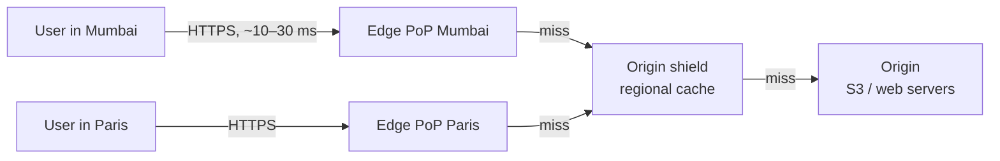
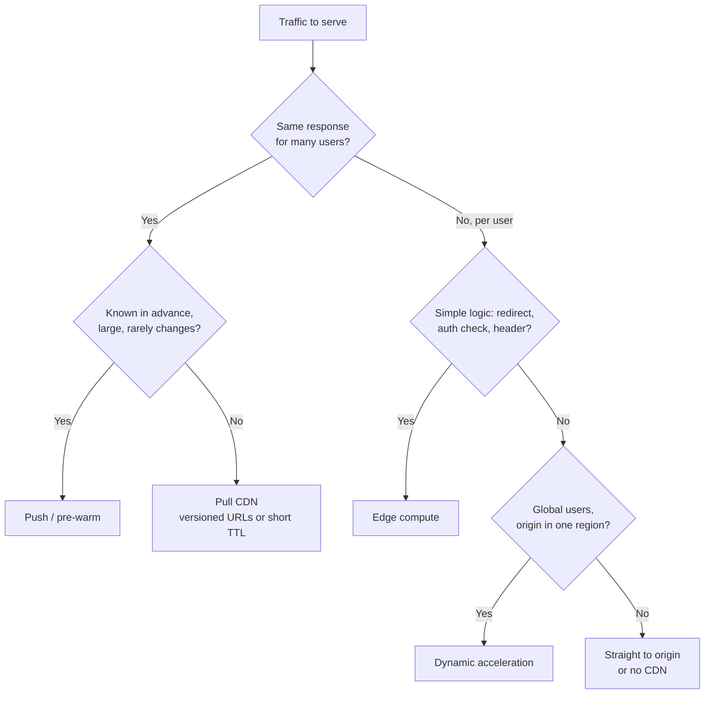

# CDN (Content Delivery Network)

## TL;DR
- **Pull CDN** (the default) for static assets, images, video segments and cacheable API
  responses: the edge fetches from your origin on the first miss and caches it.
- **Push CDN** when you publish large files ahead of time (software releases, a video library)
  and want them at the edge before the first request.
- **Dynamic acceleration** (no caching) for personalised or write traffic: the CDN still
  terminates TLS near the user and carries traffic over its faster backbone to your origin.
- **Edge compute** (Cloudflare Workers, CloudFront Functions, Lambda@Edge, Fastly Compute) for
  small logic at the edge: redirects, A/B routing, auth checks, header rewrites.
- **Multi-CDN** only at very large scale or for strict availability: two providers behind a
  traffic steering layer.
- **No CDN** for internal APIs, low-traffic sites with users near one region, or data that must
  never leave your infrastructure.

## What a CDN does



| Job | How | Benefit |
|-----|-----|---------|
| Cache near users | Hundreds of PoPs (Points of Presence) store copies | Lower latency, less origin load and egress |
| Route users to a near PoP | **Anycast** (same IP announced everywhere; BGP picks the nearest, e.g. Cloudflare) or **DNS-based** (resolver location picks a PoP IP, e.g. traditional Akamai, CloudFront mixes both) | Short network distance |
| Terminate TLS at the edge | TLS handshake with a nearby server; keep warm connections to the origin | Faster first byte, fewer handshakes to origin |
| Absorb attacks | Huge distributed capacity, WAF rules, bot management | DDoS (Distributed Denial of Service) protection |
| Optimise content | Compression (gzip, Brotli), image resizing / format conversion, HTTP/2 and HTTP/3 | Smaller, faster responses |

## Side-by-side comparison

| | Pull CDN | Push CDN | Dynamic acceleration | Edge compute |
|---|---|---|---|---|
| Content gets to edge | On first request (miss → origin) | You upload / pre-warm it | Never stored | Code runs at the edge per request |
| First request | Slow (miss) | Fast | Normal (but faster path) | Fast |
| Origin load | Low after warm-up | Very low | Full | Depends on logic |
| Freshness control | TTL + purge | You replace files | Always fresh | Code decides |
| Storage cost | Only popular objects | Everything you push | None | None |
| Best for | Websites, images, JS/CSS, HLS/DASH video, public API GETs | Large downloads, game patches, pre-launch content | Logins, carts, checkout, APIs | Redirects, auth checks, personalisation, A/B tests |
| Breaks when | Low hit ratio (long tail, uncacheable URLs) | Content changes often | Origin is far and slow anyway | Logic needs data far away |
| Examples | CloudFront, Cloudflare, Fastly, Akamai, Azure Front Door, Google Cloud CDN | Same providers' storage/pre-fetch features, Bunny CDN storage zones | Cloudflare Argo, Akamai DSA, CloudFront for dynamic origins | Cloudflare Workers, CloudFront Functions, Lambda@Edge, Fastly Compute, Vercel/Netlify Edge |

---

## Pull CDN

**What it is.** The CDN sits in front of your **origin** (web servers or object storage). On a
request, the edge checks its cache: a **hit** returns immediately; a **miss** fetches from the
origin (or an **origin shield**, a regional mid-tier cache), stores the response according to its
caching headers, and returns it.

**Use when**
- Static assets: JS, CSS, fonts, images.
- Video on demand: HLS/DASH segments are small files, perfect for caching
  ([video streaming](../_04_Case_Studies/video-streaming.md)).
- Public, cacheable API responses: product catalog, prices that tolerate 30–60 s staleness.

**Don't use when**
- Each response is unique per user → dynamic acceleration, or cache only the shared parts.
- Content must be at the edge before launch (a big release at midnight) → push / pre-warm.

**Advantages**
- Zero publishing step: point the CDN at the origin and set headers.
- Only content people actually request takes edge storage.

**Limitations**
- **Cold misses:** the first user per PoP waits for the origin. An origin shield collapses misses
  from all PoPs into one origin fetch.
- **Low hit ratio from bad cache keys:** query strings (`?utm_source=…`), cookies or `Vary` headers
  split one object into many entries. Normalise the cache key.
- **Stampede on expiry:** many requests for an expired popular object hit the origin at once.
  Use request collapsing (most CDNs do it) and `stale-while-revalidate`.

---

## Push CDN

**What it is.** You upload content to the CDN's storage (or trigger pre-fetching) before users ask.
The CDN never needs to call back to your origin for those files.

**Use when**
- Large, infrequently changing files: installers, game patches, firmware.
- Predictable launches where the first viewers must not hit the origin.

**Don't use when**
- Content changes constantly or the library is huge with a long tail → pull.

**Advantages**
- No cold misses; origin traffic near zero.

**Limitations**
- **You manage publishing and deletion,** and pay to store everything, popular or not.

---

## Dynamic acceleration

**What it is.** Uncacheable traffic still goes through the CDN: TLS ends at a nearby PoP, then the
request travels over the provider's optimised backbone with long-lived, warmed connections to your
origin. The CDN may also apply WAF and bot rules.

**Use when**
- Logins, carts, checkout, personalised APIs for a global audience with a single-region origin.
- You want DDoS and WAF protection on every request, not only on static content.

**Don't use when**
- Users are all near the origin region: little to gain.

**Advantages**
- Faster connection setup and more stable latency, without caching anything sensitive.
- One edge for everything: simpler DNS, TLS certificates and security rules.

**Limitations**
- **Origin still does all the work:** it doesn't reduce origin load the way caching does.

---

## Edge compute

**What it is.** Run small functions at the PoPs on each request or response. Two broad tiers:
lightweight functions with tight CPU/time limits for header and URL work (CloudFront Functions),
and fuller runtimes (Cloudflare Workers, Lambda@Edge, Fastly Compute) that can call APIs and use
edge key-value stores.

**Use when**
- Redirects, URL rewrites, adding security headers, normalising cache keys.
- Validating a JWT or signed cookie before serving private content.
- A/B testing and geo-based routing without a round trip to the origin.

**Don't use when**
- The logic needs your primary database: the edge is far from it → keep it at the origin.
- Heavy CPU work: edge runtimes have strict limits that vary by provider and plan.

**Advantages**
- Lowest possible latency for simple decisions; scales with the CDN.

**Limitations**
- **Limited runtimes and debugging;** state is eventually consistent across PoPs if you use edge KV.
- Logic spread across edge and origin is harder to test and version.

---

## Caching headers and invalidation

The origin controls the CDN mostly through HTTP headers. Get these right and most CDN problems
disappear.

| Header / directive | Meaning | Example |
|--------------------|---------|---------|
| `Cache-Control: max-age=N` | Browsers and CDNs may cache for N seconds | `max-age=31536000` for hashed assets (1 year) |
| `s-maxage=N` | Overrides `max-age` for shared caches (CDN) only | Browser 0 s, CDN 60 s |
| `public` / `private` | `private` = only the user's browser may cache | `private` on `/me` responses |
| `no-store` | Never cache anywhere | Banking pages, tokens |
| `no-cache` | Cache, but revalidate with the origin before each use | HTML that must always be current |
| `immutable` | Never revalidate during `max-age` | Fingerprinted files `app.3f9a1c.js` |
| `stale-while-revalidate=N` | Serve stale for N s while refreshing in the background | Smooths expiry spikes |
| `stale-if-error=N` | Serve stale if the origin errors | Survive origin outages |
| `ETag` / `Last-Modified` | Validators for `304 Not Modified` revalidation | Cheap freshness checks |
| `Vary` | Separate cache entry per listed request header | `Vary: Accept-Encoding`; avoid `Vary: Cookie` |
| `Surrogate-Key` / `Cache-Tag` | Tag objects for group purges (Fastly, Cloudflare Enterprise; names vary by provider) | Purge every page showing product 42 |

**Invalidation strategies**

| Strategy | How | Pros | Cons | Use when |
|----------|-----|------|------|----------|
| Versioned URLs | Content hash in the file name; new deploy = new URL | Instant, no purge, cache forever | Needs a build step; HTML must point to new names | JS, CSS, images: always |
| Short TTL | `s-maxage=60` | Simple | Up to 60 s stale; more origin traffic | Catalog pages, public API responses |
| Purge by URL / tag | API call to the CDN on change | Fresh within seconds | Purges take time to propagate; rate-limited; easy to miss a URL | CMS publishes, price changes |
| Stale-while-revalidate | Serve old, refresh in background | No latency spike at expiry | Briefly stale | Most cacheable HTML and API GETs |

**Rule:** cache forever with versioned URLs for assets; short TTL + `stale-while-revalidate` for
HTML and API responses; `private` or `no-store` for anything per user.

**Private content.** Use **signed URLs** or **signed cookies** (an expiry and a signature the
edge verifies), so paid videos or private downloads are cached at the edge but only served to
authorised users. Pair with [object storage](object-storage.md) as the origin.

### Worked example: an edge cache in Nginx

A CDN PoP is, at its core, a caching reverse proxy. This was run with `nginx:latest` in Docker: an
origin that sets headers, and an "edge" in front of it.

```nginx
# Origin: decides cacheability with headers
location /static/ { add_header Cache-Control "public, max-age=31536000, immutable"; }
location /        { add_header Cache-Control "public, s-maxage=60, stale-while-revalidate=30"; }
```

```nginx
# Edge
proxy_cache_path /var/cache/nginx/edge levels=1:2 keys_zone=edge:10m max_size=1g inactive=10m;
server {
    listen 8090;
    location / {
        proxy_pass http://origin:8083;
        proxy_cache edge;
        proxy_cache_key $scheme$host$uri;    # ignore query strings like ?utm_source=... in the key
        proxy_cache_use_stale error timeout updating http_500 http_502 http_503;
        proxy_cache_background_update on;    # serve stale while refreshing
        proxy_cache_lock on;                 # collapse concurrent misses into one origin request
        add_header X-Cache-Status $upstream_cache_status always;
    }
}
```

```bash
$ curl -sI localhost:8090/ | grep -i x-cache                     # first request
X-Cache-Status: MISS
$ curl -sI localhost:8090/ | grep -i x-cache                     # second request
X-Cache-Status: HIT
$ curl -sI localhost:8090/static/app.3f9a1c.js | grep -iE 'x-cache|cache-control'
Cache-Control: public, max-age=31536000, immutable
X-Cache-Status: MISS
$ curl -sI "localhost:8090/?utm_source=newsletter" | grep -i x-cache
X-Cache-Status: HIT                                               # same cache entry: key ignores the query
```

Real CDNs add hundreds of PoPs, anycast routing, a shield tier, TLS at the edge and purge APIs.

### Back-of-the-envelope: what the CDN saves

```
10 M daily users × 2 MB of static content each = 20 TB/day served
Average:  20 TB / 86,400 s ≈ 231 MB/s ≈ 1.85 Gbps     Peak (×3): ≈ 5.6 Gbps

Cache hit ratio 95% → origin serves 5% = 1 TB/day ≈ 93 Mbps average
Latency: a hit from a PoP ~10–30 ms away instead of a 150–250 ms intercontinental round trip
```

CDN egress is usually priced per GB, often cheaper than cloud egress from the origin, and varies by
region and contract; check current pricing rather than assuming.

---

## Quick decision points



| If you need… | Choose |
|--------------|--------|
| Fast JS/CSS/images worldwide | Pull CDN, hashed file names, 1-year `immutable` |
| Video on demand | Pull CDN for HLS/DASH segments, origin shield, object storage origin |
| Fresh-ish public API responses | `s-maxage=30–60` + `stale-while-revalidate` |
| Private files at the edge | Signed URLs / signed cookies |
| Lower latency for logins and checkout | Dynamic acceleration (no caching) |
| Instant change of one page | Purge by URL or tag |
| DDoS protection | CDN with WAF in front of everything |

**Common combinations in interviews**
- **[Video streaming](../_04_Case_Studies/video-streaming.md):** transcode → object storage →
  CDN; > 90% of bytes from the edge.
- **[File storage](../_04_Case_Studies/file-storage.md):** downloads through the CDN with signed URLs.
- **[News feed](../_04_Case_Studies/news-feed.md):** images and videos on the CDN; the feed API itself is dynamic.
- **[URL shortener](../_04_Case_Studies/url-shortener.md):** cache popular redirects (`301`/`302`
  with `Cache-Control`) at the edge; trade-off: edge-cached redirects hide clicks from analytics.

## Interview questions
**Q: Push vs pull CDN?**
Pull caches on the first request and suits most content; push uploads ahead of time and suits
large, rarely changing files or launches where no request may hit the origin.

**Q: How do you invalidate content on a CDN?**
Best: don't. Put a content hash in asset URLs so a new version is a new URL. For HTML and API
responses, use short TTLs with `stale-while-revalidate`, and purge by URL or tag when something
must change now.

**Q: How does the CDN pick the nearest server?**
Anycast (one IP announced from every PoP; internet routing picks the nearest) or DNS-based
steering (the DNS answer depends on the resolver's location). Both can also steer away from
overloaded or unhealthy PoPs.

**Q: What's an origin shield?**
A designated mid-tier cache between all edge PoPs and the origin. Misses from many PoPs become one
origin request, raising the effective hit ratio and protecting the origin.

**Q: Can you cache API responses on a CDN?**
Yes for shared, public `GET` responses with explicit `Cache-Control` (e.g. 30–60 s). Never for
per-user data unless the cache key includes something that isolates users, which usually destroys
the hit ratio; mark those `private`.

**Q: Why is the hit ratio low and how do you fix it?**
Cache keys split by query strings, cookies or `Vary`; TTLs too short; a long tail of rarely
requested objects. Normalise the key, raise TTLs with versioned URLs, add an origin shield.

**Q: CDN vs a cache like Redis?**
A CDN caches whole HTTP responses near users, outside your network. Redis caches data inside your
backend, near your services. They're layers of the same idea; see [cache](cache.md).

## Related
- [Cache](cache.md): caching strategies, TTLs, stampedes
- [Object storage](object-storage.md): the usual origin for static and media content
- [Load balancer](load-balancer.md#dns--global-load-balancing): DNS and global routing
- [API gateway](api-gateway.md): the layer behind the CDN
- [Security](security.md): TLS, signed URLs, WAF
- [API design](api-design.md): HTTP caching with GET, ETag and `Cache-Control`
