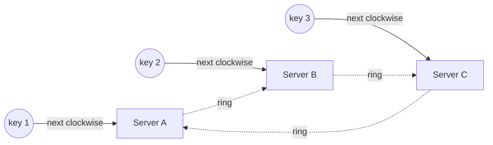

# Consistent Hashing

## TL;DR
A hashing method where adding or removing a server moves only a small part of the keys
(about **1/N**) instead of almost all of them.

## Why it matters
With `hash(key) % N`, changing N remaps nearly every key, which would empty a cache or
force a sharded database to move most of its data. Consistent hashing keeps most keys in
place.

## How it works
1. Put servers and keys on a hash ring.
2. Each key goes to the next server **clockwise**.
3. When a server is added, only the keys between it and the previous server move.
4. Use **virtual nodes** (each server placed at many points on the ring) to spread load evenly.

## Where it is used
- Distributed caches
- Sharded databases (see [sharding](sharding.md))
- Load balancers with key-based routing (see [load balancer](../_03_Building_Blocks/load-balancer.md))
- [Distributed key-value stores](../_04_Case_Studies/distributed-key-value-store.md)

## Interview questions
**Q: Explain consistent hashing.**
Put servers and keys on a hash ring. Each key goes to the next server clockwise. When a
server is added, only keys between it and the previous server move. Use virtual nodes to
spread load evenly.
