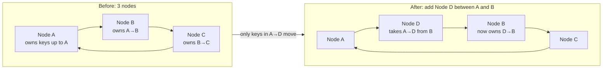
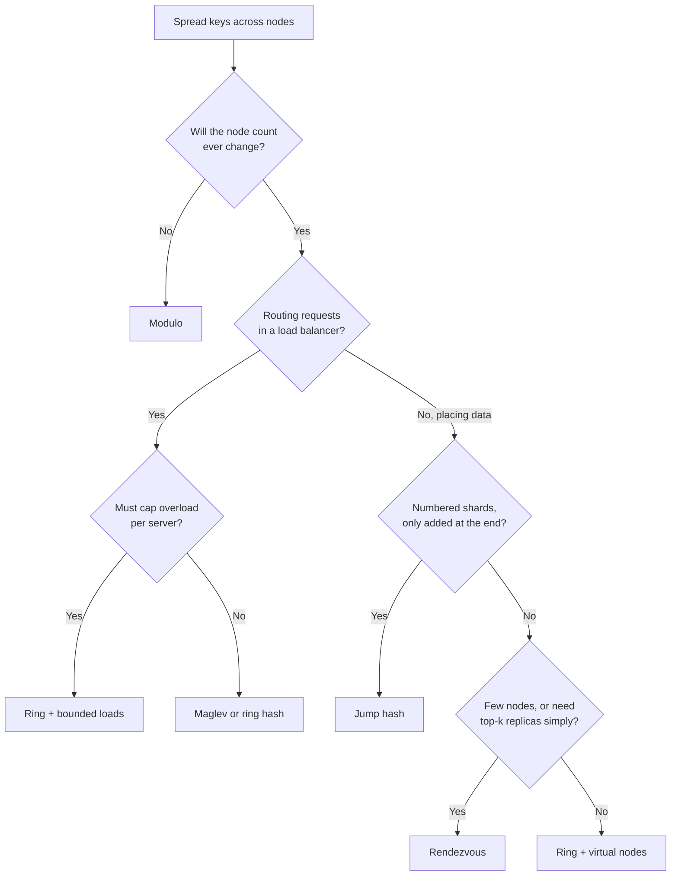

# Consistent Hashing (and Its Alternatives)

## TL;DR
- **Modulo `hash(key) % N`** only when N never changes: changing N moves almost every key.
- **Consistent hashing ring with virtual nodes** is the default for sharded databases and
  distributed caches: adding or removing a node moves only about **1/N** of the keys.
- **Bounded loads** on top of the ring when hot spots matter: no node takes more than a set
  multiple of the average.
- **Rendezvous hashing** for a small or medium set of nodes, or when you need the top-k nodes
  for replicas: no ring, near-perfect balance.
- **Jump hash** for numbered shards that only grow or shrink at the end: no memory, very fast.
- **Maglev** for load balancers: O(1) lookups from a precomputed table.
- None of them fixes a single **hot key**. That needs caching, key splitting or replication.

## The problem it solves

With `node = hash(key) % N`, going from N to N + 1 nodes changes the node for about
**N / (N + 1)** of all keys. For a cache, that's a near-total miss storm. For a sharded
database, it means moving most of the data.

| Nodes | Modulo: keys that move | Ideal: keys that move |
|-------|------------------------|-----------------------|
| 4 → 5 | ~80% | 20% (the new node's share) |
| 10 → 11 | ~91% | ~9% |
| 100 → 101 | ~99% | ~1% |

Consistent hashing gets close to the ideal: only the keys that now belong to the new node move.

## The landscape

| Family | Strategies | Core idea |
|--------|------------|-----------|
| Naive | Modulo | `hash(key) % N` |
| Ring-based | Ring, ring + virtual nodes, bounded loads | Place nodes and keys on a circle; a key belongs to the next node clockwise |
| Score-based | Rendezvous (HRW) | Score every node for the key; the highest score wins |
| Arithmetic | Jump consistent hash | A short formula maps a key to bucket `0 … N-1` |
| Table-based | Maglev | Precompute a large lookup table; a lookup is one array access |
| Not hashing | Range or directory-based | Store explicit key ranges or a lookup table (see [sharding](sharding.md)) |

## Side-by-side comparison

Measured numbers come from [`_06_Experiments/consistent-hashing`](../_06_Experiments/consistent-hashing/README.md)
(100,000 keys, MD5).

| | Modulo | Ring (1 point/node) | Ring + vnodes | Bounded loads | Rendezvous | Jump hash | Maglev |
|---|---|---|---|---|---|---|---|
| Keys moved, 4 → 5 nodes (ideal 20%) | 79.9% | 9.0% | 18.9% | ≈ ring + small extra | 19.9% | 20.1% | Near minimal |
| Keys moved, remove 1 of 5 (ideal 20%) | 79.9% | 27.8% | 18.9% | ≈ ring + small extra | 20.1% | 20.1% (last bucket only) | Near minimal |
| Busiest node vs average (10 nodes) | 1.02× | 2.78× | 1.08× | Capped (1.25× with c = 1.25) | 1.02× | 1.02× | ~1.0× |
| Lookup cost | O(1) | O(log N) | O(log N·V) | O(log N·V) + walk | O(N) | O(log N) | O(1) |
| Memory | None | N points | N·V points | N·V points + live load counts | Node list | None | Table of size M (e.g. 65,537) |
| Remove any node | Yes (but remaps all) | Yes | Yes | Yes | Yes | **Last bucket only** | Yes |
| Weighted nodes | No | Hard | More vnodes for bigger nodes | Yes | Yes (weighted variant) | No | Yes |
| Replicas (next k nodes) | No | Next k clockwise | Next k *distinct* nodes clockwise | Next k clockwise | Top-k scores | No | No |
| Used by | Simple in-process sharding | Original Karger et al. design | Cassandra, Riak, Amazon's Dynamo, memcached clients (Ketama) | HAProxy (`hash-balance-factor`), Vimeo | Some CDNs and load balancers (e.g. GitHub's GLB) | Sharded storage with numbered shards | Google Maglev, Envoy, Cilium |

N = nodes, V = virtual nodes per node, M = Maglev table size.

---

## Modulo hashing

**What it is.** `node = hash(key) % N`. Fast and perfectly even, but N is baked into every
placement, so changing N reshuffles nearly everything.

**Use when**
- The number of nodes is fixed for the life of the data: in-process sharding of a lock table or
  a fixed set of worker queues.
- You can afford a full rehash on resize (e.g. a small cache that warms quickly).

**Don't use when**
- Nodes are added, removed or fail → a ring with vnodes, rendezvous or jump hash.
- Data is expensive to move (databases, large caches).

**Advantages**
- Simplest possible; O(1); no state to store.
- Perfectly even spread with a good hash function.

**Limitations**
- **Mass remapping:** ~N/(N+1) of keys move on any change (79.9% measured for 4 → 5 nodes).
- One failed node changes N, so its failure also moves everyone else's keys.

---

## Consistent hashing ring

**What it is.** Introduced by Karger et al. (1997) for web caching at what became Akamai. Hash
nodes and keys onto the same circle (e.g. 0 to 2^64 − 1). Each key belongs to the **first node
clockwise** from its position. Adding a node only takes keys from its clockwise neighbor;
removing one only hands its keys to the next node.



**Use when**
- Teaching or reasoning about the idea; in practice, always add virtual nodes (next section).

**Don't use when**
- You need even load: with one point per node, arc lengths are random.

**Advantages**
- Minimal movement in principle: only one neighbor's keys move.
- No central lookup table; every client can compute placement.

**Limitations**
- **Uneven load:** random arcs gave the busiest of 10 nodes **2.78×** the average in our run.
- **Uneven movement:** the new node took only 9% of keys (ideal 20%), and removing a node moved
  27.8%, all of it onto **one** neighbor, which can overload it.
- **No weights:** a bigger machine can't easily take a bigger share.

---

## Ring with virtual nodes (vnodes)

**What it is.** Each physical node is placed on the ring at **many** points (V virtual nodes,
e.g. `node-A#0 … node-A#99`). Many small arcs average out, so load evens out, and when a node
leaves, its keys spread across **all** the other nodes instead of one neighbor.

**Use when**
- Partitioning data across a cluster that grows and shrinks: Cassandra, Riak and Amazon's Dynamo
  design use it.
- Client-side sharding across cache servers (memcached clients using Ketama).
- Machines with different capacity: give bigger machines more vnodes.

**Don't use when**
- The node count is small and lookups can afford O(N) → rendezvous is simpler and more even.
- Shards are numbered and only added at the end → jump hash needs no memory.

**Advantages**
- Close to ideal movement and balance: **18.9%** moved and **1.08×** max/avg with 100 vnodes.
- A failed node's load spreads across the whole cluster.
- Natural weighting (more vnodes = bigger share) and natural replication (walk clockwise).

**Limitations**
- **Memory and lookup cost grow with N·V:** a sorted array of all points, searched with binary search.
- **Choosing V is a trade-off:** more vnodes mean better balance, but more metadata, slower
  rebalancing operations and, in Cassandra, more repair overhead. Cassandra lowered its default
  `num_tokens` from 256 to 16 in version 4.0, using a smarter token allocator to keep balance.
- Still no protection against one hot key.

### Ring guidelines
- **Use a stable hash function** such as Murmur3, xxHash or MD5. Never use a language's built-in
  `hash()`, which can differ between processes and versions.
- **Lookup:** keep points in a sorted array and binary-search for the first point ≥ `hash(key)`,
  wrapping to index 0 at the end.
- **Replicas:** the key's replicas are the next **k distinct physical nodes** clockwise (Dynamo
  calls this the preference list). Skip extra vnodes of a node you've already picked, and prefer
  nodes in different racks or availability zones.
- **Every client must agree on the ring:** share membership through a coordination service
  (ZooKeeper, etcd) or gossip, and version it.

---

## Consistent hashing with bounded loads

**What it is.** From Mirrokni, Thorup and Zadimoghaddam (2016). Set a capacity of
**c × average load** per node (e.g. c = 1.25). If a key's node is full, keep walking
clockwise to the next node with room.

**Use when**
- Load balancing **requests** with affinity (the same user or object goes to the same server
  for cache locality) but no server may be overloaded. Vimeo built this into HAProxy as
  `hash-balance-factor`.
- Popular keys cluster on a few nodes and you can track live load.

**Don't use when**
- Placing **stored data**: a key's location then depends on current load, so it can move
  without any membership change → plain ring with vnodes.
- You can't track each node's current load in real time.

**Advantages**
- **Hard cap on overload:** the busiest node was exactly **1.25×** the average with c = 1.25,
  down from 2.78× on the same uneven ring.
- Keeps most of the affinity of consistent hashing.

**Limitations**
- **Needs live load information** for every node, so it's stateful and needs coordination.
- Keys can move when load changes, not only when nodes change.
- A smaller c means better balance but more keys pushed off their first-choice node.

---

## Rendezvous hashing (Highest Random Weight)

**What it is.** From Thaler and Ravishankar (1996). For each key, compute a score
`hash(key, node)` for **every** node and pick the highest. When a node is added, it wins only
the keys where it scores highest; when one is removed, each of its keys goes to its own
second-best node, spreading them evenly.

```python
def node_for(key, nodes):
    return max(nodes, key=lambda node: hash64(f"{key}|{node}"))

def replicas_for(key, nodes, k=3):
    return sorted(nodes, key=lambda node: hash64(f"{key}|{node}"), reverse=True)[:k]
```

**Use when**
- Tens to a few hundred nodes, where O(N) per lookup is cheap.
- You need **k replicas** per key: just take the top-k scores.
- Weighted nodes (the weighted variant scales scores by capacity).
- CDN or proxy routing, and choosing cache servers.

**Don't use when**
- Thousands of nodes and very high lookup rates → ring with vnodes, jump hash or Maglev.

**Advantages**
- **Near-perfect balance and minimal movement** without virtual nodes: **19.9%** moved,
  **1.02×** max/avg.
- No ring or table to build or share: just the node list.
- Top-k replicas fall out naturally.

**Limitations**
- **O(N) per lookup:** every node is scored for every key.
- Every client must still agree on the node list.

---

## Jump consistent hash

**What it is.** From Lamping and Veach at Google (2014). A few lines of arithmetic map a key
to a bucket number `0 … N-1`. When N grows by one, each key moves to the new bucket with
probability 1/(N+1), or stays put.

```python
def jump_hash(key: int, num_buckets: int) -> int:
    b, j = -1, 0
    while j < num_buckets:
        b = j
        key = (key * 2862933555777941757 + 1) & 0xFFFFFFFFFFFFFFFF
        j = int((b + 1) * ((1 << 31) / ((key >> 33) + 1)))
    return b
```

**Use when**
- Data is split into **numbered shards** (`shard-0 … shard-N-1`) that you add at the end, and
  each shard is itself replicated so it never "disappears".
- You want zero memory and very fast lookups.

**Don't use when**
- Arbitrary nodes can fail or be removed: jump hash can only remove the **last** bucket.
- Nodes have different capacities (no weights) → ring with vnodes or weighted rendezvous.

**Advantages**
- **No memory, O(log N) time,** and near-ideal balance and movement (**20.1%** moved, **1.02×** max/avg).
- Trivial to implement and identical across languages.

**Limitations**
- **Buckets, not servers:** you must map bucket numbers to machines yourself.
- Only shrinks from the end; removing a middle bucket breaks the guarantee.
- No weights and no built-in replica selection.

---

## Maglev hashing

**What it is.** Used by Google's Maglev software load balancer (NSDI 2016). Each backend fills a
large lookup table (size M, a prime much larger than N, e.g. 65,537) by taking turns along its own
pseudo-random sequence of slots. A lookup is `table[hash(key) % M]`.

**Use when**
- Load balancers routing connections or flows to backends with connection affinity: Google
  Maglev, and the Maglev policy in Envoy and Cilium.
- Very high lookup rates where O(1) matters.

**Don't use when**
- Placing stored data where keys must move exactly once on membership change → ring with vnodes.
- Backends change many times per second (each change rebuilds the table).

**Advantages**
- **O(1) lookups** and almost perfectly even load.
- Supports weights, and every load balancer instance builds the same table from the same backend list.

**Limitations**
- **Near-minimal disruption, not minimal:** a change moves slightly more keys than the ideal.
- Table rebuild on every change, and memory for M entries per load balancer.

---

## Rebalancing and hot keys

Consistent hashing decides **where** keys go. Running it in production also needs:

| Concern | What to do |
|---------|------------|
| Moving data when a node joins | Stream the affected key range from the old owner; serve reads from both until the copy finishes, then switch ownership |
| Node failure | Replicas (next k distinct nodes) take over reads; repair or hinted handoff restores the copy count |
| Agreeing on membership | Versioned ring stored in ZooKeeper/etcd, or spread by gossip (Cassandra, Dynamo) |
| Uneven capacity | Weight nodes: more vnodes, weighted rendezvous or Maglev weights |
| **Hot keys** | Consistent hashing can't help: one key always lands on one node. Cache it in front, split it (`counter:42#0 … #7`) and sum on read, or replicate it to several nodes |

**Worked example: a ring in Python**

```python
import bisect, hashlib

def hash64(value: str) -> int:
    return int.from_bytes(hashlib.md5(value.encode()).digest()[:8], "big")

class Ring:
    def __init__(self, nodes, vnodes=100):
        self.points = sorted((hash64(f"{n}#{i}"), n) for n in nodes for i in range(vnodes))
        self.hashes = [p for p, _ in self.points]

    def node_for(self, key):
        i = bisect.bisect(self.hashes, hash64(key)) % len(self.points)   # next point clockwise
        return self.points[i][1]

    def replicas_for(self, key, k=3):
        i, found = bisect.bisect(self.hashes, hash64(key)), []
        while len(found) < k:                                            # next k distinct nodes
            node = self.points[i % len(self.points)][1]
            if node not in found:
                found.append(node)
            i += 1
        return found

ring = Ring(["cache-a", "cache-b", "cache-c"])
ring.node_for("user:42")        # 'cache-a'
ring.replicas_for("user:42")    # ['cache-a', 'cache-b', 'cache-c']
```

The full comparison script, with all five strategies and the measurements above, is in
[`_06_Experiments/consistent-hashing`](../_06_Experiments/consistent-hashing/README.md).

---

## Quick decision points



| If you need… | Choose |
|--------------|--------|
| A fixed number of partitions that never changes | Modulo |
| Data partitioning in a growing cluster (Cassandra-style) | Ring + virtual nodes |
| Client-side sharding across cache servers | Ring + virtual nodes (Ketama) or rendezvous |
| Replicas for each key across failure zones | Ring (next k distinct nodes) or rendezvous (top-k) |
| Sticky load balancing with no overloaded server | Ring + bounded loads |
| Very fast connection routing in a load balancer | Maglev |
| Numbered, replicated shards with zero memory | Jump hash |
| To fix a single hot key | None of these: cache, split or replicate the key |

**Common combinations in interviews**
- **[Distributed key-value store](../_04_Case_Studies/distributed-key-value-store.md):** ring with
  vnodes for partitioning, next 3 distinct nodes as replicas, quorum reads and writes (see
  [CAP and consistency](cap-and-consistency.md#tuning-consistency-in-practice)), gossip for membership.
- **Distributed cache** (see [cache](cache.md)): ring with vnodes or
  rendezvous in the client, so adding a cache server only empties ~1/N of the cache.
- **[Chat application](../_04_Case_Studies/chat-application.md):** hash `conversation_id` to pick
  the storage partition, and a presence store to find which WebSocket server holds a user.
- **[Load balancer](load-balancer.md):** Maglev or ring hash for sticky
  sessions; bounded loads when one server must not take a burst.

## Interview questions
**Q: Explain consistent hashing.**
Put servers and keys on a hash ring. Each key goes to the next server clockwise. When a
server is added, only keys between it and the previous server move. Use virtual nodes to
spread load evenly.

**Q: Why not just use `hash(key) % N`?**
Changing N changes the result for about N/(N+1) of keys: 80% when going from 4 to 5 nodes. A cache
would almost empty, and a database would move most of its data. Consistent hashing moves only ~1/N.

**Q: Why do we need virtual nodes?**
With one point per node, arcs are random sizes, so load is uneven (2.78× the average on the busiest
node in our test), and a failed node dumps all its keys on one neighbor. Many points per node even
out the arcs and spread a failed node's keys across the whole cluster. They also allow weighting
bigger machines.

**Q: How are replicas placed on the ring?**
Walk clockwise from the key and take the next k **distinct physical** nodes, skipping extra vnodes
of nodes already chosen, ideally in different racks or zones.

**Q: Consistent hashing vs rendezvous hashing?**
Both move only ~1/N of keys. Rendezvous is simpler, needs no virtual nodes, balances almost
perfectly and gives top-k replicas directly, but costs O(N) per lookup. A ring costs O(log N·V)
per lookup, so it suits large clusters.

**Q: Does consistent hashing solve hot keys?**
No. It balances many keys, but one very popular key still lives on one node. Cache it, split it
into sub-keys, or replicate it. Bounded loads helps with request routing, not with a single stored key.

**Q: What happens to data when a node joins?**
The new node takes over the key ranges just before its points on the ring. Those ranges are
streamed from their previous owners, reads can go to both during the copy, and ownership switches
once it finishes. All other keys stay put.

## Related
- [Sharding](sharding.md): hash, range and directory-based partitioning
- [Replication](replication.md): quorums and replica placement
- [CAP and consistency](cap-and-consistency.md)
- [Load balancer](load-balancer.md)
- [Cache](cache.md)
- [Distributed key-value store](../_04_Case_Studies/distributed-key-value-store.md)
- [Experiment: compare hashing strategies](../_06_Experiments/consistent-hashing/README.md)
