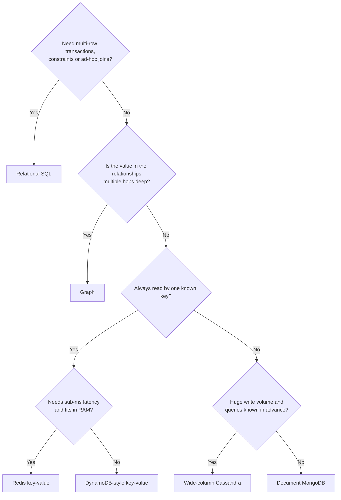

# Databases

## TL;DR
- **Relational (SQL)** for transactions, joins and data whose rules must always hold: payments, orders, inventory. The default.
- **Key-value** for lookups by one key at very low latency or huge scale: sessions, caches, feature flags, counters.
- **Document** for self-contained records with a flexible shape that you read and write whole: product catalog, user profiles.
- **Wide-column** for huge write volume with known query patterns: time series, messages, activity logs.
- **Graph** when the relationships *are* the question: friends of friends, recommendations, fraud rings.
- **Use none of them** for big files (object storage), full-text search (a search index) or
  heavy analytics (a data warehouse). Real systems combine several stores.
- Whatever you pick, **indexes** speed up reads at the cost of writes and storage.

## SQL vs NoSQL

| Aspect | SQL (relational) | NoSQL |
|--------|------------------|-------|
| Schema | Fixed tables | Flexible |
| Guarantees | ACID | Often BASE |
| Scaling | Mostly vertical; sharding is hard | Built for horizontal scale |
| Queries | Joins, complex queries | Simple lookups by key |
| Examples | PostgreSQL, MySQL | Cassandra, DynamoDB, MongoDB, Redis, Cosmos DB |
| Use for | Payments, orders, inventory | Feeds, sessions, logs, IoT |

**ACID:** Atomicity (all or nothing), Consistency (rules always hold), Isolation
(transactions don't see each other's half-finished work), Durability (committed data
survives crashes).

**BASE:** Basically Available, Soft state, Eventually consistent.

"NoSQL" is not one thing: it means "not the relational model", and the four families below
have very different strengths. The table is a starting point, not a rule:
- **NoSQL can do transactions.** MongoDB has multi-document ACID transactions, DynamoDB has
  `TransactWriteItems`, Cassandra has lightweight transactions for compare-and-set.
- **SQL can scale out.** Read replicas, sharding (Vitess, Citus), and distributed SQL
  ("NewSQL": Google Spanner, CockroachDB, TiDB) keep SQL and ACID across many nodes.
- **The real question is the access pattern:** how will you read this data, and how much of it is there?

## NoSQL types

| Type | Examples | Data looks like | Good for |
|------|----------|-----------------|----------|
| Key-value | Redis, DynamoDB | `key → opaque value` | Sessions, cache |
| Document | MongoDB, Cosmos DB | `key → JSON document` | Product catalog, user profiles |
| Wide-column | Cassandra, HBase | `partition key → sorted rows of columns` | Time series, huge write volume |
| Graph | Neo4j | Nodes and edges with properties | Social networks, recommendations |

**Specialised stores** you will also name in interviews (not general-purpose databases):

| Store | Examples | Use for |
|-------|----------|---------|
| Search index | Elasticsearch, OpenSearch | Full-text search, autocomplete, log search |
| Time-series | InfluxDB, TimescaleDB | Metrics and sensor data with time-range queries |
| Data warehouse (OLAP) | BigQuery, Snowflake, Redshift | Analytics over huge history; scans, not point lookups |
| Object storage | S3, GCS | Files, images, video, backups |

**OLTP vs OLAP:** OLTP (Online Transaction Processing) is many small reads and writes of
current data (the databases in this note). OLAP (Online Analytical Processing) is few, large
queries over history (a warehouse). Don't run heavy reports on your OLTP primary.

## Side-by-side comparison

| | Relational | Key-value | Document | Wide-column | Graph |
|---|---|---|---|---|---|
| Model | Tables, rows, foreign keys | Key → value | Key → JSON document | Partition key → rows with clustering columns | Nodes + edges |
| Schema | Enforced | None | Flexible (optional validation) | Defined per table | Flexible |
| Query power | Joins, aggregates, ad-hoc SQL | Get/put by key only | Queries on fields, secondary indexes, aggregation | By partition key (+ clustering range); no joins | Traversals and pattern matching |
| Transactions | Full ACID, multi-row | Single key (some: multi-key) | Single document; multi-document supported | Single partition (light), no multi-row | ACID in Neo4j |
| Consistency (typical) | Strong | Strong (Redis primary) to eventual (DynamoDB option) | Strong on primary, eventual on replicas | Tunable per query (quorums) | Strong on one node |
| Scaling | Vertical + replicas; sharding is manual | Horizontal, easy | Horizontal (sharded) | Horizontal, linear | Hard to shard |
| Write throughput | Medium | Very high | High | Very high (LSM tree) | Medium |
| Latency | ms | Sub-ms (memory) to single-digit ms | ms | ms | Depends on traversal depth |
| Ad-hoc queries | Excellent | None | Good | Poor: model for the query | Excellent on relationships |
| Ops complexity | Low to medium | Low | Medium | High (compaction, repair, tuning) | Medium |
| Where it breaks | One big primary; cross-shard joins | Anything beyond a key lookup | Many-to-many relationships; unbounded embedded arrays | New query patterns need new tables | Large-scale partitioning |

---

## Relational (SQL)

**What it is.** Data lives in **tables** of rows and typed columns. Tables relate through
**foreign keys**, and you query across them with **joins** in SQL (Structured Query
Language). Transactions give **ACID** guarantees, and the schema is enforced by the database.

| Variant | Examples | Notes |
|---------|----------|-------|
| Classic RDBMS | PostgreSQL, MySQL, SQL Server, Oracle | Single primary, read replicas |
| Distributed SQL (NewSQL) | Spanner, CockroachDB, TiDB | SQL and ACID spread over many nodes; higher write latency |
| Embedded | SQLite | A library, not a server |

```sql
CREATE TABLE orders (
  id         BIGINT PRIMARY KEY,
  user_id    BIGINT NOT NULL REFERENCES users(id),
  status     TEXT   NOT NULL,            -- pending, shipped, delivered
  total      NUMERIC(10,2) NOT NULL,
  created_at TIMESTAMP NOT NULL DEFAULT now()
);

-- one query across three tables
SELECT u.name, o.id, o.total, i.sku
FROM orders o
JOIN users u        ON u.id = o.user_id
JOIN order_items i  ON i.order_id = o.id
WHERE o.id = 1001;
```

**Use when**
- Money, orders, inventory, bookings: anything that needs **multi-row transactions** and constraints.
- The data has clear relationships and you will ask new questions of it later (reports, ad-hoc queries).
- Data fits on one primary plus replicas (a few TB, thousands to tens of thousands of QPS).

**Don't use when**
- You need millions of writes per second or many TB with simple access → wide-column or key-value.
- The data is a pile of varied, self-contained JSON records → document.
- The queries are deep relationship traversals (6 joins to find friends of friends of friends) → graph.

**Advantages**
- ACID transactions, constraints (`NOT NULL`, `UNIQUE`, foreign keys, `CHECK`) keep data correct.
- SQL is powerful and universal: joins, aggregates, window functions, any new question.
- Mature tooling, query planners and a huge talent pool.

**Limitations**
- **Scaling writes:** one primary takes all writes. Fix: scale vertically, cache, then [shard](sharding.md); read replicas only help reads ([replication](replication.md)).
- **Cross-shard joins and transactions are slow or impossible** once sharded. Fix: shard by the key most queries use and keep related rows together.
- **Schema changes on huge tables** can lock or take hours. Fix: online migration tools (gh-ost or pt-online-schema-change for MySQL), expand-then-contract changes.
- **Rigid shape** for data that varies per record; use a `JSONB` column or a document store.

### Transactions and isolation

A transaction groups statements into one all-or-nothing unit. The **isolation level**
decides which weird interleavings of concurrent transactions you must tolerate.

| Level | Prevents | Still possible | Default in |
|-------|----------|----------------|------------|
| Read Uncommitted | Nothing reliable | Dirty reads (PostgreSQL treats it as Read Committed) | – |
| Read Committed | Dirty reads | Non-repeatable reads, phantoms | PostgreSQL, SQL Server, Oracle |
| Repeatable Read | Dirty and non-repeatable reads | Phantoms (not in PostgreSQL's snapshot isolation); write skew | MySQL InnoDB |
| Serializable | All anomalies; behaves as if one at a time | More aborts and retries | – |

Higher isolation = fewer surprises but more locking or retries. Most apps run the default
and make the critical statement itself safe:

```sql
-- sell the last item without overselling: the check and the decrement are one atomic statement
BEGIN;
UPDATE inventory SET stock = stock - 1 WHERE sku = 'A1' AND stock > 0;   -- UPDATE 1 or UPDATE 0
COMMIT;
```

If the update reports `UPDATE 0`, the item is sold out, and no second buyer can go below zero.
For work across several services see [distributed transactions](distributed-transactions.md).

---

## Key-value

**What it is.** A giant dictionary: you `GET` and `PUT` a **value** by its **key**. The store
does not look inside the value. Because the only access path is the key, the data can be spread
over many nodes by hashing it, and lookups stay fast at any size.

| Variant | Examples | Notes |
|---------|----------|-------|
| In-memory | Redis, Memcached | Sub-millisecond; capacity is RAM; optional persistence (Redis) |
| Durable, distributed | DynamoDB, Riak, etcd | Disk-backed, replicated; DynamoDB adds a sort key and secondary indexes |

```
SET session:9f3a '{"user_id":42,"cart":[1001]}' EX 1800     # a 30-minute session
GET session:9f3a
INCR views:post:7                                           # atomic counter
```

**Use when**
- Sessions, shopping carts, feature flags, rate-limit counters, leaderboards (Redis sorted sets).
- You always know the exact key: user ID, short code (a URL shortener's `code → long URL`).
- A [cache](cache.md) in front of a slower database.
- Very high throughput with predictable single-digit-millisecond latency (DynamoDB).

**Don't use when**
- You need to query by anything but the key ("all orders over $100") → relational or document.
- Relationships and multi-key transactions matter → relational.
- The dataset is large and RAM-only storage is too expensive (Redis) → DynamoDB or disk-based stores.

**Advantages**
- Simplest model and the fastest reads and writes.
- Scales horizontally almost linearly (hash the key to a partition).
- Operationally simple.

**Limitations**
- **Lookups by key only:** no joins, little filtering. Fix: a secondary index (DynamoDB GSI) or a second store.
- **Hot keys:** one very popular key overloads a single partition. Fix: split the key (`key#1..#N`), add a local cache.
- **Memory cost (Redis):** data must fit in RAM. Fix: evict with a policy, or use a disk-backed store.
- **Durability varies:** Redis can lose recent writes after a crash depending on persistence settings.

---

## Document

**What it is.** Each record is a self-contained **document** (JSON or BSON) holding nested
fields and arrays, stored under an ID. Documents in one collection need not share a shape, and
you can index and query on any field. Related data is usually **embedded** in the document
instead of joined.

```javascript
// one order, with its items embedded: one read gets everything
db.orders.insertOne({
  _id: 1001, user_id: 42, status: "pending", total: 42.5,
  created_at: new Date(),
  items: [{ sku: "A1", qty: 1, price: 42.5 }]
});

db.orders.createIndex({ user_id: 1, created_at: -1 });
db.orders.find({ user_id: 42 }).sort({ created_at: -1 }).limit(20);   // uses the index (IXSCAN)
db.orders.updateOne({ _id: 1001 }, { $set: { status: "shipped" } });
```

**Use when**
- Records are read and written as a whole: product catalog (each product has different attributes), user profiles, CMS content.
- The schema changes often or differs per record.
- The data's natural shape is nested, and you rarely query across documents.
- You want horizontal scale with richer queries than key-value (MongoDB, Cosmos DB).

**Don't use when**
- Many-to-many relationships and frequent joins → relational.
- Multi-entity money-style transactions are the core of the system → relational.
- You need extreme write volume with fixed queries → wide-column.

**Advantages**
- One read returns the whole object: no joins, good locality.
- Flexible schema; easy to evolve (add a field, no migration).
- Rich queries and secondary indexes, plus an aggregation pipeline.
- Maps naturally to objects in application code.

**Limitations**
- **Duplicated data:** the same fact embedded in many documents (a product name inside every order). Fix: embed what is read together and rarely changes; reference the rest by ID.
- **Unbounded growth:** an ever-growing embedded array hits the document size limit (16 MB in MongoDB). Fix: put the many side in its own collection.
- **Weak cross-document guarantees:** transactions exist but cost performance. Model so that one document is the unit of consistency.
- **No schema enforcement by default:** bad data creeps in. Fix: schema validation rules.

---

## Wide-column

**What it is.** Data is stored in tables, but each table is built around one query. A row is
found by its **partition key** (which node holds it) and sorted inside the partition by
**clustering columns**. Writes are appended to an in-memory table and a log, then merged into
sorted files on disk (an **LSM tree**, see [Indexing](#indexing)), which makes writes very fast.
Examples: Cassandra, ScyllaDB, HBase, Bigtable.

```sql
-- CQL (Cassandra Query Language): the table IS the query "latest orders of a user"
CREATE TABLE orders_by_user (
  user_id    bigint,
  created_at timestamp,
  order_id   bigint,
  status     text,
  total      decimal,
  PRIMARY KEY ((user_id), created_at, order_id)       -- partition key, then clustering columns
) WITH CLUSTERING ORDER BY (created_at DESC, order_id ASC);

SELECT * FROM orders_by_user WHERE user_id = 42 LIMIT 20;      -- one partition, already sorted
SELECT * FROM orders_by_user WHERE status = 'shipped';         -- REJECTED: needs ALLOW FILTERING (full scan)
```

**Use when**
- Huge write volume that a single primary can't take: messages ([chat](../_04_Case_Studies/chat-application.md)), IoT readings, activity feeds, event logs.
- You know your queries in advance and can build one table per query.
- You need always-on availability across data centers (Cassandra has no single primary).
- Time-ordered data read in ranges: "latest 20 events for device 7".

**Don't use when**
- You need ad-hoc queries, joins or aggregates → relational or a warehouse.
- Multi-row transactions or strict constraints → relational.
- The team can't operate it: compaction, repair and tuning take real expertise.

**Advantages**
- Very high, predictable write throughput; scales linearly by adding nodes.
- No single point of failure; replication across racks and regions built in.
- **Tunable consistency** per query (`ONE`, `QUORUM`, `ALL`); see [CAP](cap-and-consistency.md) and [replication](replication.md).
- Data in a partition is stored sorted, so range reads are fast.

**Limitations**
- **Query-first modeling:** a new access pattern usually means a new table and duplicated data. Fix: design from the queries (see [Data modeling](#data-modeling)).
- **Hot or huge partitions:** a partition key like `country` puts everything on a few nodes. Fix: a high-cardinality key, or add a bucket (`user_id, month`).
- **Deletes leave tombstones** that slow reads until compaction. Fix: use TTLs and avoid delete-heavy patterns.
- **Weak transactions:** only per-partition lightweight transactions.
- **Operational cost:** repairs, compaction strategy, JVM tuning.

---

## Graph

**What it is.** Data is **nodes** (entities) and **edges** (relationships), both with
properties. The query language describes a pattern to match. A native graph database such as
Neo4j stores each node's connections directly, so a traversal costs about the number of
neighbours it visits, not the size of the whole dataset (a relational join would look up an index at every hop).

```cypher
// Cypher: friends of Asha's friends who she doesn't follow yet
MATCH (a:User {name: "Asha"})-[:FOLLOWS]->(:User)-[:FOLLOWS]->(rec:User)
WHERE NOT (a)-[:FOLLOWS]->(rec) AND rec <> a
RETURN rec.name, count(*) AS mutuals
ORDER BY mutuals DESC LIMIT 10;
```

**Use when**
- The value is in the connections: social graphs, recommendations, fraud detection (shared devices and cards), knowledge graphs, network topology.
- Queries traverse several hops ("within 3 steps of this account").
- Relationships are added and queried as freely as the entities.

**Don't use when**
- Simple lookups, CRUD or reporting → relational. Joins handle one or two hops fine.
- The dataset is huge and must be partitioned across many nodes with low latency → hard for graphs; consider modeling the hot path in a key-value or wide-column store.
- Mostly bulk analytics → warehouse.

**Advantages**
- Deep relationship queries are short to write and fast to run.
- Flexible: new relationship types need no schema migration.
- Pattern matching reads like the question you're asking.

**Limitations**
- **Hard to shard:** edges cross partitions whatever you do. Fix: scale vertically with replicas; keep the graph in one place.
- **Niche:** smaller ecosystem and skills than SQL.
- **Not for bulk scans:** aggregating over all nodes is slower than in a relational or columnar store.
- **Super-nodes:** one account with millions of edges slows traversals. Fix: cap, bucket or special-case them.

---

## Indexing

The essentials are below; [DB indexing](db-indexing.md) covers every index type, ESR column order and tested plans in depth.

- An index makes reads fast (like a book index) but makes writes slower and uses extra storage.
- **B-tree index:** good for range queries. The default in most SQL DBs.
- **Hash index:** exact match only.
- **Composite index** on `(a, b)` helps queries on `a` or on `a and b`, not on `b` alone
  (the leftmost-prefix rule; a few optimizers can skip-scan, but don't rely on it).

| Structure | How it works | Reads | Writes | Used by |
|-----------|--------------|-------|--------|---------|
| **B-tree / B+tree** | Balanced sorted tree of pages; updates change pages in place | Fast: a few page reads, ranges and sorting | Each write updates the table and every index; random I/O | PostgreSQL, MySQL (InnoDB), SQL Server |
| **LSM tree** (Log-Structured Merge) | Writes go to memory + a log, flush to immutable sorted files (SSTables), merged in the background (compaction) | A read may check several files; bloom filters skip most | Very fast: sequential appends | Cassandra, HBase, RocksDB, LevelDB |
| **Hash** | Hash of the key → location | Exact match only, no ranges or sorting | Fast | Redis, DynamoDB partition lookup, PostgreSQL hash indexes |

**Rule of thumb:** B-tree for read-heavy and mixed workloads; LSM for write-heavy workloads
that can tolerate slightly slower reads and background compaction.

### Index types you'll use in SQL

| Type | Example | Use |
|------|---------|-----|
| Single column | `CREATE INDEX ON orders (user_id)` | Filter or join on one column |
| Composite | `(user_id, created_at DESC)` | Filter by `user_id` and sort by time in one scan |
| Covering (`INCLUDE`) | `(user_id) INCLUDE (total)` | The query is answered from the index alone (an "index-only scan"): no table lookup |
| Partial | `(created_at) WHERE status = 'pending'` | Small index for a hot subset |
| Unique | `UNIQUE (email)` | Constraint and fast lookup |

**Order columns in a composite index:** equality columns first, then the sort/range column.
**Don't index everything:** each index slows every `INSERT`, `UPDATE` and `DELETE` and takes
disk and memory. Index columns that you filter, join or sort on, and check with `EXPLAIN`.
Low-selectivity columns (a boolean) rarely help alone.

### Worked example: from sequential scan to index (PostgreSQL 17, 1 M orders)

The query behind "my latest orders": `WHERE user_id = 42 ORDER BY created_at DESC LIMIT 20`.

```sql
EXPLAIN (ANALYZE) SELECT * FROM orders
WHERE user_id = 42 ORDER BY created_at DESC LIMIT 20;
--  Sort
--    -> Parallel Seq Scan on orders        <- reads all 1 M rows, discards ~99.99%
--  Rows Removed by Filter: 333300 (per worker)

CREATE INDEX idx_orders_user_created ON orders (user_id, created_at DESC);

EXPLAIN (ANALYZE) SELECT * FROM orders
WHERE user_id = 42 ORDER BY created_at DESC LIMIT 20;
--  Index Scan using idx_orders_user_created on orders
--    Index Cond: (user_id = 42)            <- already sorted, stops after 20 rows
```

| Query | Plan | Why |
|-------|------|-----|
| `WHERE user_id = 42 ORDER BY created_at DESC LIMIT 20` | Index Scan | Matches the index's leading column and its order |
| `WHERE created_at > now() - interval '1 minute'` | Seq Scan | `created_at` is the *second* column; the leftmost-prefix rule |
| `SELECT sum(total) ... WHERE user_id = 42` with `INDEX (user_id) INCLUDE (total)` | Index Only Scan | The index holds `total`, no table lookup |
| `WHERE status = 'pending' AND created_at > ...` with `INDEX (created_at) WHERE status = 'pending'` | Index Scan on the partial index | The index only contains pending rows |

On this data the sequential scan took tens of milliseconds and the index scan well under a
millisecond; the exact numbers depend on your machine, so run it yourself. The cost:
`idx_orders_user_created` took ~30 MB beside a 68 MB table, and every insert now updates it.

---

## Data modeling

| Question | Relational | Document | Wide-column |
|----------|------------|----------|-------------|
| Start from | The entities and their relationships | The objects your app reads together | The queries you must serve |
| Duplicate data? | No: **normalize** (each fact once) | Some: **embed** what is read together | Yes: one table per query (**denormalize**) |
| Joins | In the database | In the app, or avoid via embedding | Never |
| Change a query pattern | Add an index or a view | Add an index; maybe remodel | New table + backfill |

- **Normalization** stores each fact once (1NF/2NF/3NF), which prevents update anomalies and keeps writes cheap.
- **Denormalization** copies data to avoid joins, which speeds reads but makes writes harder and risks drift. Do it deliberately, for a measured hot path.
- **Embed vs reference** (document): embed when data is read together, is bounded in size and changes together; reference when it is shared, large or unbounded.
- **Pick keys for access:** the partition or shard key should match the most common query and spread load evenly ([choosing a shard key](sharding.md#choosing-a-shard-key)).

---

## Scaling a database

When a database gets slow, work from cheapest to most complex:

| Step | Do | Typical gain | Cost |
|------|-----|--------------|------|
| 1 | Find slow queries (`EXPLAIN`, slow-query log) and add or fix **indexes** | 10×–1000× on those queries | Low |
| 2 | Add a [**cache**](cache.md) for hot reads | Cuts read load by the hit ratio | Staleness, invalidation |
| 3 | Add **read replicas** ([replication](replication.md)) | Scales reads | Replication lag |
| 4 | **Scale up** (bigger machine) | Buys time | Cost; has a ceiling |
| 5 | **Shard** ([sharding](sharding.md)) | Scales writes and size | Cross-shard queries, resharding |
| 6 | **Split by service** or by workload (separate stores, a warehouse for reports) | Isolation | More systems to run |

---

## Quick decision points



| If you need… | Choose |
|--------------|--------|
| Money, orders, inventory, constraints | Relational (PostgreSQL, MySQL) |
| Sessions, cache, counters, leaderboards | Redis |
| Single-key access at massive scale, managed | DynamoDB |
| Flexible, nested records read as a whole | MongoDB |
| Millions of writes/s, time-ordered reads, multi-region | Cassandra |
| "Who is connected to whom" | Neo4j |
| Full-text search | Elasticsearch / OpenSearch |
| Files and media | Object storage (S3) |
| Reports over years of data | Data warehouse |

**Common combinations in interview designs (polyglot persistence)**
- **PostgreSQL + Redis:** SQL as source of truth, Redis as a [cache](cache.md) and for sessions and counters. The default web app.
- **Key-value for the hot path, SQL for the rest:** [URL shortener](../_04_Case_Studies/url-shortener.md) (`code → URL` lookups) with SQL or analytics on the side.
- **Cassandra for messages, SQL for users:** [chat application](../_04_Case_Studies/chat-application.md).
- **SQL + search index + warehouse:** the primary database, Elasticsearch for search, a warehouse for reports, kept in sync by events or CDC (Change Data Capture).
- **SQL for payments with transactions and an outbox:** [payment system](../_04_Case_Studies/payment-system.md).
- **Object storage for bytes, a database for metadata:** [file storage](../_04_Case_Studies/file-storage.md).

---

## Interview questions

**Q: SQL or NoSQL for this system?**
Ask: do I need transactions or joins? → SQL. Huge write scale, simple access by key,
flexible schema? → NoSQL. "It depends, because…" with reasons is the right answer.

**Q: Your DB is slow. What do you check, in order?**
Go from cheapest to most complex: (1) slow queries and missing indexes, (2) add a cache,
(3) read replicas, (4) vertical scaling, (5) shard, (6) split into separate DBs per service.
See [Scaling a database](#scaling-a-database) and [sharding](sharding.md#interview-questions).

**Q: What does an index cost?**
Extra disk and memory, and every write must update it, so too many indexes slow writes.
Add indexes for queries you actually run, check them with `EXPLAIN`, and drop unused ones.

**Q: B-tree vs LSM tree?**
B-tree updates pages in place: fast, predictable reads, slower random writes (PostgreSQL, MySQL).
LSM tree appends to memory and a log, then merges sorted files: very fast writes, reads may
touch several files, plus background compaction (Cassandra, RocksDB). Read-heavy → B-tree; write-heavy → LSM.

**Q: ACID vs BASE?**
ACID gives correctness: transactions are all-or-nothing, isolated and durable. BASE trades some of
that for availability and scale: replicas may briefly disagree but converge. Money → ACID; a
like counter or feed → BASE is fine. See [CAP and consistency](cap-and-consistency.md).

**Q: Document vs relational for a product catalog?**
Products have different attributes (a shirt has size, a laptop has RAM), are read as a whole and
rarely joined, so a document store fits. Orders, payments and inventory tie to constraints and
transactions, so they stay relational. Often both.

**Q: Document vs wide-column?**
Document: flexible shape, rich queries and secondary indexes, moderate scale. Wide-column:
fixed query patterns, extreme write volume, multi-region availability, but one table per query and
no ad-hoc queries.

**Q: Can NoSQL do transactions?**
Yes, within limits: MongoDB multi-document transactions, DynamoDB `TransactWriteItems`, Cassandra
lightweight transactions per partition. They cost latency and throughput, so design so that one
document or partition is the unit of consistency.

**Q: Normalize or denormalize?**
Normalize first: each fact once, writes simple and consistent. Denormalize a specific hot read path
once you measure it is too slow, and accept the work of keeping the copies in sync.

**Q: Why not just use one database for everything?**
One store rarely fits every access pattern: SQL is not a search engine, Redis is not a system
of record, a warehouse is not for 5 ms lookups. Start with one (usually PostgreSQL), and add
a specialised store only for a pain you can name.

**Q: What are the isolation levels, and which do you use?**
Read Committed, Repeatable Read, Serializable (and Read Uncommitted): higher means fewer anomalies
but more locking or retries. Most apps keep the default and make critical updates atomic (`UPDATE … WHERE stock > 0`),
using Serializable plus retries only where needed.

---

## Related
- [Replication](replication.md)
- [Sharding](sharding.md)
- [Cache](cache.md)
- [CAP and consistency](cap-and-consistency.md)
- [Distributed transactions](distributed-transactions.md)
- [Message queues](message-queues.md): event-driven sync between stores
- [Case studies](../_04_Case_Studies/): [URL shortener](../_04_Case_Studies/url-shortener.md), [chat](../_04_Case_Studies/chat-application.md), [payments](../_04_Case_Studies/payment-system.md)
- Docker labs: [PostgreSQL](../_03_Building_Blocks/_01_Docker_Databases/postgresql/), [MySQL](../_03_Building_Blocks/_01_Docker_Databases/mysql/), [SQL Server](../_03_Building_Blocks/_01_Docker_Databases/mssql/), [MongoDB](../_03_Building_Blocks/_01_Docker_Databases/mongodb/), [Redis](../_03_Building_Blocks/_01_Docker_Databases/redis/), [Cassandra](../_03_Building_Blocks/_01_Docker_Databases/cassandra/)
- [DB indexing](db-indexing.md): B-tree, LSM, GIN, BRIN, composite and covering indexes in depth
- [DB sharding](db-sharding.md) and [search index](search-index.md)
