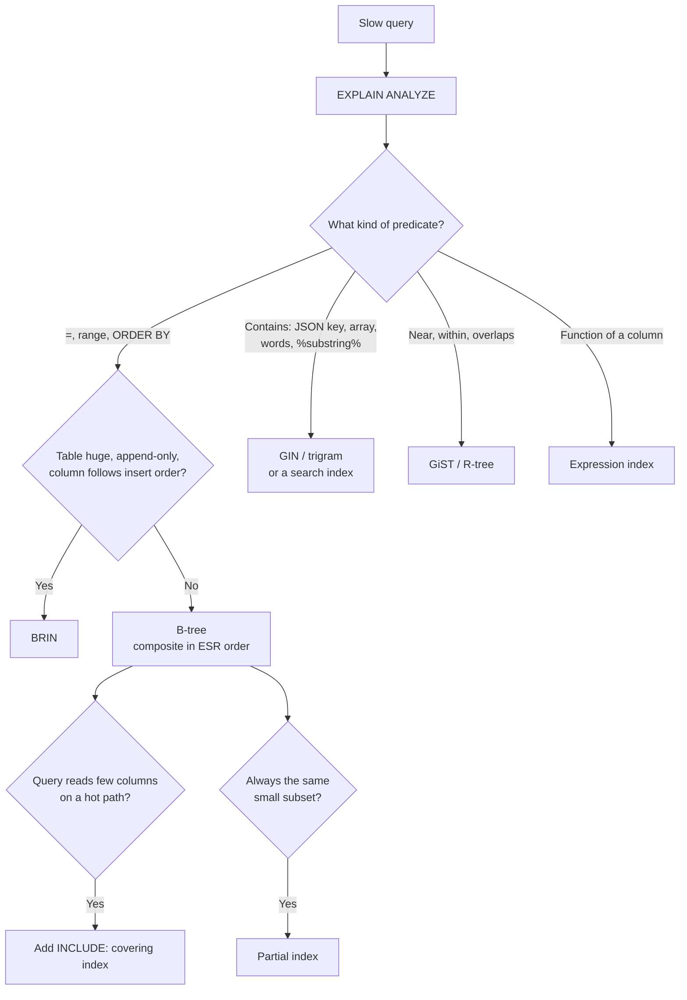

# Database Indexing

## TL;DR
- **B-tree** (the default) for equality, ranges, sorting and prefix matches: almost every
  `WHERE`, `JOIN` and `ORDER BY` in an OLTP (Online Transaction Processing) database.
- **Hash** for equality-only lookups on a long key, when you never need ranges or sorting.
- **LSM tree** (a storage engine, not an index you create) for write-heavy stores: Cassandra,
  RocksDB, ScyllaDB.
- **Inverted index (GIN)** for "contains" queries: JSONB keys, arrays, full-text words.
- **GiST / R-tree** for geometry, nearest-neighbour and overlapping ranges.
- **BRIN** for huge append-only tables where a column follows insert order (time series).
- **Bitmap indexes** for low-cardinality columns in analytical (OLAP) databases, not OLTP.
- **No index** for small tables, columns you never filter on, and write-heavy tables where reads
  are rare: every index slows every write.

## The landscape

| Category | Structures | Answers |
|----------|------------|---------|
| Ordered | B-tree / B+tree, LSM tree | `=`, `<`, `BETWEEN`, `ORDER BY`, `LIKE 'abc%'` |
| Hashed | Hash index | `=` only |
| Inverted | GIN, full-text, Lucene | "rows containing this word / key / element" |
| Spatial / multi-dimensional | GiST, R-tree, SP-GiST, geohash | "within 2 km", "overlaps", nearest neighbour |
| Summary | BRIN, zone maps, min/max per block | "skip blocks that can't match" |
| Bitmap | Bitmap index | Combine low-cardinality filters in OLAP |

How an index is **attached** to a table is a separate choice (covered [below](#index-design-the-choices-that-matter-more)):
clustered vs secondary, single vs composite, covering, partial, expression, unique.

## Side-by-side comparison

| | B-tree | Hash | LSM tree | GIN (inverted) | GiST / R-tree | BRIN | Bitmap |
|---|---|---|---|---|---|---|---|
| Equality | Yes | Yes, fastest in theory | Yes | Yes (contains) | Some types | Coarse | Yes |
| Range / sort | Yes | No | Yes | No | Geometric ranges | Coarse ranges | Yes, by combining |
| Writes | Moderate (in-place page updates) | Moderate | Fast (sequential appends) | Slow (many entries per row) | Moderate | Very cheap | Expensive under concurrency |
| Size | Medium | Medium | Medium + compaction overhead | Can be large | Medium | Tiny | Small for low cardinality |
| Best data | Most columns | Long keys, equality only | High write rates | JSONB, arrays, text | Geo, ranges, KNN | Huge, naturally ordered tables | Few distinct values, read-mostly |
| Found in | PostgreSQL, MySQL InnoDB, SQL Server, Oracle, MongoDB | PostgreSQL, MySQL MEMORY, in-memory KV stores | Cassandra, HBase, RocksDB, LevelDB, ScyllaDB | PostgreSQL GIN, Elasticsearch (Lucene) | PostGIS, PostgreSQL range types | PostgreSQL | Oracle, data warehouses |

---

## B-tree (B+tree)

**What it is.** A balanced tree of fixed-size pages (8 KB in PostgreSQL, 16 KB in InnoDB). Inner
pages hold separator keys; leaf pages hold sorted keys and pointers to rows, linked left to right.
A lookup walks root → leaf in 3–4 page reads even for hundreds of millions of rows, then scans
leaves in order for ranges. "B-tree" in databases almost always means the B+tree variant.

```text
                [ 400 | 800 ]                  root
              /       |       \
     [100|250]    [500|650]    [900|...]       inner pages
     /  |  \        ...
 [1..99][100..249][250..399] ⇄ ...              leaves, sorted and linked → range scans
```

**Use when**
- Almost always: primary keys, foreign keys, filters, joins, sorts.
- Prefix matching: `LIKE 'abc%'` (with the right collation or `text_pattern_ops` in PostgreSQL).

**Don't use when**
- `LIKE '%abc%'`, words inside text → full-text / trigram GIN, or a [search index](search-index.md).
- "Contains this JSON key" → GIN.
- Low-cardinality column alone (`is_active`) → usually no index, or a partial index.

**Advantages**
- One structure serves `=`, ranges, `ORDER BY`, `MIN/MAX` and uniqueness.
- Predictable `O(log n)` lookups; shallow trees.

**Limitations**
- **Write amplification:** each insert updates the table and every index, with random page writes.
  Keep only indexes that queries use.
- **Bloat and page splits** with random keys (UUIDv4): inserts land on random pages. Time-ordered
  keys ([UUIDv7, Snowflake](id-generation.md)) append to the right edge instead.

---

## Hash index

**What it is.** Stores `hash(key) → row pointers` in buckets. A lookup is one hash plus one bucket
read. Supports only `=`.

**Use when**
- Equality on long values (URLs, tokens) where a hash is smaller than the full key.
- In-memory key-value stores: Redis's main dictionary is a hash table.

**Don't use when**
- Any range, sort or prefix query → B-tree.
- In PostgreSQL before 10, hash indexes weren't WAL-logged (not crash-safe); avoid on old versions.

**Advantages**
- Small and fast for equality on wide keys.

**Limitations**
- **Equality only:** tested on PostgreSQL 17, `WHERE email = '…'` used the hash index, but
  `WHERE email > '…'` fell back to a sequential scan.
- Can't enforce `UNIQUE` in PostgreSQL; a B-tree is usually nearly as fast, so it's rarely worth it.

---

## LSM tree (Log-Structured Merge tree)

**What it is.** A storage engine design rather than an index you add. Writes go to an in-memory
sorted table (**memtable**) and a write-ahead log. When full, the memtable is flushed as an
immutable sorted file (**SSTable**). Background **compaction** merges files and drops overwritten
or deleted (tombstoned) keys. Reads check the memtable, then files newest to oldest; per-file
**bloom filters** skip files that can't contain the key.

**Use when**
- Write-heavy workloads: event logs, metrics, messaging, IoT (Cassandra, ScyllaDB, HBase).
- Embedded storage under other databases: RocksDB under CockroachDB (Pebble, a Go rewrite),
  TiKV, MyRocks, Kafka Streams state stores.

**Don't use when**
- Read-heavy OLTP with many secondary indexes and range scans → B-tree engines.

**Advantages**
- Sequential writes: high write throughput, good on SSDs.
- Good compression; immutable files are easy to back up.

**Limitations**
- **Read amplification:** a read may touch several files. Bloom filters and compaction limit it.
- **Compaction debt:** compaction competes with traffic for I/O; if it falls behind, reads slow and disk fills.
- **Tombstones:** many deletes leave markers that slow scans until compacted (a classic Cassandra problem).

---

## GIN and other inverted indexes

**What it is.** An **inverted index** maps each element (a word, a JSON key-value, an array item)
to the list of rows that contain it. PostgreSQL's GIN (Generalized Inverted Index) does this for
`jsonb`, arrays, `tsvector` full-text and trigrams (`pg_trgm`). Lucene, behind Elasticsearch and
OpenSearch, is an inverted index at heart.

**Use when**
- `attrs @> '{"gift": true}'` on JSONB, `tags @> ARRAY['sale']` on arrays.
- Full-text search inside the database (see [search index](search-index.md#database-full-text-search)).
- `LIKE '%keyboard%'` and fuzzy matching with `pg_trgm`.

**Don't use when**
- Exact match on a scalar column → B-tree.
- Heavy write rates with large documents: each row adds many index entries.

**Advantages**
- Makes "contains" queries fast without restructuring the data.

**Limitations**
- **Slow, large writes:** PostgreSQL buffers new entries in a pending list (`fastupdate`) and
  merges them later, which makes some reads slower until it's flushed.
- The planner can't use it for sorting.

---

## GiST, SP-GiST and R-tree

**What it is.** Balanced trees over **bounding shapes** instead of sorted values: each node holds a
box (or range) that covers its children. PostGIS uses GiST as an R-tree for geometry; GiST also
indexes range types and supports nearest-neighbour ordering (`ORDER BY location <-> point`).

**Use when**
- Geospatial queries: drivers within 2 km, restaurants in a polygon (ride sharing, maps).
- Overlapping ranges, e.g. preventing double bookings with an exclusion constraint on `tstzrange`.

**Don't use when**
- Simple point lookups by ID → B-tree.
- Massive real-time geo updates (millions of moving drivers) → an in-memory geo index (Redis
  `GEOSEARCH`, geohash or H3 cells in a key-value store).

**Advantages**
- Answers multi-dimensional questions that sorted indexes can't.

**Limitations**
- **Lossy:** candidate rows are rechecked against the real geometry; costs more CPU than a B-tree lookup.

---

## BRIN (Block Range Index)

**What it is.** Stores only the **min and max** value of a column per range of table pages (128
pages by default in PostgreSQL). A query skips every block range whose min–max can't match.
Effective only when the column's values follow the physical order of rows, like `created_at` in an
append-only table.

**Use when**
- Huge append-only tables queried by time: events, logs, metrics, audit trails.

**Don't use when**
- Values are scattered across the table (random IDs, frequently updated rows) → B-tree.
- You need a few specific rows fast; BRIN returns whole block ranges to recheck.

**Advantages**
- Tiny: on the 1 M-row test table below, BRIN on `created_at` was **24 kB** vs **21 MB** for a B-tree.
- Almost free to maintain on insert.

**Limitations**
- **Coarse:** reads every row in matching block ranges, then filters.
- Useless once correlation with physical order breaks (bulk updates, out-of-order backfills).

---

## Bitmap index

**What it is.** For each distinct value of a column, a bit array with one bit per row. Filters
combine with fast bitwise `AND`/`OR`. Common in data warehouses and Oracle. (PostgreSQL has no
persistent bitmap index; it builds **bitmap scans** at query time from other indexes.)

**Use when**
- Analytical queries over low-cardinality columns: `region`, `status`, `device_type`.

**Don't use when**
- OLTP with concurrent updates: changing one row can lock a large part of a bitmap.

**Advantages**
- Very compact for few distinct values; combining many filters is cheap.

**Limitations**
- **Poor for frequent writes and high-cardinality columns.**

---

## Index design: the choices that matter more

Picking B-tree is easy. Most real performance comes from **which columns, in what order, and what
else the index holds**.

| Choice | What it means | Example (`orders`) | Use when |
|--------|---------------|--------------------|----------|
| Clustered | The table itself is stored in index order | InnoDB orders rows by primary key; SQL Server clustered index | Range scans on the key; choose a short, increasing PK |
| Secondary (non-clustered) | Separate structure pointing to rows | PostgreSQL: every index (the table is a heap); InnoDB secondary indexes store the PK | Every other access path |
| Composite | Several columns, sorted left to right | `(status, created_at)` | Filter on one column, sort or range on another |
| Covering | Index holds every column the query needs → **index-only scan** | `(user_id, created_at DESC) INCLUDE (total, status)` | Hot read paths |
| Partial | Index only rows matching a condition | `(created_at) WHERE status = 'pending'` | Queries always target a small subset |
| Expression | Index a computed value | `(lower(email))` | Queries filter on that exact expression |
| Unique | Enforce uniqueness | `UNIQUE (email)` | Business keys, idempotency keys |

**Composite column order: the ESR rule** (Equality, Sort, Range; popularised by MongoDB, applies to
B-trees everywhere):
1. **Equality** columns first (`status = 'pending'`).
2. Then **Sort** columns (`ORDER BY created_at`).
3. Then **Range** columns (`total > 100`).

The **leftmost-prefix rule:** an index on `(a, b, c)` helps queries on `a`, `a, b` or `a, b, c`,
not on `b` or `c` alone.

**In NoSQL stores**

| Store | Index model |
|-------|-------------|
| DynamoDB | Primary key (partition + sort key); **LSI** (Local Secondary Index: same partition key, different sort key) and **GSI** (Global Secondary Index: different partition key, its own throughput, eventually consistent) |
| MongoDB | B-tree indexes on fields, compound, multikey (arrays), text, 2dsphere (geo), TTL |
| Cassandra | Query-first tables; secondary indexes (SAI, Storage-Attached Indexing, in 5.0) for selective filters inside a partition, not as a general substitute |
| Elasticsearch | Every field is indexed by default (inverted index, doc values for sorting) |

On a sharded database, a secondary index is either **local** (per shard; queries on it scatter)
or **global** (partitioned by the indexed value; writes touch two places). See
[DB sharding](db-sharding.md#secondary-indexes-on-sharded-data).

---

## Worked example: one table, five index decisions

Tested on PostgreSQL 17 with a 1 M-row `orders` table (126 MB), the same shape used across these notes:

```sql
CREATE TABLE orders (
  order_id   BIGINT GENERATED ALWAYS AS IDENTITY PRIMARY KEY,
  user_id    BIGINT NOT NULL,
  status     TEXT NOT NULL,             -- pending 10%, paid, shipped, delivered, cancelled
  total      NUMERIC(10,2) NOT NULL,
  email      TEXT NOT NULL,
  attrs      JSONB NOT NULL,            -- {"channel": "ios", "gift": false}
  created_at TIMESTAMPTZ NOT NULL       -- increases with insert order
);
```

**1. Column order (ESR).** Query: pending orders since June.

```sql
EXPLAIN (ANALYZE, BUFFERS)
SELECT count(*) FROM orders WHERE status = 'pending' AND created_at >= '2026-06-01';

-- INDEX (created_at, status)   Range column first: walks every order since June, filters status
--   Index Only Scan ... Buffers: read=2096
-- INDEX (status, created_at)   Equality first: jumps to 'pending', reads only those
--   Index Only Scan ... Buffers: read=188
```

Same rows returned (48,188), **~11× fewer pages read** with the right order.

**2. Covering index for the hottest screen ("my latest orders").**

```sql
CREATE INDEX idx_user_cov ON orders (user_id, created_at DESC) INCLUDE (total, status);

EXPLAIN (ANALYZE, BUFFERS)
SELECT created_at, total, status FROM orders
WHERE user_id = 42 ORDER BY created_at DESC LIMIT 20;
--  Index Only Scan using idx_user_cov ... Heap Fetches: 0   Buffers: hit=4 read=3
```

Seven pages, no table access, already sorted. (`Heap Fetches: 0` needs a recent `VACUUM` so the
visibility map is current.)

**3. Expression index for case-insensitive login.**

```sql
EXPLAIN SELECT * FROM orders WHERE lower(email) = 'user42@example.com';
--  Parallel Seq Scan on orders   Filter: (lower(email) = ...)      ← an index on email can't help
CREATE INDEX idx_email_lower ON orders (lower(email));
--  Bitmap Index Scan on idx_email_lower                             ← query must use lower(email) too
```

**4. GIN for a JSONB filter.**

```sql
CREATE INDEX idx_attrs ON orders USING gin (attrs jsonb_path_ops);
EXPLAIN SELECT count(*) FROM orders WHERE attrs @> '{"gift": true}';
--  Bitmap Index Scan on idx_attrs   Index Cond: (attrs @> '{"gift": true}'::jsonb)
```

**5. BRIN vs B-tree for time-range scans on an append-only table.**

```sql
CREATE INDEX idx_created_brin ON orders USING brin (created_at);
EXPLAIN SELECT count(*) FROM orders WHERE created_at BETWEEN '2026-03-01' AND '2026-03-02';
--  Bitmap Index Scan on idx_created_brin   → recheck rows in matching block ranges
```

| Index | Size on 1 M rows |
|-------|------------------|
| Table `orders` | 126 MB |
| `orders_pkey` (B-tree, bigint) | 21 MB |
| B-tree on `created_at` | 21 MB |
| **BRIN on `created_at`** | **24 kB** |
| `(status, created_at)` | 34 MB |
| `lower(email)` | 39 MB |
| GIN on `attrs` (`jsonb_path_ops`) | 2.2 MB |

Together these indexes are larger than the table. Each one slows every insert; keep the ones
your `EXPLAIN` plans and `pg_stat_user_indexes.idx_scan` show are used.

**Back-of-the-envelope: index size.** A PostgreSQL B-tree entry is the key + an 8 B index-tuple
header (which holds the 6 B row pointer) + a 4 B line pointer. For `(user_id, created_at)`:
16 + 8 + 4 = 28 B. 100 M orders × 28 B = 2.8 GB, ÷ 0.9 leaf fill factor ≈ **3 GB**. (Check: the
1 M-row `bigint` primary key above is 8 + 8 + 4 = 20 B × 1 M ÷ 0.9 ≈ 22 MB; measured 21 MB.) Ten
such indexes ≈ 30 GB that should ideally fit in RAM for fast lookups.

---

## Quick decision points



| If you need… | Choose |
|--------------|--------|
| Filter by `user_id`, newest first | B-tree `(user_id, created_at DESC)` |
| Answer a hot query without touching the table | Covering index (`INCLUDE`) |
| Fast access to the 1% of rows still `pending` | Partial index `WHERE status = 'pending'` |
| Case-insensitive email lookup | Expression index `lower(email)` (or `citext`) |
| JSONB attribute filters | GIN `jsonb_path_ops` |
| Time-range scans over billions of log rows | BRIN, or [partitioning](db-sharding.md#table-partitioning-on-one-node) by time |
| Nearby drivers or stores | GiST (PostGIS) or Redis geo |
| Very high write throughput | LSM-based store (Cassandra, RocksDB) |

**Common combinations in interviews**
- **[URL shortener](../_04_Case_Studies/url-shortener.md):** primary key on `short_code`; unique
  index on `long_url_hash` if you deduplicate.
- **[News feed](../_04_Case_Studies/news-feed.md):** `(user_id, created_at DESC)` for a user's posts;
  cursor pagination over it ([API design](api-design.md#pagination)).
- **[Search autocomplete](../_04_Case_Studies/search-autocomplete.md):** a trie or prefix index,
  not `LIKE '%…%'`.

## Interview questions
**Q: Why not index every column?**
Each index makes every insert, update and delete slower, uses disk and memory, and adds work for
vacuum/compaction. Unused indexes are pure cost. Index the columns your queries filter, join and
sort on, confirmed with `EXPLAIN`.

**Q: B-tree vs hash index?**
Hash only does equality; B-tree does equality, ranges, sorting and prefix matches at nearly the
same speed for equality. Pick B-tree unless you've measured a benefit.

**Q: B-tree vs LSM tree?**
B-trees update pages in place: fast reads, more random writes. LSM trees append and compact
later: fast writes, reads may check several files (bloom filters help) and compaction uses I/O.
Read-heavy OLTP → B-tree; write-heavy → LSM.

**Q: How do you order columns in a composite index?**
Equality columns first, then the sort column, then range columns (ESR). An index on `(a, b)`
can't serve a filter on `b` alone.

**Q: What's a covering index?**
An index that contains every column a query needs, so the database answers from the index alone
(index-only scan) without reading the table. Use `INCLUDE` for columns that are only returned.

**Q: Clustered vs non-clustered index?**
A clustered index decides the physical order of the table (InnoDB's primary key); there's only
one. Non-clustered indexes are separate structures pointing at rows. In InnoDB, secondary indexes
store the primary key, so a long PK makes every index bigger.

**Q: Why are random UUIDs bad primary keys?**
In a B-tree, random keys insert into random pages: more page splits, a larger working set and
worse cache use. Time-ordered IDs (UUIDv7, Snowflake) insert at the end. See [ID generation](id-generation.md).

**Q: Your query has an index but doesn't use it. Why?**
The predicate doesn't match it (function on the column, wrong leading column, implicit type cast),
the query returns a large share of the table so a sequential scan is cheaper, or statistics are
stale (`ANALYZE`).

## Related
- [Databases](databases.md): storage engines, transactions, data modeling
- [DB sharding](db-sharding.md): local vs global secondary indexes
- [Search index](search-index.md): when an inverted index outgrows the database
- [ID generation](id-generation.md): keys that are friendly to B-trees
- [API design](api-design.md#pagination-sorting-and-filtering): indexes behind pagination and filtering
- [PostgreSQL Docker lab](../_03_Building_Blocks/_01_Docker_Databases/postgresql/): run the examples yourself
