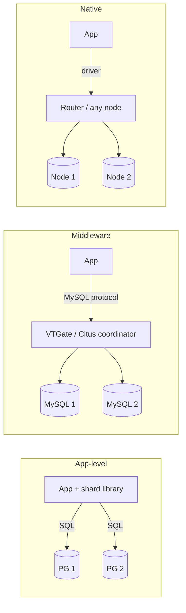
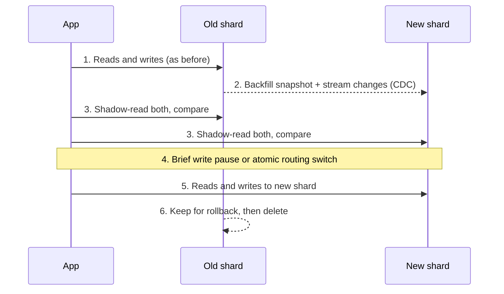
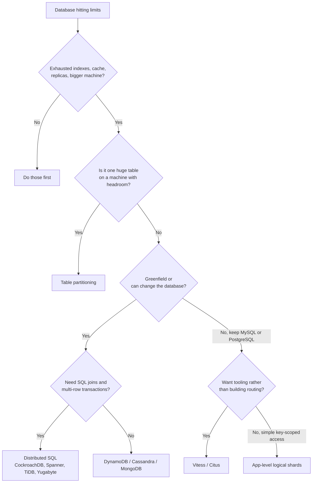

# Database Sharding in Practice

[Sharding](sharding.md) covers the **strategies** (hash, range, directory, geo) and how to pick a
shard key. This note covers the **implementation**: where the routing lives, which databases do
it for you, and how to reshard, index and migrate without downtime.

## TL;DR
- **Table partitioning on one node** (PostgreSQL declarative partitioning, MySQL partitioning)
  first, when the pain is one huge table (retention, vacuum, index size), not one machine's limits.
- **Natively distributed database** (DynamoDB, Cassandra, MongoDB, CockroachDB, Spanner, TiDB,
  YugabyteDB) for new systems that know they'll outgrow one node: sharding, rebalancing and
  failover come built in.
- **Sharding middleware** (Vitess for MySQL, Citus for PostgreSQL) to keep an existing MySQL or
  PostgreSQL application and scale it out with few code changes.
- **Application-level sharding** when you need full control and have a simple access pattern
  (everything by `user_id` or `tenant_id`): many logical shards mapped onto fewer physical databases.
- **Don't shard** if indexes, caching, read replicas and a bigger machine still work
  ([scaling a database](databases.md#scaling-a-database)). A modern single node handles a lot.

## Where the routing lives

| Approach | Who decides which shard | Examples |
|----------|-------------------------|----------|
| Partitioning (one node) | The database planner, within one server | PostgreSQL `PARTITION BY`, MySQL `PARTITION BY`, SQL Server partitioned tables |
| Application-level | Your code (a library computes `shard = f(key)`) | Instagram's and Notion's sharded PostgreSQL, Pinterest's sharded MySQL |
| Middleware / proxy | A proxy or coordinator in front of ordinary databases | Vitess (VTGate), Citus (coordinator), Apache ShardingSphere, ProxySQL (routing only) |
| Native distributed DB | The database itself (routers + metadata service) | DynamoDB, Cassandra, MongoDB (`mongos` + config servers), CockroachDB, Spanner, TiDB, YugabyteDB |



## Side-by-side comparison

| | Partitioning (one node) | Application-level | Middleware (Vitess, Citus) | Native distributed |
|---|---|---|---|---|
| Scales beyond one machine | No | Yes | Yes | Yes |
| App code changes | None | Large: every query needs the key and the router | Small: add the shard key to queries and schema | None to small (data model must fit) |
| Cross-shard queries | Planner handles them | You write scatter-gather | Supported, slower | Supported (SQL: distributed planner; NoSQL: usually discouraged) |
| Cross-shard transactions | Normal (one node) | You build sagas / 2PC | Supported with limits (Citus 2PC; Vitess atomic mode is limited) | Distributed SQL: yes (Raft/Paxos + 2PC); NoSQL: limited (DynamoDB `TransactWriteItems`, MongoDB multi-doc) |
| Resharding | Re-partition a table | You build it: copy, dual-write, cut over | Tooling (Vitess `Reshard`, Citus `rebalance_table_shards`) | Automatic splits and rebalancing |
| Ops burden | Low | High | Medium to high | Low (managed) to medium (self-hosted) |
| Lock-in | None | None | Moderate | Higher, especially managed NoSQL |
| When it breaks | One node's CPU, RAM or disk | Bugs in routing; every team re-learns the rules | Queries without the shard key fan out everywhere | Hot partitions; data model fights the database |

---

## Table partitioning on one node

**What it is.** One logical table split into child tables on the **same server** by a partition
key (range, list or hash). The planner skips partitions that can't match (**partition pruning**).
Not sharding (it doesn't add machines), but it's the cheapest first step and the same thinking.

**Use when**
- Time-series data with retention: drop last year's partition instead of `DELETE`-ing 500 M rows.
- One table's indexes no longer fit in memory, or vacuum on it takes hours.
- Rehearsing a shard key before going distributed.

**Don't use when**
- The limit is the machine itself (CPU, IOPS, disk) → real sharding.
- Most queries don't include the partition key: they scan every partition.

**Advantages**
- No application changes; full SQL, joins and transactions still work.
- Instant retention (`DETACH` + `DROP` a partition), smaller per-partition indexes.

**Limitations**
- **Unique constraints must include the partition key** (in PostgreSQL), so a global unique
  `email` needs a separate table.
- Too many partitions (thousands) slow planning.

---

## Application-level sharding

**What it is.** The application owns the routing. A common pattern: create many **logical shards**
(e.g. 1,024 or 4,096 PostgreSQL schemas) up front and map them onto a few **physical** database
servers. `logical = hash(user_id) % 1024`; a small config maps logical → physical. Growing means
moving whole logical shards to new servers, never rehashing keys. Instagram described thousands of
logical shards on few servers, and Notion described 480 logical shards over 32 databases (later
spread over more databases); check their engineering blogs for details.

**Use when**
- Nearly every query is scoped to one key (user, workspace, tenant).
- You want plain PostgreSQL/MySQL operations per shard and full control of placement.

**Don't use when**
- Many queries span users (analytics, global search) → middleware or distributed SQL, plus a warehouse.
- The team can't own a routing library, migrations across shards and resharding tooling.

**Advantages**
- No new database technology; each shard is a normal database with normal tools.
- Explicit, debuggable placement; easy to isolate a big tenant.

**Limitations**
- **Every query must carry the shard key:** a forgotten key becomes a scatter-gather, or a bug.
- **Schema migrations run N times** and can partially fail; you need tooling to track them.
- **Resharding is yours to build** (see [below](#resharding-without-downtime)).

---

## Sharding middleware (Vitess, Citus)

**What it is.** A layer that speaks the database's own protocol and hides the shards.
- **Vitess** (from YouTube; used by Slack, GitHub and others): `VTGate` proxies route MySQL queries
  using a **VSchema** that defines each table's sharding key (a "vindex"); `VTTablet` sits beside
  each MySQL instance. It supports online resharding and moving tables.
- **Citus** (a PostgreSQL extension, open source, also on Azure): a **coordinator** node holds
  metadata; `create_distributed_table` hash-distributes a table by a column across **worker**
  nodes. **Reference tables** are copied to every worker so joins stay local.

```sql
-- Citus (illustrative; not run in this repo's labs)
SELECT create_distributed_table('orders',      'user_id');
SELECT create_distributed_table('order_items', 'user_id', colocate_with => 'orders');
SELECT create_reference_table('products');      -- small, read-mostly: copied to every node

-- Routed to one worker: has the distribution column
SELECT * FROM orders WHERE user_id = 42;
-- Runs in parallel on all workers, merged on the coordinator
SELECT status, count(*) FROM orders GROUP BY status;
```

**Use when**
- An existing MySQL (Vitess) or PostgreSQL (Citus) app has outgrown one primary.
- You want SQL and existing drivers, with sharding handled by tooling.
- Multi-tenant SaaS keyed by `tenant_id` (a classic Citus use case).

**Don't use when**
- A greenfield system whose access pattern fits a managed NoSQL store → DynamoDB/Cassandra.
- Queries rarely include a natural shard key → distributed SQL handles arbitrary queries better.

**Advantages**
- Keeps your database, SQL dialect and most of the code.
- Online resharding and rebalancing tools.

**Limitations**
- **Some SQL isn't supported or is slow across shards** (certain joins, foreign keys between
  distributed tables, some subqueries). Read the compatibility docs for your version.
- **Another distributed system to run:** proxies, topology service (Vitess uses etcd/ZooKeeper/Consul),
  coordinator HA.

---

## Natively distributed databases

**What it is.** Databases built to shard themselves. They split data into partitions automatically,
place replicas, rebalance as you add nodes and fail over on their own.

| Database | How it shards | You choose |
|----------|---------------|------------|
| DynamoDB | Hash of partition key; partitions split by size and throughput; adaptive capacity for hot keys | Partition key (+ sort key) |
| Cassandra / ScyllaDB | [Consistent hashing](consistent-hashing.md) ring with vnodes | Partition key (+ clustering columns) |
| MongoDB | Ranged or hashed shard key; chunks moved by the balancer | Shard key (can be refined or resharded in newer versions) |
| CockroachDB / TiDB / YugabyteDB | Range-based splits of the key space; one Raft group per range | Primary key (avoid sequential keys, or use hash-sharded indexes) |
| Spanner | Range splits by primary key; Paxos per split; TrueTime for global consistency | Primary key and interleaving |

**Use when**
- New systems with a clear, key-based access pattern and large scale (DynamoDB, Cassandra).
- You need SQL and transactions **and** horizontal scale → distributed SQL (CockroachDB, Spanner, TiDB, YugabyteDB).
- No team to build and run sharding.

**Don't use when**
- Data fits on one well-sized node for years: a single PostgreSQL is simpler and faster per query.
- Heavy ad-hoc joins on a NoSQL store → model the queries first, or use SQL.

**Advantages**
- Rebalancing, splitting and failover are automatic.
- Managed options remove most operations work.

**Limitations**
- **Hot partitions still happen:** a bad key (celebrity user, current timestamp) overloads one
  partition whatever the database. The key design is still yours.
- **Distributed SQL adds latency per transaction:** commits wait for a quorum, and multi-range
  transactions add coordination.
- **Data modeling is query-first for NoSQL:** one table per access pattern.

---

## Resharding without downtime

The same playbook applies to moving a logical shard, splitting a shard, or migrating to a new
database. Vitess and MongoDB automate versions of it; with app-level sharding you build it.



| Step | Detail | Risk to watch |
|------|--------|---------------|
| 1. Pick the unit | Move whole logical shards or key ranges, never individual keys | Too-small units = millions of moves |
| 2. Copy | Snapshot + replay the change stream (binlog / WAL / CDC with Debezium) until lag ≈ 0 | Lag growing faster than replay |
| 3. Verify | Checksums per range, shadow reads compared in the background | Silent data drift |
| 4. Cut over | Stop writes for that unit for seconds, drain lag, flip the routing map | Clients with cached routes: version the map |
| 5. Clean up | Keep the old copy read-only for rollback, then delete | Deleting before you're sure |

**Dual writes** (app writes to old and new) are the alternative to CDC, but two writes without a
transaction can diverge on partial failure; prefer CDC or the [outbox pattern](distributed-transactions.md).

## Secondary indexes on sharded data

When you shard `orders` by `user_id`, a query by `order_id` or `email` doesn't know the shard.

| Option | How | Reads by the indexed column | Writes | Examples |
|--------|-----|-----------------------------|--------|----------|
| Local index | Each shard indexes its own rows | **Scatter to all shards**, merge | Cheap, local, consistent | MongoDB, Cassandra secondary indexes, Elasticsearch |
| Global index | Index partitioned by the indexed value, stored separately | One shard lookup, then fetch | Two places to update: async (eventually consistent) or distributed transaction | DynamoDB GSI (async), Vitess lookup vindex, CockroachDB/Spanner (transactional) |
| Encode the shard in the ID | Put the shard number inside the ID | Route directly from the ID | Free | Instagram-style IDs: timestamp + shard ID + sequence ([ID generation](id-generation.md)) |
| Separate lookup store | `email → user_id` in a small KV table | One extra lookup | Keep it in sync (outbox/CDC) | Login by email in many apps |

## Worked example: partition pruning in PostgreSQL

Tested on PostgreSQL 17 with the 1 M-row `orders` data from [DB indexing](db-indexing.md#worked-example-one-table-five-index-decisions).

```sql
CREATE TABLE orders_p (
  user_id    BIGINT NOT NULL,
  order_id   BIGINT NOT NULL,
  created_at TIMESTAMPTZ NOT NULL,
  total      NUMERIC(10,2) NOT NULL,
  PRIMARY KEY (user_id, order_id)            -- must include the partition key
) PARTITION BY HASH (user_id);

CREATE TABLE orders_p0 PARTITION OF orders_p FOR VALUES WITH (MODULUS 4, REMAINDER 0);
CREATE TABLE orders_p1 PARTITION OF orders_p FOR VALUES WITH (MODULUS 4, REMAINDER 1);
CREATE TABLE orders_p2 PARTITION OF orders_p FOR VALUES WITH (MODULUS 4, REMAINDER 2);
CREATE TABLE orders_p3 PARTITION OF orders_p FOR VALUES WITH (MODULUS 4, REMAINDER 3);
```

```sql
EXPLAIN (COSTS OFF) SELECT * FROM orders_p WHERE user_id = 42;
--  Bitmap Heap Scan on orders_p2            ← pruned to one partition: the "single-shard" query

EXPLAIN (COSTS OFF) SELECT count(*) FROM orders_p WHERE created_at > '2026-10-01';
--  Parallel Append
--    -> Parallel Seq Scan on orders_p0      ← no user_id: every partition, the "scatter-gather"
--    -> Parallel Seq Scan on orders_p1
--    -> Parallel Seq Scan on orders_p2
--    -> Parallel Seq Scan on orders_p3
```

Rows per partition: 251,106 / 249,849 / 249,663 / 249,382: hashing spreads `user_id` evenly.
Exactly the trade-off of a distributed hash-sharded table, on one machine.

**Range partitions for retention:**

```sql
CREATE TABLE events (id BIGINT, created_at TIMESTAMPTZ NOT NULL, payload JSONB)
  PARTITION BY RANGE (created_at);
CREATE TABLE events_2026_10 PARTITION OF events FOR VALUES FROM ('2026-10-01') TO ('2026-11-01');
CREATE TABLE events_2026_11 PARTITION OF events FOR VALUES FROM ('2026-11-01') TO ('2026-12-01');

EXPLAIN (COSTS OFF) SELECT * FROM events WHERE created_at >= '2026-11-05';
--  Seq Scan on events_2026_11               ← October skipped

ALTER TABLE events DETACH PARTITION events_2026_10;   -- retention: instant, no DELETE
DROP TABLE events_2026_10;
```

**Back-of-the-envelope: how many shards?**

```
Data: 20 TB today, growing 5 TB/year → plan for 3 years: 35 TB
Writes: 40,000 QPS peak
Assume one primary comfortably holds 2 TB and 5,000 write QPS (measure your own hardware)

By storage: 35 TB / 2 TB  = 18 shards
By writes:  40,000 / 5,000 = 8 shards
→ storage dominates: ~18 physical shards, each with 2 replicas = 54 database nodes
Use 1,024 logical shards (≈ 57 per physical) so growth = moving logical shards, not rehashing
```

---

## Quick decision points



| If you need… | Choose |
|--------------|--------|
| Drop old data instantly | Range partitioning by time |
| Scale an existing MySQL app's writes | Vitess |
| Scale a multi-tenant PostgreSQL SaaS | Citus (distribute by `tenant_id`) or app-level shards |
| Key-value access at huge scale, managed | DynamoDB |
| Write-heavy time-series or messaging | Cassandra / ScyllaDB |
| SQL + transactions across regions | Spanner, CockroachDB |
| Look up sharded rows by a non-key column | Global index (async) or a lookup table |

**Common combinations in interviews**
- **[Chat application](../_04_Case_Studies/chat-application.md):** Cassandra partitioned by
  `conversation_id`, messages clustered by time.
- **[URL shortener](../_04_Case_Studies/url-shortener.md):** DynamoDB or Cassandra keyed by short code.
- **[Payment system](../_04_Case_Studies/payment-system.md):** a relational database sharded by
  `merchant_id` or account (Vitess or distributed SQL); ledger entries stay on one shard per account.
- **[Distributed key-value store](../_04_Case_Studies/distributed-key-value-store.md):** consistent
  hashing with virtual nodes, like Cassandra/Dynamo.

## Interview questions
**Q: Partitioning vs sharding?**
Partitioning splits a table into pieces on one server; sharding puts the pieces on different
servers. Partitioning fixes table-level pain (retention, index size); sharding fixes machine-level
limits (write throughput, storage).

**Q: Application-level sharding vs Vitess/Citus vs a distributed database?**
App-level gives full control but you build routing, migrations and resharding. Middleware keeps
your MySQL/PostgreSQL and adds tooling, with some SQL limits. A distributed database does it all
natively but means adopting a new system and its data model.

**Q: How do you reshard without downtime?**
Move logical shards, not keys: snapshot + change-data-capture into the new location, verify with
checksums and shadow reads, pause writes for that shard for seconds, switch the routing map, keep
the old copy for rollback.

**Q: How do you look up a user by email when users are sharded by `user_id`?**
A global secondary index (e.g. DynamoDB GSI, eventually consistent) or a small `email → user_id`
lookup table kept in sync via an outbox; otherwise every login is a scatter-gather.

**Q: Why use logical shards?**
Rehashing keys on growth moves most data. With a fixed number of logical shards, the key → logical
mapping never changes; adding a server only moves some logical shards and updates a small map.

**Q: What breaks when you shard?**
Cross-shard joins, transactions, unique constraints and global ordering; schema migrations
multiply; backups and restores become per shard; hot keys still overload one shard. Design the
key so the main workload stays on one shard.

## Related
- [Sharding](sharding.md): strategies, shard key choice, hot keys
- [Consistent hashing](consistent-hashing.md): placement on a ring
- [Replication](replication.md): each shard is replicated
- [Distributed transactions](distributed-transactions.md): 2PC, sagas, outbox for cross-shard writes
- [DB indexing](db-indexing.md): indexes inside each shard
- [ID generation](id-generation.md): IDs that don't need a central counter
- [Docker labs](../_03_Building_Blocks/_01_Docker_Databases/): PostgreSQL, MySQL, MongoDB and Cassandra locally
