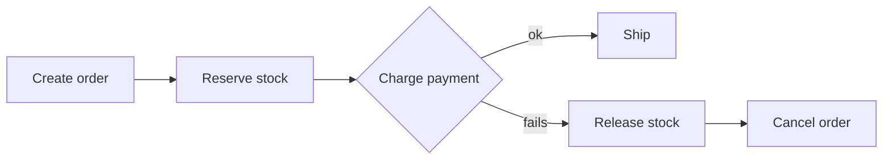

# Distributed Transactions

## TL;DR
When one business action touches several services or databases, use a **saga** (local
transactions + compensating actions) rather than 2PC, and the **outbox pattern** to publish
events reliably.

## Approaches
| Approach | How | Trade-off |
|----------|-----|-----------|
| 2PC (Two-Phase Commit) | A coordinator asks everyone to "prepare", then "commit". | Blocking, slow; the coordinator is a SPOF. |
| Saga | A chain of local transactions; on failure, run compensating actions. | Eventual consistency; you must design the undo steps. |
| ↳ Choreography | Services react to each other's events. | Loose coupling, hard to trace. |
| ↳ Orchestration | A central orchestrator tells each service what to do. | Easier to follow, one more component. |
| Outbox pattern | Write business data + event to an "outbox" table in **one** transaction; a relay publishes the event. | Guarantees the event is published if the data is saved. |

## Interview questions
**Q: Why not just write to the DB and then publish to Kafka?**
If the app crashes between the two steps, data and events disagree (the "dual write"
problem). The outbox pattern fixes this.

**Q: Give an order saga example.**
Create order → reserve stock → charge payment → ship.
If payment fails: release stock (compensate) → cancel order.

## Related
- [Payment system](../_04_Case_Studies/payment-system.md)
- [Message queues](../_03_Building_Blocks/message-queues.md)
- [Idempotency](idempotency-and-delivery-guarantees.md)
