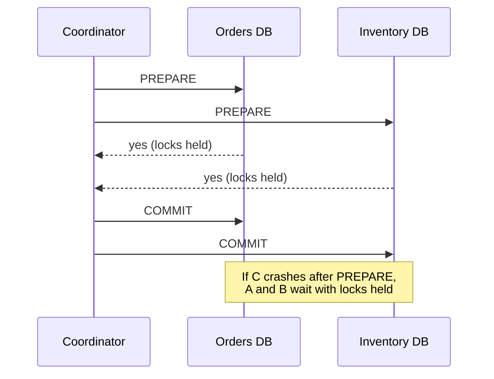
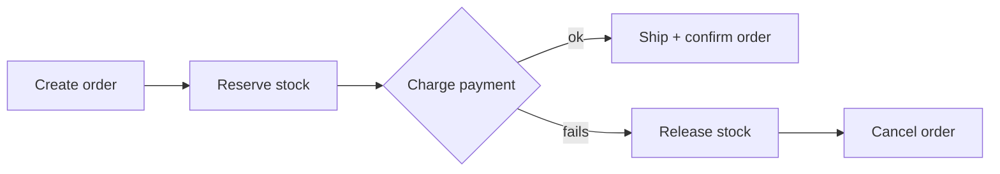
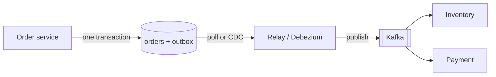
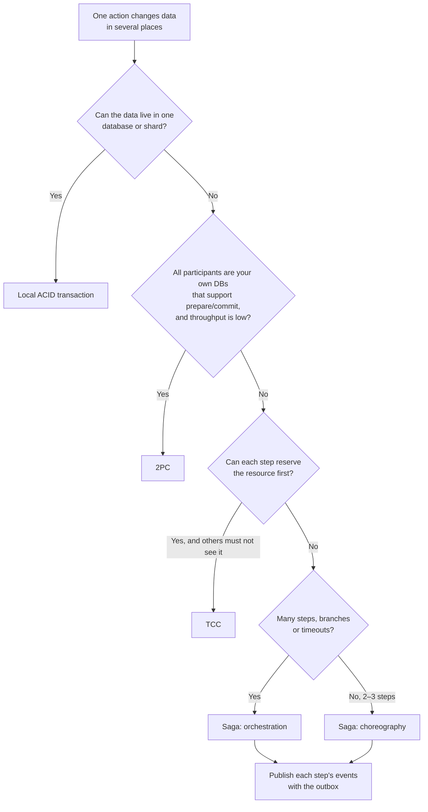

# Distributed Transactions

## TL;DR
- **Avoid them by design** where you can: keep data that must change together in one database
  (or one shard) and use a normal local transaction.
- **Saga** (local transactions + compensating actions) for business flows across services, such
  as order → payment → shipping. Use **orchestration** for complex flows and **choreography** for
  simple ones.
- **2PC (Two-Phase Commit)** only for a few participants that support it, inside one trust
  boundary, when you need atomicity and can accept blocking.
- **TCC (Try-Confirm/Cancel)** when each step can reserve something first: seats, stock, credit.
- **Transactional outbox** whenever a service updates its database and publishes an event. It
  fixes the "dual write" problem.

## The problem

One business action touches several databases or services:

```
Place order:  orders DB (create order)  →  inventory service (reserve stock)
              →  payment service (charge card)  →  shipping service (create shipment)
```

Each step can fail, time out or succeed without telling you. Without care you get an order with
no payment, a charge with no order, or stock reserved forever. A local ACID transaction can't span
services, so you need one of the patterns below.

## The landscape

| Pattern | Consistency | Idea |
|---------|-------------|------|
| 2PC | Atomic (all or nothing) | A coordinator asks everyone to prepare, then tells everyone to commit |
| 3PC | Atomic, less blocking in theory | Adds a pre-commit phase; rarely used because it breaks under network partitions |
| Saga | Eventual | A sequence of local transactions; on failure, run compensations in reverse |
| TCC | Eventual, with reservations | Try (reserve) on every service, then Confirm all or Cancel all |
| Outbox (+ CDC) | Reliable event publishing | Write data and the event in one local transaction; a relay publishes the event |

## Side-by-side comparison

| | 2PC | Saga (orchestration) | Saga (choreography) | TCC | Outbox |
|---|---|---|---|---|---|
| Atomicity | Yes | No: compensations undo | No: compensations undo | Reservations, then confirm/cancel | N/A (makes publishing reliable) |
| Isolation | Locks held until commit | None: others see intermediate states | None | Reserved resources are hidden | N/A |
| Blocking | Yes, if the coordinator fails mid-way | No | No | No (reservations time out) | No |
| Coupling | Tight: all participants must support XA / prepare | Central orchestrator knows the flow | Services react to events | Each service exposes try/confirm/cancel | Local to one service |
| Visibility | Coordinator log | Easy: orchestrator state | Hard: flow is spread across services | Coordinator state | Outbox table |
| Latency | High (two round trips, locks) | Medium | Medium | Medium | Low |
| Tools | XA transactions, database-internal 2PC (Spanner, CockroachDB) | Temporal, AWS Step Functions, Camunda | Kafka / RabbitMQ events | Custom, Seata (TCC mode) | Debezium (CDC), a polling relay |

---

## Two-Phase Commit (2PC)

**What it is.** A coordinator runs the transaction in two phases:
1. **Prepare:** every participant does the work, writes it durably, keeps its locks and votes yes or no.
2. **Commit / abort:** if all voted yes, the coordinator tells everyone to commit; otherwise to abort.



**Use when**
- A few databases inside your own system must change atomically, and they support it (XA, or
  PostgreSQL `PREPARE TRANSACTION`).
- Inside distributed databases: Spanner and CockroachDB use 2PC across shards internally, on top of consensus.

**Don't use when**
- Across microservices or third-party APIs: they don't support prepare/commit → saga.
- High-throughput paths: locks held across network round trips kill throughput.

**Advantages**
- True atomicity: all participants commit or none do.
- Applications don't need compensation logic.

**Limitations**
- **Blocking:** if the coordinator crashes after prepare, participants hold locks until it recovers.
- **Slow:** two round trips and locks held for their whole duration.
- **Coordinator is a SPOF** unless it is itself replicated (e.g. with consensus).
- Every participant must support the protocol.

---

## Saga

**What it is.** Split the business transaction into a sequence of **local** transactions, one per
service. Each step has a **compensating action** that semantically undoes it. If a step fails,
run the compensations for the completed steps in reverse order.

| Step | Action | Compensation |
|------|--------|--------------|
| 1 | Create order (`PENDING`) | Cancel order |
| 2 | Reserve stock | Release stock |
| 3 | Charge payment | Refund payment |
| 4 | Create shipment, mark order `CONFIRMED` | (last step: no compensation needed) |



There are two ways to coordinate a saga.

### Orchestration

A central **orchestrator** (a workflow) tells each service what to do and tracks the state.

**Use when**
- Flows with many steps, branches, timeouts or human approvals.
- You need to see where each transaction is ("order 42 is waiting for payment").

**Don't use when**
- A two-step flow: an orchestrator is extra infrastructure.

**Advantages**
- The whole flow is in one place: easy to understand, test, monitor and change.
- Timeouts and retries are handled centrally.

**Limitations**
- **One more component** to run and keep highly available.
- Risk of a "god service" that knows too much about other services.

### Choreography

No central coordinator: each service listens for events and emits its own
(`OrderCreated` → inventory reserves → `StockReserved` → payment charges → …).

**Use when**
- Short flows of two or three steps, with loosely coupled teams.

**Don't use when**
- Many steps or branches: nobody can see the whole flow, and cyclic event chains appear.

**Advantages**
- Loose coupling; no central service.
- Each service owns its own logic.

**Limitations**
- **Hard to follow and debug:** the flow only exists across many services' code. Use
  distributed tracing (see [observability](observability.md)).
- Adding a step means changing several services.

### Saga advantages and limitations (both styles)

**Advantages**
- No distributed locks; each service uses fast local transactions.
- Works across microservices, different databases and external APIs.

**Limitations**
- **No isolation:** other requests can see intermediate states (an order that's `PENDING`, stock
  reserved but not yet paid). Use status fields (semantic locks) and design the UI for them.
- **Compensations are business logic:** a refund isn't an "undo"; emails already sent can't be
  unsent. Some steps can only be compensated by a follow-up action.
- **Every step and compensation must be idempotent and retryable**, because messages are
  at-least-once (see [idempotency](idempotency-and-delivery-guarantees.md)).

---

## TCC (Try-Confirm/Cancel)

**What it is.** Each participant offers three operations:
- **Try:** check and **reserve** resources without making them final (hold 2 seats, hold $50 of credit).
- **Confirm:** make the reservation final.
- **Cancel:** release the reservation.

The coordinator calls Try on all participants; if all succeed it calls Confirm on all, otherwise
Cancel. Reservations expire on their own if the coordinator disappears.

**Use when**
- Resources can be held temporarily: seats, hotel rooms, stock, credit limits.
- You need others **not** to see or take the resource while the transaction is in progress.

**Don't use when**
- Services can't model a reservation, or you don't own them (third-party APIs) → saga.

**Advantages**
- Better isolation than a saga: reserved resources are invisible to others.
- No long-held database locks; reservations time out.

**Limitations**
- **Three operations per service** to build and test.
- Confirm and Cancel must be idempotent and must tolerate arriving before or after Try.
- Reservations reduce available capacity while they're held.

---

## Transactional outbox

**What it is.** The **dual write** problem: a service writes to its database and then publishes
an event to Kafka. If it crashes in between, the database and the event stream disagree. The
outbox pattern writes the business change **and** the event into an `outbox` table in the
**same local transaction**. A separate relay reads the outbox and publishes the events.



**Use when**
- Any service that changes its data and must tell others: almost every event-driven microservice.
- Each saga step publishing its result.

**Don't use when**
- No event is needed; or the downstream only needs a best-effort hint (e.g. a cache refresh).

**Advantages**
- **No lost events:** if the data is committed, the event will be published.
- **No phantom events:** if the transaction rolls back, the event disappears with it.
- Uses only a local transaction.

**Limitations**
- **At-least-once publishing:** the relay may publish an event twice after a crash, so consumers
  must deduplicate (the **inbox** pattern: a processed-messages table on the consumer side).
- An extra table, a relay process and cleanup of sent rows.
- Adds a little delay between commit and publish.

**Worked example: outbox in PostgreSQL**

```sql
CREATE TABLE orders (
  order_id   BIGINT PRIMARY KEY,
  user_id    BIGINT NOT NULL,
  status     TEXT   NOT NULL,
  total      NUMERIC(10,2) NOT NULL
);
CREATE TABLE outbox (
  id           BIGSERIAL PRIMARY KEY,
  aggregate_id BIGINT      NOT NULL,
  event_type   TEXT        NOT NULL,
  payload      JSONB       NOT NULL,
  created_at   TIMESTAMPTZ NOT NULL DEFAULT now(),
  published_at TIMESTAMPTZ
);

-- In the order service: business change + event in ONE transaction
BEGIN;
INSERT INTO orders (order_id, user_id, status, total) VALUES (1001, 42, 'PENDING', 59.90);
INSERT INTO outbox (aggregate_id, event_type, payload)
VALUES (1001, 'OrderCreated', '{"order_id": 1001, "user_id": 42, "total": 59.90}');
COMMIT;

-- In the relay: claim a batch without blocking other relay instances
BEGIN;
SELECT id, event_type, payload FROM outbox
WHERE published_at IS NULL
ORDER BY id
LIMIT 100
FOR UPDATE SKIP LOCKED;
-- … publish each event to Kafka, keyed by aggregate_id to keep per-order ordering …
UPDATE outbox SET published_at = now() WHERE id IN (1);   -- the ids just published
COMMIT;
```

Instead of polling, **CDC** (Change Data Capture) tools like Debezium read the database's
replication log and publish outbox rows with lower latency and no polling load.

---

## Quick decision points



| If you need… | Choose |
|--------------|--------|
| Atomic changes across tables you control | Put them in one database; local transaction |
| Atomic writes across shards of one distributed database | The database's built-in transactions (Spanner, CockroachDB use 2PC internally) |
| An order flow across inventory, payment and shipping | Saga with orchestration + outbox |
| A simple two-step reaction between services | Choreographed saga + outbox |
| Booking seats or rooms across services | TCC (reserve, then confirm/cancel) |
| To update a DB and publish an event reliably | Transactional outbox (polling relay or CDC) |

**Common combinations in interviews**
- **[Payment system](../_04_Case_Studies/payment-system.md):** orchestrated saga for checkout,
  outbox for events, idempotency keys on every call to the payment provider, and a status like
  `PENDING` while the provider is unsure.
- **E-commerce checkout:** reserve stock (TCC-style reservation with a timeout) → charge →
  confirm; release stock if payment fails.
- **Travel booking:** flights, hotels and cars reserved with TCC or a saga, with refunds as compensations.

## Interview questions
**Q: Why not just write to DB and then publish to Kafka?**
If the app crashes between the two, data and events disagree (the "dual write" problem). The
outbox pattern fixes this: write both in one local transaction and publish from the outbox.

**Q: Give an order saga example.**
Create order → reserve stock → charge payment → ship. If payment fails: release stock
(compensate) → cancel order.

**Q: 2PC vs saga?**
2PC gives atomicity but blocks and holds locks across the network, and every participant must
support it. A saga uses local transactions and compensations, so it works across microservices
and scales, but it's only eventually consistent and has no isolation.

**Q: Orchestration vs choreography?**
Orchestration puts the flow in one service: easy to see and change, but one more component.
Choreography has services react to events: loosely coupled, but hard to follow once there are more
than a few steps.

**Q: What if a compensation fails?**
Retry it with backoff (it must be idempotent). If it keeps failing, park the saga in a failed
state, alert, and let a person or a reconciliation job resolve it.

**Q: How does a saga handle isolation?**
It doesn't by default. Use semantic locks (status fields like `PENDING`), commutative updates,
re-reading values before acting, or TCC-style reservations for resources others mustn't take.

**Q: Is the outbox pattern exactly-once?**
No. The relay can publish an event twice after a crash, so it's at-least-once. Consumers
deduplicate by event ID (the inbox pattern).

## Related
- [Idempotency and delivery guarantees](idempotency-and-delivery-guarantees.md)
- [Message queues](../_03_Building_Blocks/message-queues.md)
- [CAP and consistency](cap-and-consistency.md)
- [Sharding](sharding.md): avoiding cross-shard transactions
- [Payment system](../_04_Case_Studies/payment-system.md)
- [PostgreSQL Docker setup](../_03_Building_Blocks/_01_Docker_Databases/postgresql/README.md)
