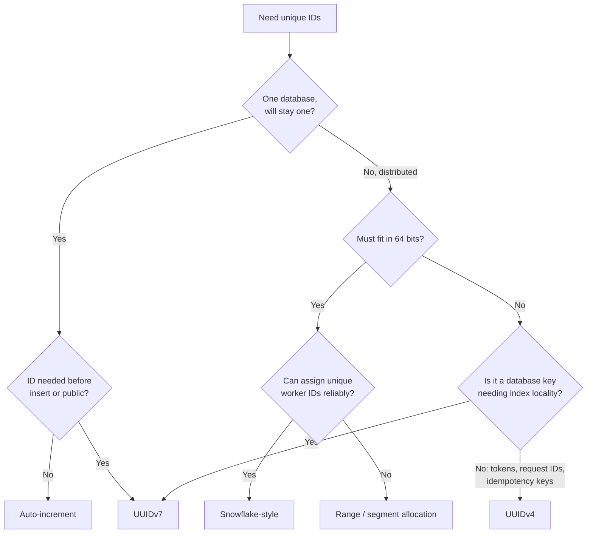

# Unique ID Generation

## TL;DR
- **Database auto-increment** for a single database that will stay single: simple, compact,
  ordered. It breaks once you shard or need IDs before the insert.
- **UUIDv4** (random, 128-bit) when any node must create IDs with zero coordination and order
  doesn't matter: idempotency keys, request IDs, public tokens.
- **UUIDv7 / ULID** (time-ordered, 128-bit) as the modern default for distributed primary keys:
  no coordination, roughly sorted by creation time, friendly to B-tree indexes.
- **Snowflake-style** (64-bit: timestamp + worker ID + sequence) when IDs must fit in a `BIGINT`
  and be time-ordered at very high rates: Twitter/X, Discord, Instagram-style IDs.
- **Range / segment allocation** (ticket server, Hi/Lo) when you want short, dense, mostly
  sequential numbers across many nodes: each node leases a block of IDs from a central counter.
- **Never expose sequential IDs** where guessing them leaks information (invoice counts, other
  users' resources); use random public IDs or check authorization anyway.

## What you might need from an ID

| Property | Why it matters | Who has it |
|----------|----------------|------------|
| Unique | Correctness | All (with the right setup) |
| No coordination per ID | Availability and speed: any node can create IDs | UUIDs, Snowflake (after worker ID assignment), ranges (between leases) |
| Time-ordered (k-sortable) | Index locality, "newest first" without an extra column | Auto-increment, Snowflake, UUIDv7, ULID |
| Compact | Smaller indexes and foreign keys; fits `BIGINT` | Auto-increment, Snowflake, ranges (64-bit) vs UUIDs (128-bit) |
| Not guessable | Security for public URLs | UUIDv4; UUIDv7 partly (random bits but time is visible) |
| Created before the insert | Client-side IDs, idempotency, linking records before saving | All except auto-increment |
| Short in URLs | Shareable links | Base62-encoded counters or random strings |

## Side-by-side comparison

| | Auto-increment | Range / segment | UUIDv4 | UUIDv7 | ULID | Snowflake (64-bit) |
|---|---|---|---|---|---|---|
| Size | 32/64-bit | 64-bit | 128-bit | 128-bit | 128-bit (26-char string) | 64-bit |
| Ordered | Strictly (per DB) | Roughly (per block) | No | By ms timestamp | By ms timestamp | By ms timestamp |
| Coordination | Every insert, in one DB | One call per block | None | None | None | Worker ID assignment once |
| Throughput limit | The DB's write rate | Block size / lease rate | Unlimited | Unlimited | Unlimited | 4,096 per ms per worker (12-bit sequence) |
| B-tree insert pattern | Append | Mostly append | **Random** (page splits, cache misses) | Append | Append | Append |
| Leaks | Row count, growth rate | Approximate counts | Nothing | Creation time | Creation time | Creation time, worker ID |
| Clock dependence | None | None | None | Mild (order only) | Mild (order only) | **Strong:** clock going back can duplicate IDs |
| Examples | PostgreSQL `IDENTITY`, MySQL `AUTO_INCREMENT` | Flickr ticket servers, Hibernate Hi/Lo, Meituan Leaf-segment | `gen_random_uuid()`, `uuid.uuid4()` | PostgreSQL 18 `uuidv7()`, Python 3.14 `uuid.uuid7()` | ULID libraries | Twitter Snowflake, Discord, Sony Sonyflake, Instagram's PL/pgSQL IDs |

---

## Database auto-increment

**What it is.** The database hands out the next integer on insert (`GENERATED ALWAYS AS IDENTITY`
in PostgreSQL, `AUTO_INCREMENT` in MySQL). Gaps can appear (rolled-back transactions, cached
sequence values), but values never repeat.

**Use when**
- One database, internal IDs, and no plan to shard soon.

**Don't use when**
- Sharded or multi-leader databases: each shard would issue `1, 2, 3…` → Snowflake/UUIDv7.
- You need the ID before inserting (client-generated, idempotent creates).
- IDs appear in public URLs and growth figures are sensitive.

**Advantages**
- Compact, strictly increasing, human-friendly, zero code.

**Limitations**
- **Single point of issue:** tied to one primary; failover and multi-region writes complicate it.
- **Merging data** from several databases collides. Workarounds such as MySQL's
  `auto_increment_increment`/`auto_increment_offset` (odd/even IDs on two leaders) don't scale well.

---

## Range / segment allocation (ticket server, Hi/Lo)

**What it is.** A central counter hands out **blocks** instead of single IDs. A node asks for the
next block of 1,000 (`UPDATE seq SET max_id = max_id + 1000 RETURNING max_id`), then issues IDs
from memory until the block runs out. Flickr ran two **ticket servers** (MySQL, one issuing odd and
one even numbers) for this; Hibernate's Hi/Lo and Meituan's Leaf-segment are the same idea.

**Use when**
- You want compact, nearly sequential 64-bit IDs across many app servers.
- Snowflake's clock dependence or worker ID management is unwanted.

**Don't use when**
- Strict global ordering is required: two nodes interleave blocks, so IDs are only roughly ordered.

**Advantages**
- Central store hit once per block: 1,000 IDs per round trip.
- No clock issues; dense numbers.

**Limitations**
- **Lost IDs:** a node that crashes wastes the rest of its block (harmless, just gaps).
- The counter store must be highly available; pre-fetch the next block before the current one runs out.

---

## UUIDv4 (random)

**What it is.** A 128-bit UUID (Universally Unique Identifier) with 122 random bits, defined in RFC
9562 (which replaced RFC 4122). The chance of a collision is negligible: you'd need around
2.7 × 10¹⁸ IDs for a 50% chance of a single collision.

**Use when**
- Idempotency keys, request and trace IDs, public tokens, file names in object storage.
- IDs created offline on clients (mobile apps) and merged later.

**Don't use when**
- Primary key of a large, write-heavy B-tree table → UUIDv7 or Snowflake.

**Advantages**
- Zero coordination, unguessable, universally supported.

**Limitations**
- **Random inserts hurt B-trees:** each insert lands on a random index page, causing page splits,
  bloat and a working set that no longer fits in memory. See [DB indexing](db-indexing.md).
- 16 bytes per ID (36 characters as text): bigger indexes and foreign keys than `BIGINT`.

---

## UUIDv7 and ULID (time-ordered)

**What it is.** 128-bit IDs whose **first 48 bits are a Unix timestamp in milliseconds**, followed
by random bits (UUIDv7 can also use a counter in some of them). New IDs sort after older ones, so
inserts append to the end of an index like auto-increment, yet any node can create them. UUIDv7 is
standardised in RFC 9562 and fits existing `uuid` columns; **ULID** (Universally Unique
Lexicographically Sortable Identifier) is the same idea encoded as 26 Crockford base32 characters.

```python
# Python 3.14 (tested)
import uuid
ids = [uuid.uuid7() for _ in range(5)]
print(ids[0], ids[0].version)      # 01a19142-6907-768f-9e20-d55238399859 7
print(ids == sorted(ids))          # True: created in order, sort in order
```

```sql
-- PostgreSQL 18+ has a built-in uuidv7(); on 17 and earlier use an extension or generate in the app
CREATE TABLE orders (
  order_id UUID PRIMARY KEY DEFAULT uuidv7(),
  ...
);
```

**Use when**
- New distributed systems that want UUID-compatible keys with good index locality.
- Event IDs that should sort by time (logs, outbox rows, messages).

**Don't use when**
- Creation time must stay secret (it's readable from the ID) → UUIDv4 for public IDs.
- You must fit in 64 bits → Snowflake.

**Advantages**
- No coordination, sortable, standard type, good B-tree behaviour.

**Limitations**
- **Still 128 bits.**
- Only ordered to the millisecond across machines; clock skew between nodes means "roughly" ordered.

---

## Snowflake-style IDs (64-bit)

**What it is.** A 64-bit integer built from bits of a timestamp, a worker (machine) ID and a
per-worker sequence. Twitter open-sourced Snowflake in 2010. Each worker generates IDs alone; the
only coordination is giving each worker a unique ID once (config, ZooKeeper/etcd, or a lease).

```text
 0 | 41 bits: ms since custom epoch | 10 bits: worker ID | 12 bits: sequence
 ─   ─────────────────────────────    ──────────────────   ────────────────
sign   2^41 ms ≈ 69.7 years            1,024 workers         4,096 IDs per ms per worker
```

| Variant | Layout |
|---------|--------|
| Twitter Snowflake | 41 time (ms) + 10 machine (5 datacenter + 5 worker) + 12 sequence |
| Instagram (PL/pgSQL in each shard) | 41 time + 13 logical shard ID + 10 sequence: the shard is readable from the ID |
| Sonyflake | 39 time (10 ms units, ~174 years) + 8 sequence + 16 machine |
| Discord | Snowflake with a 2015 epoch |

### Worked example: a Snowflake generator

Tested with Python 3.14: 100,000 IDs generated, all unique and strictly increasing.

```python
import threading, time

EPOCH_MS = 1_767_225_600_000          # 2026-01-01T00:00:00Z: a recent epoch gives the full 69 years
WORKER_BITS, SEQ_BITS = 10, 12
MAX_WORKER, MAX_SEQ = (1 << WORKER_BITS) - 1, (1 << SEQ_BITS) - 1

class Snowflake:
    def __init__(self, worker_id: int):
        assert 0 <= worker_id <= MAX_WORKER
        self.worker_id, self.last_ms, self.seq = worker_id, -1, 0
        self.lock = threading.Lock()

    def next_id(self) -> int:
        with self.lock:
            now = time.time_ns() // 1_000_000
            if now < self.last_ms:                       # clock moved backwards
                raise RuntimeError(f"clock moved back {self.last_ms - now} ms; refusing to issue IDs")
            if now == self.last_ms:
                self.seq = (self.seq + 1) & MAX_SEQ
                if self.seq == 0:                        # 4,096 IDs used this ms: wait for the next ms
                    while now <= self.last_ms:
                        now = time.time_ns() // 1_000_000
            else:
                self.seq = 0
            self.last_ms = now
            return ((now - EPOCH_MS) << (WORKER_BITS + SEQ_BITS)) | (self.worker_id << SEQ_BITS) | self.seq

def decode(id_: int) -> dict:
    return {"ms_since_epoch": id_ >> 22, "worker": (id_ >> 12) & MAX_WORKER, "seq": id_ & MAX_SEQ}
```

```text
109944497764331520  {'ms_since_epoch': 26212810937, 'worker': 7, 'seq': 0}
                       └─ ≈ 303 days after 2026-01-01 = 2026-10-31
```

**Use when**
- IDs must fit a `BIGINT` column (smaller indexes, faster joins than UUIDs).
- Very high creation rates with time ordering: tweets, messages, orders.
- You want to decode creation time (and shard/worker) from the ID.

**Don't use when**
- You can't guarantee unique worker IDs (autoscaling without a lease) → UUIDv7.
- IDs go to JavaScript as numbers: integers above 2⁵³ lose precision; send them as **strings**
  (Twitter's API returns `id_str` for this reason).

**Advantages**
- 64-bit, time-ordered, no per-ID coordination, millions per second per worker.

**Limitations**
- **Clock going backwards** (NTP step, VM migration) can produce duplicates: refuse to issue, or
  wait until the clock passes `last_ms`, and run NTP in slew mode.
- **Worker ID management:** two workers with the same ID will collide; assign them via config,
  a coordination service, or a lease.
- Leaks creation time and worker count.

---

## Short IDs for URLs

A URL shortener needs short codes, not 128-bit IDs. Two common ways:

| Approach | How | Length for 3.5 trillion codes | Trade-off |
|----------|-----|-------------------------------|-----------|
| Counter + base62 | Take a unique 64-bit ID (range allocation or Snowflake) and encode it in `[0-9a-zA-Z]` | 7 chars (62⁷ ≈ 3.5 × 10¹²) | No collisions; sequential codes are guessable unless you shuffle/encrypt the number first |
| Random + check | Random 7-char base62 string, insert with a unique constraint, retry on conflict | 7 chars | Unguessable; collision retries grow as the space fills |
| Hash of the URL | First 7 chars of base62(hash(long_url)) | 7 chars | Same URL → same code (dedupe); handle collisions |

See the [URL shortener](../_04_Case_Studies/url-shortener.md) case study.

### Back-of-the-envelope

```
Snowflake: 4,096 IDs/ms × 1,000 ms = 4.1 M IDs/s per worker; × 1,024 workers = 4.2 B IDs/s
           2^41 ms = 69.7 years from the chosen epoch
UUIDv4: 50% chance of one collision after ~2.7 × 10^18 IDs
        At 1 B IDs/s that's ~86 years of continuous generation
Storage: 1 B rows × (16 B UUID − 8 B BIGINT) = 8 GB extra per index that contains the key
         (the primary key, every secondary index in InnoDB, every foreign key)
```

---

## Quick decision points



| If you need… | Choose |
|--------------|--------|
| Simple IDs in one database | `IDENTITY` / `AUTO_INCREMENT` |
| Distributed primary keys, standard type | UUIDv7 |
| Distributed `BIGINT` keys, time-ordered | Snowflake |
| Dense numbers across many app servers | Range allocation (Hi/Lo, ticket server) |
| Unguessable public tokens, idempotency keys | UUIDv4 (or 128+ random bits) |
| Short URL codes | Base62 of a unique counter, or random + uniqueness check |
| The shard encoded in the ID | Instagram-style layout (time + shard + sequence) |

**Common combinations in interviews**
- **[URL shortener](../_04_Case_Studies/url-shortener.md):** range allocation per app server →
  base62 → 7-character code.
- **[Chat application](../_04_Case_Studies/chat-application.md):** Snowflake message IDs give
  time order inside a conversation partition.
- **[Payment system](../_04_Case_Studies/payment-system.md):** UUIDv4 idempotency keys from the
  client; internal payment IDs as UUIDv7 or Snowflake.
- **[News feed](../_04_Case_Studies/news-feed.md):** time-ordered post IDs make the cursor for
  pagination simply the last ID.

## Interview questions
**Q: How do you generate unique IDs in a distributed system?**
Without coordination: UUIDv4 (random) or UUIDv7 (time-ordered). For 64-bit, time-ordered IDs:
Snowflake (timestamp + worker ID + sequence). For dense numbers: lease ranges from a central
counter. Pick based on size, ordering and whether you can manage worker IDs.

**Q: Why not use auto-increment across shards?**
Each shard would produce the same numbers. Offsets (shard 1 issues 1, 11, 21…) are fragile when
you add shards, and a single central sequence becomes a bottleneck and a single point of failure.

**Q: UUIDv4 vs UUIDv7 as a primary key?**
Both avoid coordination. UUIDv4 is random, so B-tree inserts scatter across the index, causing page
splits and cache misses. UUIDv7 starts with a timestamp, so inserts append at the end. Prefer v7
for keys; v4 when the creation time must not be visible.

**Q: How does Snowflake handle the clock moving backwards?**
It must not issue IDs with an earlier timestamp. Implementations refuse (error), wait until the
clock catches up, or use the last timestamp with the sequence (some use a logical clock). Run NTP
in slew mode so the clock doesn't jump.

**Q: How many IDs per second can Snowflake generate?**
12 sequence bits = 4,096 per millisecond per worker ≈ 4.1 million per second per worker, with
1,024 workers. The 41-bit timestamp lasts about 69.7 years from its epoch.

**Q: Are sequential IDs a security problem?**
They let anyone enumerate resources and estimate business volume. Always authorize access
regardless of ID, and use random public IDs (or encode/shuffle internal ones) in URLs.

## Related
- [DB indexing](db-indexing.md): why random keys hurt B-trees
- [DB sharding](db-sharding.md) and [sharding](sharding.md): IDs that don't depend on one database
- [Leader election](leader-election.md): leases for assigning worker IDs
- [Idempotency](idempotency-and-delivery-guarantees.md): idempotency keys
- [URL shortener](../_04_Case_Studies/url-shortener.md): short codes in practice
