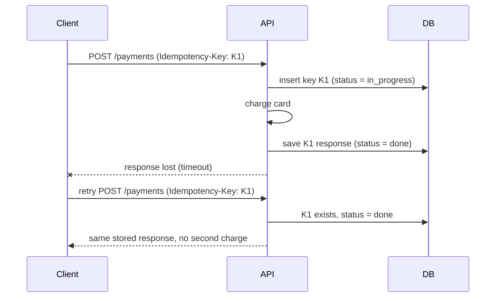
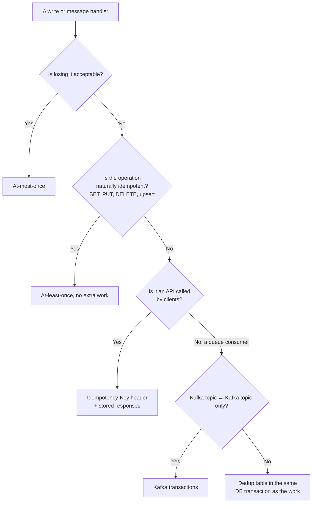

# Idempotency and Delivery Guarantees

## TL;DR
- Networks time out, clients retry and queues redeliver, so **every write path will see
  duplicates**. Plan for them.
- **At-least-once delivery + idempotent handlers** is the standard design. It gives the
  practical effect of exactly-once.
- **At-most-once** only when losing a message is fine (metrics, presence pings).
- **"Exactly-once"** exists only inside a closed system (e.g. Kafka transactions from topic to
  topic). Any side effect outside it, such as an email or a card charge, still needs idempotency.
- Make writes idempotent with **idempotency keys**, **deduplication tables**, **upserts /
  conditional writes**, or **naturally idempotent operations** (`SET` instead of `INCREMENT`).

## The landscape

| Term | Meaning |
|------|---------|
| Idempotent operation | Doing it twice has the same effect as doing it once: `SET balance = 50`, `DELETE order 7` |
| Not idempotent | Each repeat changes the result: `balance = balance - 10`, `INSERT` a new row, "send email" |
| Delivery guarantee | What a messaging system promises: at-most-once, at-least-once, exactly-once |
| Processing guarantee | What your system achieves end to end, after retries and dedup |
| Idempotency key | A unique ID the client sends with a request so the server can recognise a retry |

**Why duplicates happen**
- The client sends a request, the server processes it, the response is lost, and the client retries.
- A consumer processes a message but crashes before acknowledging it; the broker redelivers it.
- A producer retries a publish after a timeout, but the first publish actually succeeded.
- A user double-clicks "Pay".

## Side-by-side comparison

| | At-most-once | At-least-once | Exactly-once (effectively) |
|---|---|---|---|
| Can lose messages | Yes | No | No |
| Can duplicate | No | Yes | No (duplicates are absorbed) |
| How | Acknowledge before processing; never retry | Acknowledge after processing; retry on failure | At-least-once + dedup / idempotency, or transactional processing |
| Cost | Lowest | Low | Higher: dedup storage, transactions |
| Use for | Metrics, logs you can lose, presence, live video frames | Most messaging and APIs | Payments, orders, inventory, billing |
| Examples | UDP telemetry, fire-and-forget publishes | SQS, RabbitMQ with manual acks, Kafka consumers committing after processing | Kafka transactions (topic → topic), consumer + dedup table, Stripe-style idempotency keys |

---

## At-most-once

**What it is.** Each message is delivered once or not at all. The consumer acknowledges (or the
producer forgets) before the work is done, and nobody retries.

**Use when**
- Losing some data is harmless: metrics samples, heartbeats, typing indicators.
- Stale data is worse than missing data: live video or game state updates.

**Don't use when**
- Any message represents money, an order or a user action → at-least-once + idempotency.

**Advantages**
- Simplest and fastest; no duplicates to handle.

**Limitations**
- **Silent data loss** on any crash or network blip.

---

## At-least-once

**What it is.** The sender retries until it gets an acknowledgement, and the consumer
acknowledges only **after** it finishes the work. Nothing is lost, but the same message can
arrive more than once.

**Use when**
- Almost always: SQS, RabbitMQ, Kafka consumers and HTTP clients with retries all work this way.

**Don't use when**
- The handler isn't idempotent and duplicates cause harm. Fix the handler; don't drop the guarantee.

**Advantages**
- No data loss; simple to build with retries and acknowledgements.
- Works with any broker.

**Limitations**
- **Duplicates:** every consumer must deduplicate or be naturally idempotent.
- **Ordering can break:** a retried message can arrive after a later one.
- **Poison messages:** a message that always fails is retried forever; send it to a DLQ (Dead
  Letter Queue) after N attempts (see [message queues](message-queues.md)).

---

## Exactly-once

**What it is.** Each message affects the result exactly once. True exactly-once **delivery**
over an unreliable network is impossible; what systems provide is exactly-once **processing**:

| Approach | How | Scope |
|----------|-----|-------|
| Idempotent consumer | At-least-once delivery + a dedup table keyed by message ID, updated in the same transaction as the work | Your database |
| Kafka idempotent producer | `enable.idempotence=true`: the broker drops duplicate retries of the same producer sequence number | Producer → one partition |
| Kafka transactions | Read, process and write to output topics plus commit offsets in one transaction; consumers use `isolation.level=read_committed` | Kafka topic → Kafka topic |
| Transactional outbox | Write business data and the outgoing event in one DB transaction (see [distributed transactions](distributed-transactions.md)) | DB → broker (at-least-once, deduplicated downstream) |

**Use when**
- Payments, billing, inventory, ledgers: duplicates cost money.
- Stream processing that computes totals (counting a duplicate twice corrupts the result).

**Don't use when**
- Duplicates are harmless or naturally absorbed (setting a status, overwriting a cache) → plain at-least-once.

**Advantages**
- Correct results despite retries and crashes.

**Limitations**
- **Only within a boundary:** Kafka transactions don't cover an email you send or an API you call.
  Those still need idempotency keys.
- **Cost:** dedup storage, transactions and coordination add latency and complexity.
- Dedup records must be kept long enough to catch late retries, which costs storage.

---

## Making operations idempotent

| Technique | How | Example |
|-----------|-----|---------|
| Naturally idempotent writes | Set absolute values instead of applying deltas | `SET status = 'shipped'` instead of "advance status"; `PUT` replaces the whole resource |
| Upsert / unique constraint | A unique key turns a duplicate insert into a no-op | `INSERT … ON CONFLICT (order_id) DO NOTHING` |
| Conditional write (optimistic concurrency) | Apply only if the version matches what you read | `UPDATE … SET stock = 9, version = 8 WHERE id = 7 AND version = 7` |
| Idempotency key (APIs) | Client sends a unique key; server stores the key with the result and replays it on retry | `Idempotency-Key: 5f2b…` header on `POST /payments` |
| Deduplication table (consumers) | Record processed message IDs in the same transaction as the work | `processed_messages(message_id PRIMARY KEY)` |
| Deterministic IDs | Derive the record ID from the input, so a retry produces the same ID | `payment_id = hash(order_id, attempt_group)` |

### Idempotency keys for APIs



Rules:
- The **client generates** the key (a UUID) once per logical operation and reuses it on every retry.
- Store the key with a hash of the request body. A retry with the same key but a different body
  is a client bug: reject it with `422`.
- If the first request is still running, answer `409 Conflict` so the client retries later.
- Expire keys after a window (Stripe keeps them for 24 hours).
- Scope keys per user or account, so one client can't collide with another.

**Worked example: idempotency keys in PostgreSQL**

```sql
CREATE TABLE idempotency_keys (
  account_id    BIGINT      NOT NULL,
  key           TEXT        NOT NULL,
  request_hash  TEXT        NOT NULL,
  status        TEXT        NOT NULL DEFAULT 'in_progress',   -- in_progress | done
  response_code INT,
  response_body JSONB,
  created_at    TIMESTAMPTZ NOT NULL DEFAULT now(),
  PRIMARY KEY (account_id, key)
);

-- 1. Claim the key. Exactly one concurrent request gets a row back.
INSERT INTO idempotency_keys (account_id, key, request_hash)
VALUES (42, 'K1', 'sha256-of-body')
ON CONFLICT (account_id, key) DO NOTHING
RETURNING key;

-- 2a. Got a row: do the work, then store the response.
UPDATE idempotency_keys
SET status = 'done', response_code = 201, response_body = '{"payment_id": "p_123"}'
WHERE account_id = 42 AND key = 'K1';

-- 2b. No row (a retry): return the stored response, or 409 if it's still in progress.
SELECT status, request_hash, response_code, response_body
FROM idempotency_keys WHERE account_id = 42 AND key = 'K1';

-- Housekeeping: drop keys older than the retry window.
DELETE FROM idempotency_keys WHERE created_at < now() - INTERVAL '24 hours';
```

### Idempotent message consumers

```sql
CREATE TABLE processed_messages (
  message_id   TEXT PRIMARY KEY,
  processed_at TIMESTAMPTZ NOT NULL DEFAULT now()
);

BEGIN;
-- Record the message first; a duplicate inserts nothing.
INSERT INTO processed_messages (message_id) VALUES ('msg-789') ON CONFLICT DO NOTHING;
-- Only if that inserted a row (1 row affected), apply the effect in the same transaction:
UPDATE accounts SET balance = balance - 10 WHERE id = 42;
COMMIT;
-- Acknowledge the message to the broker only after COMMIT succeeds.
```

If the consumer crashes after `COMMIT` but before acknowledging, the broker redelivers; the insert
then affects 0 rows, so the handler skips the work and simply acknowledges.

---

## Quick decision points



| If you need… | Choose |
|--------------|--------|
| Safe retries of `POST /payments` or `POST /orders` | Idempotency key + stored response |
| A consumer that updates a database | At-least-once + dedup table in the same transaction |
| Duplicate-free stream processing inside Kafka | Idempotent producer + Kafka transactions |
| Safe "create if missing" | Unique constraint + `ON CONFLICT DO NOTHING` |
| Safe concurrent updates | Conditional write with a version column |
| Cheap telemetry where loss is fine | At-most-once |

**Common combinations in interviews**
- **[Payment system](../_04_Case_Studies/payment-system.md):** idempotency key on every request,
  unique constraint on the provider's charge ID, and a ledger insert keyed by transaction ID.
- **[Notification system](../_04_Case_Studies/notification-system.md):** at-least-once queues plus
  a dedup key per (user, notification) so a retry never sends a second email.
- **Order pipeline:** outbox → Kafka (at-least-once) → consumers with dedup tables; a saga
  coordinates the steps (see [distributed transactions](distributed-transactions.md)).

## Interview questions
**Q: What's the difference between at-least-once and exactly-once?**
At-least-once never loses messages but may deliver duplicates. Exactly-once means each message
affects the result once. In practice it's built as at-least-once delivery plus idempotent or
transactional processing.

**Q: Is exactly-once delivery possible?**
Not over an unreliable network in general: a sender can't tell a lost message from a lost
acknowledgement. Systems provide exactly-once processing inside a boundary, like Kafka
transactions or a database transaction with a dedup table.

**Q: How do you make `POST /payments` safe to retry?**
The client sends an `Idempotency-Key` header. The server claims the key in a table with a unique
constraint, processes the payment once, stores the response, and replays that response for any
retry with the same key.

**Q: Which HTTP methods are idempotent?**
GET, PUT and DELETE (also HEAD and OPTIONS). POST isn't; PATCH isn't guaranteed. See
[API design](api-design.md).

**Q: A consumer charged a customer twice. What went wrong and how do you fix it?**
It processed the message, crashed before acknowledging, and the broker redelivered it. Store
processed message IDs in the same transaction as the effect, and pass an idempotency key to the
payment provider.

**Q: How long do you keep idempotency keys or dedup records?**
At least as long as clients or brokers might retry: usually hours to days (Stripe uses 24 hours).
Expire them to bound storage.

## Related
- [Message queues](message-queues.md)
- [Distributed transactions](distributed-transactions.md): outbox and sagas
- [Reliability](reliability.md): retries with backoff
- [API design](api-design.md)
- [Payment system](../_04_Case_Studies/payment-system.md)
