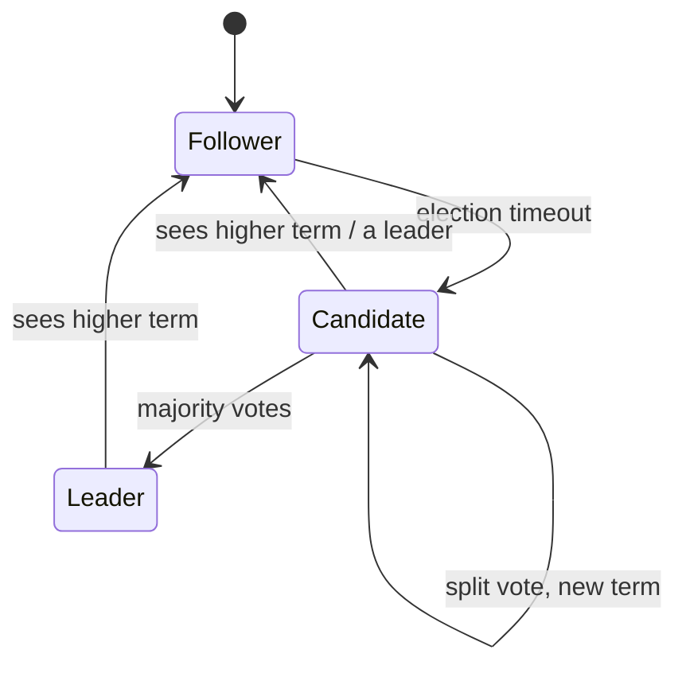
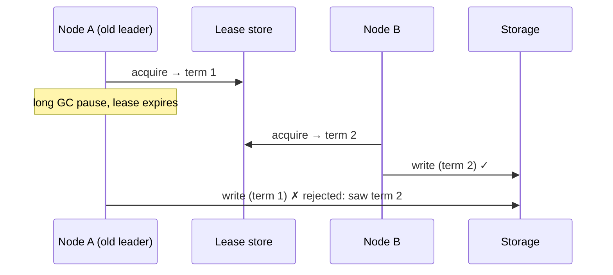
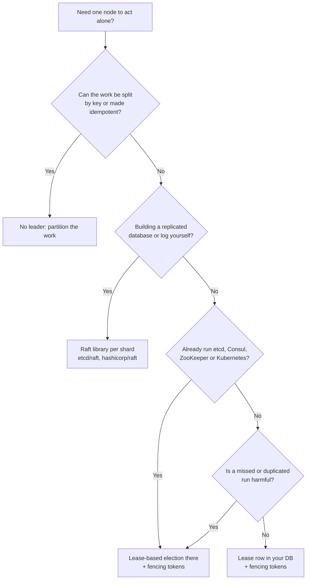

# Leader Election and Consensus

## TL;DR
- **Don't build consensus yourself.** Use a coordination service that already implements it:
  **etcd** or **Consul** (Raft) or **ZooKeeper** (ZAB), and take a **lease** there to elect a leader.
- **Raft** when you're building or choosing a replicated system and want an understandable,
  widely implemented algorithm (etcd, Consul, CockroachDB, TiKV, Kafka KRaft).
- **Paxos / Multi-Paxos** to understand the theory and the systems built on it (Google Chubby,
  Spanner); in practice you meet it inside products, rarely write it.
- **ZAB** if you run ZooKeeper (HBase, older Kafka, Hadoop, Solr).
- **Lease on a database row or Redis key** for a single non-critical job (a cron scheduler),
  only with **fencing tokens**, and knowing it's only as available as that one store.
- **Bully / ring algorithms** only in textbooks: they assume reliable failure detection and can
  elect two leaders during a network partition.
- **No leader at all** when the work can be split by key ([sharding](sharding.md)) or made
  idempotent so any node can do it ([leaderless replication](replication.md#leaderless)).

## Why you need it

| Problem | Why one leader helps | Example |
|---------|----------------------|---------|
| Order all writes | One node decides the order; followers copy it | PostgreSQL primary, Kafka partition leader |
| Run a job exactly once | Only the leader runs the scheduler | Kubernetes controller manager, cron service |
| Own a shard or lock | One owner per partition at a time | Kafka controller, HBase region server |
| Agree on config / membership | All nodes see the same cluster view | etcd for Kubernetes, ZooKeeper for HBase |

**Consensus** is getting several nodes to agree on one value (or one sequence of values, a
replicated log) even when some nodes crash and messages are delayed. **Leader election** is one
use of it: agreeing on who the leader is for a **term**. Both need a **majority (quorum)**:

| Nodes (N) | Majority | Failures tolerated | Note |
|-----------|----------|--------------------|------|
| 1 | 1 | 0 | No fault tolerance |
| 3 | 2 | 1 | The usual minimum |
| 4 | 3 | 1 | No better than 3; more nodes to wait on |
| 5 | 3 | 2 | Common for etcd / ZooKeeper in production |
| 7 | 4 | 3 | Rare; every write waits for more nodes |

Tolerate `f` failures with `2f + 1` nodes. Two majorities always share at least one node, so two
leaders can't both be confirmed in the same term. That overlap is the whole trick.

## Side-by-side comparison

| | Raft | Multi-Paxos | ZAB | Lease in coordination service | Lease on DB row / Redis key | Bully / ring |
|---|---|---|---|---|---|---|
| What it is | Consensus algorithm with a strong leader and a replicated log | Consensus algorithm; family of variants | ZooKeeper's atomic broadcast protocol | Use etcd/ZooKeeper/Consul to elect | A single store holds a row "who leads, until when" | Classic election by node ID |
| Safe during partitions | Yes | Yes | Yes | Yes (the service is consensus-backed) | Only as safe as the store + fencing | **No**: can elect two leaders |
| Fault tolerance | f of 2f+1 | f of 2f+1 | f of 2f+1 | Service's quorum | The single store is the SPOF | Any, but unsafe |
| Understandability | Designed for it | Notoriously hard | Medium | Easy: an API call | Easy | Easy |
| You implement it? | Library (etcd/raft, hashicorp/raft) or product | Almost never | No (ZooKeeper does) | No, just use the client | A few lines of SQL | Yes |
| Used by | etcd, Consul, CockroachDB, TiKV, Kafka KRaft, RabbitMQ quorum queues, MongoDB (Raft-like) | Chubby, Spanner (per split), Megastore | ZooKeeper | Kubernetes leader election (Lease objects), Patroni, Kafka clients of ZK | Small cron/worker fleets | Textbooks, some old systems |

---

## Raft

**What it is.** A consensus algorithm (Ongaro and Ousterhout, 2014) designed to be easier to
understand than Paxos. Each node is a **follower**, **candidate** or **leader**. Time is split
into numbered **terms**; each term has at most one leader. The leader appends client commands to
its **log** and replicates them; an entry is **committed** once a majority stores it.

| Step | What happens |
|------|--------------|
| 1. Heartbeats | The leader sends `AppendEntries` (empty = heartbeat) to followers regularly |
| 2. Timeout | A follower that hears nothing for a **randomized election timeout** (the paper suggests 150–300 ms) becomes a candidate, increments the term and votes for itself |
| 3. Vote | It sends `RequestVote` to all; each node grants **one vote per term**, and only to a candidate whose log is at least as up to date as its own |
| 4. Win | With votes from a majority it becomes leader and starts heartbeats |
| 5. Split vote | Nobody wins; randomized timeouts make a repeat unlikely and a new term starts |
| 6. Step down | Any node that sees a higher term reverts to follower |



**Use when**
- You need a strongly consistent replicated state machine: metadata, config, locks, a small KV store.
- Choosing a system: "it uses Raft" tells you it's CP (Consistency over Availability under
  partition, see [CAP](cap-and-consistency.md)) and needs a majority up.

**Don't use when**
- Big, high-throughput data paths across many nodes in one group: every write waits for a
  majority → shard into many Raft groups (CockroachDB and TiKV run one group per range).
- Writes must succeed during partitions in every region → leaderless / multi-leader replication.

**Advantages**
- Understandable; many production-grade libraries and a formal (TLA+) spec.
- Strong leader simplifies the log: entries flow only leader → followers.
- Safe under crashes, delays and partitions; a minority side can't commit.

**Limitations**
- **Leader is a throughput bottleneck:** all writes go through one node per group. Shard into groups.
- **Unavailable without a majority:** lose 2 of 3 nodes and writes stop.
- **Cross-region latency:** each commit needs a round trip to a majority; place nodes so a majority is close.
- Reads from the leader can be stale if it has been deposed without knowing; use **ReadIndex** or
  **leader leases** for linearizable reads.

---

## Paxos and Multi-Paxos

**What it is.** The original consensus algorithm (Leslie Lamport; published 1998, "Paxos Made
Simple" 2001). Basic Paxos agrees on **one** value in two phases; **Multi-Paxos** elects a stable
leader to skip phase 1 and agree on a sequence of values, which ends up close to Raft.

| Phase | Proposer sends | Acceptors reply |
|-------|----------------|-----------------|
| 1a / 1b Prepare | `prepare(n)` with a proposal number higher than any it has used | `promise(n)`: ignore lower numbers; report any value already accepted |
| 2a / 2b Accept | `accept(n, v)`, where `v` is the highest-numbered value reported, or its own | `accepted(n, v)` unless they promised a higher `n` |
| Chosen | A majority accepted `(n, v)` | Learners learn `v` |

**Use when**
- Understanding the theory and reading papers (Chubby, Spanner, Megastore).
- Some products expose Paxos-based features: Cassandra's lightweight transactions (`IF NOT EXISTS`)
  use Paxos (the newer Accord protocol, CEP-15, targets general transactions; check your version);
  Spanner replicates each split with Paxos.

**Don't use when**
- You're implementing consensus yourself → pick a Raft library, or better, use etcd/ZooKeeper.

**Advantages**
- Proven, minimal core; many variants (Fast Paxos, EPaxos, Flexible Paxos) for special needs.
- No fixed leader required for correctness: any node can propose.

**Limitations**
- **Hard to understand and to turn into a full system:** the paper leaves log management,
  membership changes and leader election to the implementer. That gap is why Raft exists.
- **Duelling proposers** can livelock basic Paxos; Multi-Paxos fixes it with a stable leader.

---

## ZAB (ZooKeeper Atomic Broadcast)

**What it is.** The protocol inside Apache ZooKeeper. A leader orders all writes, identified by a
**zxid** (epoch + counter), and broadcasts them; a write commits when a quorum acknowledges it.
After a leader fails, a recovery phase elects the node with the most recent history and syncs
followers before new writes are accepted. Clients use ZooKeeper's **ephemeral sequential znodes**
to build elections and locks.

**Use when**
- You already run ZooKeeper (HBase, Solr, Hadoop HA, older Kafka clusters).

**Don't use when**
- New systems: etcd or Consul are common choices now. Kafka removed ZooKeeper completely in Kafka
  4.0 (2025) in favour of its built-in Raft (KRaft).

**Advantages**
- Mature and battle-tested; clean recipes for election, locks and group membership.

**Limitations**
- **Another cluster to operate** (JVM tuning, session timeouts).
- Writes go through one leader; not for high write volumes.

---

## Lease-based election in a coordination service

**What it is.** The way applications actually elect leaders. Each candidate tries to create the
same key in etcd, ZooKeeper or Consul, attached to a **lease** (TTL session). The one that creates
it is leader; it keeps renewing the lease. If it dies or is cut off, the lease expires, the key
disappears and another candidate wins. The service runs Raft or ZAB underneath, so the decision is
safe.

| Service | Primitive | Example |
|---------|-----------|---------|
| etcd | Lease + transaction "create key if absent"; `etcdctl elect`; Go `concurrency.Election` | Kubernetes control plane, Patroni |
| ZooKeeper | Ephemeral sequential znode; lowest sequence number leads; the next one watches its predecessor | HBase master, Curator `LeaderLatch` |
| Consul | Session + KV `acquire` lock | Vault HA, service leaders |
| Kubernetes | `coordination.k8s.io/v1` Lease object, client-go `leaderelection` | Controllers and operators |

**Use when**
- A service runs N replicas for availability but only one may do some work at a time
  (scheduler, controller, single writer to an external system).
- Automatic database failover (Patroni uses etcd/Consul/ZooKeeper to decide the PostgreSQL primary).

**Don't use when**
- The work can be split among all replicas (partition it by key) → no leader needed.
- You don't run a coordination service and the job is non-critical → a database lease may do.

**Advantages**
- Correctness comes from a proven consensus implementation; your code is a few API calls.
- Watches/notifications tell followers immediately when leadership changes.

**Limitations**
- **A lease isn't a guarantee you're still leader:** a GC pause or network delay longer than the
  TTL means the old leader keeps working after a new one is elected. Protect resources with
  **fencing tokens** (below).
- **TTL trade-off:** short TTL = fast failover but false elections on brief hiccups; long TTL =
  slow failover. Typical values are seconds to tens of seconds.

---

## Lease on a database row or Redis key

**What it is.** The same lease idea with an ordinary database as the referee: one row says who
leads and until when. Every candidate runs an atomic "take it if free or expired" statement. The
database's own clock decides expiry, so node clocks don't matter.

**Use when**
- A small fleet (2–5 instances) with one cron-like job, and you already depend on that database.

**Don't use when**
- Correctness is critical and must survive the store failing → coordination service.
- Redis with async replication: a failover can lose the lease key and elect two leaders. The
  multi-node Redlock algorithm is debated (Martin Kleppmann's critique vs Salvatore Sanfilippo's
  reply); don't rely on it for correctness without fencing.

**Advantages**
- No new infrastructure; easy to read and test.

**Limitations**
- **The store is a single point of failure** for leadership.
- Same lease-expiry problem as above: still needs fencing.

---

## Bully and ring algorithms

**What it is.** Classic algorithms from distributed-systems courses. **Bully:** a node that
notices the leader is gone messages all higher-ID nodes; if none answer, it declares itself
leader. **Ring:** an election message travels around a logical ring collecting IDs; the highest wins.

**Use when**
- Learning, or inside a system whose network gives reliable failure detection (rare).

**Don't use when**
- Real networks, where "no reply" can mean slow, not dead → a quorum-based algorithm.

**Advantages**
- Very simple.

**Limitations**
- **Split brain:** during a partition, each side elects its own leader, because nothing requires a majority.
- Message-heavy (bully is O(n²) in the worst case).

---

## Split brain and fencing tokens

**Split brain** is two nodes acting as leader at the same time. It happens when the old leader is
paused or partitioned, a new leader is elected, and the old one wakes up still believing it leads.
Elections alone can't stop it, because the old leader doesn't know it was replaced.

**Fencing token:** every election returns a number that only increases (Raft term, ZooKeeper zxid,
etcd revision, or a `term` column). The leader sends it with every write; the **resource** rejects
any write with a token lower than the highest it has seen.



### Worked example: a lease with fencing in PostgreSQL

Tested on PostgreSQL 17.

```sql
CREATE TABLE leader_lease (
  name       TEXT PRIMARY KEY,         -- one row per elected role, e.g. 'scheduler'
  holder     TEXT NOT NULL,
  term       BIGINT NOT NULL,          -- fencing token (increases on every change of leader)
  expires_at TIMESTAMPTZ NOT NULL
);

-- Acquire or renew, atomically. Run every ~3 s with a 10 s lease.
INSERT INTO leader_lease AS l (name, holder, term, expires_at)
VALUES ('scheduler', :me, 1, now() + interval '10 seconds')
ON CONFLICT (name) DO UPDATE
SET holder     = EXCLUDED.holder,
    term       = CASE WHEN l.holder = EXCLUDED.holder THEN l.term ELSE l.term + 1 END,
    expires_at = EXCLUDED.expires_at
WHERE l.holder = EXCLUDED.holder        -- I already lead: renew
   OR l.expires_at < now()              -- or the old lease expired: take over
RETURNING holder, term;                 -- a row back = I lead with this term; no row = someone else does
```

| Call | Result |
|------|--------|
| `node-a` acquires | `node-a`, term 1 |
| `node-b` tries while the lease is valid | no row: not leader |
| `node-a` renews | `node-a`, term 1 |
| `node-a` stalls past `expires_at`; `node-b` tries | `node-b`, **term 2** |

```sql
-- The protected resource checks the token on every write
CREATE TABLE job_state (job_id TEXT PRIMARY KEY, value TEXT, writer_term BIGINT NOT NULL);

UPDATE job_state SET value = 'done-by-b', writer_term = 2
WHERE job_id = 'nightly-report' AND writer_term <= 2;          -- UPDATE 1

UPDATE job_state SET value = 'late-write-by-a', writer_term = 1
WHERE job_id = 'nightly-report' AND writer_term <= 1;          -- UPDATE 0: stale leader fenced off
```

Rules for the leader: stop doing leader work as soon as a renewal fails or the lease is close to
expiry by its own (monotonic) clock, and always send the term with writes.

---

## Quick decision points



| If you need… | Choose |
|--------------|--------|
| One active scheduler among N replicas on Kubernetes | Kubernetes Lease / client-go leader election |
| Automatic PostgreSQL failover | Patroni with etcd or Consul |
| A strongly consistent config / metadata store | etcd or Consul (Raft), ZooKeeper (ZAB) |
| A distributed SQL DB's replication | Raft per range (CockroachDB, TiDB, YugabyteDB) or Paxos (Spanner) |
| A cheap single-job lock, non-critical | DB lease row with a term column |
| Writes that never block during partitions | No consensus: leaderless replication with conflict resolution |

**Common combinations in interviews**
- **[Distributed key-value store](../_04_Case_Studies/distributed-key-value-store.md):** Raft per
  partition for a CP design, or leaderless quorums (Dynamo-style) for AP.
- **Kafka:** a controller quorum (KRaft) elects partition leaders; producers write to the leader.
- **[Notification system](../_04_Case_Studies/notification-system.md) / schedulers:** one leader
  assigns work, or no leader with partitioned queues.

## Interview questions
**Q: Why do consensus clusters have an odd number of nodes?**
A majority of 4 is 3, which tolerates 1 failure: the same as 3 nodes, with more nodes to wait on.
`2f + 1` nodes tolerate `f` failures, so 3 or 5 is typical.

**Q: Raft vs Paxos?**
Both are safe under the same failure model and need a majority. Raft was designed to be easier to
understand and implement: one strong leader, log entries only flow from it, randomized timeouts
for elections, and a full spec for membership changes. Multi-Paxos ends up similar but leaves more
to the implementer.

**Q: How does Raft prevent two leaders?**
Each node votes at most once per term, and a leader needs a majority. Two majorities overlap, so
two candidates can't both win the same term. An old leader with a lower term steps down when it
sees the higher term.

**Q: What is split brain and how do you prevent it?**
Two nodes both acting as leader, usually after a partition or a long pause. Require a majority to
elect, and fence the old leader: storage rejects writes carrying an older term or token.

**Q: Why isn't a lease enough on its own?**
The leader can't be sure its lease is still valid at the moment its write lands: a GC pause or
network delay can outlast the TTL. A fencing token checked by the resource closes the gap.

**Q: Leader election vs distributed lock?**
Same mechanism (a lease on a key). A lock guards one critical section for a short time; election
makes one node responsible for a role for a long time, renewing continuously. Both need fencing.

**Q: How fast is failover?**
Detection (election timeout or lease TTL) plus the election itself. With Raft-style timeouts of
hundreds of milliseconds, a new leader can be in place in about a second on a LAN; lease-based
setups with 10–30 s TTLs fail over in that range. Shorter means more false failovers.

**Q: Can you get consensus without a majority available?**
No. If the majority is unreachable, a CP system stops accepting writes rather than risk two
histories. That's the C-over-A choice in [CAP](cap-and-consistency.md).

## Related
- [Replication](replication.md): single-leader failover, split brain, quorums
- [CAP and consistency](cap-and-consistency.md): why consensus systems are CP
- [Distributed transactions](distributed-transactions.md): 2PC's coordinator is a single point; consensus-based commit fixes it
- [Service discovery](service-discovery.md): etcd, Consul and ZooKeeper also serve as registries
- [Sharding](sharding.md): one consensus group per shard
- [Reliability](reliability.md): failover, health checks
