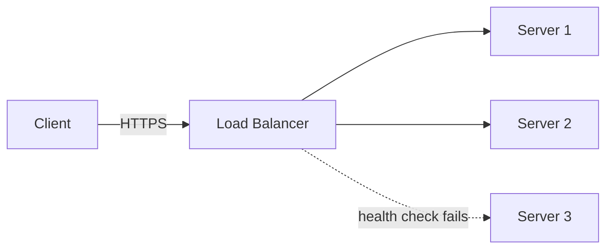
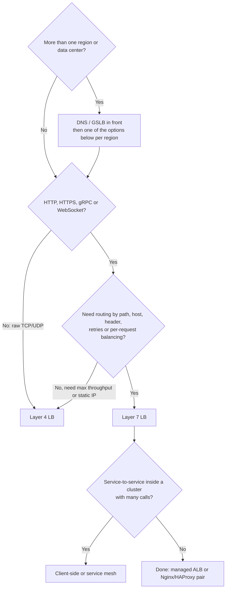

# Load Balancer

## TL;DR
A load balancer (LB) spreads traffic across servers and removes unhealthy ones. Layer 4 is
fast but blind to URLs; Layer 7 can route on HTTP details.

- **Layer 7 (application) LB** for HTTP, HTTPS, gRPC and WebSocket services: path/host routing, TLS (Transport Layer Security) termination, retries. The default for web apps (AWS ALB, Nginx, HAProxy, Envoy).
- **Layer 4 (transport) LB** for raw TCP/UDP, extreme throughput or latency, static IPs, or non-HTTP protocols (databases, game servers, MQTT). (AWS NLB, HAProxy in `tcp` mode.)
- **DNS / global (GSLB)** to send users to the nearest or healthiest region or data center. Always *in front of* the others, never instead of them.
- **Client-side balancing** for service-to-service calls inside a cluster (gRPC, service mesh, Kubernetes): no extra hop.
- **Algorithm:** **round robin** for equal servers and short requests; **least connections** or **power of two choices** when requests vary a lot; **consistent hash** when the same key should hit the same server (caches).
- **Use none** for one server, or when a managed platform already does it for you (Kubernetes `Service`, serverless, a managed API gateway).

## What a load balancer does

| Job | Detail |
|-----|--------|
| **Distribute** | Spread requests over many servers so none is overloaded (horizontal scaling, see [scalability](scalability.md)) |
| **Health checking** | Stop sending traffic to dead or sick servers; add them back when they recover |
| **Single entry point** | Clients see one address; you add, remove and replace servers behind it |
| **Offload** | TLS termination, compression, connection pooling, HTTP/2 |
| **Routing** (Layer 7) | By host, path, header or cookie: `/api` → API servers, `/static` → file servers |
| **Resilience** | Retry on another server, drain connections for deployments, shed load |

The servers behind it should be **stateless**, so any of them can handle any request (see [scalability](scalability.md)).

## Ways to balance load

| Where | What decides | Sees | Examples |
|-------|--------------|------|----------|
| **DNS / GSLB** (Global Server Load Balancing) | Which IP the name resolves to | Domain name, client's resolver location | Route 53, Azure Traffic Manager, Cloudflare |
| **Layer 4 LB** | Which server gets the TCP connection | IP addresses and ports | AWS NLB, HAProxy (`mode tcp`), LVS, Google Maglev |
| **Layer 7 LB** | Which server gets each HTTP request | URL, headers, cookies, body | AWS ALB, Nginx, HAProxy (`mode http`), Envoy, Traefik |
| **Client-side** | The caller picks a server from a list | Service registry, its own stats | gRPC client balancing, Envoy sidecars, Netflix Ribbon |

A typical stack uses several: DNS picks a region, a Layer 4 or Layer 7 LB spreads over servers
in the region, and a service mesh balances calls between services.

## Side-by-side comparison

| | DNS / GSLB | Layer 4 | Layer 7 | Client-side |
|---|---|---|---|---|
| Balances | Regions, data centers | TCP/UDP connections | HTTP requests | Calls from one service to another |
| Can route by URL / header | No | No | Yes | Depends on the client library |
| Throughput | Not in the data path | Very high (millions of connections) | Lower: parses and often terminates TLS | No extra hop |
| Added latency | None (just the lookup) | Very low | Low (parsing, buffering) | None |
| Health awareness | Slow: TTLs and caches delay failover | Fast (active checks, seconds) | Fast (active + passive) | Depends on the registry |
| Handles TLS | Not involved | Pass-through (some can terminate) | Terminates, can re-encrypt | Mesh sidecar (mTLS) |
| Spreads load per request | No: per lookup | Per connection | Per request | Per request |
| Long-lived connections | n/a | Balanced only at connect time | HTTP/2 and gRPC need Layer 7 awareness | Per-call with the right client |
| Extra hop and cost | None | One | One | None |
| Single point of failure risk | No (but TTL lag) | Yes unless redundant | Yes unless redundant | No |
| Typical use | Multi-region, failover | Databases, TCP, UDP, huge scale | Web apps and APIs | Microservices |

---

## DNS / global load balancing

**What it is.** The domain name resolves to **different IPs** depending on who asks, where
they are or which sites are healthy. The **GSLB** (Global Server Load Balancing) layer
returns the nearest, least loaded or healthy region. Anycast (many sites announce the same IP,
and the network routes each user to the nearest) does it at the routing layer: Cloudflare and
Google use it.

| Policy | Result |
|--------|--------|
| Round-robin records | Rotate several IPs |
| Latency-based | Lowest-latency region for the user |
| Geo / geo-proximity | By the user's country or continent (data-residency rules) |
| Weighted | 90/10 for gradual regional rollouts |
| Failover | Primary region, secondary if health checks fail |

**Use when**
- Multi-region or multi-data-center deployments: route users to the closest region.
- Regional failover and disaster recovery.
- Gradual migrations (weighted records).

**Don't use when**
- You need instant failover or per-request balancing → Layer 4 or Layer 7 behind it. DNS answers are **cached** by resolvers and clients, so changes take up to the TTL (Time To Live) to spread.
- You need to balance inside one site → a Layer 4/7 LB.

**Advantages**
- Cheap, no data-path hop, works with any protocol.
- Only practical way to steer traffic between regions.

**Limitations**
- **Slow failover:** clients and resolvers keep old answers for the TTL, and some ignore it. Fix: low TTLs (30–60 s) with health-checked records, anycast, or a global LB in front.
- **Coarse and uneven:** one resolver can represent millions of users, and balancing is per lookup, not per request.
- **Not load aware** by default: it can't tell that a region is overloaded unless a health check or weight says so.

---

## Layer 4 (transport) load balancer

**What it is.** Works on **connections**: it looks at IP address and port, picks a server, and
forwards the TCP (or UDP) packets without reading the HTTP inside. Variants: a **proxy**
terminates the client connection and opens a second one to the server, or **pass-through**
(NAT, or Direct Server Return, where servers reply straight to the client) rewrites packets.
Because it does so little, it's fast.

```
# HAProxy, Layer 4: any TCP protocol, no HTTP awareness
listen tcp_pass
  mode tcp
  bind *:81
  balance roundrobin
  server app1 app1:80 check
  server app2 app2:80 check
```

**Use when**
- Very high connection rates or throughput with minimal latency (millions of connections).
- Non-HTTP protocols: databases, MQTT, game servers, SMTP, custom TCP, UDP (DNS, video).
- You need a **static IP**, source-IP preservation, or TLS pass-through (the LB never sees the traffic).
- As the outer, dumb, fast tier in front of a fleet of Layer 7 proxies.

**Don't use when**
- You need to route by URL, header or cookie → Layer 7.
- You need HTTP retries, request-level metrics or per-request balancing of gRPC/HTTP/2 → Layer 7.
- You need WAF (Web Application Firewall) rules or HTTP-level rate limiting → Layer 7.

**Advantages**
- Highest throughput and lowest latency; simple and cheap to run.
- Protocol-agnostic.
- Keeps the client's IP (or passes it with the PROXY protocol).

**Limitations**
- **Blind to requests:** can't route on `/api` vs `/images`, can't see status codes, can't retry a failed request. Fix: add Layer 7 behind it.
- **Uneven load for long-lived connections:** a connection stays on its server for its life. A gRPC or HTTP/2 client multiplexing 10,000 requests over one connection loads one server. Fix: Layer 7 or client-side balancing.
- **Coarse health checks** (TCP connect) can pass while the app is broken. Fix: an HTTP health check where supported.

---

## Layer 7 (application) load balancer

**What it is.** Terminates the client's connection, **reads each HTTP request**, picks a
server by rule and algorithm, and forwards it on a separate connection. Because it
understands HTTP it can route by host, path, header or cookie, terminate TLS, retry, cache,
compress, and report per-request metrics. Often called a reverse proxy.

```
# Nginx, Layer 7: round robin with passive health checks
upstream app {
    server app1 max_fails=3 fail_timeout=10s;
    server app2 max_fails=3 fail_timeout=10s;
    server app3 max_fails=3 fail_timeout=10s;
}
server {
    listen 80;
    location /api/    { proxy_pass http://app; }
    location /static/ { proxy_pass http://file_servers; }
}
```

| Routing rule | Example |
|--------------|---------|
| Path | `/api/*` → API pool, `/images/*` → image pool |
| Host | `shop.example.com` → shop service, `admin.example.com` → admin |
| Header / cookie | `X-Version: beta` → canary pool |
| Weighted split | 95% stable, 5% canary (progressive delivery) |

**Use when**
- Web apps and APIs (HTTP, HTTPS, gRPC, WebSocket): the usual choice.
- Several services behind one domain (microservices, path-based routing).
- You want TLS termination in one place, HTTP/2 to clients, request retries and per-request metrics.
- Canary releases, A/B tests, blue-green deployments.

**Don't use when**
- Raw TCP/UDP or max performance → Layer 4.
- You must keep end-to-end encryption without the LB ever seeing the data → Layer 4 TLS pass-through.
- A tiny setup where a platform already routes (Kubernetes `Service`) → don't add another hop.

**Advantages**
- Smart routing, retries, health checks that call a real endpoint (`/healthz`).
- Offloads TLS, compression and connection management from the servers.
- Rich observability: per-route latency, status codes, error rates.
- Balances each request, so HTTP/2 and gRPC load spreads properly.

**Limitations**
- **More CPU and latency than Layer 4:** it parses every request and often decrypts TLS. Fix: scale the LB tier out, put a Layer 4 LB in front.
- **Client IP is hidden:** servers see the LB's IP. Fix: the `X-Forwarded-For` header (or the PROXY protocol).
- **It's a critical component:** a bad config or an overloaded LB takes everything down. Fix: redundant LBs, config tests, gradual rollouts.
- **Retries can duplicate work:** retrying a non-idempotent `POST` can double-charge. Fix: retry only idempotent requests or use idempotency keys (see [reliability](reliability.md)). Nginx does not retry a non-idempotent request after it was sent unless you opt in.
- **WebSocket and long connections** pin to one server, so use timeouts and draining carefully.

---

## Layer 4 vs Layer 7

| | Layer 4 | Layer 7 |
|---|---|---|
| Works at | Network level (IP + port) | Application level (HTTP) |
| Can route by | Address and port only; can't read URLs | URL, header, cookie |
| Speed | Fast | Slower but smarter |
| TLS | Usually passes it through unread | Terminates it (and can re-encrypt to servers) |
| Balances | Connections | Requests |
| Health checks | TCP connect | HTTP status and body |
| gRPC / HTTP/2 | One connection = one server | Spreads each call |
| Typical products | AWS NLB, LVS, Maglev | AWS ALB, Nginx, HAProxy, Envoy |



**Rule of thumb:** Layer 7 unless you have a reason for Layer 4. Both together is common:
a Layer 4 LB gives the stable public IP and raw throughput, and a fleet of Layer 7 proxies
behind it does the routing.

---

## Client-side load balancing

**What it is.** There is no balancer in the middle. The **caller** keeps a list of
healthy servers (from service discovery such as DNS, Consul, Kubernetes endpoints or a mesh
control plane) and picks one for every call. In a **service mesh** (Istio, Linkerd) a sidecar proxy
next to each service does it for the app.

**Use when**
- Many internal microservice calls where an extra hop per call hurts latency and cost.
- gRPC and HTTP/2, which need per-call balancing.
- You already run service discovery or a mesh.

**Don't use when**
- External clients (browsers, mobile apps) → server-side LB.
- Many languages and no shared library or mesh to keep policy consistent.

**Advantages**
- No extra hop, no central bottleneck or single point of failure.
- The caller can use its own latency stats (least request, power of two choices).

**Limitations**
- **Logic in every client:** every language and version needs it; policy changes mean redeploying clients. Fix: a mesh sidecar.
- **Stale server lists** send calls to dead instances. Fix: short registry TTLs plus client-side health tracking, retries and circuit breakers ([reliability](reliability.md)).
- **Harder to see and control** than one central LB.

---

## Algorithms

| Algorithm | How it works | Good for | Weakness |
|-----------|--------------|----------|----------|
| Round robin | Each server in turn | Equal servers | Ignores that requests cost different amounts |
| Weighted round robin | Round robin, but bigger servers get more turns | Mixed hardware, canaries (95/5) | Weights are static |
| Least connections | Server with the fewest open connections | Long-lived or variable-cost requests | Needs shared state across LB nodes; new servers get flooded |
| Weighted least connections | Least connections scaled by weight | Mixed hardware and variable requests | Same |
| Least response time | Fewest active connections and lowest average latency | Servers with uneven performance | Noisy signal; needs measuring |
| **Power of two choices** | Pick two random servers, send to the less loaded | Many LBs or clients with no shared state | Needs a load signal |
| Random | A random server | Very simple, no state | Uneven in the short term |
| IP / key hash | Same client → same server | Sticky sessions, caches (see [consistent hashing](consistent-hashing.md)) | Uneven if keys are skewed; reshuffles when servers change unless consistent |

**Pick:**
- Equal servers, similar short requests → **round robin**.
- Requests vary (seconds vs milliseconds), or long-lived connections (WebSocket, uploads) → **least connections**.
- Many independent balancers or client-side balancing → **power of two choices**.
- Cache servers or per-user state → **consistent hash** on the key, so adding a server moves only about 1/N of keys ([consistent hashing](consistent-hashing.md)). Google's Maglev and Envoy's ring hash use it.

**Why two random choices work.** Sending each request to a *random* server leaves some servers
much busier than others. Sampling just **two** and picking the less loaded avoids almost all of
that, with no shared state. A quick simulation of 1,000 requests over 1,000 servers (20 runs):
the busiest server got **5 to 7** requests with pure random, and **3** every time with two choices.
Envoy's `LEAST_REQUEST` does this by default, and Nginx has `random two least_conn`.

**Weighted and slow start.** Give a new server a small weight and ramp up (**slow start**), so a cold
JIT or empty cache isn't hit with its full share at once.

---

## Health checks

| Type | How | Pros | Cons |
|------|-----|------|------|
| **Active** | The LB calls `GET /healthz` every few seconds | Finds failures before users do; detects recovery | Extra traffic; the check may not match real traffic |
| **Passive** | The LB watches real responses and marks a server down after N failures | No extra traffic; reflects real requests | Users see the first failures (unless retried) |

Use both where you can. (Open-source Nginx has only passive checks; HAProxy, Envoy and cloud LBs do both.)

- **Shallow check** (process up, can accept a request) for the LB. **Deep checks** (calls the database) can cause a *cascading failure*: a slow DB marks every server unhealthy and the LB has nothing left to send to. Keep dependency checks for *readiness* in the app, not for removing every server at once.
- **Thresholds:** mark down after N failures (e.g. 2–3) and up after M successes, so one slow response doesn't flap the server.
- **Connection draining:** when removing a server (deploy, scale-in), stop sending new requests but let in-flight ones finish (AWS calls it deregistration delay). Avoids dropped requests on every release.
- **Retry on another server** for failures that happen before a response, and only for idempotent requests.
- **Panic mode:** if almost all servers look unhealthy, many LBs send traffic to all of them anyway, because it's better than nothing.

---

## Sticky sessions (session affinity)

**What it is.** The LB keeps sending a client to the **same server**: by source IP hash, or by a
cookie the LB sets (`AWSALB`, `SERVERID`). Used when a server keeps per-user state in memory.

**Prefer stateless servers.** Sticky sessions cause:
- **Uneven load:** a busy user (or a big office behind one IP) pins to one server.
- **Lost sessions** when that server dies or is scaled in.
- **Harder deployments and autoscaling.**

Fix: move session state to a shared store such as Redis (see [cache](cache.md)) or a signed token
(JWT, see [security](security.md)), then any server can handle any request. Keep stickiness for
WebSocket connections, cache locality or legacy apps, and always handle the case where the server is gone.

---

## TLS termination

| Mode | LB does | Servers get | Use when |
|------|---------|-------------|----------|
| **Terminate** (offload) | Decrypts HTTPS, sends plain HTTP | HTTP | Simplest; the network behind the LB is trusted |
| **Re-encrypt** | Decrypts, inspects, re-encrypts to servers | HTTPS | Compliance requires encryption inside the network |
| **Pass-through** | Layer 4 only, never decrypts | HTTPS from the client | End-to-end encryption, no inspection |

Terminating at the LB centralizes certificates (one place to renew) and offloads the CPU cost. See [security](security.md).

---

## Making the load balancer itself reliable

A single LB is a **single point of failure**. Options:

| Approach | How | Notes |
|----------|-----|-------|
| **Active-passive pair** | Two LBs share a floating (virtual) IP using VRRP (Virtual Router Redundancy Protocol, e.g. keepalived); the standby takes over if the active dies | Simple; half the capacity idle; failover takes seconds |
| **Active-active** | Several LBs all serve traffic, spread by DNS, anycast or ECMP (Equal-Cost Multi-Path routing) | Uses all capacity; needs a front door |
| **Managed cloud LB** | AWS ALB/NLB, Azure Load Balancer, Google Cloud LB run as a redundant, auto-scaling fleet | You never see a single box |
| **Layered** | DNS → Layer 4 tier → Layer 7 tier | How the biggest sites do it |

Also: keep LB config in version control, test it before rollout (`nginx -t`), and keep headroom
because the LB tier must survive the loss of one node.

---

## Capacity: a quick estimate

Assume **50,000 QPS** (queries per second) at peak, and each app server handles **2,000 QPS** at a safe
utilisation (both are assumptions; measure yours).

```
servers needed      = 50,000 / 2,000                   = 25
+ headroom (30%)    = 25 × 1.3                         ≈ 33
+ N+1 / AZ failure  = losing 1 of 3 zones removes 1/3, so size for 2 zones:
                      50,000 / 2,000 / (2/3) = 37.5   ≈ 38 servers across 3 zones
health-check load   = 38 servers × 1 check/s × 3 LB nodes = ~114 req/s (negligible)
```

Rules of thumb: size for the **loss of a zone**, not just average load; make sure the LB tier itself
has more headroom than the servers; remember each LB connection to the client **and** to the server
uses memory, so connection count (not only QPS) limits a Layer 7 node.

---

## Worked example: Nginx and HAProxy in front of three servers

Three identical servers (`app1`, `app2`, `app3`) that reply with their own name, all on one Docker
network. Tested with Nginx 1.27 and HAProxy 3.0; each command was `curl` in a loop.

**1. Round robin (Nginx).** 300 requests, no weights.

```
upstream app { server app1; server app2; server app3; }
```
Result: **102 / 102 / 96**. Close to even; Nginx keeps counters per worker process, so the split is not exact.

**2. Weights 3:1:1.** `server app1 weight=3;` → **180 / 66 / 54** of 300 (about 60% / 22% / 18%): app1 gets about 3× a
single other server.

**3. Key hash (cache-style affinity).** `hash $request_uri consistent;`
- 20 requests to `/item/42` all went to **one server**.
- 30 different URLs spread **11 / 11 / 8**.

This is what you want in front of a cache: the same key always lands where its data already is.

**4. Failover.** Stop `app2` and send 60 requests: **60 of 60 returned 200**, now split between app1 and
app3. Nginx retried the failed attempt on the next server and stopped sending to the dead one.

**5. HAProxy: Layer 7 with active health checks and least connections.**

```
backend app
  balance leastconn
  option httpchk GET /healthz
  default-server check inter 1s fall 2 rise 2     # check every 1 s; down after 2 fails, up after 2 passes
  server app1 app1:80
  server app2 app2:80
  server app3 app3:80
```
Results: 90 requests → **30 / 30 / 30**. After `docker stop app3`, the stats page showed app3 **DOWN** within
about 4 s, and 60 further requests all returned 200. After restarting it, it returned to **UP**.

**6. Layer 4 mode.** The `listen tcp_pass` block above (with `mode tcp`) split 10 requests 5 / 5 between
two servers. It balanced connections without reading any HTTP.

To try it yourself, put each server behind a tiny Nginx that returns its name (`return 200 "app1\n";`),
run the LB on the same Docker network, and `curl` it in a loop.

---

## Quick decision points



| If you need… | Choose |
|--------------|--------|
| Web app or API behind one domain, path routing | Layer 7 (ALB, Nginx) |
| Raw TCP/UDP, millions of connections, static IPs | Layer 4 (NLB, HAProxy tcp) |
| Nearest region and regional failover | DNS / GSLB (Route 53, Traffic Manager) |
| Microservices calling each other, gRPC | Client-side / service mesh |
| Same key to the same server (cache, shard) | Consistent hash |
| Mixed request costs or long connections | Least connections or power of two choices |
| Canary or gradual rollout | Layer 7 weighted routing |
| One server, serverless, or Kubernetes `Service` | No separate LB |

**Common combinations in interview designs**
- **DNS → CDN → Layer 7 LB → stateless app servers → cache → database:** the standard web design
  ([URL shortener](../_04_Case_Studies/url-shortener.md), [news feed](../_04_Case_Studies/news-feed.md)).
- **Layer 4 LB → Layer 7 proxy fleet:** very high traffic, stable IPs.
- **Consistent hashing in front of cache nodes:** [distributed key-value store](../_04_Case_Studies/distributed-key-value-store.md).
- **Layer 7 LB with WebSocket support, sticky only for the connection:** [chat application](../_04_Case_Studies/chat-application.md).
- **Per-client rate limiting at the Layer 7 LB or gateway:** [rate limiter](../_04_Case_Studies/rate-limiter.md).

---

## Interview questions

**Q: What happens if the load balancer itself fails?**
Run LBs in pairs (active-passive or active-active) with a floating IP or DNS (Domain Name
System) failover. Cloud LBs (AWS ALB, Azure Load Balancer) are already redundant.

**Q: Explain consistent hashing.**
See [consistent hashing](consistent-hashing.md). In short: hash both servers and keys onto a ring so
adding or removing a server moves only about 1/N of the keys, which keeps caches warm.

**Q: Layer 4 vs Layer 7?**
Layer 4 forwards connections by IP and port: very fast, any protocol, but blind to URLs and
unable to retry a request. Layer 7 reads each HTTP request, so it can route by path or header, terminate
TLS, retry and give per-request metrics, at more CPU and latency. Layer 7 by default; Layer 4 for raw TCP/UDP,
static IPs or extreme throughput; often both, with Layer 4 in front.

**Q: Round robin vs least connections?**
Round robin is stateless and fine when requests are similar. Least connections adapts when requests
vary a lot or are long-lived, because slow requests don't pile up on one server. At many balancers, power of two
choices gets most of the benefit without shared state.

**Q: How does the LB know a server is down?**
Active checks (calls `/healthz` every few seconds) and passive checks (watches real
failures). Mark down after a few failures, up after a few successes, and drain in-flight requests on removal.

**Q: Sticky sessions: good or bad?**
Mostly bad. They create uneven load and lose sessions when a server dies. Store session state in Redis or a token so any
server can answer. Keep stickiness for WebSocket, cache locality or legacy apps.

**Q: How do you load balance WebSocket or gRPC?**
Use a Layer 7 LB that supports them (ALB, Envoy, Nginx). A long-lived connection stays on one server, so balance at
connect time with least connections, set idle timeouts, and for gRPC balance per call (Layer 7 or client-side)
because many calls share one HTTP/2 connection.

**Q: How do you do zero-downtime deploys?**
Remove one server from the pool, drain its connections, deploy, wait for health to pass, add it back (slow start),
then repeat (rolling). Or blue-green / canary with weighted Layer 7 routing.

**Q: How do you spread traffic across regions?**
DNS-based GSLB with latency or geo policies and health checks, or anycast, with a regional LB inside each region. DNS
caching makes failover take up to the TTL, so keep TTLs low and plan for it.

**Q: How would you size the LB tier?**
Estimate peak QPS and connections, divide by what one node handles (measured), add headroom, and make sure
the loss of one node or zone still leaves enough capacity. See [Capacity](#capacity-a-quick-estimate).

---

## Related
- [Scalability](scalability.md): stateless services and horizontal scaling
- [Reliability](reliability.md): health checks, retries, circuit breakers and failover
- [Consistent hashing](consistent-hashing.md): key-based balancing (ring, rendezvous, Maglev)
- [Cache](cache.md): shared session state instead of sticky sessions
- [Security](security.md): TLS termination
- [API design](api-design.md): gRPC and WebSocket need Layer 7 awareness
- [Rate limiting](rate-limiting.md): often done at the LB or gateway
- Case studies: [URL shortener](../_04_Case_Studies/url-shortener.md), [chat](../_04_Case_Studies/chat-application.md), [news feed](../_04_Case_Studies/news-feed.md)
