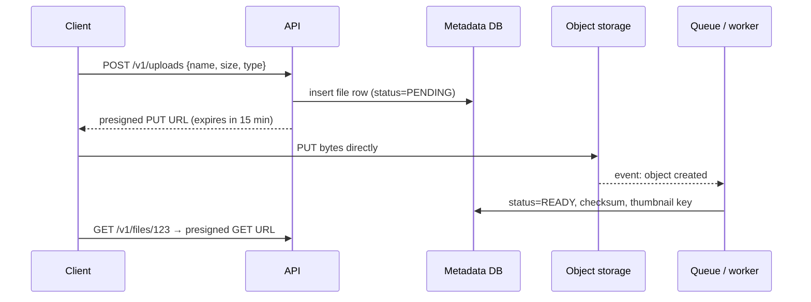
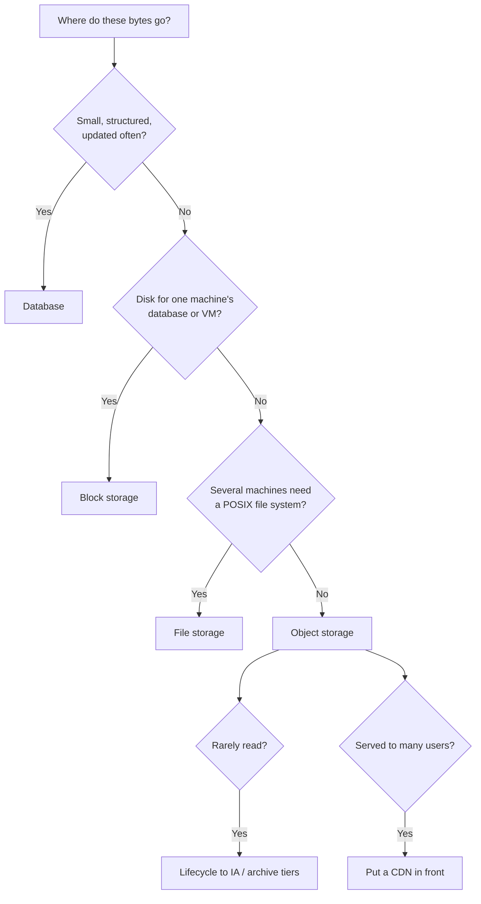

# Object Storage

## TL;DR
- **Object storage** (Amazon S3, Google Cloud Storage, Azure Blob Storage, MinIO, Ceph RGW) for
  files, images, video, backups, logs and data-lake tables: effectively unlimited, cheap,
  very durable, accessed over HTTP by key.
- **Block storage** (AWS EBS, GCP Persistent Disk, Azure Managed Disks) for a database's or a VM's
  own disk: low-latency random reads and writes, attached to one machine.
- **File storage** (AWS EFS, Azure Files, Google Filestore, NFS/SMB) when several machines need a
  shared POSIX (Portable Operating System Interface) file system with directories, locks and
  in-place edits.
- **Never store large files in your database:** put the bytes in object storage and the key and
  metadata in the database.
- **None of these** for small, structured, frequently updated records → a [database](databases.md).

## The landscape

| | Unit | Access | Shared by | Examples |
|---|---|---|---|---|
| Object | Whole object (bytes + metadata) under a key in a bucket | HTTP API: `PUT`, `GET`, `DELETE`, `LIST` | Anyone with permission, anywhere | S3, GCS, Azure Blob, MinIO, Ceph RGW, Cloudflare R2 |
| Block | Fixed-size blocks on a virtual disk | Mounted as a device; the OS adds a file system | One machine (some allow multi-attach) | EBS, Persistent Disk, Azure Disks, iSCSI SANs |
| File | Files in directories | Mounted via NFS / SMB; POSIX calls | Many machines at once | EFS, Azure Files, Filestore, NetApp, CephFS |

## Side-by-side comparison

| | Object storage | Block storage | File storage |
|---|---|---|---|
| Latency | Tens of ms to first byte (lower with "express"/single-zone tiers) | Sub-ms to low ms | Low ms |
| Throughput | Very high in aggregate (parallel requests) | Per-volume limits (IOPS, MB/s) | Shared; scales with size or provisioned |
| Capacity | Practically unlimited | Per volume (up to tens of TB) | Large, elastic on managed services |
| Updates | Replace the whole object (no in-place edit; append only in some tiers) | In place, any byte | In place, any byte |
| Consistency | S3: strong read-after-write for PUT/DELETE and LIST (since Dec 2020); others: check the docs | Strong (one writer) | Close-to-open (NFS) or strong, varies |
| Durability | Designed for very high durability across zones (S3 Standard: 11 nines design target) | Replicated within one zone; snapshots for backup | Replicated (regional or zonal) |
| Cost per GB | Lowest, with colder tiers cheaper still | Higher, and you pay for provisioned size | Highest of the three |
| Interface | HTTP + SDKs | Disk device | POSIX file system |
| When it breaks | Treating it like a file system (renames, small random writes, many tiny files) | Sharing between machines; scaling past one volume | Very high metadata ops; cost at scale |

---

## Object storage

**What it is.** A flat namespace of **buckets** holding **objects**. Each object is an immutable
blob of bytes plus metadata (content type, custom headers, tags), addressed by a **key** such as
`users/42/avatars/2026-10-31.jpg`. Slashes only look like folders; the namespace is flat and
`LIST` with a prefix emulates directories. Data is replicated or erasure-coded across devices and
zones; you read and write over HTTPS.

| Storage class (S3 names; GCS and Azure have equivalents) | For | Trade-off |
|-----------------------------------------------------------|-----|-----------|
| Standard | Hot data read often | Highest storage price, no retrieval fee |
| Infrequent Access (Standard-IA, One Zone-IA) | Read about monthly | Cheaper storage, retrieval fee, minimum duration |
| Intelligent-Tiering | Unknown or changing access | Moves objects between tiers automatically; small monitoring fee |
| Glacier Instant / Flexible / Deep Archive | Archives, compliance | Very cheap; retrieval from milliseconds (Instant) to hours (Deep Archive) |
| Express One Zone | Low-latency, single-zone hot data (ML, analytics) | Faster, but one zone only |

**Use when**
- User uploads: photos, videos, documents ([file storage](../_04_Case_Studies/file-storage.md)).
- Media origins behind a [CDN](cdn.md) ([video streaming](../_04_Case_Studies/video-streaming.md)).
- Backups, database snapshots, logs, ML datasets.
- Data lakes: Parquet files with table formats (Apache Iceberg, Delta Lake, Hudi) queried by
  Athena, Spark, Trino, Snowflake.
- Static website hosting.

**Don't use when**
- Low-latency random writes or a database's data files → block storage.
- Many processes editing the same file in place, or software expecting POSIX → file storage.
- Small records updated often (a user's balance) → a database.

**Advantages**
- Scales without capacity planning; pay for what you store and transfer.
- Very high durability; versioning, replication across regions, object lock (WORM, Write Once Read Many).
- Accessible from anywhere over HTTP; integrates with CDNs, event notifications and analytics engines.
- Lifecycle rules move or delete data automatically.

**Limitations**
- **No in-place updates or cheap renames:** a "rename" is copy + delete; changing 1 byte rewrites
  the object. Design keys to be write-once.
- **Many tiny objects are expensive:** per-request pricing and per-object overhead. Batch small
  records into larger files (e.g. Parquet files of 100 MB+ for analytics).
- **Request-rate limits per prefix:** S3 supports at least 3,500 writes and 5,500 reads per second
  per prefix and scales by partitioning prefixes; spread hot keys across prefixes.
- **First-byte latency** is too high for request-path lookups of small values → cache or database.
- **Egress costs:** serving directly to the internet is often the largest bill; put a CDN in front.

### Object storage guidelines
- **Keep metadata in a database:** `files(id, owner_id, bucket, key, size, content_type, checksum, created_at)`.
  Listing a user's files from the database is far faster than `LIST` on a bucket.
- **Write-once keys:** include a version or content hash: `users/42/avatar/3f9a1c.jpg`. Never overwrite
  in place; caches and CDNs stay correct.
- **Block public access by default;** share via presigned URLs or a CDN with signed URLs.
- **Turn on versioning** for important buckets, plus lifecycle rules to expire old versions.
- **Encrypt** at rest (provider-managed or KMS keys) and require TLS.
- **Event notifications** (S3 → SQS/SNS/Lambda/EventBridge) trigger processing: thumbnails,
  virus scans, transcoding.

---

## Block storage

**What it is.** A virtual disk attached over the network (or locally) to one machine. The OS
formats it with a file system (ext4, XFS) and applications see normal files. You choose a volume
type by IOPS (I/O operations per second), throughput and latency.

**Use when**
- Database data directories (PostgreSQL, MySQL, Kafka log segments).
- VM boot disks and anything needing fast random I/O.

**Don't use when**
- Several machines need the same data → file or object storage.
- Data grows without bound → object storage.

**Advantages**
- Lowest latency of the network options; full control over the file system.
- Snapshots for backup and cloning.

**Limitations**
- **Tied to one machine and usually one zone:** losing the zone means restoring from a snapshot or a replica.
- Pay for provisioned size and performance, not usage.
- Local NVMe instance storage is faster but **disappears** when the instance stops.

---

## File storage

**What it is.** A managed network file system that many machines mount at once over NFS or SMB,
with directories, permissions, locks and in-place edits.

**Use when**
- Lift-and-shift apps that expect a shared directory (CMS uploads, legacy batch jobs).
- Shared home directories, build caches, ML training data that tools read as files.
- Kubernetes `ReadWriteMany` volumes.

**Don't use when**
- Serving user content at scale to the internet → object storage + CDN.
- A single database's disk → block storage.

**Advantages**
- Familiar POSIX semantics; no code changes.
- Shared by many clients simultaneously.

**Limitations**
- **Highest price per GB;** performance often tied to size or provisioned throughput.
- **Metadata-heavy workloads** (millions of tiny files, `ls` on huge directories) are slow.

---

## Upload and download patterns

| Pattern | How | Use when |
|---------|-----|----------|
| Through your API | Client → API server → object storage | Small files you must inspect inline; simplest |
| **Presigned URL** | API returns a short-lived signed URL; the client uploads/downloads directly to storage | Default for user uploads and private downloads: bytes skip your servers |
| **Multipart upload** | Split into parts uploaded in parallel, then "complete" | Files over ~100 MB; resumable uploads on mobile |
| CDN with signed URLs | CDN serves cached private content with an expiring signature | Paid video, downloads at scale |
| Event-driven processing | Storage emits "object created" → queue → worker | Thumbnails, transcoding, indexing |

**S3 multipart limits** (check the current docs): parts of 5 MiB to 5 GiB (the last part can be
smaller), up to 10,000 parts. A single `PUT` is limited to 5 GiB.



### Worked example: presigned upload with boto3

Illustrative; signing happens locally in the SDK, so this produces a URL without contacting S3.

```python
import boto3, uuid

s3 = boto3.client("s3", region_name="eu-west-1")

def create_upload(user_id: int, content_type: str) -> dict:
    key = f"users/{user_id}/uploads/{uuid.uuid4()}"          # write-once key
    url = s3.generate_presigned_url(
        "put_object",
        Params={"Bucket": "photos-prod", "Key": key, "ContentType": content_type},
        ExpiresIn=900,                                       # 15 minutes
    )
    # INSERT INTO files (owner_id, bucket, key, status) VALUES (:user_id, 'photos-prod', :key, 'PENDING')
    return {"key": key, "upload_url": url}
```

```bash
# The client uploads straight to S3; the Content-Type must match what was signed
curl -X PUT -H "Content-Type: image/jpeg" --upload-file photo.jpg "$UPLOAD_URL"
```

**Lifecycle rule** (S3 JSON): move uploads to Infrequent Access after 30 days, Glacier after 180,
and remove old versions after 90.

```json
{
  "Rules": [{
    "ID": "uploads-tiering",
    "Filter": { "Prefix": "users/" },
    "Status": "Enabled",
    "Transitions": [
      { "Days": 30,  "StorageClass": "STANDARD_IA" },
      { "Days": 180, "StorageClass": "GLACIER" }
    ],
    "NoncurrentVersionExpiration": { "NoncurrentDays": 90 }
  }]
}
```

### Back-of-the-envelope: a photo app

```
Uploads: 10 M photos/day × 2 MB = 20 TB/day
  ≈ 20 TB / 86,400 s ≈ 231 MB/s average ingest (peak ×3 ≈ 700 MB/s)
  Write QPS: 10 M / 86,400 ≈ 116 PUT/s average, ~350/s peak: easy for object storage
Year one: 20 TB × 365 ≈ 7.3 PB (the provider handles replication; you pay for logical bytes)
Thumbnails: 3 sizes × ~50 KB ≈ 150 KB per photo → +1.5 TB/day
Metadata rows: 10 M/day × ~500 B ≈ 5 GB/day in the database: fine for a sharded SQL or NoSQL store
Reads: if 100 M views/day go through a CDN at 95% hit ratio, origin GETs ≈ 5 M/day ≈ 58/s
```

---

## Quick decision points



| If you need… | Choose |
|--------------|--------|
| Store user uploads cheaply and durably | Object storage + metadata in a DB |
| Let clients upload without passing through your servers | Presigned URLs (multipart for large files) |
| A PostgreSQL data volume | Block storage (or the managed DB's own storage) |
| A shared directory for legacy apps | File storage (EFS, Azure Files) |
| Cheap long-term archives / compliance | Archive tiers + object lock |
| A data lake for analytics | Object storage + Parquet + Iceberg/Delta |
| S3 locally for development | MinIO, or an emulator such as LocalStack |

**Common combinations in interviews**
- **[File storage (Dropbox-like)](../_04_Case_Studies/file-storage.md):** split files into chunks,
  store chunks in object storage by content hash (deduplication), metadata in a database.
- **[Video streaming](../_04_Case_Studies/video-streaming.md):** raw upload → object storage →
  transcoding workers → segments in object storage → CDN.
- **[Chat application](../_04_Case_Studies/chat-application.md):** media attachments in object
  storage; messages carry only the key.

## Interview questions
**Q: Object vs block vs file storage?**
Object: HTTP access to whole immutable objects, unlimited and cheap, for files and media. Block: a
low-latency disk for one machine, for databases and VMs. File: a shared POSIX file system for many
machines, for legacy apps and shared directories.

**Q: Why not store images in the database?**
Large blobs bloat the database, its backups, replication and cache, and make it serve bytes it's
bad at serving. Object storage is cheaper, scales without limit and sits behind a CDN; keep only
the key and metadata in the database.

**Q: How do you let users upload large files reliably?**
Presigned multipart upload: the API authorizes and returns signed URLs per part; the client
uploads parts in parallel and retries failed parts; the API completes the upload; an event marks
the file ready.

**Q: How is S3 so durable?**
It stores data redundantly across multiple devices and availability zones, continuously checks
integrity and repairs lost copies. AWS designs S3 Standard for 99.999999999% (11 nines) annual
durability. Durability isn't backup, though: versioning and replication protect against deletes
and bugs.

**Q: Is S3 strongly consistent?**
Since December 2020, S3 gives strong read-after-write consistency for PUTs, DELETEs and LISTs.
Other stores and S3-compatible systems vary; check before relying on it.

**Q: How do you keep object storage costs down?**
Lifecycle rules to colder tiers, expire old versions and incomplete multipart uploads, batch tiny
objects into bigger ones, compress, and serve through a CDN to cut egress.

## Related
- [CDN](cdn.md): serving objects to users
- [Databases](databases.md): where the metadata lives
- [Message queues](message-queues.md): processing on "object created" events
- [Security](security.md): encryption, signed URLs, least-privilege bucket policies
- [Search index](search-index.md): indexing document contents
- [AWS lab](../_03_Building_Blocks/_03_AWS/): local AWS emulators used in this repo
