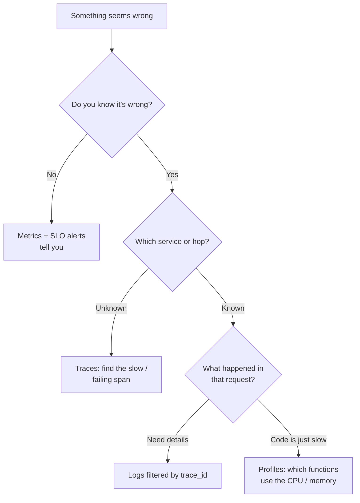

# Observability

## TL;DR
- **Metrics** to know *that* something is wrong: cheap, aggregated numbers over time, used for
  dashboards and alerts.
- **Logs** to know *what* happened: detailed, structured events for one request or error.
- **Traces** to know *where* it went wrong: one request's path and timing across services.
- **Profiles** to know *why* code is slow: CPU and memory by function.
- Tie them together with a **trace ID** in every log line and request.
- Alert on **symptoms users feel** (SLO burn rate, error rate, p99 latency), not on every cause.

## The landscape

| Signal | Question it answers | Shape | Typical tools |
|--------|---------------------|-------|---------------|
| Metrics | Is the system healthy? How much, how fast? | Numbers over time, with labels | Prometheus, Grafana, Datadog, CloudWatch, Azure Monitor |
| Logs | What exactly happened? | Timestamped events (ideally JSON) | Elasticsearch/OpenSearch, Loki, Splunk, CloudWatch Logs |
| Traces | Where did time go across services? | A tree of timed spans per request | OpenTelemetry + Jaeger, Tempo, Zipkin, X-Ray |
| Profiles | Which code uses the CPU or memory? | Stack samples over time | Pyroscope, Parca, async-profiler, pprof |
| Events / audit logs | Who changed what, and when? | Business or security events | Audit tables, SIEM (security information and event management) tools |

**Monitoring vs observability:** monitoring checks known failure modes ("is CPU above 90%?").
Observability lets you investigate problems you didn't predict, by slicing rich data by any
dimension (customer, region, version).

## Side-by-side comparison

| | Metrics | Logs | Traces |
|---|---|---|---|
| Granularity | Aggregated (per minute, per label set) | Per event | Per request, per hop |
| Cost at scale | Low (fixed size per series) | High (grows with traffic) | Medium to high; usually sampled |
| Best for | Dashboards, alerts, trends, SLOs | Debugging a specific error, auditing | Finding the slow or failing service in a chain |
| Retention | Months to years (downsampled) | Days to weeks (hot), longer in cold storage | Days |
| Weakness | Loses per-request detail; **high cardinality** labels explode cost | Hard to aggregate; noisy; expensive | Sampling can miss rare errors; needs instrumentation in every service |
| Standard | OpenMetrics / Prometheus format, OpenTelemetry | Structured JSON, OpenTelemetry logs | W3C Trace Context, OpenTelemetry |

---

## Metrics

**What it is.** Numeric measurements recorded over time, each identified by a name and labels:
`http_requests_total{service="orders", route="/orders", code="500"}`.

| Type | Meaning | Example |
|------|---------|---------|
| Counter | Only goes up (reset on restart) | Requests served, errors, bytes sent |
| Gauge | Goes up and down | Memory in use, queue length, open connections |
| Histogram | Counts values in buckets, so you can compute percentiles | Request duration, payload size |
| Summary | Percentiles computed in the client | Same use as histograms, but can't be aggregated across instances |

**What to measure**

| Method | For | Signals |
|--------|-----|---------|
| Golden signals (Google SRE) | Any user-facing service | **Latency, Traffic, Errors, Saturation** |
| RED | Request-driven services | **Rate, Errors, Duration** |
| USE | Resources (CPU, disks, pools) | **Utilization, Saturation, Errors** |

**Use when**
- Dashboards, alerts and capacity planning.
- Measuring SLIs and SLOs (see [reliability](reliability.md#slas-slos-slis-and-error-budgets)).

**Don't use when**
- You need per-request detail (which user, which order) → logs and traces.
- A label would have unbounded values (user ID, order ID, full URL) → put that in logs or traces.

**Advantages**
- Cheap to store and fast to query, even over months.
- Ideal for alerting and spotting trends.

**Limitations**
- **Cardinality explosion:** every unique label combination is a new time series. A `user_id`
  label on a busy service can create millions of series and break the metrics system.
- **Averages lie:** an average of 50 ms can hide a p99 of 2 s. Use histograms and percentiles
  (p50, p95, p99).
- Percentiles can't be averaged across instances; aggregate histogram buckets instead.

---

## Logs

**What it is.** Timestamped records of discrete events. Write them as **structured JSON** with
consistent fields, so they can be searched and aggregated:

```json
{
  "ts": "2026-10-29T10:15:02.481Z",
  "level": "error",
  "service": "orders",
  "trace_id": "4bf92f3577b34da6a3ce929d0e0e4736",
  "span_id": "00f067aa0ba902b7",
  "user_id": 42,
  "order_id": 1001,
  "msg": "payment provider timeout",
  "provider": "stripe",
  "duration_ms": 3000
}
```

**Use when**
- Investigating a specific error or customer complaint.
- Audit trails: who did what, when.
- Rare events that metrics only count.

**Don't use when**
- You want trends or alerts over time → metrics (derive metrics from logs only as a stopgap).
- Logging every successful request at high traffic → sample, or rely on metrics and traces.

**Advantages**
- Full detail and context for each event.
- Every language and platform supports them.

**Limitations**
- **Cost:** volume grows with traffic; store less (levels, sampling) and keep hot retention short.
- **Unstructured text is hard to search:** use JSON with consistent field names.
- **Sensitive data:** never log passwords, tokens, card numbers or secrets; mask personal data
  (see [security](security.md)).

---

## Distributed traces

**What it is.** A **trace** follows one request through every service it touches. Each unit of
work is a **span** with a name, start time, duration, attributes and a parent span. Services pass
the trace context to each other in a header, using the W3C Trace Context standard:

```
traceparent: 00-4bf92f3577b34da6a3ce929d0e0e4736-00f067aa0ba902b7-01
             │  │                                │                └ flags (01 = sampled)
             │  │                                └ parent span ID (16 hex)
             │  └ trace ID (32 hex), the same across all services
             └ version
```



```mermaid
gantt
  title One checkout request (trace 4bf92f…), times in ms
  dateFormat x
  axisFormat %L
  section api-gateway
  POST /checkout          :0, 480
  section orders
  create order            :20, 60
  section inventory
  reserve stock           :70, 120
  section payment
  charge card (slow)      :130, 460
```

The trace makes it obvious that the payment call takes most of the 480 ms.

**Use when**
- Microservices: finding which hop is slow or failing.
- Understanding fan-out, retries and call patterns you didn't know about.
- Following a [saga](distributed-transactions.md) across services.

**Don't use when**
- A monolith with one database: profiling and logs may be enough.

**Advantages**
- Shows the critical path and where latency comes from, across teams and services.
- Links straight to the logs of each span through the trace ID.

**Limitations**
- **Instrumentation everywhere:** every service, client library and queue must propagate context.
  Use OpenTelemetry auto-instrumentation where possible.
- **Sampling:** storing every trace is expensive.
  - **Head-based** sampling decides at the start (e.g. keep 1%). It's cheap, but misses rare errors.
  - **Tail-based** sampling decides after the trace finishes (keep all errors and slow traces).
    It's better, but needs buffering in a collector.
- Async hops (queues) need the context carried in message headers.

---

## Alerting

**What it is.** Notify a person only when users are affected, or soon will be. Good alerts are
**actionable**, **urgent** and have a runbook.

| Alert on | Example | Why |
|----------|---------|-----|
| SLO burn rate (best) | "At this rate, the 30-day error budget is gone in 2 days" | Directly tied to user impact |
| Symptoms | Error rate > 1%, p99 latency > 500 ms for 5 minutes | Users feel these |
| Imminent saturation | Disk full in < 4 hours, connection pool > 90% | Predictable outages |
| Not on causes alone | "CPU 85%" with no user impact | Leads to alert fatigue |

**Multi-window burn-rate alerts** (from the Google SRE Workbook), for a 99.9% SLO over 30 days:
- **Page** if the burn rate is above 14.4× over 1 hour (2% of the monthly budget gone in an hour).
- **Page** if it's above 6× over 6 hours (5% gone).
- **Ticket** for slower burns.

**Worked example: PromQL queries for a request-driven service**

```promql
# Traffic: requests per second, per route
sum by (route) (rate(http_requests_total{service="orders"}[5m]))

# Errors: share of requests returning 5xx
sum(rate(http_requests_total{service="orders", code=~"5.."}[5m]))
  / sum(rate(http_requests_total{service="orders"}[5m]))

# Latency: p99 from histogram buckets, aggregated across all instances
histogram_quantile(0.99,
  sum by (le) (rate(http_request_duration_seconds_bucket{service="orders"}[5m])))

# Saturation: connection pool usage
max(db_pool_in_use{service="orders"} / db_pool_max{service="orders"})
```

---

## Quick decision points



| If you need… | Choose |
|--------------|--------|
| Dashboards and alerts | Metrics (golden signals / RED / USE) |
| To find the slow service in a request chain | Distributed tracing (OpenTelemetry) |
| Details of one failed request | Structured logs with `trace_id` |
| To find hot code paths | Continuous profiling |
| Fewer, better pages | SLO burn-rate alerts |
| Per-customer analysis without exploding metrics | Logs or traces with customer attributes, not metric labels |
| To avoid vendor lock-in | OpenTelemetry SDKs and the Collector |

**Common combinations in interviews**
- **Any microservices design:** OpenTelemetry in every service → Collector → metrics
  (Prometheus), traces (Tempo/Jaeger), logs (Loki/OpenSearch), with Grafana dashboards and SLO alerts.
- **[Payment system](../_04_Case_Studies/payment-system.md):** audit logs for every money
  movement, traces across the saga, alerts on payment failure rate and provider latency.
- **[Notification system](../_04_Case_Studies/notification-system.md):** metrics on queue depth,
  delivery rate and DLQ (Dead Letter Queue) size per channel.

## Interview questions
**Q: Metrics, logs and traces: when do you use each?**
Metrics to detect problems and alert (cheap, aggregated). Traces to find which service or call in a
request is slow or failing. Logs for the detailed story of one request, linked by trace ID.

**Q: Why use percentiles instead of averages?**
Averages hide the slow tail. If 1% of requests take 3 s, the average barely moves, but p99 shows it.
Users who make many requests hit the tail often.

**Q: What is high cardinality and why is it a problem?**
Labels with many unique values (user ID, request ID, full URL) create a separate time series for
every value, which blows up memory and cost in metrics systems. Put those values in logs and traces.

**Q: How does distributed tracing work across services?**
Each service reads the trace context from the incoming `traceparent` header, creates a span for its
work, and passes the same trace ID with its own span ID to downstream calls and message headers.
Spans are sent to a collector and assembled into a trace.

**Q: Head-based vs tail-based sampling?**
Head-based decides when the request starts: cheap, but it drops most errors along with everything
else. Tail-based decides after the trace completes, so it can keep all errors and slow requests,
but it needs a collector that buffers traces.

**Q: What makes a good alert?**
It reflects user impact (SLO burn, error rate, latency), needs action now, and links to a runbook.
Everything else is a dashboard or a ticket.

## Related
- [Reliability](reliability.md): SLIs, SLOs and error budgets
- [Distributed transactions](distributed-transactions.md): tracing sagas
- [Message queues](../_03_Building_Blocks/message-queues.md): propagating context through queues
- [Security](security.md): what not to log
- [Scalability](scalability.md): latency vs throughput
