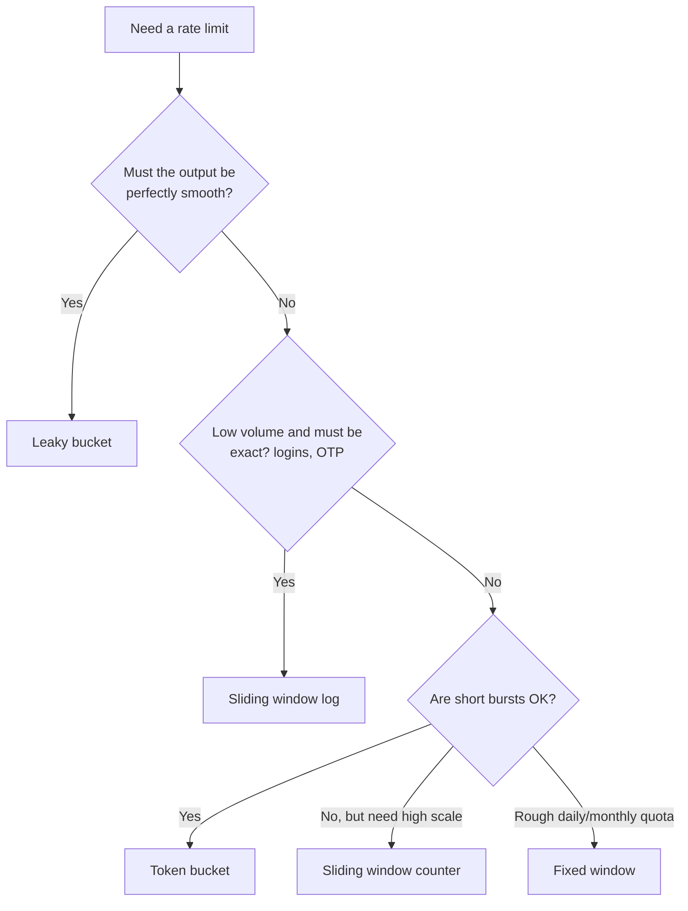

# Rate Limiting

## TL;DR
- **Token bucket** by default: allows short bursts up to a cap and a steady average rate. Used by
  AWS API Gateway, Stripe and most API gateways.
- **Leaky bucket** when the downstream needs a **smooth, constant** outflow.
- **Fixed window** only for simple, rough limits: it allows up to 2× the limit at window edges.
- **Sliding window log** when limits must be exact and traffic per key is low.
- **Sliding window counter** for accurate limits at high scale with tiny memory.
- In a cluster, keep counters in a **shared store** (Redis) with **atomic** updates (a Lua script),
  and return **429 Too Many Requests** with `Retry-After`.

## Why rate limit

| Goal | Example |
|------|---------|
| Protect the service from overload | Cap requests per second so a spike can't take it down |
| Fairness between clients | One noisy customer can't starve the others |
| Stop abuse | Brute-force logins, scraping, spam, denial-of-service attempts |
| Control cost | Expensive operations (LLM calls, SMS, third-party APIs billed per call) |
| Enforce plans | Free tier: 100 requests/min; paid tier: 1,000 |

## Where to rate limit

| Layer | Limits by | Tools |
|-------|-----------|-------|
| Edge / CDN / WAF | IP, country, bot signature | Cloudflare, AWS WAF, Azure Front Door |
| API gateway | API key, user, plan, route | AWS API Gateway, Azure APIM, Kong, Envoy |
| Service | User, tenant, operation cost | Middleware + Redis |
| Client side | Its own outgoing calls | Client libraries that respect `Retry-After` |
| Before a dependency | Calls to a fragile or paid API | Outbound limiter or queue |

## Side-by-side comparison

| | Token bucket | Leaky bucket | Fixed window | Sliding window log | Sliding window counter |
|---|---|---|---|---|---|
| Idea | Tokens refill at a steady rate; each request spends one | Requests queue and leave at a fixed rate | Count requests per clock window | Store every request timestamp; count those in the last window | Weighted mix of the current and previous window counts |
| Bursts | Allowed, up to bucket size | Smoothed out (queued or dropped) | Up to 2× limit at window edges | No bursts beyond the limit | Mostly prevented |
| Accuracy | Good | Exact output rate | Rough | Exact | Approximate (very close) |
| Memory per key | 2 numbers | Queue (or 2 numbers if just metering) | 1 counter | One entry per request | 2 counters |
| Typical use | API limits | Smoothing traffic to a downstream | Simple quotas, daily limits | Low-volume, strict limits (logins) | High-volume API limits |
| Used by | AWS, Stripe, Envoy local rate limit | NGINX `limit_req` (leaky-bucket style), traffic shaping | Many simple quotas | Small-scale strict limits | Cloudflare (described in its blog) |

---

## Token bucket

**What it is.** Each key has a bucket that holds up to **capacity** tokens and refills at
**rate** tokens per second. A request takes a token if one is available; otherwise it's
rejected. A full bucket allows a burst of `capacity` requests, and the long-run average is `rate`.

```
capacity = 10, rate = 5/s
t = 0 s   bucket 10 → a burst of 10 requests all pass → bucket 0
t = 1 s   refilled 5 → 5 more pass
steady state: 5 requests/s
```

**Use when**
- Public API limits per user or API key: allow short bursts, cap the average.
- Different costs per request: an expensive call spends more tokens.

**Don't use when**
- The downstream can't take any bursts → leaky bucket.
- You need an exact "N per calendar window" quota (e.g. 1,000 per day) → fixed window.

**Advantages**
- Handles bursty, real-world traffic gracefully.
- Tiny state: token count and last refill time.
- Easy to give different limits per plan.

**Limitations**
- **Two parameters to tune** (capacity and rate).
- A burst of `capacity` can still hit the backend all at once.
- Needs atomic read-modify-write in a distributed setup (see the [Redis example](#distributed-rate-limiting-with-redis)).

---

## Leaky bucket

**What it is.** Requests enter a fixed-size queue (the bucket) and are processed at a constant
rate, like water dripping from a hole. If the queue is full, new requests are dropped.

**Use when**
- Protecting a downstream that needs a steady rate: a legacy system, a payment provider's API,
  an SMS gateway.
- Network traffic shaping.

**Don't use when**
- Users expect immediate responses during bursts: queued requests wait.

**Advantages**
- Perfectly smooth output rate.
- Simple to reason about.

**Limitations**
- **Adds latency:** bursty requests wait in the queue.
- A burst of old requests can block newer, more important ones.
- Queue size and rate need tuning.

---

## Fixed window counter

**What it is.** Count requests per key in fixed clock windows (`user:42:2026-10-29T10:15`). Reject
once the count passes the limit; the counter resets at the next window.

**Use when**
- Simple quotas where rough is fine: 1,000 calls per day, 100 per minute for internal tools.

**Don't use when**
- Burst protection matters: with a limit of 100/min, a client can send 100 at 10:00:59 and 100 at
  10:01:00, i.e. **200 in two seconds**.

**Advantages**
- Simplest: one counter with an expiry (`INCR` + `EXPIRE` in Redis).
- Very little memory.

**Limitations**
- **Edge bursts** up to 2× the limit.
- Everyone's quota resets at the same moment, which can cause a thundering herd.

---

## Sliding window log

**What it is.** Store a timestamp for every request (e.g. in a Redis sorted set). For each new
request, drop timestamps older than the window, count the rest, and allow it if the count is
under the limit.

**Use when**
- Strict limits on low-volume, sensitive actions: logins, password resets, OTP (one-time password) requests.

**Don't use when**
- High-volume keys: memory grows with every request.

**Advantages**
- **Exact:** never more than the limit in any rolling window.

**Limitations**
- **Memory and CPU grow with traffic:** one entry per request per key.

---

## Sliding window counter

**What it is.** Keep counters for the current and previous fixed windows, and estimate the rolling
count by weighting the previous window by how much of it still overlaps:

```
estimated = previous_count × (1 − elapsed_fraction_of_current_window) + current_count

limit 100/min, at 10:01:15 (25% into the current minute)
previous minute (10:00) = 80, current minute so far = 30
estimated = 80 × 0.75 + 30 = 90  → allowed (90 < 100)
```

**Use when**
- High-volume API limits that should be close to exact without storing every request.

**Don't use when**
- You need exact guarantees for each individual request → sliding window log.

**Advantages**
- Smooths out fixed-window edge bursts.
- Two counters per key: cheap at scale.

**Limitations**
- **Approximate:** assumes requests in the previous window were evenly spread.

---

## Distributed rate limiting with Redis

With many API servers, each server's local counter only sees part of the traffic. Keep the state
in Redis, and update it **atomically** with a Lua script, so two servers can't both read
"9 tokens left" and both let a request through.

**Token bucket in Lua**

```lua
-- KEYS[1] = bucket key, ARGV[1] = capacity, ARGV[2] = refill rate per second, ARGV[3] = cost
local capacity = tonumber(ARGV[1])
local rate     = tonumber(ARGV[2])
local cost     = tonumber(ARGV[3])

local t   = redis.call('TIME')                      -- use Redis's clock, not each server's
local now = tonumber(t[1]) * 1000 + math.floor(tonumber(t[2]) / 1000)

local b      = redis.call('HMGET', KEYS[1], 'tokens', 'ts')
local tokens = tonumber(b[1]) or capacity
local ts     = tonumber(b[2]) or now

tokens = math.min(capacity, tokens + (now - ts) / 1000 * rate)
local allowed = 0
if tokens >= cost then
  tokens  = tokens - cost
  allowed = 1
end

redis.call('HSET', KEYS[1], 'tokens', tokens, 'ts', now)
redis.call('PEXPIRE', KEYS[1], math.ceil(capacity / rate * 1000))   -- idle buckets disappear
return { allowed, math.floor(tokens) }
```

Run it with `EVAL` (or load it once with `SCRIPT LOAD` and call `EVALSHA`):

```bash
redis-cli EVAL "$(cat token_bucket.lua)" 1 rl:user:42 10 5 1
# 1) (integer) 1    ← allowed
# 2) (integer) 9    ← tokens left
```

**Sliding window log in Redis (sorted set)**

```text
MULTI
ZREMRANGEBYSCORE rl:login:42 0 <now_ms - 60000>   # drop entries older than 60 s
ZADD             rl:login:42 <now_ms> <request_id>
ZCARD            rl:login:42                     # count in the window; reject if > limit
PEXPIRE          rl:login:42 60000
EXEC
```

You can try both against the [Redis Docker setup](../_03_Building_Blocks/_01_Docker_Databases/redis/README.md).

**Design rules**
- **Respond clearly:** `429 Too Many Requests`, `Retry-After: <seconds>`, and limit headers
  (`RateLimit-Limit`, `RateLimit-Remaining`, `RateLimit-Reset`; many APIs use `X-RateLimit-*`).
- **Choose the key carefully:** API key or user ID for authenticated traffic; IP only for anonymous
  traffic (many users can share one IP behind a NAT or proxy).
- **Decide fail-open vs fail-closed:** if Redis is down, allow traffic (keeps the API up) or
  block it (protects the backend). Most public APIs fail open, with a local in-memory limit as a backstop.
- **Reduce Redis round trips** for very high traffic: keep a small local limit per server and sync
  with Redis periodically, accepting slight inaccuracy.
- **Different limits per route and plan:** `POST /login` far stricter than `GET /products`.

---

## Quick decision points



| If you need… | Choose |
|--------------|--------|
| A public API limit per key with bursts allowed | Token bucket in Redis |
| To protect a fragile downstream at a steady rate | Leaky bucket (or a queue with fixed-rate workers) |
| A daily or monthly quota per plan | Fixed window |
| Strict login or OTP attempt limits | Sliding window log |
| Accurate limits at very high traffic | Sliding window counter |
| A limit shared by many servers | Redis + Lua (atomic), with a local fallback |
| Protection from floods before they reach your servers | Edge / WAF limits by IP |

**Common combinations in interviews**
- **[Rate limiter case study](../_04_Case_Studies/rate-limiter.md):** token bucket per user in
  Redis with a Lua script, enforced in the API gateway, `429` + `Retry-After`, fail-open with a
  local backstop.
- **Login service:** sliding window log per account and per IP, plus a CAPTCHA (an automated
  "are you human" test) after repeated failures.
- **[Notification system](../_04_Case_Studies/notification-system.md):** per-user limits so
  nobody gets 50 notifications an hour; leaky bucket in front of each SMS/email provider.
- **LLM-backed API:** token bucket where the cost is the number of model tokens, not the number of requests.

## Interview questions
**Q: Token bucket vs leaky bucket?**
Token bucket allows bursts up to the bucket size and enforces an average rate; good for APIs.
Leaky bucket outputs a constant rate and queues or drops bursts; good for protecting a downstream.

**Q: What's wrong with a fixed window?**
Bursts at the boundary: a client can use the full limit at the end of one window and again at the
start of the next, sending up to 2× the limit in a short time. Sliding windows fix this.

**Q: How do you rate limit across many servers?**
Keep counters in a shared store like Redis and update them atomically with a Lua script (or
`INCR` for fixed windows). Use Redis time, not server clocks. Decide what happens if Redis is down.

**Q: Fail-open or fail-closed when the limiter's store is down?**
Fail-open keeps the API available but removes protection; fail-closed protects the backend but
causes an outage. Usually fail open with a local in-memory limit as a backstop; fail closed for
security-critical limits like login attempts.

**Q: What should the response look like when a client is limited?**
`429 Too Many Requests` with `Retry-After`, and headers showing the limit, remaining requests and
reset time, so well-behaved clients can back off.

**Q: How do you limit by cost instead of request count?**
Give each request a cost (e.g. 1 for a read, 10 for a report, or the number of LLM tokens) and
subtract that many tokens from the bucket.

## Related
- [Rate limiter case study](../_04_Case_Studies/rate-limiter.md)
- [API design](api-design.md): API gateways and status codes
- [Reliability](reliability.md): load shedding and retries with backoff
- [Security](security.md): protecting APIs from abuse
- [Cache](cache.md): Redis
- [Redis Docker setup](../_03_Building_Blocks/_01_Docker_Databases/redis/README.md)
