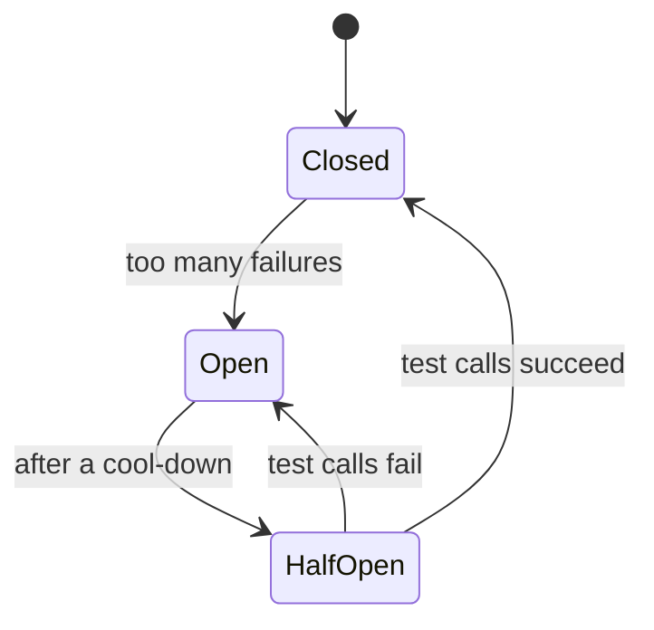

# Reliability and Fault Tolerance

## TL;DR
Remove every single point of failure, put timeouts on every network call, retry carefully,
and degrade gracefully instead of failing completely.

## Techniques
- **Redundancy:** remove every SPOF with multiple instances, zones and regions.
- **Failover:** active-passive (a standby takes over) or active-active (all serve traffic).
- **Retries** with exponential backoff + jitter (a random delay), so all clients don't
  retry at the same moment.
- **Timeouts** on every network call. No timeout = hung threads.
- **Circuit breaker:** after many failures, stop calling the service for a while (OPEN),
  then test a few calls (HALF-OPEN), then resume (CLOSED).
- **Bulkhead:** separate thread/connection pools per dependency, so one slow service can't
  use up all resources.
- **Graceful degradation:** serve partial results (e.g. a feed without recommendations)
  instead of failing completely.
- **Health checks:** liveness (is it running?) and readiness (can it take traffic?).

## SLA / SLO / SLI
| Term | Meaning | Example |
|------|---------|---------|
| SLI (Service Level Indicator) | The measured number | 99.95% success |
| SLO (Service Level Objective) | Internal target | 99.9% |
| SLA (Service Level Agreement) | Contract with customers, with penalties | |

## Disaster recovery
- **RPO (Recovery Point Objective):** max data loss allowed (e.g. 5 minutes).
- **RTO (Recovery Time Objective):** max downtime allowed (e.g. 1 hour).

## Interview questions
**Q: How do you design for 99.99% availability?**
Multiple instances across availability zones, redundant load balancers, a replicated DB
with automatic failover, no SPOF, health checks, circuit breakers, blue-green or canary
deployments, and multi-region if required.

## Related
- [Estimation cheat sheet](../_01_Interview_Playbook/estimation-cheat-sheet.md#availability-the-nines): availability math
- [Idempotency](idempotency-and-delivery-guarantees.md): what makes retries safe
- [Observability](observability.md)
