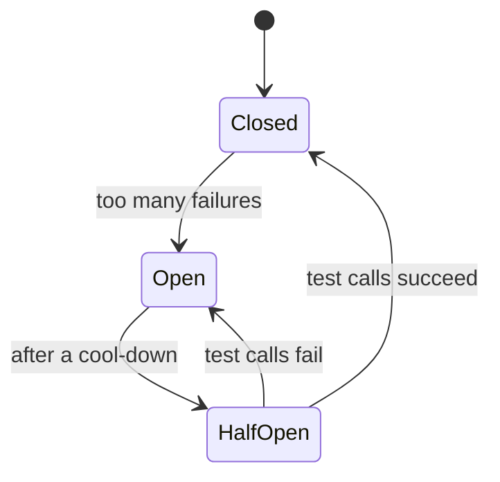
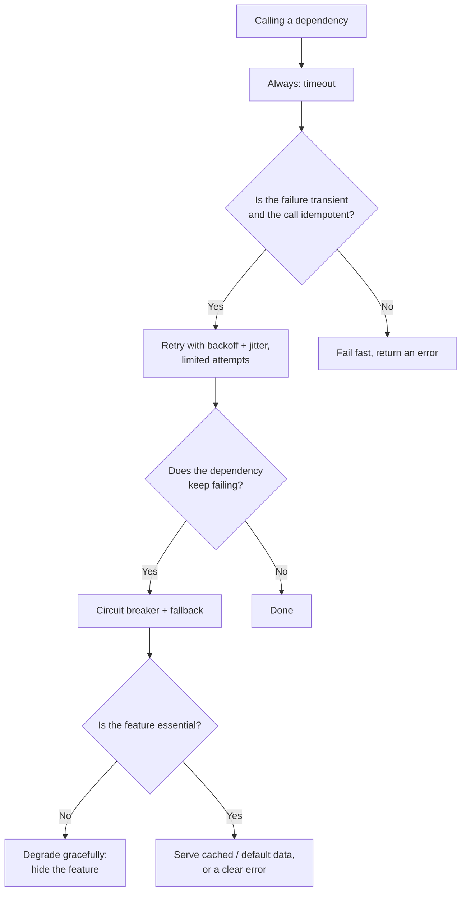

# Reliability and Fault Tolerance

## TL;DR
- **Assume everything fails:** machines, disks, networks, zones, dependencies, deployments.
- **Timeouts on every network call**, and **retries with exponential backoff + jitter**, only for
  idempotent operations.
- **Circuit breakers** to stop calling a failing dependency; **bulkheads** so one slow dependency
  can't use up all threads or connections.
- **Load shedding and graceful degradation:** serve less, not nothing.
- **Redundancy + failover** across availability zones (active-passive or active-active) to remove
  every single point of failure.
- Set targets with **SLOs** and **error budgets**, and recovery goals with **RPO / RTO**.

## The landscape

| Layer | Techniques |
|-------|------------|
| Each call | Timeouts, retries with backoff and jitter, idempotency, hedged requests |
| Each dependency | Circuit breaker, bulkhead, fallback, cache of last good value |
| Each service | Health checks, rate limiting, load shedding, graceful degradation, autoscaling |
| Infrastructure | Redundancy across zones and regions, failover, backups |
| Process | SLOs and error budgets, canary and blue-green deployments, chaos testing, postmortems |

## Side-by-side comparison

| Pattern | Protects against | How | Watch out for |
|---------|------------------|-----|---------------|
| Timeout | Hung calls tying up threads | Give up after a deadline | Too long = hung threads; too short = false failures |
| Retry + backoff + jitter | Brief, transient failures | Try again after growing, randomized delays | Retry storms; retrying non-idempotent calls |
| Circuit breaker | A dependency that keeps failing | Stop calling it for a while, then probe | Tuning thresholds; needs a fallback |
| Bulkhead | One slow dependency exhausting shared resources | Separate pools per dependency | Pools sized too small waste capacity |
| Rate limiting / load shedding | Overload | Reject excess work early with 429 / 503 | Rejecting important traffic; needs priorities |
| Graceful degradation | Partial outages | Turn off non-essential features | Must be designed and tested in advance |
| Redundancy + failover | Machine, zone or region loss | Spare capacity elsewhere takes over | Split brain; untested failover |
| Health checks | Sending traffic to broken instances | Liveness and readiness probes | Checks that are too deep cause cascading restarts |

---

## Timeouts

**What it is.** A deadline on every network call: connect, read and overall. Without one, a slow
dependency holds a thread or connection forever, and the caller runs out of them.

**Use when**
- Always, on every remote call: HTTP, gRPC, database queries, cache lookups, queue publishes.

**Don't use when**
- Never skip them. Instead, choose values carefully.

**Advantages**
- Bounds how long failures can hold resources.
- Turns "hangs" into errors you can handle (retry, fallback, alert).

**Limitations**
- **Choosing the value:** base it on the dependency's p99 latency plus a margin, not a guess.
- **Deadline propagation:** if the caller has 2 s left, downstream calls should get less, not a
  fresh 2 s each. gRPC propagates deadlines; HTTP needs it done by hand.
- A timeout doesn't mean the work didn't happen: the server may have completed it. Retries must be idempotent.

---

## Retries with exponential backoff and jitter

**What it is.** Retry a failed call after a delay that grows each time (100 ms, 200 ms, 400 ms …,
up to a cap), with **random jitter**, so thousands of clients don't retry in sync.

```python
import random, time

def call_with_retries(fn, attempts=5, base=0.1, cap=5.0):
    for attempt in range(attempts):
        try:
            return fn()
        except TransientError:
            if attempt == attempts - 1:
                raise
            # "Full jitter": sleep a random time between 0 and the exponential delay
            time.sleep(random.uniform(0, min(cap, base * 2 ** attempt)))
```

**Use when**
- Transient errors: timeouts, connection resets, `503`, `429` (respect `Retry-After`), leader elections.
- The operation is idempotent, or carries an [idempotency key](idempotency-and-delivery-guarantees.md).

**Don't use when**
- Permanent errors: `400`, `401`, `403`, `404`, validation failures.
- The operation isn't idempotent (a POST without an idempotency key).
- At every layer of a deep call chain: 3 retries at each of 3 layers = up to 27 calls to the bottom service.

**Advantages**
- Hides most short glitches from users.
- Jitter spreads retries out and prevents synchronized retry storms.

**Limitations**
- **Retry storms:** retries multiply load on an already struggling service. Limit attempts, use a
  **retry budget** (e.g. retries ≤ 10% of requests) and a circuit breaker.
- Adds latency to failures.
- Retrying only at the outermost layer (or one layer) is usually best.

---

## Circuit breaker

**What it is.** Wraps calls to a dependency. After too many failures it **opens** and fails fast
without calling the dependency. After a cool-down it goes **half-open** and lets a few test calls
through; if they succeed it **closes** again.



**Use when**
- Calling dependencies that can go down: other services, third-party APIs, databases.
- You have a sensible fallback: a cached value, a default, a degraded response or a clear error.

**Don't use when**
- Calls to local, in-process code.
- Every request goes to a different backend: one shared breaker would trip on unrelated failures.
  Use per-host breakers, or rely on load balancer health checks.

**Advantages**
- Fails fast instead of waiting on timeouts: saves threads and latency.
- Gives the failing dependency time to recover instead of hammering it.
- Prevents cascading failures across services.

**Limitations**
- **Tuning:** failure-rate threshold, minimum number of calls, open duration.
- Needs a fallback; otherwise it just turns errors into faster errors.
- Shared state across instances is optional; most breakers are per instance.

Libraries: Resilience4j (Java), Polly (.NET), and service meshes such as Envoy and Istio (outlier detection).

---

## Bulkhead

**What it is.** Named after a ship's watertight compartments: give each dependency its own limited
pool of threads, connections or concurrency, so one slow dependency can't use up the resources
every other request needs.

**Use when**
- One service calls several dependencies with different reliability (e.g. payments and recommendations).
- Separating critical traffic from non-critical (checkout vs analytics).

**Don't use when**
- A service with a single dependency: there's nothing to isolate.

**Advantages**
- A failure stays inside its compartment; the rest of the service keeps working.

**Limitations**
- **Sizing pools** is a trade-off: too small rejects good traffic; too big gives no protection.
- More configuration and monitoring.

---

## Load shedding, rate limiting and graceful degradation

**What it is.** When demand exceeds capacity, deliberately do **less** work instead of collapsing:
- **[Rate limiting](rate-limiting.md):** cap requests per client.
- **Load shedding:** when the service itself is overloaded (queue too long, CPU saturated),
  reject new low-priority requests early with `503`.
- **Graceful degradation:** turn off non-essential features: show the feed without
  recommendations, serve cached prices, disable search suggestions.

**Use when**
- Traffic spikes beyond what autoscaling can absorb in time.
- A non-critical dependency is down.

**Don't use when**
- Dropping the work loses data you can't recover: queue it instead (see [message queues](../_03_Building_Blocks/message-queues.md)).

**Advantages**
- Keeps the core experience up during overload or partial outages.
- Faster recovery: the system isn't buried under a backlog.

**Limitations**
- **Must be designed upfront:** which features are optional, and which traffic has priority.
- Feature flags and fallbacks need regular testing, or they fail when needed.

---

## Redundancy and failover

**What it is.** Run more than one of everything, in different failure domains (machines, racks,
availability zones, regions), and move traffic away from failed parts.

| Mode | How | Recovery | Cost |
|------|-----|----------|------|
| Active-passive | A standby waits and takes over on failure | Seconds to minutes (detection + promotion) | Standby capacity sits idle |
| Active-active | All copies serve traffic | Near-instant: others absorb the load | Each site needs headroom to take over; data sync is harder |

**Disaster recovery strategies** (cheapest to most resilient):

| Strategy | Setup | Typical RTO |
|----------|-------|-------------|
| Backup and restore | Regular backups in another region | Hours |
| Pilot light | Core data replicated; minimal infrastructure ready to scale up | Tens of minutes |
| Warm standby | A scaled-down full copy always running | Minutes |
| Multi-site active-active | Full capacity in several regions | Near zero |

**Use when**
- Any component whose failure would take the system down (a SPOF).
- Requirements of 99.9% or higher availability.

**Don't use when**
- Non-critical internal tools where some downtime is acceptable and cost matters.

**Advantages**
- Survives hardware, zone and even region failures.
- Enables maintenance and deployments without downtime.

**Limitations**
- **Untested failover fails:** practise it regularly (game days, chaos experiments).
- **Split brain:** two nodes both acting as primary; needs fencing or consensus (see [replication](replication.md)).
- Costs more: spare capacity and data replication.

**Health checks**
- **Liveness:** is the process alive? If not, restart it.
- **Readiness:** can it serve traffic now (dependencies connected, cache warm)? If not, take it
  out of the load balancer but don't restart it.
- Keep liveness checks shallow: a liveness check that calls the database restarts every
  instance when the database blips.

---

## SLAs, SLOs, SLIs and error budgets

| Term | Meaning | Example |
|------|---------|---------|
| SLI (Service Level Indicator) | The measured number | 99.95% of requests succeeded in under 300 ms |
| SLO (Service Level Objective) | Internal target | 99.9% of requests succeed in under 300 ms, over 30 days |
| SLA (Service Level Agreement) | Contract with customers, with penalties | 99.5% monthly uptime or service credits |
| Error budget | 100% − SLO: how much failure is allowed | 0.1% of 30 days ≈ 43 minutes |

Set SLAs looser than SLOs, so you notice problems before they cost money. If the error budget is
spent, slow down risky releases and spend time on reliability work.

**Disaster recovery goals**
- **RPO (Recovery Point Objective):** max data loss allowed (e.g. 5 minutes). Drives backup and
  replication frequency: synchronous replication gives RPO ≈ 0.
- **RTO (Recovery Time Objective):** max downtime allowed (e.g. 1 hour). Drives the failover
  strategy in the table above.

**Worked example: availability math**

```
Request path: load balancer → API → database, all in series
  LB 99.99% × API 99.9% × DB 99.95% = 99.84% → about 14 hours of downtime a year

Run the API as 2 independent instances in parallel:
  API availability = 1 − (0.001 × 0.001) = 99.9999%
  Path = 99.99% × 99.9999% × 99.95% ≈ 99.94%  → about 5 hours a year

The database is now the weakest link. Add a standby with automatic failover to improve it further.
```

Components in series multiply, so every dependency on the critical path lowers availability.
Redundant components in parallel multiply their *failure* rates, which raises availability (see
the [estimation cheat sheet](../_01_Interview_Playbook/estimation-cheat-sheet.md#availability-the-nines)).
This assumes failures are independent; shared dependencies (the same zone, the same deploy) break that assumption.

---

## Quick decision points



| If you need… | Choose |
|--------------|--------|
| Protection from hung calls | Timeouts everywhere, with deadline propagation |
| To ride out brief glitches | Retries with exponential backoff + jitter (idempotent calls only) |
| To stop hammering a failing service | Circuit breaker |
| One bad dependency not to take down the service | Bulkheads (separate pools) |
| To survive traffic spikes | Rate limiting, load shedding, autoscaling, queues |
| To survive a zone failure | Redundancy across zones, active-active for stateless tiers |
| To survive a region failure | Warm standby or multi-region active-active |
| Zero data loss on failover | Synchronous replication (RPO ≈ 0) |

**Common combinations in interviews**
- **Microservices:** timeouts + retries with jitter at the edge, circuit breakers and bulkheads
  per dependency (often in a service mesh), health checks for the load balancer.
- **[News feed](../_04_Case_Studies/news-feed.md):** degrade to a non-personalized feed when
  ranking is down; serve stale cached feeds rather than errors.
- **[Payment system](../_04_Case_Studies/payment-system.md):** retries only with idempotency keys;
  mark payments `PENDING` on timeout and reconcile, never retry blindly.

## Interview questions
**Q: How do you design for 99.99% availability?**
Multiple instances across availability zones, redundant load balancers, a replicated DB
with automatic failover, no SPOF, health checks, circuit breakers, blue-green or canary
deployments, and multi-region if required.

**Q: Why add jitter to retries?**
Without it, all clients that failed at the same moment retry at the same moment, creating waves of
load that keep the service down. Random delays spread retries out.

**Q: What's a retry storm and how do you prevent it?**
Retries multiply traffic to a struggling service, especially when every layer retries. Limit
attempts, retry at one layer, use retry budgets and circuit breakers, and honour `Retry-After`.

**Q: Circuit breaker vs retry?**
Retries handle brief, occasional failures. A circuit breaker handles sustained failure by stopping
calls entirely for a while. Use both: retries inside a closed breaker.

**Q: Liveness vs readiness checks?**
Liveness says whether to restart the process; readiness says whether to send it traffic. Keep
liveness shallow so a dependency blip doesn't restart every instance.

**Q: What are RPO and RTO?**
RPO is how much data you can afford to lose (time since the last good copy); RTO is how long you
can afford to be down. Together they decide the replication and failover strategy.

**Q: What's an error budget?**
The amount of failure the SLO allows (100% − SLO). While budget remains, ship features; when it's
spent, prioritise reliability.

## Related
- [Rate limiting](rate-limiting.md)
- [Idempotency](idempotency-and-delivery-guarantees.md): what makes retries safe
- [Observability](observability.md): measuring SLIs and alerting on SLOs
- [Replication](replication.md): failover and split brain
- [Scalability](scalability.md): autoscaling and redundancy
- [Estimation cheat sheet](../_01_Interview_Playbook/estimation-cheat-sheet.md#availability-the-nines): availability math
