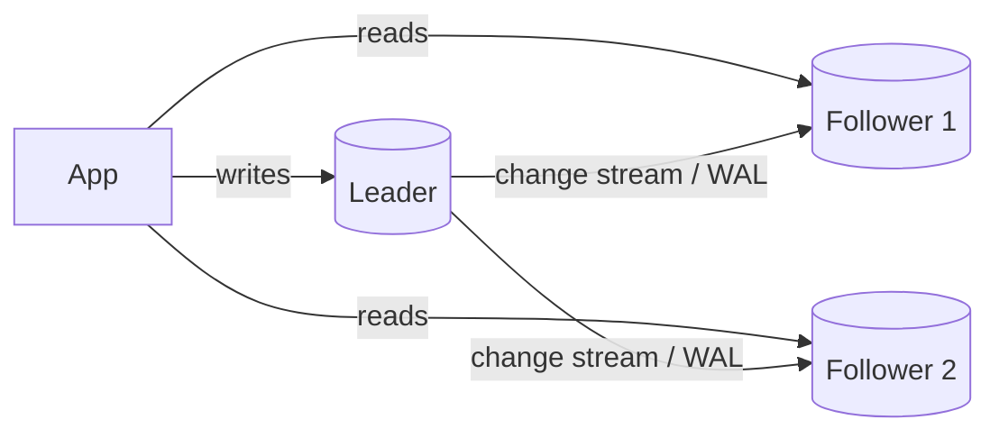
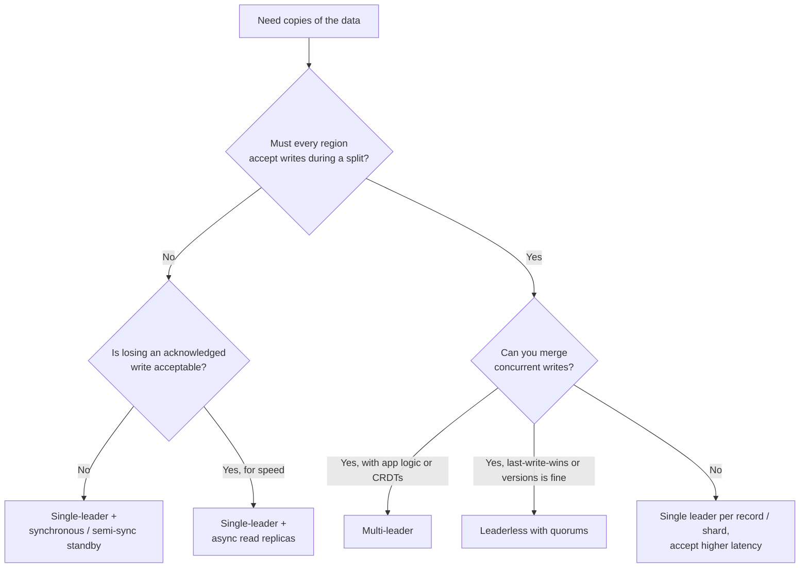

# Replication

## TL;DR
- **Single-leader (leader-follower)** by default: one node takes writes, followers serve reads and
  stand by for failover. PostgreSQL, MySQL, MongoDB, Redis.
- **Multi-leader** when writes must be accepted in several regions or offline, and you can resolve
  conflicts.
- **Leaderless** (quorums) when writes must always succeed and you can tolerate eventual
  consistency. Cassandra, DynamoDB, Riak.
- **Synchronous** replication when losing an acknowledged write is unacceptable;
  **asynchronous** when write latency matters more; **semi-synchronous** for a middle ground.
- Replication scales **reads** and **availability**, not writes. To scale writes, [shard](sharding.md).

## Why replicate

| Goal | How replication helps |
|------|-----------------------|
| High availability | A follower takes over when the leader fails |
| Read scaling | Spread reads across replicas |
| Lower latency | Put replicas near users in other regions |
| Durability | Data survives the loss of a disk, machine or zone |
| Isolation | Run analytics or backups on a replica, not the primary |

## Side-by-side comparison

| | Single-leader | Multi-leader | Leaderless |
|---|---|---|---|
| Who accepts writes | One leader | Several leaders (e.g. one per region) | Any replica |
| Write conflicts | None (one writer) | Yes: need resolution | Yes: need resolution |
| Read consistency | Strong from the leader; possibly stale from followers | Eventual across leaders | Tunable with quorums (W + R > N) |
| Failover | Promote a follower (manual or automatic) | Other leaders keep working | No failover needed; quorums tolerate node loss |
| Write availability during failures | Lost until a new leader is chosen | High | High |
| Complexity | Lowest | High (conflicts, topology) | Medium (quorums, repair, versioning) |
| Examples | PostgreSQL, MySQL, MongoDB replica sets, Redis, Kafka partitions | MySQL/PostgreSQL multi-primary setups, CouchDB, Cosmos DB multi-region writes | Cassandra, DynamoDB, Riak, ScyllaDB |

---

## Single-leader (leader-follower)

**What it is.** One node (the leader, or primary) accepts all writes and sends a stream of
changes to the followers (replicas or secondaries). Clients read from the leader for fresh data,
or from followers to spread the load.



**Use when**
- Most applications: read-heavy workloads on a relational or document database.
- You need simple, strong consistency for writes (one place decides).
- Read replicas for reporting, analytics and backups.

**Don't use when**
- Writes must continue in every region during a network split → multi-leader or leaderless.
- Write volume exceeds one machine → [shard](sharding.md) (each shard can still be single-leader).

**Advantages**
- No write conflicts; easy to reason about.
- Reads scale by adding followers.
- Widely supported and well understood.

**Limitations**
- **Replication lag:** followers can be seconds behind, so reads from them may be stale (see
  [anomalies](#replication-lag-anomalies)).
- **Failover is risky:** detecting a dead leader takes time; promoting a lagging follower loses
  writes; two nodes believing they're leader (**split brain**) corrupts data. Use fencing and
  consensus-based election (e.g. Patroni with etcd for PostgreSQL).
- **Write bottleneck:** all writes go through one machine.

---

## Multi-leader

**What it is.** Several nodes accept writes, usually one leader per data center or region, and
replicate to each other. Offline-first apps are an extreme case: each device is a leader.

**Use when**
- Users write in several regions and must not wait for a cross-ocean round trip.
- A region must keep accepting writes when it's cut off from the others.
- Collaborative editing and offline-capable apps (calendars, notes).

**Don't use when**
- You can't define a correct merge for concurrent writes to the same data (balances, stock) →
  single-leader per record, or strong consistency.
- A single region is enough: the complexity isn't worth it.

**Advantages**
- Local write latency in every region.
- Survives a region outage or network partition without failover.

**Limitations**
- **Write conflicts:** two regions edit the same row at once. Resolve with last-write-wins
  (simple, but silently loses an update), app-specific merge logic, or CRDTs (Conflict-free
  Replicated Data Types).
- **Constraint problems:** unique constraints and auto-increment IDs can clash across leaders.
  Use UUIDs or per-region ID ranges.
- Complex to operate and test.

---

## Leaderless

**What it is.** Any replica accepts reads and writes. The client (or a coordinator node) sends
each write to all **N** replicas and waits for **W** acknowledgements; a read asks **R** replicas
and takes the newest version. If **W + R > N**, the read and write sets overlap, so reads see the
latest acknowledged write. This was popularized by Amazon's Dynamo paper (2007).

| N | W | R | Behavior |
|---|---|---|----------|
| 3 | 2 | 2 | Balanced: tolerates one node down for both reads and writes |
| 3 | 3 | 1 | Fast reads; any node down blocks writes |
| 3 | 1 | 3 | Fast writes; any node down blocks reads |
| 3 | 1 | 1 | Fastest and most available; eventual consistency only |

Replicas that missed a write are fixed by **read repair** (fixing stale replicas found during a
read), **hinted handoff** (another node holds the write until the replica returns) and
**anti-entropy** (background comparison using Merkle trees).

**Use when**
- Writes must always succeed, even with nodes down: carts, events, time series, IoT.
- Very high write throughput across many nodes.
- You're fine tuning consistency per request (see [CAP and consistency](cap-and-consistency.md#tuning-consistency-in-practice)).

**Don't use when**
- You need transactions across rows or strict invariants → single-leader relational database.
- You need linearizable reads everywhere: quorums alone don't guarantee it.

**Advantages**
- No leader, no failover, no single write bottleneck.
- Tolerates node failures and slow nodes gracefully.
- Tunable consistency vs latency per request.

**Limitations**
- **Conflicting writes:** concurrent writes to one key need version vectors or last-write-wins.
- **Quorums aren't linearizable:** sloppy quorums, partial writes and clock-based last-write-wins
  still allow anomalies.
- Repair and tombstones (markers for deleted data) add operational work.

---

## Synchronous vs asynchronous replication

| Mode | Leader acknowledges the write after… | Durability | Write latency | If a follower is down |
|------|--------------------------------------|-----------|---------------|------------------------|
| Synchronous | All (or the chosen) followers confirm | No acknowledged write is lost | Highest | Writes block |
| Semi-synchronous | At least one follower confirms | Survives loss of the leader | Medium | Falls back to another follower |
| Asynchronous | Only its own disk write | Recent writes lost if the leader dies | Lowest | No effect on writes |

Most production setups use **asynchronous** replication to most followers, with
**semi-synchronous** (one synchronous standby) for the failover candidate. PostgreSQL does this
with `synchronous_standby_names`; MySQL has a semi-sync plugin.

**Replication log formats**
- **Statement-based:** ship the SQL statements. Small, but functions like `NOW()` or `RAND()`
  give different results on followers.
- **Write-ahead log (WAL) shipping:** ship low-level disk changes. Exact, but ties followers to
  the same database version (PostgreSQL streaming replication).
- **Logical (row-based):** ship row changes. Works across versions and feeds change data capture
  (CDC) tools like Debezium (MySQL binlog in ROW format, PostgreSQL logical replication).

---

## Replication lag anomalies

With asynchronous followers, a read can miss recent writes. Three classic problems:

| Anomaly | What the user sees | Fix |
|---------|--------------------|-----|
| Read-your-writes | Updates their profile, refreshes, sees the old one | Read from the leader for a few seconds after a write, or read only from replicas that have caught up to the write's position (LSN) |
| Monotonic reads | A comment appears, then disappears on refresh | Pin each user to the same replica (e.g. by user ID hash) |
| Consistent prefix | Sees an answer before the question it replies to | Write causally related data to the same partition, or track causal order |

These are the session guarantees described in [CAP and consistency](cap-and-consistency.md#session-guarantees-read-your-writes-monotonic-reads).

**Worked example: checking lag in PostgreSQL**

```sql
-- On the primary: how far behind is each standby?
SELECT application_name, state, sync_state,
       pg_wal_lsn_diff(pg_current_wal_lsn(), replay_lsn) AS bytes_behind,
       replay_lag
FROM pg_stat_replication;

-- On a replica: how old is the last replayed transaction?
SELECT now() - pg_last_xact_replay_timestamp() AS replica_delay;
```

Route a read to a replica only if its lag is below your threshold (e.g. 1 s); otherwise read from
the primary. You can run PostgreSQL locally with the
[PostgreSQL Docker setup](../_03_Building_Blocks/_01_Docker_Databases/postgresql/README.md); it's a
single node, so `pg_stat_replication` is empty there.

---

## Quick decision points



| If you need… | Choose |
|--------------|--------|
| More read capacity for a relational database | Single-leader + async read replicas |
| Zero data loss on failover | Single-leader + a synchronous (or semi-sync) standby |
| Local writes in several regions | Multi-leader (with conflict resolution) |
| Always-writable, high-volume key-value data | Leaderless (Cassandra, DynamoDB) |
| Reporting without hurting production | A dedicated read replica |
| Disaster recovery in another region | Async replica in that region (see [reliability](reliability.md)) |

**Common combinations in interviews**
- **[Payment system](../_04_Case_Studies/payment-system.md):** single-leader database with a
  synchronous standby; reads that drive decisions go to the leader.
- **[Chat application](../_04_Case_Studies/chat-application.md):** leaderless Cassandra with
  `LOCAL_QUORUM` for messages; single-leader SQL for accounts.
- **[Distributed key-value store](../_04_Case_Studies/distributed-key-value-store.md):** leaderless
  with N = 3, W = 2, R = 2, hinted handoff and read repair.
- **Global SaaS app:** single-leader per region for that region's tenants, async replicas elsewhere for reads.

## Interview questions
**Q: How do you give "read-your-writes" with read replicas?**
Route a user's reads to the leader for a few seconds after they write, or track the write
version and only read from replicas that have caught up.

**Q: Synchronous or asynchronous replication?**
Synchronous guarantees no acknowledged write is lost but adds latency and blocks if the follower
is down. Asynchronous is fast but can lose recent writes on failover. Most systems use async
followers plus one synchronous standby for failover.

**Q: What is split brain and how do you prevent it?**
Two nodes both act as leader after a network problem and accept conflicting writes. Prevent it with
consensus-based leader election (a majority must agree), fencing tokens or STONITH ("shoot the other
node in the head") so the old leader can't keep writing, and leases that expire.

**Q: Does W + R > N guarantee strong consistency?**
It makes read and write quorums overlap, so a read reaches the latest acknowledged write, but it
isn't fully linearizable: sloppy quorums, partial writes and last-write-wins can still cause
anomalies.

**Q: Does replication scale writes?**
No. Every replica must apply every write. Replication scales reads and availability; sharding
scales writes.

**Q: How does a failed replica catch up in a leaderless system?**
Hinted handoff replays writes another node held for it, read repair fixes keys as they're read,
and anti-entropy compares Merkle trees in the background to fix the rest.

## Related
- [CAP and consistency](cap-and-consistency.md): consistency models and quorum tuning
- [Sharding](sharding.md): scaling writes
- [Consistent hashing](consistent-hashing.md): placing replicas on a ring
- [Reliability](reliability.md): failover, RPO and RTO
- [Databases](../_03_Building_Blocks/databases.md)
- [PostgreSQL Docker setup](../_03_Building_Blocks/_01_Docker_Databases/postgresql/README.md)
