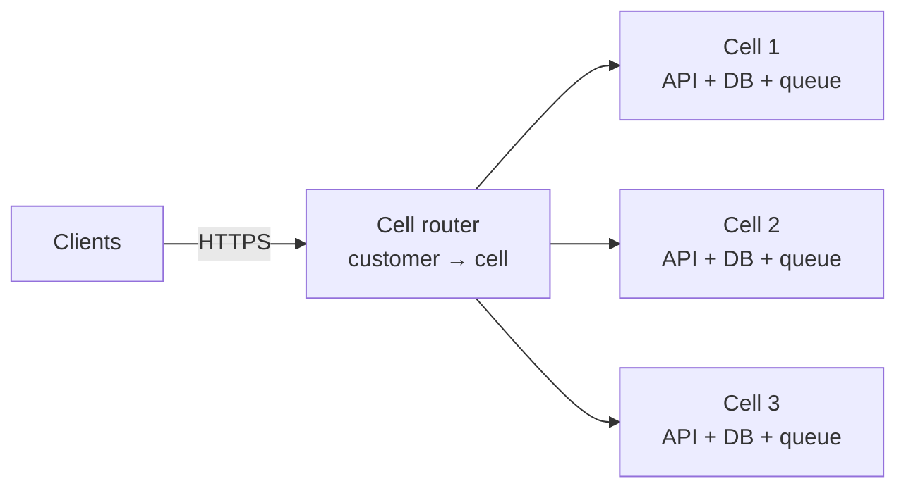
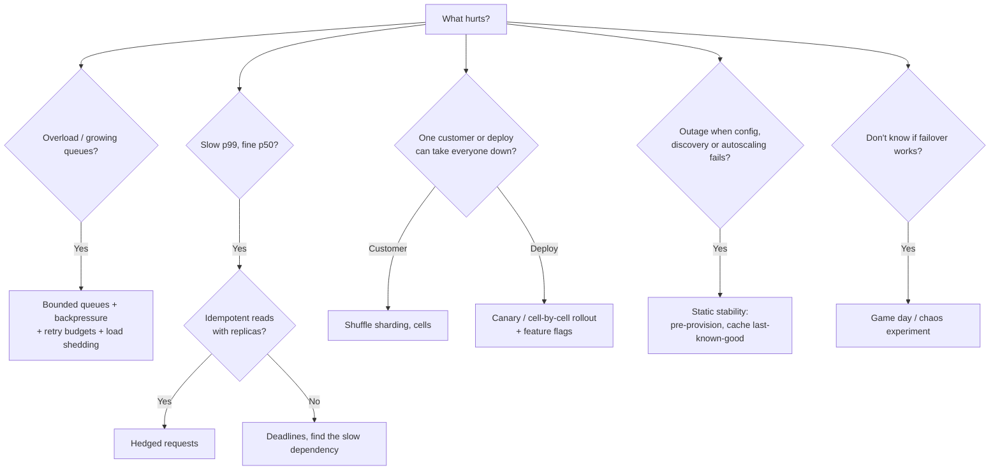

# Resiliency Patterns

[Reliability](reliability.md) covers the **per-call** defences: timeouts, retries with backoff,
circuit breakers, bulkheads, load shedding, failover and SLOs. This note covers the
**system-level** patterns that keep a failure small and recoverable: controlling overload, cutting
tail latency, limiting blast radius, changing the system safely, and proving it all works.

## TL;DR
- **Backpressure** when a producer can outrun a consumer: bounded queues and flow control, so
  overload slows senders down instead of exhausting memory.
- **Retry budgets** so retries can never multiply traffic more than ~10–20%: the fix for retry storms.
- **Hedged requests** to cut p99 latency on idempotent reads by sending a backup request after a delay.
- **Cell-based architecture** to cap the blast radius: many independent copies of the stack, each
  serving a slice of customers.
- **Shuffle sharding** so one bad tenant can only hurt the few others that share all its workers.
- **Static stability** so the data plane keeps working when the control plane (config, autoscaling,
  discovery) is down.
- **Progressive delivery** (canary, blue-green, feature flags, automatic rollback), because most
  outages start with a change.
- **Chaos engineering and game days** to prove the above work before a real incident does.
- **None of these** before the basics in [reliability](reliability.md) are in place: timeouts,
  retries with jitter, health checks and redundancy come first.

## The landscape

| Goal | Patterns | Typical tools |
|------|----------|---------------|
| Survive overload | Backpressure, admission control, retry budgets, [load shedding](reliability.md#load-shedding-rate-limiting-and-graceful-degradation) | Bounded queues, Reactive Streams, gRPC/HTTP/2 flow control, Envoy retry budgets |
| Cut tail latency | Hedged requests, tied requests, deadline propagation | gRPC hedging policy, custom clients |
| Contain failures | Cells, shuffle sharding, bulkheads, static stability | Per-cell stacks, AWS Route 53 shuffle sharding, pre-provisioned capacity |
| Change safely | Canary, blue-green, feature flags, automatic rollback | Argo Rollouts, Flagger, Spinnaker, LaunchDarkly / OpenFeature |
| Prove it | Chaos engineering, game days, disaster-recovery drills | Chaos Monkey, AWS FIS, Gremlin, LitmusChaos, Chaos Mesh |

## Side-by-side comparison

| | Backpressure | Retry budget | Hedged requests | Cells | Shuffle sharding | Static stability | Progressive delivery | Chaos engineering |
|---|---|---|---|---|---|---|---|---|
| Protects against | Fast producer, slow consumer | Retry storms | Slow outliers (p99) | Failures spreading to everyone | One noisy or poison tenant | Control-plane outages | Bad deploys and config | Unknown weaknesses |
| Mechanism | Bound queues; signal "slow down" | Cap retries as a % of requests | Second request after p95 delay | Independent full stacks | Each tenant on a random small subset of workers | Pre-provision; cache last-known-good | Expose change to a small slice first | Inject failures on purpose |
| Cost | Callers see waits or rejections | Some failures not retried | ~5% extra load (if hedging at p95) | Duplicated infra; routing layer | Placement logic | Idle headroom | Slower rollouts; tooling | Engineering time; controlled risk |
| Blast radius reduced to | One queue | — | — | 1 / number of cells | Tenants sharing all workers | None lost | The canary slice | Found before customers do |
| Real-world | TCP windows, Kafka consumer pull, Akka/Reactor | Envoy, Finagle, gRPC retry throttling | Google BigTable/Spanner clients, gRPC hedging | AWS services, Slack, DoorDash | AWS Route 53, Lambda | AWS EC2 / zonal designs | Most large SaaS | Netflix Chaos Monkey |

---

## Backpressure

**What it is.** A way for a slow consumer to tell a fast producer to slow down. Every queue between
stages is **bounded**; when one fills, the producer blocks, waits, or gets rejected, instead of the
queue growing until memory runs out. TCP's receive window and HTTP/2 flow control are backpressure
at the network level; Kafka consumers *pull* at their own pace, so the backlog sits on disk, not in memory.

| Response when the queue is full | Effect | Use for |
|---------------------------------|--------|---------|
| Block the producer | Slows the whole pipeline to the slowest stage | Internal pipelines, batch jobs |
| Reject (429 / 503) | Caller retries later or degrades | Request/response services |
| Drop oldest / newest | Lose some data, stay current | Metrics, telemetry, live video frames |
| Buffer to disk | Absorb bursts durably | Log shipping, Kafka |

**Use when**
- Any pipeline where stages run at different speeds: ingestion → processing → database.
- Streaming systems (Reactive Streams, Akka Streams, Project Reactor, RxJava).

**Don't use when**
- You can't slow the source (user clicks, sensors) → buffer durably (Kafka) and scale consumers.

**Advantages**
- Overload becomes slower or rejected work, not crashes or out-of-memory kills.
- Makes the bottleneck visible: the full queue is where to add capacity.

**Limitations**
- **Unbounded queues hide the problem:** latency grows until timeouts fire and everything retries.
  Always set a maximum size and alert on queue depth.
- Blocking upstream can deadlock cyclic pipelines.

---

## Retry budgets

**What it is.** A cap on retries as a share of normal traffic, e.g. "retries may add at most 10%
of requests over the last 10 s". When a dependency fails broadly, retries stop instead of
multiplying load.

```
Why per-call retry limits aren't enough:
  3 layers (gateway → API → DB client), each tries 3 times
  1 user request → 3 × 3 × 3 = 27 attempts at the database when it's struggling

With a 10% retry budget per client: at most 1.1 × normal traffic, whatever the failure rate
```

**Use when**
- Any client that retries, especially in deep call chains.
- Built in: Envoy's `retry_budget`, gRPC's retry throttling (`maxTokens` / `tokenRatio`), Finagle.

**Don't use when**
- Single, user-initiated, idempotent calls with no fan-out: a simple 2–3 attempt limit with backoff is enough.

**Advantages**
- Bounds amplification during wide failures; retries still help during small blips.

**Limitations**
- **Retry at one layer only** where possible (usually the edge or the client nearest the failure);
  budgets reduce, but don't remove, multiplication across layers.

---

## Hedged requests

**What it is.** Send a request; if no reply arrives within roughly the **p95 latency**, send the
same request to another replica and use whichever answers first, cancelling the other. Described in
Dean and Barroso's "The Tail at Scale" (2013). At scale, one slow server out of hundreds makes many
user requests slow; hedging hides it for about 5% extra load.

**Use when**
- Idempotent reads served by several equivalent replicas: key-value lookups, search shards, object reads.
- Fan-out requests (one page = 100 backend calls) where the slowest call sets the latency.

**Don't use when**
- Non-idempotent writes (payments, counters) → never hedge them.
- The dependency is overloaded: hedging adds load where there's none to spare. Cap hedges with a
  budget too (gRPC's hedging policy uses the same throttling as retries).

**Advantages**
- Big p99 cut for a small cost.

**Limitations**
- **Extra load:** hedging after p95 sends ~5% more requests; hedging after p50 would send ~50% more.
- Needs cancellation, or the loser keeps using resources.

### Worked example: hedging in Python

Tested with Python 3.14 (`asyncio`). The fake replica answers in 10 ms 95% of the time and 200 ms
otherwise (a GC pause, a noisy neighbour).

```python
import asyncio, random

async def call_replica(name: str) -> str:
    await asyncio.sleep(0.2 if random.random() < 0.05 else 0.01)
    return name

async def hedged(hedge_after_s: float = 0.03) -> str:
    first = asyncio.create_task(call_replica("replica-1"))
    done, _ = await asyncio.wait({first}, timeout=hedge_after_s)
    if done:
        return first.result()
    second = asyncio.create_task(call_replica("replica-2"))   # backup request
    done, pending = await asyncio.wait({first, second}, return_when=asyncio.FIRST_COMPLETED)
    for t in pending:
        t.cancel()                                             # cancel the loser
    return done.pop().result()
```

| 2,000 calls | p50 | p99 |
|-------------|-----|-----|
| Single request | 10 ms | 201 ms |
| Hedged after 30 ms | 10 ms | **41 ms** |

The hedge fires on ~5% of calls, so the cost is ~5% more replica traffic for a ~5× better p99.

---

## Cell-based architecture

**What it is.** Split the system into many **cells**: complete, independent copies of the stack
(services, databases, queues), each serving a fixed subset of customers. A thin **cell router**
sends each request to its customer's cell. A bad deploy, poison message or overload in one cell
affects only that cell's customers. AWS describes many of its services this way; Slack and DoorDash
have written about moving to cells.



**Use when**
- Large multi-tenant SaaS where a full outage is unacceptable but a 1/N outage is survivable.
- You need a hard ceiling on the size of each failure and each deployment.

**Don't use when**
- Small systems: one cell is the whole system, so cells add only overhead.
- Features need global data across all customers (global search, social graphs) → keep those
  global services separate and very stable, or don't cell-ify that part.

**Advantages**
- Blast radius = 1 / number of cells; deploy cell by cell like a canary.
- Each cell has a known maximum size, so load tests stay valid as you grow: add cells, not bigger cells.

**Limitations**
- **The router is critical:** keep it tiny, static and heavily cached.
- **Moving a customer between cells** is a data migration.
- More infrastructure to run and observe; cross-cell features are harder.

---

## Shuffle sharding

**What it is.** Instead of assigning each customer to one shard of workers, give each customer a
**random combination** of a few workers out of many. Two customers almost never share the *same*
combination, so a customer that crashes its workers (a poison request, a flood) can't take down
everyone on a shard. Clients retry across their small set. AWS uses it for Route 53 and other services.

```
8 workers, plain sharding into 4 shards of 2:
  A bad customer kills its shard → 1/4 of all customers lose service

8 workers, shuffle sharding with 2 workers per customer:
  combinations = C(8, 2) = 28
  Another customer shares BOTH workers with the bad one: 1/28 ≈ 3.6%
  Customers sharing one worker still have the other one

100 workers, 5 per customer: C(100, 5) = 75,287,520 combinations
  A full overlap is very unlikely
```

**Use when**
- Multi-tenant services where one tenant's traffic or data can break workers.
- You already have many interchangeable workers or endpoints.

**Don't use when**
- Failures are shared anyway (one database behind all workers) → isolate that first.
- Clients can't retry across their assigned workers.

**Advantages**
- Huge reduction in blast radius with **no extra capacity**.

**Limitations**
- **Partial overlap still degrades** customers that share some workers; they rely on retries to
  their healthy ones.
- Needs a placement service and client-side routing.

---

## Static stability

**What it is.** A system is statically stable if it keeps working **without needing to change**
when something fails. The data plane (serving requests) must not depend on the control plane
(config, autoscaling, service discovery, deployment) being up. In practice: pre-provision enough
capacity in each zone to lose one zone without launching anything, and cache the last-known-good
config so a broken config service doesn't stop traffic.

| Instead of | Statically stable design |
|------------|--------------------------|
| Autoscale into the remaining zones when one fails | Run 3 zones at ≤ 66% each, so 2 zones carry 100% with no new instances |
| Fetch credentials or config on every request | Cache with long expiry; keep serving with the last good copy |
| Service discovery lookup per call | Cache endpoints in the client; tolerate a stale list |
| DNS change to fail over | Health-checked endpoints already in rotation |

**Use when**
- Any critical path: the moment you most need to scale or reconfigure (a zone outage) is when
  control planes are most likely to be overloaded or down.

**Don't use when**
- Cost-sensitive, non-critical batch systems where waiting for capacity is acceptable.

**Advantages**
- Failures need no reaction to survive; fewer moving parts during an incident.

**Limitations**
- **Idle headroom costs money:** surviving the loss of 1 of 3 zones means ~33% spare capacity.
- Stale caches need a hard expiry so a bad value can't live forever.

---

## Progressive delivery (safe change)

**What it is.** Most incidents are triggered by a change: code, config, a feature or a schema.
Progressive delivery exposes each change to a small slice first, watches metrics, and continues or
rolls back automatically.

| Technique | How | Rollback | Use when |
|-----------|-----|----------|----------|
| Canary | Send 1% → 10% → 50% → 100% to the new version, pausing on metrics | Shift traffic back | Default for services |
| Blue-green | Run new version beside old; switch all traffic at once | Switch back instantly | Need an instant, whole switch; can afford 2× capacity briefly |
| Feature flags | Code is deployed dark; turn the feature on per user, tenant or % | Turn the flag off | Decouple deploy from release; per-tenant rollout |
| Rolling | Replace instances a batch at a time | Roll forward or back slowly | Simple stateless fleets |
| Cell / zone by zone | Deploy one cell or zone at a time, with bake time | Stop the wave | Large systems; matches cells |

**Use when**
- Always, for production changes. Automate the "watch metrics and roll back" step.

**Don't use when**
- Schema changes that aren't backward compatible: no traffic split can save them → use
  **expand/contract** migrations (add column, dual-write, backfill, switch reads, drop old).

**Advantages**
- A bad change affects few users for a short time.

**Limitations**
- **Needs good signals:** error rate and latency per version ([observability](observability.md)).
- **Flags become debt:** remove them after the rollout.
- Old and new versions run together, so APIs and messages must be compatible both ways.

---

## Chaos engineering and game days

**What it is.** Run controlled experiments that inject real failures (kill instances, add latency,
cut a zone, fill a disk) to check the system behaves as designed. Start with a **steady-state
hypothesis** ("checkout success stays above 99.5%"), inject the fault in a limited scope, and stop
automatically if the metric breaks. Netflix's Chaos Monkey popularised it; game days are the
manual, team-run version, including disaster-recovery drills.

**Use when**
- After the resilience mechanisms exist: to test failover, circuit breakers and alerts.
- Before a big event (launch, sale), and regularly, because systems drift.

**Don't use when**
- There's no monitoring or rollback yet → fix that first.
- In production without a stop condition and a small blast radius.

**Advantages**
- Finds weaknesses on your schedule, not during an incident.
- Trains people: runbooks and on-call get practised.

**Limitations**
- **Real risk:** start in staging, then a small production slice, with automatic abort.
- Needs organisational buy-in; findings are only useful if fixed.

---

## Quick decision points



| If you need… | Choose |
|--------------|--------|
| A slow consumer not to crash the pipeline | Bounded queues + backpressure |
| Retries not to cause outages | Retry budgets, retry at one layer |
| Lower p99 on reads | Hedged requests at ~p95 |
| A failure to hit at most 1/N of customers | Cell-based architecture |
| One tenant not to take down others | Shuffle sharding |
| To survive a zone loss with no scaling action | Static stability (N+1 zones of capacity) |
| Bad deploys to hit few users | Canary + automated rollback, feature flags |
| Confidence it all works | Chaos experiments and game days |

**Common combinations in interviews**
- **[Notification system](../_04_Case_Studies/notification-system.md):** Kafka as a durable buffer
  (backpressure), per-channel worker pools (bulkheads), retry budgets towards SMS/email providers.
- **[Video streaming](../_04_Case_Studies/video-streaming.md):** hedged segment fetches from CDN
  and origin; serve a lower bitrate rather than stall (degradation).
- **Multi-tenant SaaS:** cells by tenant, shuffle sharding inside each cell, cell-by-cell deployments.

## Interview questions
**Q: Reliability patterns vs resiliency patterns?**
Overlapping terms. Per-call patterns (timeouts, retries, circuit breakers) stop one failing call
from hurting the caller. System-level patterns (cells, shuffle sharding, static stability,
progressive delivery) limit how far a failure spreads and how often changes cause one.

**Q: How do you prevent a retry storm?**
Retry at one layer, with exponential backoff and jitter, honour `Retry-After`, add a retry budget
(retries ≤ ~10% of requests) and a circuit breaker. Show the math: 3 layers × 3 attempts = 27×.

**Q: What are hedged requests and when are they unsafe?**
Send a duplicate to another replica if the first hasn't answered by ~p95, take the first reply,
cancel the other. Safe only for idempotent operations, and only with spare capacity: hedging an
overloaded service makes it worse.

**Q: Cells vs shuffle sharding?**
Cells duplicate the entire stack, so any failure (deploy, database, poison data) is limited to one
cell, at the cost of more infrastructure. Shuffle sharding reuses one pool of workers but gives
each tenant a random subset, so one tenant's damage rarely fully overlaps another's, at no extra
capacity. Large systems use both.

**Q: What is static stability?**
Designing so nothing has to happen for the system to survive a failure: capacity is already in
place, config is cached, endpoints are known. You don't depend on the control plane during the
outage, when it's most likely to be impaired.

**Q: Canary vs blue-green?**
Canary shifts traffic gradually and compares metrics, limiting impact; blue-green switches all
traffic at once between two full environments, giving instant rollback but needing double
capacity for a while and exposing everyone at once.

**Q: How do you start with chaos engineering?**
Define steady-state metrics, form a hypothesis, start in staging with one small fault (kill one
instance), add an automatic stop, then move to a small slice of production and widen gradually.
Fix what you find before the next experiment.

## Related
- [Reliability](reliability.md): timeouts, retries, circuit breakers, bulkheads, failover, SLOs
- [Rate limiting](rate-limiting.md): admission control at the edge
- [Message queues](message-queues.md): durable buffers that absorb bursts
- [Observability](observability.md): the signals canaries and chaos experiments depend on
- [Sharding](sharding.md): tenant placement and hot keys
- [Idempotency](idempotency-and-delivery-guarantees.md): what makes retries and hedges safe
- [API gateway](api-gateway.md): where edge retries, timeouts and limits live
