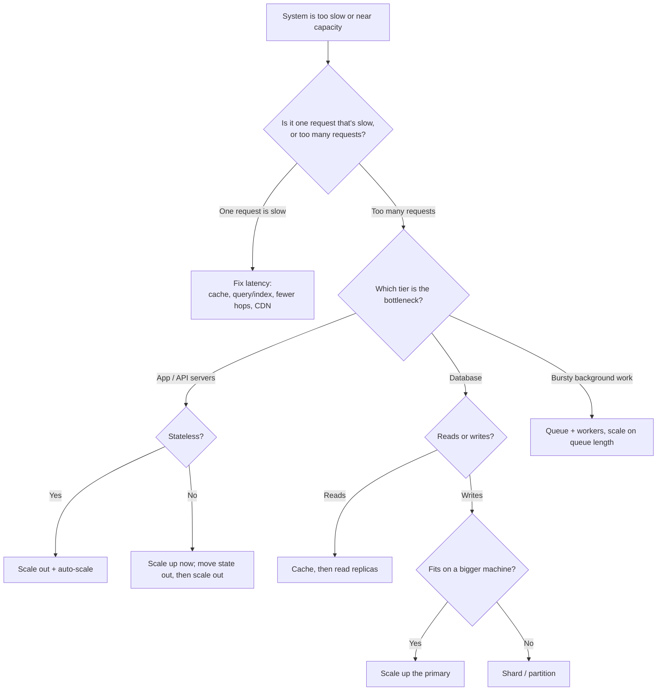

# Scalability: Scaling Up, Out and Automatically

## TL;DR
- **Vertical scaling (scale up)** first: a bigger machine is the simplest fix, until you hit the
  hardware limit, the price curve, or need redundancy.
- **Horizontal scaling (scale out)** for anything that must grow without limit or survive a
  machine failure. It requires **stateless** services.
- **Auto-scaling** when load changes during the day: add and remove instances from metrics or a schedule.
- **Scale the data tier separately:** cache → read replicas → sharding, in that order.
- **Latency vs throughput:** scaling out raises throughput; it doesn't make a single request faster.
- If load is bursty and work can wait, **don't scale for the peak**: put a
  [queue](message-queues.md) in front and process at a steady rate.

## The landscape

| Lever | What changes | Typical tools |
|-------|--------------|---------------|
| Vertical scaling | Bigger CPU, RAM, disk on one machine | Resize a VM or database instance |
| Horizontal scaling | More machines behind a [load balancer](load-balancer.md) | Kubernetes Deployments, VM scale sets, AWS Auto Scaling groups |
| Auto-scaling | Number of machines over time | Kubernetes HPA, AWS/Azure/GCP autoscalers, KEDA |
| Offloading work | Less work per request | [Cache](cache.md), CDN, async [queues](message-queues.md) |
| Scaling data | Where data lives and who serves it | [Replication](replication.md), [sharding](sharding.md) |

## Side-by-side comparison

| | Vertical | Horizontal | Auto-scaling |
|---|---|---|---|
| How | Bigger machine | More machines | Add/remove machines automatically |
| Upper limit | Largest machine available | Practically none (for stateless tiers) | Your quotas and budget |
| Fault tolerance | None: one machine is a SPOF (Single Point of Failure) | Survives machine failures | Replaces failed instances |
| Code changes | None | Services must be stateless; shared state moves out | Same as horizontal, plus fast startup |
| Downtime to scale | Often a restart | None (add nodes behind the LB) | None |
| Cost curve | Rises steeply at the high end | Roughly linear | Pays only for what's used |
| Complexity | Lowest | Load balancing, coordination, distributed state | Metrics, thresholds, warm-up, cooldowns |
| Good for | Early stage, databases that are hard to shard | Web/API tiers, workers, caches | Daily or weekly traffic patterns, spikes |

---

## Vertical scaling (scale up)

**What it is.** Move the workload to a machine with more CPU, memory, faster disks or network.
Nothing about the architecture changes.

**Use when**
- Early stage or small load: one bigger box is cheaper than a distributed system.
- Relational databases before sharding: a large primary plus read replicas goes a long way.
- Workloads that don't split well: a single-threaded process, an in-memory dataset, licensed software priced per machine.

**Don't use when**
- You need to survive a machine failure → horizontal scaling with redundancy.
- Growth is open-ended → you'll hit the biggest machine eventually.
- You'd need downtime to resize and can't afford it.

**Advantages**
- No code or architecture change; no distributed-systems problems.
- Low latency: everything is local (memory is far faster than the network; see
  [latency numbers](../_01_Interview_Playbook/estimation-cheat-sheet.md#latency-numbers)).
- Strong consistency comes for free on one machine.

**Limitations**
- **Hard ceiling:** the largest available machine is the limit.
- **SPOF:** one machine means one failure takes everything down.
- **Cost rises faster than capacity** at the top end.
- Resizing often needs a restart.

---

## Horizontal scaling (scale out)

**What it is.** Run many identical instances behind a load balancer and add more as load grows.
This works cleanly only for **stateless** services: any instance can handle any request, because
session data, files and caches live in shared stores.

| State | Where it goes |
|-------|---------------|
| User sessions | Redis or a database, or signed cookies / JWTs |
| Uploaded files | Object storage (S3, Azure Blob) |
| Caches | A shared distributed cache (Redis, Memcached), plus small local caches |
| Long-running jobs | A queue and worker pool |

**Use when**
- Web and API tiers, background workers, stream processors.
- You need high availability: lose an instance, keep serving.
- Load can grow by 10× or 100×.

**Don't use when**
- The service is stateful and can't be made stateless yet (scale up first, then refactor).
- The bottleneck is the database: adding app servers just adds connections to it.
- Coordination dominates the work (strongly consistent writes to one record): more nodes won't help.

**Advantages**
- Near-linear capacity growth for stateless tiers.
- Fault tolerance through redundancy across machines and availability zones.
- Scale without downtime; roll out new versions gradually.
- Commodity machines are cheap.

**Limitations**
- **Needs stateless design:** sticky sessions are a workaround that breaks even load spreading
  and failover.
- **Distributed-system costs:** network calls, partial failures, consistency
  ([CAP](cap-and-consistency.md)), and harder debugging (see [observability](observability.md)).
- **Shared dependencies become the bottleneck:** database connections, caches, rate limits of
  third-party APIs.
- More operational work: deployment, service discovery, configuration.

---

## Auto-scaling

**What it is.** Automatically change the number of instances based on a signal.

| Type | Signal | Example |
|------|--------|---------|
| Reactive (target tracking) | Live metrics: CPU, requests per second per instance, queue length, p95 latency | Keep CPU around 60%; add workers when queue depth > 1,000 |
| Scheduled | Time of day or calendar | Scale up before 9 a.m. and before a sale |
| Predictive | Forecast from past traffic | Cloud predictive scaling ahead of a daily peak |

**Use when**
- Traffic varies through the day or week, or spikes around events.
- Worker pools that drain a queue: scale on queue length or message age (e.g. KEDA).

**Don't use when**
- Load is flat: a fixed size is simpler and predictable.
- Instances take minutes to start and spikes last seconds → keep spare capacity or queue the work.
- The bottleneck is a stateful tier that can't add nodes quickly (most databases).

**Advantages**
- Pays only for capacity in use.
- Handles growth and spikes without manual work.
- Replaces unhealthy instances automatically.

**Limitations**
- **Lag:** metrics, decisions and startup take time. Spikes faster than that still overload you,
  so keep headroom (e.g. target 60% CPU, not 90%).
- **Flapping:** scaling up and down repeatedly. Use cooldowns and different up/down thresholds.
- **Wrong signal:** CPU may not reflect I/O-bound or queue-bound load. Scale on the real bottleneck.
- **Cold starts:** new instances have empty caches and JIT warm-up; add readiness checks
  (see [reliability](reliability.md)).

---

## Latency vs throughput

| Term | Meaning | Unit | Improves with |
|------|---------|------|---------------|
| Latency | Time for one request, start to finish | ms (report p50, p95, p99) | Caching, fewer network hops, faster code and queries, data closer to users (CDN, regions) |
| Throughput | Requests completed per unit of time | QPS, messages/s, MB/s | More instances, parallelism, batching, async processing |

- They're related but different: a highway with more lanes carries more cars per hour
  (throughput), but each car takes the same time to arrive (latency).
- **Batching** raises throughput but adds latency (each item waits for the batch).
- Near saturation, latency climbs sharply: queues form when utilization approaches 100%.
  Keep utilization well below the limit.
- Always use **percentiles**, not averages: an average of 50 ms can hide a p99 of 2 s.

**Little's Law** links them: **concurrency = throughput × latency**.

```
Target: 2,000 requests/s, average latency 150 ms
Concurrent requests in flight = 2,000 × 0.150 s = 300

Each instance handles ~50 concurrent requests comfortably (thread pool / connections)
Instances needed = 300 / 50 = 6, plus headroom (target 60% utilization) → 10 instances

Each instance holds a pool of 10 DB connections → 100 connections at the database
```

The last line is why horizontal scaling often moves the bottleneck to the database: check its
connection limit and use a connection pooler (e.g. PgBouncer).

---

## Scaling path: from one server to millions of users

| Stage | Change | Fixes |
|-------|--------|-------|
| 1 | One server: app + database | Nothing yet; simplest start |
| 2 | Move the database to its own machine; scale it **up** | App and DB stop competing for resources |
| 3 | Add a load balancer and 2+ **stateless** app servers | Redundancy; more app capacity |
| 4 | Add a [cache](cache.md) (Redis) and a CDN for static files | Cuts most read load and latency |
| 5 | Add database [read replicas](replication.md) | Scales reads |
| 6 | Move slow work to [queues](message-queues.md) and workers | Faster responses; absorbs spikes |
| 7 | **Auto-scale** app and worker tiers | Handles daily patterns and spikes |
| 8 | [Shard](sharding.md) the database, or split it by service | Scales writes and storage |
| 9 | Multiple regions | Lower global latency; survives a region failure |

Go from cheapest to most complex, and only take the next step when measurements show you need it.

---

## Quick decision points



| If you need… | Choose |
|--------------|--------|
| A quick fix for an early-stage app | Scale up |
| To survive a server failure | Scale out across availability zones |
| To handle a daily traffic peak | Auto-scaling (scheduled + reactive) |
| More read capacity on a database | Cache, then read replicas |
| More write capacity on a database | Scale up, then shard |
| To absorb short spikes of background work | Queue + auto-scaled workers |
| Lower latency for global users | CDN, caches and regional deployments |

**Common combinations in interviews**
- **Web app:** stateless API servers behind a load balancer with auto-scaling, sessions in Redis,
  static files on a CDN, one primary database with read replicas.
- **[News feed](../_04_Case_Studies/news-feed.md):** scaled-out fan-out workers driven by a queue;
  feed cache in Redis; auto-scale on queue length.
- **[Video streaming](../_04_Case_Studies/video-streaming.md):** transcoding workers that auto-scale
  on queue depth; nearly all playback traffic served by the CDN.

## Interview questions
**Q: How do you make a service horizontally scalable?**
Make it stateless, move session/state to a shared store or database, put a load balancer
in front, and use auto-scaling based on CPU or request count.

**Q: When is vertical scaling the right choice?**
Early stage, small load, or for a database that is hard to shard. It is simpler and
cheaper until you hit the hardware limit.

**Q: What's the difference between latency and throughput?**
Latency is how long one request takes; throughput is how many requests finish per second. Scaling
out raises throughput but not single-request latency. Little's Law ties them together:
concurrency = throughput × latency.

**Q: You added app servers but the system didn't get faster. Why?**
The bottleneck is elsewhere, usually the database (connections, locks, slow queries) or a shared
dependency. Measure each tier; add a cache, read replicas or a connection pooler, or shard.

**Q: What would you auto-scale on?**
The real bottleneck: requests per instance or CPU for API servers, queue length or message age for
workers. Keep headroom, add cooldowns to avoid flapping, and set minimum instances for fast spikes.

**Q: Why are sticky sessions a problem?**
They pin users to one server, so load spreads unevenly, scaling in drops sessions, and a server
failure logs users out. Store sessions in a shared store instead.

## Related
- [Load balancer](load-balancer.md)
- [Cache](cache.md)
- [Replication](replication.md) and [sharding](sharding.md): scaling the data tier
- [Reliability](reliability.md): redundancy, health checks
- [Estimation cheat sheet](../_01_Interview_Playbook/estimation-cheat-sheet.md): QPS and capacity math
