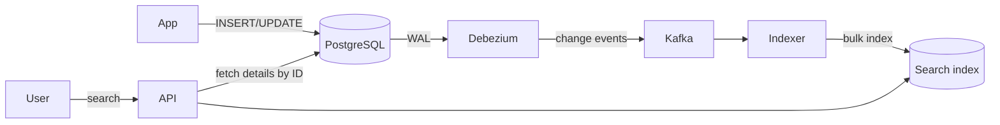
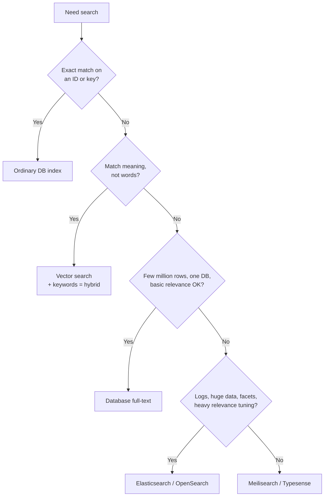

# Search Index

## TL;DR
- **Database full-text search** (PostgreSQL `tsvector` + GIN, MySQL `FULLTEXT`) for search over
  up to millions of rows when you want one system and transactional freshness.
- **Dedicated search engine** (Elasticsearch, OpenSearch, Apache Solr; all built on Lucene) for
  relevance tuning, facets, typo tolerance, log search and scale beyond one database.
- **Lightweight search engine** (Meilisearch, Typesense) for fast, typo-tolerant site or app
  search with little tuning, on modest data sizes.
- **Vector search** (pgvector, OpenSearch/Elasticsearch k-NN, Pinecone, Weaviate, Qdrant, Milvus)
  for "similar meaning" search over embeddings; combine with keywords as **hybrid search**.
- **Not a search engine** for exact lookups by ID or key (`WHERE order_id = …`) → an ordinary
  [database index](db-indexing.md); and never as the source of truth: rebuild it from the database.

## How a search index works

An **inverted index** maps each **term** to the list of documents that contain it (a **postings
list**), like the index at the back of a book.

```text
Documents                                 Inverted index (after analysis)
1: "Mechanical keyboard"                  mechan   → [1, 3]
2: "Wireless mouse pairs with keyboard"   keyboard → [1, 2, 3]
3: "Keyboard wrist rest for               wireless → [2]
    mechanical keyboards"                 mous     → [2]
                                          wrist    → [3]
```

| Stage | What happens | Example |
|-------|--------------|---------|
| Analysis (index time) | Tokenise, lowercase, remove stop words, stem or lemmatise, add synonyms | "Running Runners" → `run`, `runner` |
| Query analysis | The same analysis on the query text | "keyboards" → `keyboard` |
| Matching | Intersect / union postings lists | `mechan AND keyboard` → [1, 3] |
| Scoring | Rank by relevance: **BM25** (term frequency, inverse document frequency, field length) plus boosts | Title matches beat description matches |
| Extras | Facets/aggregations, highlighting, fuzzy (typo) matching, autocomplete | "Brand: (12) Logitech, (8) Keychron" |

## Side-by-side comparison

| | Database full-text | Elasticsearch / OpenSearch / Solr | Meilisearch / Typesense | Vector search |
|---|---|---|---|---|
| Matches | Words (stemmed), phrases | Words, phrases, fuzzy, prefix, geo, numeric ranges | Words, prefix, typo-tolerant by default | Nearest embeddings (semantic similarity) |
| Relevance | Basic (`ts_rank`) | BM25 + rich tuning (boosts, function scores, learning to rank) | Good defaults, simple ranking rules | Distance (cosine, dot product); rerankers |
| Freshness | Immediate, transactional | Near-real-time (refresh ~1 s by default) | Near-real-time | Depends on index type |
| Scale | One database node | Horizontal: shards + replicas, very large clusters | Single node (some clustering options) | From one node (pgvector) to distributed services |
| Facets / aggregations | SQL `GROUP BY` | Built in, fast | Built in | Limited |
| Ops cost | None extra | High: a cluster to size, tune and upgrade | Low | Low (pgvector) to medium |
| Sync with DB | None needed | Pipeline needed | Pipeline needed | Pipeline + embedding model |
| When it breaks | Large data, complex ranking, typos | Used as primary store; mapping explosions; deep pagination | Very large datasets, complex analytics | Exact keyword needs (SKUs, names) |

---

## Database full-text search

**What it is.** Search built into the database. In PostgreSQL, `to_tsvector` turns text into
normalised lexemes, a **GIN** inverted index stores them, `@@` matches a `tsquery`, and
`ts_rank` scores results. MySQL has `FULLTEXT` indexes with `MATCH … AGAINST`.

**Use when**
- Search over thousands to a few million rows in an app that already runs PostgreSQL or MySQL.
- Results must reflect writes immediately and respect transactions and row-level permissions.
- You want to avoid running and syncing another system.

**Don't use when**
- You need typo tolerance, synonyms at scale, rich relevance tuning or facets on large data → search engine.
- Search load would compete with OLTP load on the primary.

**Advantages**
- No new infrastructure, no sync pipeline, always consistent.
- Combine full-text with ordinary SQL filters and joins in one query.

**Limitations**
- **Basic relevance:** no BM25 out of the box in core PostgreSQL; extensions exist (e.g. ParadeDB's `pg_search`).
- **No typo tolerance** without `pg_trgm` similarity, which is slower.
- Scales only as far as the database node.

### Worked example: PostgreSQL full-text search

Tested on PostgreSQL 17.

```sql
CREATE TABLE products (
  id          BIGINT PRIMARY KEY,
  title       TEXT,
  description TEXT,
  search      tsvector GENERATED ALWAYS AS (
                setweight(to_tsvector('english', coalesce(title, '')), 'A') ||       -- title counts more
                setweight(to_tsvector('english', coalesce(description, '')), 'B')
              ) STORED
);
CREATE INDEX idx_products_search ON products USING gin (search);

INSERT INTO products VALUES
 (1, 'Mechanical keyboard', 'Hot-swappable switches, RGB backlight'),
 (2, 'Wireless mouse',      'Pairs with any keyboard via Bluetooth'),
 (3, 'Keyboard wrist rest', 'Memory foam for mechanical keyboards'),
 (4, 'USB-C hub',           'Seven ports');

SELECT id, title, round(ts_rank(search, q)::numeric, 3) AS rank
FROM products, websearch_to_tsquery('english', 'mechanical keyboards') q
WHERE search @@ q
ORDER BY rank DESC
LIMIT 10;
--  id |        title        | rank
--   1 | Mechanical keyboard | 0.991     ← both words in the title (weight A)
--   3 | Keyboard wrist rest | 0.722     ← one word in title, both in description

SELECT to_tsvector('english', 'Running runners ran quickly');
--  'quick':4 'ran':3 'run':1 'runner':2     ← stemming: "keyboards" matches "keyboard"
```

`EXPLAIN` shows `Bitmap Index Scan on idx_products_search` once the table is large enough for the
planner to prefer the index. Product 2 mentions "keyboard" but not "mechanical", so the `AND`
semantics of `websearch_to_tsquery` exclude it.

---

## Dedicated search engine (Elasticsearch, OpenSearch, Solr)

**What it is.** A distributed server built on **Apache Lucene**. An **index** is split into
**primary shards** (each a Lucene index), each with **replica shards** on other nodes. Documents are
JSON; a **mapping** defines each field's type and analyzer. New documents become searchable after a
**refresh** (1 s by default in Elasticsearch/OpenSearch), so search is **near-real-time**. OpenSearch
is the Apache-licensed fork of Elasticsearch 7.10 maintained under the Linux Foundation.

```json
PUT /products
{
  "settings": { "number_of_shards": 3, "number_of_replicas": 1 },
  "mappings": {
    "properties": {
      "title":       { "type": "text", "analyzer": "english" },
      "description": { "type": "text", "analyzer": "english" },
      "brand":       { "type": "keyword" },
      "price":       { "type": "scaled_float", "scaling_factor": 100 },
      "in_stock":    { "type": "boolean" }
    }
  }
}
```

```json
GET /products/_search
{
  "query": {
    "bool": {
      "must":   { "multi_match": { "query": "mechanical keybaord", "fields": ["title^3", "description"], "fuzziness": "AUTO" } },
      "filter": [ { "term": { "in_stock": true } }, { "range": { "price": { "lte": 150 } } } ]
    }
  },
  "aggs": { "brands": { "terms": { "field": "brand" } } },
  "size": 20
}
```

`title^3` boosts title matches, `fuzziness` tolerates the typo "keybaord", `filter` clauses don't
affect scoring and are cached, and `aggs` returns facet counts. (Illustrative; not run in this repo.)

**Use when**
- Product search, site search, document search with relevance tuning, facets and typo tolerance.
- Log and event search and analytics (the ELK / OpenSearch stack, Kibana / OpenSearch Dashboards).
- Search over hundreds of millions of documents or more.

**Don't use when**
- It would be your source of truth → keep a database as the primary store.
- Small data that database full-text handles → avoid the extra system.
- Strong consistency or transactions on writes are required.

**Advantages**
- Excellent relevance and query features; horizontal scale; fast aggregations.
- Mature ecosystem: ingest pipelines, dashboards, client libraries.

**Limitations**
- **Not a primary database:** writes aren't transactional with your data; split-brain and data-loss
  bugs have happened in older versions. Rebuild from the source of truth.
- **Shard count is fixed at index creation** (changing it needs split/shrink or a reindex). Size
  shards to roughly 10–50 GB as a common guideline.
- **Mapping explosion:** dynamic mapping on user-controlled JSON creates thousands of fields; use
  explicit mappings.
- **Deep pagination is costly:** `from + size` beyond 10,000 hits is blocked by default; use
  `search_after` (a cursor) or point-in-time.
- **Operational load:** heap sizing, shard balancing, upgrades, snapshots.

---

## Lightweight search engines (Meilisearch, Typesense)

**What it is.** Search servers designed for instant, typo-tolerant search-as-you-type with good
defaults and a simple API. They keep most of the index in memory or memory-mapped files.

**Use when**
- E-commerce, documentation or SaaS app search with up to millions of documents.
- A small team that wants great results without relevance engineering.

**Don't use when**
- Log analytics, huge datasets or complex aggregations → Elasticsearch/OpenSearch.

**Advantages**
- Fast to set up; typo tolerance, prefix search and faceting out of the box.

**Limitations**
- **Smaller scale and fewer features** than Lucene-based engines; check clustering/HA options for your version.

---

## Vector search

**What it is.** Text, images or products are turned into **embeddings** (vectors of hundreds to a
few thousand numbers) by an ML model. Similar meaning → nearby vectors. An **ANN (Approximate
Nearest Neighbour)** index such as **HNSW** (Hierarchical Navigable Small World) or IVF finds the
closest vectors quickly, trading a little accuracy for speed.

**Use when**
- Semantic search ("laptop for travel" matches "lightweight ultrabook").
- RAG (Retrieval-Augmented Generation): find passages to give an LLM.
- Recommendations and "more like this".

**Don't use when**
- Users search exact identifiers, codes or names → keyword search (BM25), or hybrid.

**Advantages**
- Finds matches with no words in common; works across languages and for images.

**Limitations**
- **Embedding cost and drift:** every document and query must be embedded; changing the model means re-embedding everything.
- **Memory:** 10 M vectors × 768 dims × 4 B ≈ 31 GB before index overhead.
- **Hybrid search** (BM25 + vectors, merged with reciprocal rank fusion) usually beats either alone.

---

## Keeping the index in sync with the database

The database is the **source of truth**; the search index is a **derived view** you can rebuild.

| Strategy | How | Pros | Cons | Use when |
|----------|-----|------|------|----------|
| Dual write | App writes DB, then the index | Simple | Index misses writes on partial failure; no ordering guarantee | Prototypes only |
| Outbox + worker | Same transaction writes an `outbox` row; a worker indexes and marks it done | Reliable, ordered per entity | An extra table and worker | Most apps ([distributed transactions](distributed-transactions.md)) |
| CDC (Change Data Capture) | Debezium reads the WAL/binlog → Kafka → indexer | No app changes; captures every change | Kafka + Debezium to run | Many tables, many consumers |
| Periodic batch reindex | Rebuild nightly from a snapshot | Simple, self-healing | Stale between runs | Catalogs that change rarely; as a backstop for the others |



**Zero-downtime reindex with aliases:** build `products_v2` with the new mapping, backfill it,
replay changes, then switch the alias `products` from `_v1` to `_v2` atomically. Clients always
query the alias.

### Back-of-the-envelope: sizing a product search cluster

```
50 M products × 2 KB of indexed JSON = 100 GB of source data
Index size ≈ 1–1.5× source with typical analysis → ~150 GB (measure on a sample)
1 replica → 300 GB on disk
Shards of ~25 GB → 150 / 25 = 6 primary shards (+6 replicas)
Peak 2,000 searches/s; assume one node serves ~500/s for these queries (load test!) → 4+ nodes
→ 6 data nodes so primaries and replicas spread evenly and one node can fail
```

---

## Quick decision points



| If you need… | Choose |
|--------------|--------|
| Search inside a small app on PostgreSQL | `tsvector` + GIN |
| E-commerce search with facets and typo tolerance | Elasticsearch / OpenSearch, or Meilisearch/Typesense for smaller catalogs |
| Log search and dashboards | OpenSearch / Elasticsearch (or a log-specific store like Loki for label-based logs) |
| Semantic search or RAG | Vector search (pgvector to start), hybrid with BM25 |
| `LIKE '%term%'` on one column | `pg_trgm` GIN index |
| Search-as-you-type suggestions | Edge n-grams / completion suggester, or a trie ([autocomplete](../_04_Case_Studies/search-autocomplete.md)) |
| Reliable sync from the DB | Outbox or CDC, plus periodic full reindex |

**Common combinations in interviews**
- **[Search autocomplete](../_04_Case_Studies/search-autocomplete.md):** a trie or prefix index of
  top queries, built offline from logs, cached at the edge; full search in Elasticsearch.
- **E-commerce:** PostgreSQL as source of truth → CDC → Elasticsearch for search and facets;
  product details fetched by ID from the database or cache.
- **[Chat application](../_04_Case_Studies/chat-application.md):** message search per user or
  conversation in a search index partitioned by user.

## Interview questions
**Q: Why not just use `LIKE '%keyword%'`?**
A leading wildcard can't use a B-tree, so it scans every row; it has no stemming, no ranking and
no typo tolerance. An inverted index answers word queries directly and ranks results.

**Q: How does an inverted index work?**
At index time, text is analysed into terms and each term maps to a postings list of documents
(with positions and frequencies). A query is analysed the same way, postings lists are combined,
and documents are scored with BM25.

**Q: Database full-text vs Elasticsearch?**
Database full-text is consistent, has no extra system and handles modest data with basic ranking.
Elasticsearch adds relevance tuning, typo tolerance, facets and horizontal scale, at the cost of a
cluster to run and a sync pipeline with eventual consistency.

**Q: How do you keep Elasticsearch in sync with the database?**
Never dual-write as the only mechanism. Use an outbox or CDC (Debezium → Kafka → indexer) so every
committed change is indexed eventually, make indexing idempotent (document ID = primary key,
version checks), and run periodic full reindexes as a backstop.

**Q: Why shouldn't the search index be your primary database?**
It's near-real-time, not transactional, and has had data-loss issues under failures. Treat it as
a derived, rebuildable view.

**Q: Keyword search vs vector search?**
Keyword (BM25) is precise for exact words, names and codes and is explainable. Vector search
finds semantic matches without shared words but can miss exact terms and needs embeddings.
Hybrid search combines both.

**Q: How do you paginate deep into search results?**
Avoid deep `from + size` offsets; use `search_after` with a sort tie-breaker (a cursor), like
[cursor pagination](api-design.md#pagination) in SQL.

## Related
- [DB indexing](db-indexing.md): GIN and inverted indexes inside the database
- [Distributed transactions](distributed-transactions.md): the outbox pattern for sync
- [Message queues](message-queues.md): Kafka as the change stream
- [Sharding](sharding.md): how search indexes are partitioned
- [API design](api-design.md#filtering): free-text `q=` parameters
- [Search autocomplete case study](../_04_Case_Studies/search-autocomplete.md)
