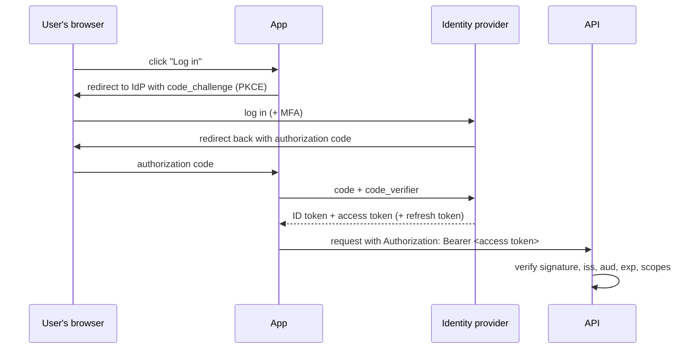

# Security

## TL;DR
- **Authentication (AuthN)** proves who you are. Use **OIDC (OpenID Connect)** with an identity
  provider for users, **mTLS** or workload identity for services, and **API keys** only to
  identify apps.
- **Authorization (AuthZ)** decides what you can do. **RBAC** (roles) by default; **ABAC**
  (attributes) for rules like "own region only"; **ReBAC** (relationships) for sharing,
  as in Google Docs.
- **Sessions** (server-side) for classic web apps; **JWTs** (short-lived) for APIs and
  distributed systems. Never long-lived JWTs without a revocation plan.
- **Encrypt everything:** TLS in transit, AES-256 at rest with keys in a KMS.
- **Secrets live in a vault**, never in code or Git.
- **Defend the edge:** rate limiting, input validation, parameterized queries, WAF, least privilege.

## The landscape

| Area | Question | Key tools and standards |
|------|----------|-------------------------|
| Authentication | Who is calling? | Passwords + MFA, OAuth 2.0, OIDC, SAML, passkeys (WebAuthn), mTLS, API keys |
| Authorization | Are they allowed to do this? | RBAC, ABAC, ReBAC, policy engines (OPA, Cedar), OpenFGA / SpiceDB |
| Session / token handling | How does the server remember who you are? | Session cookies, JWT access + refresh tokens |
| Encryption | Can someone read the data if they intercept or steal it? | TLS 1.3, AES-256, KMS, envelope encryption |
| Secrets | Where do keys and passwords live? | HashiCorp Vault, AWS Secrets Manager, Azure Key Vault |
| Application security | Can input break the system? | OWASP Top 10, input validation, parameterized queries, CSP |
| Network | Who can reach what? | Private networks, security groups, WAF, zero trust |

---

## Authentication (AuthN)

### Side-by-side comparison

| | Session cookie | JWT (bearer token) | OAuth 2.0 + OIDC | API key | mTLS |
|---|---|---|---|---|---|
| Identifies | A user's browser session | A user or service | A user, via an identity provider | An application or account | A service or device (certificate) |
| State | Server stores the session | Stateless: claims are in the signed token | Tokens issued by the identity provider | Server stores a hash of the key | Certificates from a CA (Certificate Authority) |
| Revocation | Easy: delete the session | Hard until it expires: keep it short, or keep a deny-list | Revoke at the provider; refresh tokens can be revoked | Delete the key | Revoke the certificate, or use short-lived certificates |
| Best for | Server-rendered web apps | APIs, mobile, microservices | "Log in with Google/Microsoft", SSO (single sign-on), third-party access | Server-to-server integrations, usage metering | Service-to-service in a zero-trust network |
| Main risk | CSRF (cross-site request forgery); use `SameSite` cookies | Stolen tokens stay valid until expiry | Misconfigured redirects, missing PKCE | Leaked keys (in Git, logs) | Certificate management overhead |

**Session cookies**
- **What it is:** after login, the server stores a session and sends a random session ID in a
  cookie marked `HttpOnly; Secure; SameSite=Lax`.
- **Use when:** traditional web apps on one domain.
- **Don't use when:** many independent APIs or mobile clients → tokens.
- **Advantages:** instant revocation; the token reveals nothing.
- **Limitations:** needs a shared session store when scaled out (Redis); CSRF protection needed.

**JWT (JSON Web Token)**
- **What it is:** a signed token, `header.payload.signature`, carrying claims (`sub`, `iss`,
  `aud`, `exp`, roles). Any service can verify it with the issuer's public key, without a lookup.
- **Use when:** APIs and microservices that need to verify identity without calling the auth server.
- **Don't use when:** you need instant logout or permission changes everywhere → sessions or very short JWTs.
- **Advantages:** stateless and fast to verify; works across services and domains.
- **Limitations:**
  - **Hard to revoke:** keep access tokens short (5–15 minutes), use refresh tokens, and keep a
    deny-list for emergencies.
  - **Signed, not encrypted:** anyone can read the payload, so never put secrets in it.
  - **Verification mistakes:** accepting `alg: none`, not checking `aud` or `exp`.

**OAuth 2.0 and OIDC**
- **What it is:** OAuth 2.0 lets an app get **access** to an API on a user's behalf (an access
  token). OIDC adds **identity** on top (an ID token saying who the user is). Use the
  **Authorization Code flow with PKCE** (Proof Key for Code Exchange) for web, mobile and
  single-page apps; use **client credentials** for service-to-service.
- **Use when:** login through an identity provider (Entra ID, Okta, Auth0, Google, Keycloak), SSO,
  or letting third-party apps call your API.
- **Don't use when:** you'd be building your own OAuth server for one app; use a managed identity provider instead.
- **Advantages:** no passwords in your app; MFA, SSO and account security handled by the provider.
- **Limitations:** complex specification; misconfiguration (open redirects, no PKCE, wrong token
  type) causes real vulnerabilities.



**API keys**
- **What it is:** a long random string that identifies a calling application.
- **Use when:** server-to-server integrations, developer APIs, usage metering and rate limiting.
- **Don't use when:** identifying end users, or in browser or mobile code where anyone can read it.
- **Advantages:** simple for developers.
- **Limitations:** usually long-lived and easy to leak. Store only a hash, allow rotation, scope
  them narrowly, and scan repositories for leaks.

**mTLS (mutual TLS)**
- **What it is:** both client and server present certificates, so each side proves its identity
  during the TLS handshake.
- **Use when:** service-to-service traffic inside a zero-trust network, often automated by a
  service mesh (Istio, Linkerd) or SPIFFE/SPIRE workload identities.
- **Don't use when:** public clients and browsers.
- **Advantages:** strong identity plus encryption, with no tokens to steal.
- **Limitations:** certificate issuance and rotation need automation.

**Passwords, if you must store them:** hash with **Argon2id**, **bcrypt** or **scrypt**, with a
unique salt per password; never encrypt them reversibly, and never use fast hashes like SHA-256
alone. Add MFA, rate-limit login attempts (see [rate limiting](rate-limiting.md)), and prefer passkeys.

---

## Authorization (AuthZ)

| | RBAC | ABAC | ReBAC |
|---|---|---|---|
| Decides by | The user's roles (`admin`, `editor`) | Attributes of user, resource and context (department, region, time) | Relationships (`user` is `editor` of `doc`, which is in `folder` shared with `team`) |
| Example rule | Editors can edit articles | Managers can approve expenses under $5,000 in their own department | You can view a file if you can view its parent folder |
| Use when | Most business apps | Fine-grained or regulatory rules | Sharing models: documents, folders, organizations |
| Limitation | **Role explosion** when rules get specific | Policies get complex to test | Needs a dedicated authorization service |
| Tools | Built into most frameworks and identity providers | OPA (Open Policy Agent), AWS Cedar | Google Zanzibar-style: OpenFGA, SpiceDB |

**Rules for any model**
- **Deny by default;** grant the least privilege needed.
- **Check on the server, on every request,** for every object: a missing per-object check
  ("can user 42 read order 1001?") is **IDOR** (insecure direct object reference), one of the
  most common API bugs (OWASP's "broken object level authorization").
- Keep authorization logic in one place (a library, policy engine or service), not scattered across handlers.
- Log authorization failures; they often signal probing.

---

## Encryption

| Where | How | Notes |
|-------|-----|-------|
| In transit | TLS 1.2+ (prefer 1.3) everywhere, including inside the data center | HSTS (HTTP Strict Transport Security) on public sites; mTLS between services |
| At rest | AES-256, usually built into the disk, database or object store | Keys managed by a KMS (key management service), rotated regularly |
| Application-level | Encrypt specific fields (card numbers, national IDs) before storing | **Envelope encryption:** a data key encrypts the data; the KMS encrypts the data key |
| End-to-end | Only the end users' devices hold the keys | Messaging apps (Signal protocol); the server can't read content |

**Hashing ≠ encryption:** hashing is one-way (passwords, integrity checks); encryption is
reversible with a key (data you need to read later).

---

## Secrets management

- Store secrets (database passwords, API keys, signing keys) in a **vault**: HashiCorp Vault, AWS
  Secrets Manager, Azure Key Vault, GCP Secret Manager.
- **Never in code, Git, container images or logs.** Use `.env` files only for local development,
  and keep them Git-ignored (as in this repo's Docker setups).
- Prefer **workload identity** (cloud IAM roles, managed identities) over static credentials.
- Use **short-lived, dynamic credentials** where possible (Vault can issue a database user per service that expires).
- **Rotate** regularly and immediately after any suspected leak. A secret committed to Git must
  be rotated; deleting the commit isn't enough.
- Scan for leaked secrets before every commit and in CI (continuous integration).

---

## Protecting APIs and applications

| Threat | Defense |
|--------|---------|
| SQL injection | Parameterized queries / ORM; never build SQL from strings |
| Cross-site scripting (XSS) | Escape output, Content Security Policy (CSP), `HttpOnly` cookies |
| Cross-site request forgery (CSRF) | `SameSite` cookies, CSRF tokens for cookie-based sessions |
| Broken object-level authorization (IDOR) | Per-object authorization checks on every request |
| Brute force and credential stuffing | [Rate limiting](rate-limiting.md), MFA, breached-password checks, CAPTCHA |
| DDoS (distributed denial of service) | CDN/WAF, edge rate limits, autoscaling, load shedding |
| Server-side request forgery (SSRF) | Allow-list outbound destinations; block cloud metadata IPs |
| Mass assignment | Explicit allow-lists of writable fields |
| Sensitive data exposure | Return only needed fields; mask in logs; encrypt |
| Vulnerable dependencies | Dependency scanning, pinned versions, regular updates |

**Zero trust:** don't trust a request because it comes from inside the network. Authenticate and
authorize every call, encrypt internal traffic, and segment the network.

**Worked example: verifying a JWT access token in an API**

```python
import jwt   # PyJWT

def authenticate(auth_header: str, jwks_client) -> dict:
    token = auth_header.removeprefix("Bearer ")
    signing_key = jwks_client.get_signing_key_from_jwt(token)   # issuer's public key (JWKS)
    claims = jwt.decode(
        token,
        signing_key.key,
        algorithms=["RS256"],                 # an explicit list: never accept "none"
        audience="https://api.example.com",   # token was issued for THIS API
        issuer="https://login.example.com/",  # by the identity provider we trust
        options={"require": ["exp", "iat", "sub"]},   # expiry is checked automatically
    )
    return claims                             # then authorize: scopes, roles, object ownership

# Example claims after decoding:
# {"sub": "user-42", "aud": "https://api.example.com", "iss": "https://login.example.com/",
#  "exp": 1793269200, "scope": "orders:read orders:write"}
```

Authentication only proves who the caller is. The handler must still check that `user-42` may
access order 1001.

---

## Quick decision points

```mermaid
flowchart TD
  A[Who is calling?] --> B{A human user?}
  B -->|Yes| C{Server-rendered web app<br/>on one domain?}
  C -->|Yes| S[Session cookie via OIDC login]
  C -->|No: SPA, mobile, many APIs| J[OIDC + short-lived JWT access tokens<br/>+ refresh tokens]
  B -->|No, a service| D{Inside your own network?}
  D -->|Yes| M[mTLS / workload identity,<br/>or OAuth client credentials]
  D -->|No, a partner or developer| K[API key or OAuth client credentials]
  S --> Z[Then authorize every request:<br/>RBAC / ABAC / ReBAC]
  J --> Z
  M --> Z
  K --> Z
```



| If you need… | Choose |
|--------------|--------|
| Login for users, with SSO and MFA | OIDC with a managed identity provider |
| Auth for a classic web app | Session cookies (`HttpOnly`, `Secure`, `SameSite`) |
| Auth for APIs, mobile and SPAs | OAuth 2.0 Authorization Code + PKCE, short-lived JWTs |
| Service-to-service identity | mTLS (service mesh) or OAuth client credentials |
| Developer or partner API access | API keys (hashed, scoped, rotatable) or OAuth client credentials |
| Simple permissions | RBAC |
| Permissions by department, region, amount | ABAC with a policy engine |
| Document and folder sharing | ReBAC (Zanzibar-style) |
| To store passwords | Argon2id or bcrypt |
| To store secrets | A vault + workload identity |

**Common combinations in interviews**
- **Typical SaaS:** OIDC login → API gateway validates JWTs → services check RBAC and per-object
  ownership → mTLS between services → secrets in a vault → TLS everywhere.
- **[Payment system](../_04_Case_Studies/payment-system.md):** card data tokenized by the payment
  provider (stay out of PCI DSS scope where possible), encryption at rest, audit logs, strict IAM.
- **[File storage](../_04_Case_Studies/file-storage.md):** ReBAC for sharing, pre-signed URLs
  that expire for uploads and downloads.
- **[Chat application](../_04_Case_Studies/chat-application.md):** token checked at the WebSocket
  handshake, re-checked on refresh; end-to-end encryption if required.

## Interview questions
**Q: Authentication vs authorization?**
Authentication proves who you are (login, token, certificate). Authorization decides what you're
allowed to do (roles, policies, ownership checks). A request needs both.

**Q: Sessions or JWTs?**
Sessions are easy to revoke and reveal nothing, but need a shared session store. JWTs are
stateless and work across services, but can't be revoked before they expire. Use short-lived
JWTs (minutes) with refresh tokens for APIs, sessions for classic web apps.

**Q: OAuth 2.0 vs OIDC?**
OAuth 2.0 is for delegated **access** to APIs (access tokens). OIDC is a layer on top for
**identity** (ID tokens with who the user is). "Log in with Google" is OIDC.

**Q: Why PKCE?**
It stops a stolen authorization code from being exchanged by an attacker: only the client that
created the `code_verifier` can redeem the code. It's required for public clients (SPAs, mobile)
and recommended for all.

**Q: How do you store passwords?**
Never in plain text or with reversible encryption. Hash them with a slow, salted algorithm:
Argon2id, bcrypt or scrypt. Add MFA and rate-limit login attempts.

**Q: How do services authenticate to each other?**
mTLS with automatically rotated certificates (often via a service mesh), or OAuth client
credentials tokens. Avoid shared static secrets.

**Q: A secret was committed to Git. What do you do?**
Rotate it immediately: revoke the old one and issue a new one. Then remove it from history and add
secret scanning so it doesn't happen again. Deleting the file alone isn't enough.

**Q: What is IDOR and how do you prevent it?**
Insecure direct object reference: an API returns order 1001 to anyone who asks for it, because it
checks only that the caller is logged in. Check ownership or permission for every object on every request.

## Related
- [API design](api-design.md): API gateways
- [Rate limiting](rate-limiting.md): brute-force and abuse protection
- [Observability](observability.md): audit logs; what not to log
- [Reliability](reliability.md)
- [Payment system](../_04_Case_Studies/payment-system.md)
