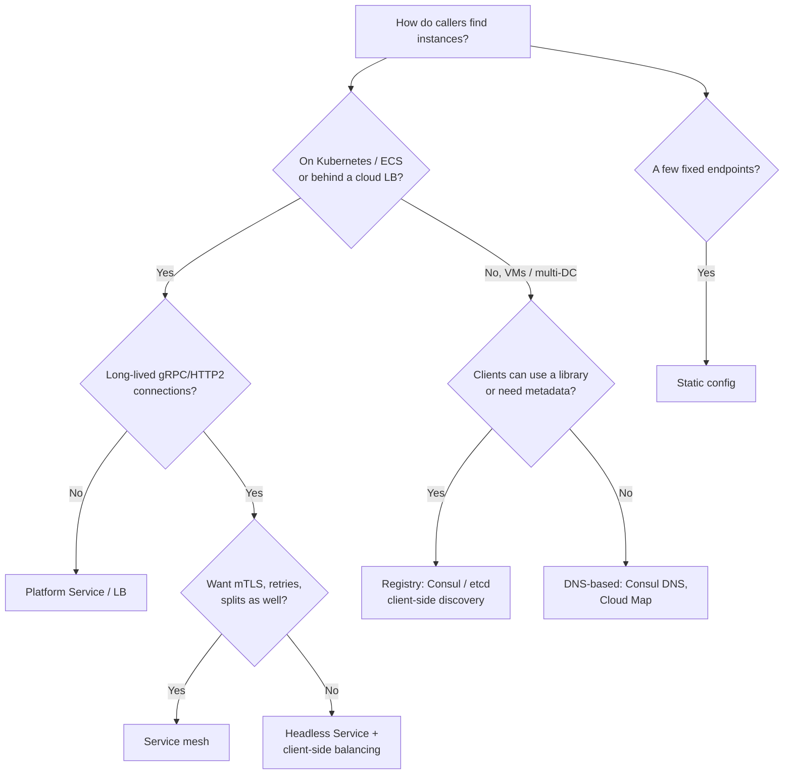

# Service Discovery

## TL;DR
- **Platform (server-side) discovery** by default: on Kubernetes, call `http://orders` and let the
  Service's virtual IP or a [load balancer](load-balancer.md) pick a healthy instance. No client code.
- **DNS-based discovery** for simple, language-agnostic setups and anything outside Kubernetes:
  Consul DNS, AWS Cloud Map, Route 53 private zones, Kubernetes headless Services.
- **Client-side discovery with a registry** (Consul, Eureka, etcd, ZooKeeper) when clients need
  the full instance list to do their own load balancing, e.g. gRPC with long-lived HTTP/2 connections.
- **Service mesh** when you also want mTLS, retries and traffic splitting on every call; discovery
  comes with it (Envoy xDS).
- **Static config** (a list of hosts in a file) only for a few fixed, rarely changing endpoints
  (a managed database, a partner API).

## The problem

Instances come and go: autoscaling, deployments, crashes, spot reclaims. Their IPs change. Callers
need an up-to-date list of **healthy** instances for each service, without hard-coding addresses.

| Piece | Job | Examples |
|-------|-----|----------|
| **Registry** | Database of service name → instances (IP, port, metadata, health) | Consul, etcd, ZooKeeper, Eureka, Kubernetes API (EndpointSlices), AWS Cloud Map |
| **Registration** | Instances get added and removed | Self-registration (the app calls the registry) or third-party (Kubernetes, ECS, a registrar agent) |
| **Health checking** | Remove instances that stop responding | Readiness probes, TTL heartbeats, active HTTP/TCP checks |
| **Lookup** | Caller resolves a name to instances | DNS query, registry API + client cache, virtual IP, sidecar proxy |

## Side-by-side comparison

| | Server-side (platform / LB) | DNS-based | Client-side + registry | Service mesh |
|---|---|---|---|---|
| Who picks the instance | A load balancer or kernel proxy (kube-proxy, IPVS, eBPF) | The client, from DNS answers | The client library | The local sidecar / node proxy |
| Client code needed | None | None (DNS) | A discovery-aware library | None |
| Load-balancing quality | Good; per connection for L4 | Weak: DNS caching, little control | Best: per request, any algorithm, zone-aware | Best: per request, L7 |
| Freshness | Seconds | TTL + client caching (can be stale for minutes) | Watches/streams: near real time | Near real time (xDS push) |
| Polyglot | Yes | Yes | One library per language | Yes |
| Extra hop | Yes (the LB) unless kernel-level | No | No | Yes (proxy on each side) |
| Examples | Kubernetes `ClusterIP` Service, AWS ALB/NLB target groups | Consul DNS, CoreDNS, Cloud Map, `SRV` records | Netflix Eureka + Ribbon (legacy), Consul API, gRPC xDS / name resolvers | Istio, Linkerd, Consul Connect |
| When it breaks | LB becomes a bottleneck or SPOF | Clients that cache DNS forever (old JVM defaults) | Library drift across languages | Mesh complexity |

---

## Server-side (platform) discovery

**What it is.** The caller sends requests to one stable name or virtual IP; something in the
platform tracks healthy instances and forwards each connection. In Kubernetes, a `Service` gets a
stable DNS name and **ClusterIP**; the endpoints controller keeps **EndpointSlices** of ready pods,
and kube-proxy (iptables/IPVS) or an eBPF data plane (Cilium) routes to them. On AWS, an ALB/NLB
**target group** plays the same role.

```yaml
apiVersion: v1
kind: Service
metadata:
  name: orders
spec:
  selector:
    app: orders           # every ready pod with this label is an endpoint
  ports:
    - port: 80            # callers use http://orders (or orders.<namespace>.svc.cluster.local)
      targetPort: 8080
```

Only pods passing their **readiness probe** become endpoints, so discovery and health checking are
one mechanism.

**Use when**
- You run on Kubernetes, ECS or behind a cloud load balancer: it's already there.
- Callers are written in many languages and shouldn't carry discovery logic.

**Don't use when**
- Long-lived connections (gRPC, HTTP/2) need per-request balancing: a ClusterIP balances per
  **connection**, so one client can stick to one pod → headless Service + client-side balancing, or a mesh.

**Advantages**
- Zero client code; the platform handles registration and health.

**Limitations**
- **Connection-level balancing** for L4 virtual IPs; uneven load with long-lived connections.
- Usually limited to one cluster; multi-cluster needs extra tooling (mesh, MCS API, Cloud Map).

---

## DNS-based discovery

**What it is.** The registry answers DNS queries: `orders.service.consul` returns A records (IPs)
of healthy instances, or `SRV` records with ports. A Kubernetes **headless Service**
(`clusterIP: None`) returns all pod IPs instead of one virtual IP.

```bash
$ dig +short orders.service.consul          # Consul DNS: healthy instances only
10.0.1.12
10.0.2.31
$ dig +short SRV _orders._tcp.service.consul
1 1 8080 0a00010c.addr.dc1.consul.
```

**Use when**
- Any client that can do DNS: no libraries, works with legacy software.
- Headless Services for stateful sets (each pod has a stable name: `db-0.db.default.svc`).

**Don't use when**
- You need fast failover: TTLs and client-side DNS caches keep dead IPs around.
- Clients need weights, zones or metadata → registry API or mesh.

**Advantages**
- Universal and simple; no extra hop.

**Limitations**
- **Caching defeats freshness:** set low TTLs (seconds), and check runtime caches (the JVM caches
  DNS by `networkaddress.cache.ttl`; some clients resolve once at startup).
- **Poor load balancing:** clients often take the first record; a few IPs get most traffic.

---

## Client-side discovery with a registry

**What it is.** Instances register in a registry; clients fetch (and **watch**) the instance list
for a service, cache it, and pick an instance per request with their own algorithm (round robin,
least requests, zone-aware). Netflix's Eureka + Ribbon popularised it; today it's common with
Consul's API, etcd, ZooKeeper, or gRPC's **xDS** resolver fed by a control plane.

```json
{
  "service": {
    "name": "orders",
    "id": "orders-10-0-1-12",
    "address": "10.0.1.12",
    "port": 8080,
    "tags": ["v2", "zone-a"],
    "check": { "http": "http://10.0.1.12:8080/ready", "interval": "5s", "timeout": "1s",
               "deregister_critical_service_after": "1m" }
  }
}
```

Consul service definition (registered by the local agent; the agent runs the health check).

**Use when**
- gRPC or other long-lived connections where per-request balancing matters.
- Clients need metadata: zone-aware routing, canary tags, weights.
- Outside Kubernetes, across VMs and data centres.

**Don't use when**
- Many languages and teams: each needs a well-maintained client library → platform discovery or mesh.

**Advantages**
- No extra hop; the smartest load balancing; works across platforms.

**Limitations**
- **The registry is critical:** run it as a replicated cluster (Consul, etcd and ZooKeeper use
  consensus, see [leader election](leader-election.md)); clients must keep working on a **cached**
  list if it's down ([static stability](resiliency.md#static-stability)).
- **CP vs AP registries:** etcd/ZooKeeper/Consul prefer consistency (a minority partition can't
  update); Eureka chose availability (it may return stale instances). For discovery, a slightly
  stale list plus client retries is often better than no list.
- Library per language.

---

## Service mesh

**What it is.** A proxy next to every service (sidecar or per node) receives the full, live
endpoint list from a control plane over **xDS** (Envoy's discovery APIs) and balances each request.
The application just calls `http://orders`; the proxy resolves, balances, encrypts with mTLS and
retries. See [API gateway → service mesh](api-gateway.md#service-mesh).

**Use when**
- Many services needing discovery **and** mTLS, retries, traffic splitting and telemetry.

**Don't use when**
- A few services where Kubernetes Services already work.

**Advantages**
- Per-request L7 balancing in every language; multi-cluster support in most meshes.

**Limitations**
- **Operational complexity** and resource cost of proxies.

---

## Static configuration

**What it is.** Addresses in config files or environment variables, changed by redeploying.

**Use when**
- A handful of stable endpoints: a managed database endpoint, a payment provider's URL.

**Don't use when**
- Anything that autoscales or redeploys often.

**Advantages**
- Nothing to run; easy to reason about.

**Limitations**
- **Every change is a deploy,** and failures need manual updates.

---

## Health checks and registration

| Approach | How | Pros | Cons |
|----------|-----|------|------|
| Self-registration | App registers on startup, heartbeats, deregisters on shutdown | Simple, no platform needed | Crashed instances linger until TTL; logic in every app |
| Third-party registration | Platform (Kubernetes, ECS, Nomad) or an agent registers instances | Apps stay unaware; reliable deregistration | Needs the platform |
| TTL heartbeat | Instance must refresh every N s or it's removed | Detects silent deaths | Choosing N: fast detection vs false removals |
| Active check | Registry/agent calls `/ready` | Tests real readiness | Load on instances; check must be cheap |

**Graceful shutdown order:** fail readiness → wait for the registry/LB to remove you (a few
seconds) → stop accepting new connections → finish in-flight requests → exit. Otherwise callers
hit a closing instance during every deploy.

### Back-of-the-envelope: registry load

```
500 services × 20 instances = 10,000 instances
Heartbeats every 10 s → 1,000 writes/s to the registry
Watchers: 10,000 instances each watching ~10 dependencies
  A deploy of one 20-instance service → ~20 changes × (instances watching it) notifications
Lesson: use local agents/caches (Consul agents, mesh control planes) so not every client
        talks to the consensus cluster directly
```

---

## Quick decision points



| If you need… | Choose |
|--------------|--------|
| Simple discovery on Kubernetes | `ClusterIP` Service |
| Per-request balancing for gRPC on Kubernetes | Headless Service + gRPC client balancing, or a mesh |
| Discovery across VMs and data centres | Consul (DNS or API) |
| Language-agnostic, no libraries | DNS-based |
| Discovery + mTLS + traffic shifting | Service mesh |
| A managed DB or partner endpoint | Static config |

**Common combinations in interviews**
- **Microservices on Kubernetes:** Services for discovery, readiness probes for health, a mesh for
  mTLS and retries; the [API gateway](api-gateway.md) routes to Services.
- **[Chat application](../_04_Case_Studies/chat-application.md):** a presence registry
  (user → connection server) is a domain-specific form of discovery, usually in Redis.
- **[Distributed key-value store](../_04_Case_Studies/distributed-key-value-store.md):** gossip
  protocols for membership instead of a central registry (Cassandra, Dynamo).

## Interview questions
**Q: Client-side vs server-side discovery?**
Client-side: the client fetches instances from a registry and picks one: no extra hop, smart
balancing, but a library per language. Server-side: the client calls a stable address and a load
balancer or platform proxy picks: no client logic, but an extra hop and usually connection-level
balancing.

**Q: Why not just use DNS?**
DNS works everywhere, but caching makes it slow to react to failures, clients often ignore all but
the first record, and it carries little metadata. Fine with low TTLs for simple cases; use a
registry or mesh for fast failover and smart routing.

**Q: What happens if the service registry goes down?**
Clients should keep using their last known instance list (static stability) and rely on retries
and health checks on the client side. Run the registry as a replicated, consensus-based cluster
behind local agents.

**Q: Should a registry be CP or AP?**
For discovery, availability usually matters more: a slightly stale list plus retries beats
refusing lookups. That was Eureka's argument. CP stores (etcd, ZooKeeper, Consul) are still common
because clients cache and the stores are highly available in practice.

**Q: How do you avoid errors during deploys?**
Readiness probes gate traffic; on shutdown, fail readiness first, wait for deregistration to
propagate, drain in-flight requests, then exit.

**Q: Why do gRPC services on Kubernetes get uneven load?**
A ClusterIP balances TCP connections, and gRPC keeps one long-lived HTTP/2 connection per client,
so all its requests go to one pod. Use a headless Service with client-side round robin, or an L7
proxy/mesh.

## Related
- [Load balancer](load-balancer.md): server-side and client-side balancing
- [API gateway](api-gateway.md): routing at the edge; service mesh
- [Leader election](leader-election.md): the consensus behind etcd, Consul and ZooKeeper
- [Resiliency](resiliency.md#static-stability): keep working when the registry is down
- [Reliability](reliability.md): health checks, liveness vs readiness
- [Consistent hashing](consistent-hashing.md): when clients pick instances by key
