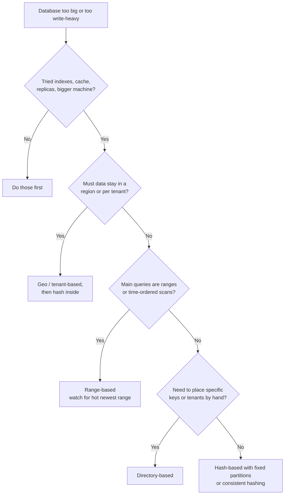

# Sharding (Partitioning)

## TL;DR
- **Don't shard until you must:** try indexes, caching, read replicas and a bigger machine first.
  Sharding scales **writes and storage**, at the cost of cross-shard queries and transactions.
- **Hash-based** sharding (with [consistent hashing](consistent-hashing.md)) for even spread
  when you look data up by key: users, sessions, carts.
- **Range-based** when you query ranges (time, alphabetical) and can handle hot spots on the newest range.
- **Directory-based** (lookup table) when you need full control over placement, e.g. moving one big tenant.
- **Geo / tenant-based** when data must stay in a region or tenants need isolation.
- **The shard key matters most:** high cardinality, even spread, and it matches the main query.

## The landscape

| Term | Meaning |
|------|---------|
| Horizontal partitioning (sharding) | Split **rows** of a table across machines: users 1–1M on shard A, … |
| Vertical partitioning | Split **columns** or tables: move large `profile_photo` blobs or the `orders` table to another database |
| Functional partitioning | Split by service or domain: billing DB, catalog DB (microservices) |
| Shard key / partition key | The column that decides which shard a row goes to |
| Shard vs partition | Often used interchangeably; "partition" can also mean splitting a table inside one database (PostgreSQL declarative partitioning) |

## Side-by-side comparison

| | Hash-based | Range-based | Directory-based | Geo / tenant-based |
|---|---|---|---|---|
| How a key finds its shard | `hash(key)` on a ring or into fixed buckets | Key falls into a range: `A–F`, `2026-10` | Look it up in a mapping table | By region or tenant ID |
| Load spread | Even | Can be uneven; newest range gets hot | Whatever you configure | Uneven if tenants differ in size |
| Range queries | Hit every shard | Efficient: touch only the matching shards | Depends | Within one tenant or region: efficient |
| Rebalancing | Easy with consistent hashing / fixed partitions | Split hot ranges | Update the mapping | Move a tenant |
| Extra component | None | Range map (often in metadata) | The directory service (must be HA) | Routing by region/tenant |
| Examples | Cassandra, DynamoDB, Redis Cluster (16,384 hash slots), MongoDB hashed sharding | HBase, Bigtable, MongoDB ranged sharding, Spanner, CockroachDB | Custom shard maps, Vitess keyspaces | Multi-region SaaS, data residency (EU data in EU) |

---

## Hash-based sharding

**What it is.** Compute `hash(shard_key)` and map it to a shard. To avoid moving most data when
shards are added, don't use plain `hash % N`. Use [consistent hashing](consistent-hashing.md), or
**fixed partitions**: create many more partitions than nodes (e.g. 1,024) up front and move whole
partitions between nodes as you grow. Redis Cluster uses 16,384 fixed hash slots.

**Use when**
- Lookups by an ID: user, account, session, cart, device.
- You need even write load across shards.

**Don't use when**
- The main queries are ranges or sorted scans ("orders from last week") → range-based.
- One key gets most of the traffic: hashing can't split a single hot key.

**Advantages**
- Even data and load distribution.
- No hot spot from sequential keys (timestamps, auto-increment IDs).
- Simple routing; clients can compute it.

**Limitations**
- **Range queries scatter:** "all orders between two dates" must query every shard.
- **Resharding:** with plain modulo, changing N moves almost everything. Use consistent hashing
  or fixed partitions.
- Related rows end up on different shards unless they share the shard key.

---

## Range-based sharding

**What it is.** Each shard owns a contiguous range of the key: users `A–F`, orders for
`2026-10`. A metadata service maps ranges to shards. When a range grows too large or too hot,
the system **splits** it (HBase, Bigtable, CockroachDB and Spanner do this automatically).

**Use when**
- Queries scan ranges: time series by time, logs, alphabetical listings.
- You want related, adjacent keys stored together.

**Don't use when**
- The key increases steadily (timestamps, auto-increment IDs) and writes are heavy: all new writes
  hit the last range → hash-based, or prefix the key with a hash or bucket.

**Advantages**
- Efficient range scans and sorted reads.
- Easy to split hot or large ranges.
- Can place ranges deliberately (archive old ranges on cheaper storage).

**Limitations**
- **Hot spots:** sequential keys send every new write to one shard.
- Uneven sizes if the key distribution is skewed.
- Needs a range map that every router can read.

---

## Directory-based sharding

**What it is.** A lookup table maps each key (or tenant, or key bucket) to a shard:
`tenant_42 → shard-7`. The application or a routing layer asks the directory first.

**Use when**
- Multi-tenant SaaS where big tenants need their own shard and small ones share.
- You need to move specific keys or tenants without touching the rest.
- Placement rules are irregular (compliance, customer contracts).

**Don't use when**
- Simple hash or range rules work: the directory is one more critical service.

**Advantages**
- Full flexibility: move any key or tenant individually.
- Rebalancing is a mapping update plus a data copy.

**Limitations**
- **The directory is a SPOF and a bottleneck:** replicate it and cache it in every router.
- Extra lookup per request (usually cached).
- The cached mapping must be invalidated correctly during moves.

---

## Geo and tenant-based sharding

**What it is.** Partition by region (`eu`, `us`, `ap`) or by tenant/customer, often as a first
level, then hash or range inside each.

**Use when**
- Data residency laws require data to stay in a region.
- Users mostly access data near them: low latency.
- Tenants need isolation (noisy neighbors, per-tenant backups, deletion).

**Don't use when**
- Users and data move between regions often, or queries span all regions.

**Advantages**
- Low latency and compliance by design.
- A region or tenant failure is contained.

**Limitations**
- **Uneven shards:** one region or tenant can be far larger than others.
- Cross-region features (global search, global leaderboards) need extra systems.

---

## Choosing a shard key

| Good shard key | Bad shard key | Why |
|----------------|---------------|-----|
| `user_id` for a social or chat app | `country` | Few values; one country gets most users |
| `conversation_id` for messages | `created_at` (range) | All new writes hit one shard |
| `tenant_id` (+ hash) for SaaS | `status` | Few values; very uneven |
| `order_id` hashed | Auto-increment `id` (range) | Newest IDs all land on the last shard |

Rules:
1. **High cardinality:** many distinct values.
2. **Even distribution:** no value dominates.
3. **Matches the main access pattern:** most queries include it, so they hit one shard.
4. **Keeps related data together:** shard `orders` and `order_items` by the same `user_id`
   (**co-location**) so joins and transactions stay on one shard.
5. **Hard to change later:** choose carefully; changing it means rewriting all data.

### Problems sharding brings

| Problem | Mitigation |
|---------|------------|
| Cross-shard queries ("top 10 products overall") | Scatter-gather to all shards and merge; or precompute in a separate analytics store |
| Cross-shard joins | Co-locate related tables by the same key; denormalize; join in the application |
| Cross-shard transactions | Avoid by design; otherwise sagas or 2PC (see [distributed transactions](distributed-transactions.md)) |
| Hot shards / celebrity users | Split the key (`user_id#bucket`), cache hot data, give big tenants their own shard |
| Global unique IDs | UUIDs, or Snowflake-style IDs (timestamp + machine ID + sequence) instead of auto-increment (see [ID generation](id-generation.md)) |
| Rebalancing | Fixed partitions or consistent hashing; move data in the background, then switch routing |
| Secondary indexes | Local index per shard (queries scatter) or a global index (writes become distributed) |

**Worked example: co-located shards for an orders app**

```text
Shard key: user_id        Partitions: 1,024 fixed        Nodes: 4 (256 partitions each)
partition = hash(user_id) % 1024        node = partition_map[partition]
```

```sql
-- Same DDL on every shard; orders and order_items share user_id, so they're co-located
CREATE TABLE orders (
  user_id    BIGINT NOT NULL,
  order_id   BIGINT NOT NULL,          -- Snowflake-style ID, unique across shards
  created_at TIMESTAMPTZ NOT NULL,
  total      NUMERIC(10,2) NOT NULL,
  PRIMARY KEY (user_id, order_id)
);
CREATE TABLE order_items (
  user_id  BIGINT NOT NULL,
  order_id BIGINT NOT NULL,
  sku      TEXT   NOT NULL,
  qty      INT    NOT NULL,
  PRIMARY KEY (user_id, order_id, sku)
);

-- Single-shard query: the router sends it only to the shard for user 42
SELECT o.order_id, o.total, i.sku, i.qty
FROM orders o JOIN order_items i USING (user_id, order_id)
WHERE o.user_id = 42
ORDER BY o.created_at DESC LIMIT 20;

-- Cross-shard query: must run on every shard and be merged ("scatter-gather")
SELECT sku, SUM(qty) AS sold FROM order_items GROUP BY sku ORDER BY sold DESC LIMIT 10;
```

Growing from 4 to 8 nodes moves 128 partitions per old node to the new ones; `hash(user_id) % 1024`
never changes, so no key is rehashed. Tools that do this for you: Vitess (MySQL), Citus
(PostgreSQL), MongoDB sharding, and managed stores like DynamoDB.

---

## Quick decision points



| If you need… | Choose |
|--------------|--------|
| Even load for key lookups | Hash-based (fixed partitions or consistent hashing) |
| Time-range queries over time series | Range-based by time, often with a hash prefix to spread writes |
| Big tenants isolated, small ones packed together | Directory-based or tenant-based |
| Data residency (e.g. EU data in the EU) | Geo-based first level |
| Joins and transactions to stay local | Co-locate related tables on the same shard key |
| To avoid sharding for now | Scale up, add read replicas and caching |

**Common combinations in interviews**
- **[Chat application](../_04_Case_Studies/chat-application.md):** shard messages by
  `conversation_id`, sorted by time inside each partition (Cassandra).
- **[URL shortener](../_04_Case_Studies/url-shortener.md):** hash-shard by short code; key-value lookups only.
- **[News feed](../_04_Case_Studies/news-feed.md):** shard posts and feed lists by `user_id`;
  celebrities handled separately (hot keys).
- **SaaS app:** shard by `tenant_id`, with a directory for large tenants.

## Interview questions
**Q: How do you choose a shard key?**
High cardinality (many distinct values), even distribution, and matches the most common
query so most queries hit one shard. Example: `user_id` for a chat app, not `country`.

**Q: Your DB is slow. What do you check, in order?**
Go from cheapest to most complex:
1. Slow queries and missing indexes
2. Add a cache
3. Read replicas
4. Vertical scaling
5. Shard
6. Split into separate DBs per service

**Q: Hash vs range sharding?**
Hash spreads load evenly and avoids hot spots but makes range queries hit every shard. Range keeps
adjacent keys together for fast scans but sends sequential writes to one shard. Pick by the main
query pattern.

**Q: How do you add shards without moving all the data?**
Pre-create many fixed partitions and move whole partitions to new nodes, or use consistent
hashing. Copy data in the background, then switch routing.

**Q: How do you handle a celebrity user with far more traffic than others?**
Split their key into sub-keys across shards, cache their data heavily, handle their fan-out
differently (pull instead of push), or give them a dedicated shard.

**Q: How do you query across shards?**
Avoid it for hot paths by co-locating related data. Otherwise scatter-gather (query all shards and
merge), or maintain a separate store built for that query: a search index or an analytics warehouse.

**Q: How do you generate unique IDs across shards?**
UUIDs (simple, but large and unordered), or Snowflake-style IDs (timestamp + machine ID + sequence)
that are unique, roughly time-ordered and 64-bit.

## Related
- [Consistent hashing](consistent-hashing.md)
- [Replication](replication.md): each shard is usually replicated
- [Distributed transactions](distributed-transactions.md): when a write spans shards
- [Scalability](scalability.md): the scaling path before sharding
- [Databases](databases.md)
- [DB sharding in practice](db-sharding.md): partitioning, Vitess/Citus, native distributed DBs, resharding
- [ID generation](id-generation.md): Snowflake, UUIDv7 and range allocation
