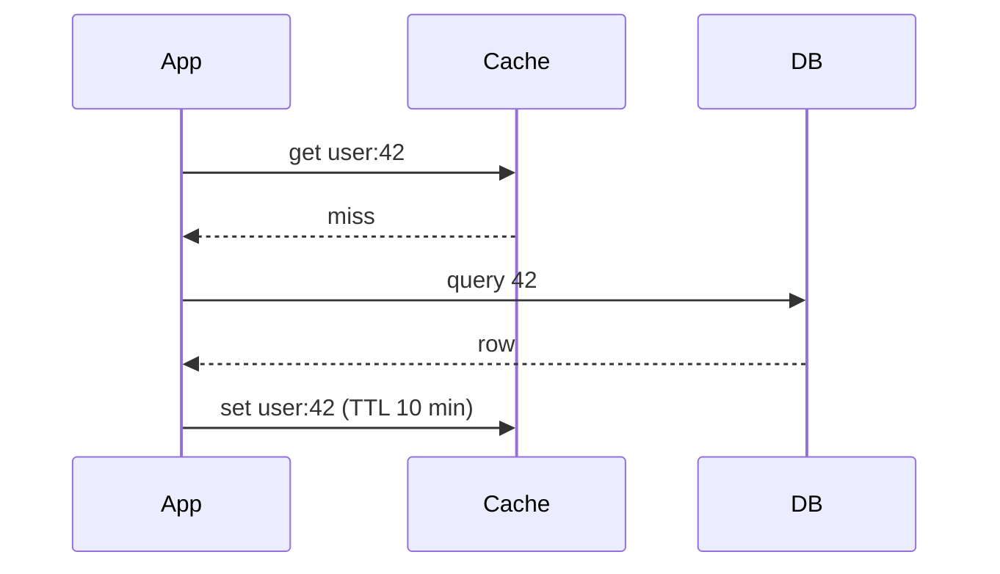

# Cache

## TL;DR
A cache is fast storage (usually memory) for frequently used data. **Cache-aside** with a
TTL is the default pattern; on writes, **delete** the cache entry rather than updating it.

## Why it matters
Memory is ~1000× faster than SSD (see [latency numbers](../_01_Interview_Playbook/estimation-cheat-sheet.md#latency-numbers)),
and read-heavy systems can serve most traffic without touching the database.

## Patterns
| Pattern | How it works | Risk |
|---------|--------------|------|
| Cache-aside | App reads the cache; on a miss, reads the DB and fills the cache. | Stale data until the TTL expires |
| Read-through | The cache itself loads from the DB on a miss. | Same as above |
| Write-through | Write the cache and DB together. | Slower writes |
| Write-back | Write the cache now, the DB later. | Data loss if the cache dies |
| Write-around | Write the DB only; the cache fills on read. | First read is slow |

## Terms
- **TTL (Time To Live):** how long an entry stays before it expires.
- **LRU (Least Recently Used):** evict the item not used for the longest time.
- **LFU (Least Frequently Used):** evict the item used the fewest times.
- **CDN (Content Delivery Network):** servers around the world that cache static files
  (images, video, JS) close to users.

## Cache-aside
```
function getUser(id):
    user = cache.get("user:" + id)
    if user is null:
        user = db.query(id)
        cache.set("user:" + id, user, ttl = 10 minutes)
    return user

function updateUser(id, data):
    db.update(id, data)
    cache.delete("user:" + id)      // delete, do not update
```



## Interview questions
**Q: Why delete the cache entry on update instead of updating it?**
Two concurrent updates can write the cache in the wrong order and leave stale data.
Deleting is safer; the next read loads fresh data.

**Q: What is a cache stampede (thundering herd) and how do you prevent it?**
A hot key expires and thousands of requests hit the DB at once. Fixes: a lock so only one
request rebuilds the entry, random jitter on the TTL, or refreshing the key early in the
background.

**Q: What is cache penetration?**
Repeated requests for keys that don't exist, so they always hit the DB. Fixes: cache the
"not found" result with a short TTL, or use a Bloom filter (a compact structure that
quickly says "definitely not present").

**Q: Where can you cache?**
Browser → CDN → API gateway → application (local memory) → distributed cache (Redis) →
database buffer cache.

## Related
- [Distributed key-value store](../_04_Case_Studies/distributed-key-value-store.md)
- [Consistent hashing](../_02_Fundamentals/consistent-hashing.md)
