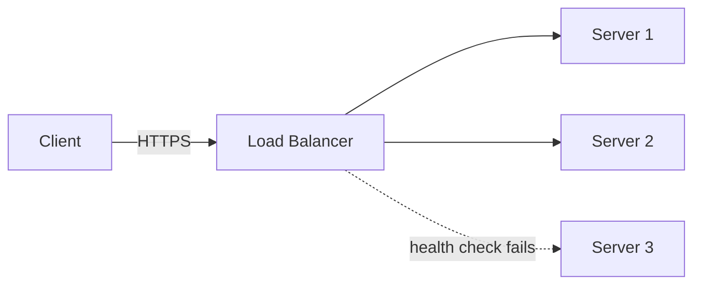

# Load Balancer

## TL;DR
A load balancer (LB) spreads traffic across servers and removes unhealthy ones. Layer 4 is
fast but blind to URLs; Layer 7 can route on HTTP details.

## Algorithms
| Algorithm | How it works | Good for |
|-----------|--------------|----------|
| Round robin | Each server in turn | Equal servers |
| Least connections | Server with the fewest open connections | Long-lived requests |
| IP / key hash | Same client → same server | Sticky sessions, caches (see [consistent hashing](../_02_Fundamentals/consistent-hashing.md)) |
| Weighted | Bigger servers get more traffic | Mixed hardware |

## Layer 4 vs Layer 7
| | Layer 4 | Layer 7 |
|---|---|---|
| Works at | Network level (IP + port) | Application level (HTTP) |
| Can route by | Address and port only; can't read URLs | URL, header, cookie |
| Speed | Fast | Slower but smarter |

## Interview questions
**Q: What happens if the load balancer itself fails?**
Run LBs in pairs (active-passive or active-active) with a floating IP or DNS (Domain Name
System) failover. Cloud LBs (AWS ALB, Azure Load Balancer) are already redundant.

**Q: Explain consistent hashing.**
See [consistent hashing](../_02_Fundamentals/consistent-hashing.md).

## Related
- [Scalability](../_02_Fundamentals/scalability.md)
- [Reliability](../_02_Fundamentals/reliability.md): health checks and failover
