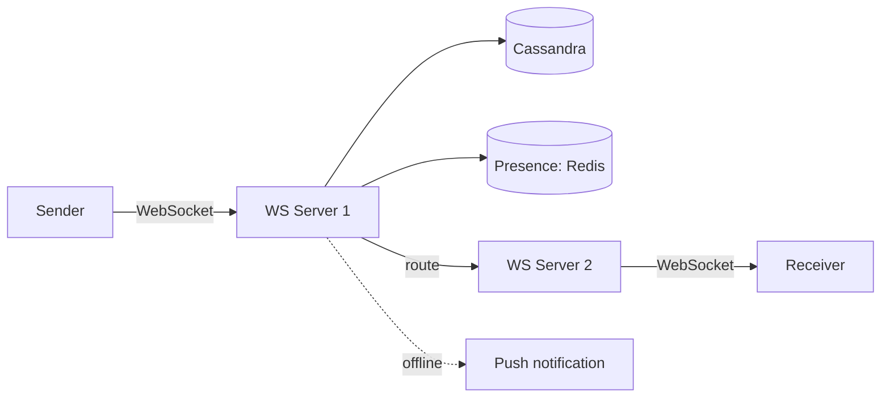

# Chat Application (like WhatsApp)

> **Status:** blueprint. Expand using the case study template in `CLAUDE.md`.

| Area | Blueprint |
|------|-----------|
| Connections | WebSocket servers keep live connections. |
| Routing | A presence store (Redis) maps user → which WebSocket server. |
| Delivery | Save the message to the DB, then push it to the receiver's WebSocket server. If the receiver is offline, store it and send a push notification. |
| Storage | Wide-column DB (Cassandra) partitioned by `conversation_id`, sorted by time. |
| Ordering | Per-conversation sequence number. |
| Receipts | Sent / delivered / read status events. |
| Deep dive | Group chat fan-out, offline sync, end-to-end encryption. |

## Related
- [Databases](../_02_Fundamentals/databases.md)
- [Notification system](notification-system.md)
