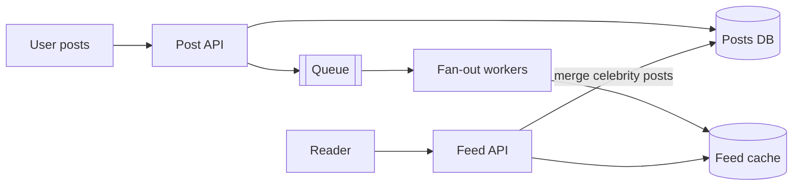

# News Feed (like Twitter / Instagram)

> **Status:** blueprint. Expand using the case study template in `CLAUDE.md`.

| Area | Blueprint |
|------|-----------|
| Write path | Post saved → event to a queue → fan-out workers push the post id into followers' feed lists in the cache (fan-out on write). |
| Celebrities | Don't fan out; merge their posts at read time (hybrid). |
| Read path | Read the precomputed feed from the cache, then hydrate post details. |
| Media | Object storage (S3 / Azure Blob) + CDN. |
| Deep dive | Ranking, cursor pagination, cache memory size. |

A worked capacity estimate for this system is in the
[estimation cheat sheet](../_01_Interview_Playbook/estimation-cheat-sheet.md#sample-estimate-twitter-like-app).

## Related
- [Trade-offs](../_01_Interview_Playbook/trade-offs.md): push vs pull
- [Message queues](../_02_Fundamentals/message-queues.md)
- [Cache](../_02_Fundamentals/cache.md)
