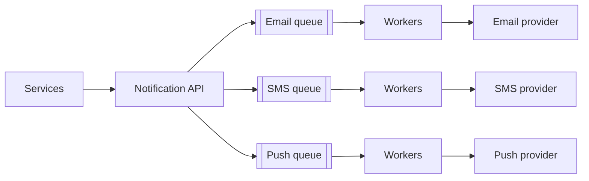

# Notification System

> **Status:** blueprint. Expand using the case study template in `CLAUDE.md`.

| Area | Blueprint |
|------|-----------|
| Flow | Services → notification API → a queue per channel (email, SMS, push) → workers → third-party providers. |
| Features | User preferences, templates, rate limiting per user, retries + DLQ, deduplication with an idempotency key. |
| Deep dive | Priority queues, scheduling, tracking delivery status. |

## Related
- [Message queues](../_03_Building_Blocks/message-queues.md)
- [Idempotency](../_02_Fundamentals/idempotency-and-delivery-guarantees.md)
- [Rate limiting](../_02_Fundamentals/rate-limiting.md)
