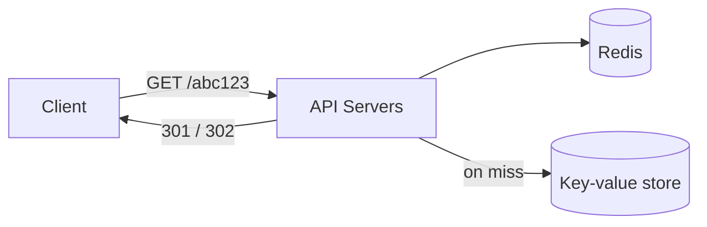

# URL Shortener (like bit.ly)

> **Status:** blueprint. Expand using the case study template in `CLAUDE.md`.

| Area | Blueprint |
|------|-----------|
| Requirements | Shorten a URL, redirect, optional expiry. Read-heavy (100:1). |
| Key idea | Generate a short unique code: 7 chars of Base62 `[a-z, A-Z, 0-9]` = 62^7 ≈ 3.5 trillion codes. |
| ID generation | Counter + Base62 encoding, or a pre-generated key service. Avoid hashing + truncating (collisions). |
| Storage | Key-value store (code → long URL). |
| Read path | Cache popular codes in Redis. Return HTTP **301** (permanent, browser caches it) or **302** (temporary, lets you count clicks). |
| Deep dive | Unique IDs across many servers: range allocation per server, or Snowflake IDs (timestamp + machine id + sequence). |

## Related
- [Cache](../_03_Building_Blocks/cache.md)
- [Databases](../_03_Building_Blocks/databases.md)
