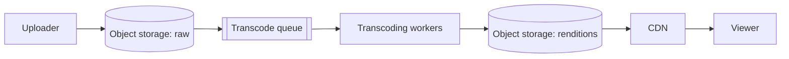

# Video Streaming (like YouTube)

> **Status:** blueprint. Expand using the case study template in `CLAUDE.md`.

| Area | Blueprint |
|------|-----------|
| Upload | Raw video → object storage → transcoding workers (via a queue) → multiple resolutions. |
| Playback | ABR (Adaptive Bitrate Streaming): the player switches quality based on network speed, using HLS (HTTP Live Streaming) or DASH (Dynamic Adaptive Streaming over HTTP). |
| Delivery | CDN for nearly all traffic. |

## Related
- [Message queues](../_02_Fundamentals/message-queues.md)
- [Cache](../_02_Fundamentals/cache.md): CDN
